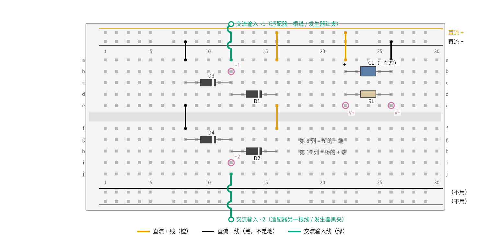
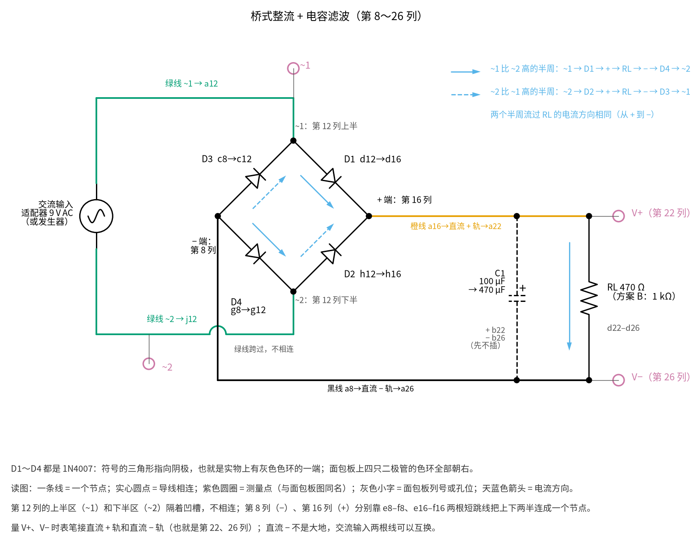

# 13 桥式整流 · 动手实验篇

[上一页：参数与调试篇](page3.md) · [直觉篇](page1.md) · [原理与实现篇](page2.md) · [参数与调试篇](page3.md) · 本页：动手实验篇 · [下一页：14 积分电路 · 直觉篇](../14-integrator/page1.md) · 前置节点：[01 元件速成 · 直觉篇](../01-components-basics/page1.md)、[03 半导体入门 · 直觉篇](../03-semiconductor-basics/page1.md)、[09 精密整流 · 直觉篇](../09-precision-rectifier/page1.md) · 后续：[17 稳压管稳压 · 直觉篇](../17-zener-regulator/page1.md)

> [!WARNING]
> **不要接 220 V。** 本页只用两种低压交流源：输出 9 V 交流的成品「交流适配器」（插头和外壳全封闭，你只碰它低压一侧的两根线），或者函数信号发生器。不要拆适配器，不要自己绕变压器，更不要去碰任何变压器的初级。整流桥接市电的电源（开关电源、充电器内部）请交给持证电工，学生不要动手。

## 这次实验要验证什么

用万用表亲手确认原理篇的两个结论：桥式整流输出的峰值是「交流峰值减两个二极管压降」，加了滤波电容以后直流读数会升到接近这个峰值；电容越大、纹波越小，纹波大小可以用 $\Delta V \approx I/(2fC)$ 估算（见 [13 桥式整流 · 原理与实现篇](page2.md) 第 1 节和第 3 节）。

## ⚠️ 安全须知

- **只用 12 V 及以下的电。** 本页的交流源是 9 V 交流适配器（有效值 9 V，峰值约 12.7 V）或信号发生器（峰值 5 V），整流后的直流在 11 V 左右。**不要接 220 V**；涉及市电的部分一律请电工处理。
- **适配器必须是「交流输出」的。** 铭牌上写「OUTPUT: 9V AC」或「9V～」才对；写「9V DC」或带「⎓」符号的是直流适配器，接上桥以后读数会怪，但不危险。
- **电解电容分正负极。** 电容外壳上有一条带「−」号的白色条纹，那一脚接桥的 − 端（第 26 列），长脚（正极）接 + 端（第 22 列）。接反会发热、鼓包，严重时会爆裂。耐压选 25 V 以上：适配器空载时电压会比 9 V 高，电容上可能充到 14 V 左右。
- **元件会发烫，不要用手摸。** 负载电阻 RL 上大约有 0.25 W 的功率，1/2 W 的电阻摸上去明显温热，所以要用 1/2 W 或 1 W 的；二极管和适配器本身也会微微发热。闻到焦味立刻拔掉适配器。
- **接线、改线之前先断电，并给电容放电。** 断电就是把适配器从插座上拔下来（或关掉信号发生器的输出）。拔掉以后电容里还存着电，用一只 1 kΩ 电阻的两脚同时碰一下电容两端放电，再动手。
- 适配器的插座端只由老师或家长插拔，手只碰低压一侧的线和面包板。

## 器材清单

| 元件 | 型号或数值 | 数量 | 说明 |
|---|---|---|---|
| 交流适配器 | 输出 9 V 交流（9V AC），300 mA 以上 | 1 | 方案 A 的交流源；插头和外壳全封闭的成品 |
| 圆口转接线端子 | 与适配器插头匹配的 DC 母座转接线 | 1 | 把适配器的圆口插头变成两根可以插面包板的线 |
| 函数信号发生器 | 能输出 0.5 Hz～50 Hz 正弦，峰值 5 V | 1 | 方案 B，有就用；没有可跳过 |
| 整流二极管 | 1N4007（或 1N4001） | 4 | D1～D4；灰色色环一端是阴极 |
| 电解电容 | 100 µF / 25 V | 1 | 方案 A 第一档滤波电容；方案 B 也用它 |
| 电解电容 | 470 µF / 25 V | 1 | 方案 A 第二档滤波电容 |
| 电阻 | 470 Ω，1/2 W 或 1 W | 1 | 方案 A 的负载 RL |
| 电阻 | 1 kΩ，1/4 W | 2 | 方案 B 的负载；另一只专门用来给电容放电 |
| 发光二极管 | 红色 LED | 1 | 可选，方案 B 慢速实验用 |
| 面包板 | 830 孔（30 列以上） | 1 | 本实验只用上方两条电源轨 |
| 跳线 | 单芯线或杜邦线 | 若干 | 橙色接直流 +，黑色接直流 −，绿色走交流输入 |
| 万用表 | 有交流电压挡、直流电压挡和二极管挡 | 1 | 有「True RMS」字样更好 |

先用万用表电阻挡量一下 RL 的实际阻值，记下来，后面的 Python 要用。

## 搭建步骤

电路就是 [13 桥式整流 · 原理与实现篇](page2.md) 第 2 节那张「变压器 + 二极管桥 + 电容滤波」电路图去掉变压器：适配器里已经装着一只封闭好的变压器，我们只从它的低压输出开始接。图 13-p4-1 是搭好后的面包板俯视图。



*图 13-p4-1　桥式整流的面包板接线：第 12 列接交流，第 16 列出「+」，第 8 列出「−」*

对照 图 13-p4-2 的电路原理图看四只二极管：面包板上它们排成上下两行，原理图里围成一个菱形。



*图 13-p4-2　图 13-p4-1 对应的电路原理图（灰色小字是面包板列号或孔位，天蓝色实线、虚线箭头是两个半周的电流）*

**对照看**：面包板的连通规则见 [01 元件速成 · 动手实验篇](../01-components-basics/page4.md)：同一列上半、下半各是一个节点，凹槽两边不通。第 12 列正好利用这一点，上半是 ~1、下半是 ~2，在原理图里是菱形的上下两个顶点；第 8 列和第 16 列靠 e8–f8、e16–f16 两根短跳线把上下两半连成一个点，就是菱形的左右两个顶点。四只 1N4007 的色环全部朝右，原理图里四个三角形也都朝右：D1、D2 指向「+」端，D3、D4 从「−」端指向两个交流输入点。[13 桥式整流 · 直觉篇](page1.md) 第一节有两个半周电流路径的分图，可以和这张图里的实线、虚线箭头对着看。

面包板的规矩：同一列里 a–e 五个孔连通，f–j 五个孔连通，中间的凹槽把上下两半隔开；电源轨整条连通（有的面包板在中间断开，用通断挡量一下）。本实验把上方两条轨当作直流输出的「+」和「−」，下方两条轨不用。

1. **先测二极管。** 万用表拨到二极管挡，红表笔接二极管没有色环的一端（阳极），黑表笔接色环端（阴极），应读到约 0.6 V；反过来应显示「OL」（不通）。四只都要测，坏的不用。
2. **插上半区的两只二极管。** D3 阳极插 c8、阴极（色环端）插 c12；D1 阳极插 d12、阴极插 d16。
3. **插下半区的两只二极管。** D4 阳极插 g8、阴极插 g12；D2 阳极插 h12、阴极插 h16。这样四只二极管的色环全部朝右。
4. **把上下两半连起来。** 黑线从 e8 接到 f8（桥的 − 端上下连通），橙线从 e16 接到 f16（桥的 + 端上下连通）。注意第 12 列**不能**连通：上半区的第 12 列是交流输入 ~1，下半区的第 12 列是 ~2，两者连通就把适配器短路了。
5. **把桥的输出接到电源轨。** 橙线从 a16 接到最上面的轨（直流 +）；黑线从 a8 接到第二条轨（直流 −）。
6. **接负载。** 橙线从 a22 接到直流 + 轨，黑线从 a26 接到直流 − 轨；RL（470 Ω）插 d22 和 d26。电容 C1 先不插。
7. **接交流输入。** 断电状态下，把适配器转接线的一根线插 a12，另一根插 j12。交流没有正负，两根线可以互换。
8. **检查一遍再上电。** 对照图 13-p4-1：四只二极管色环都朝右，第 12 列上下没有连在一起，橙线 3 根、黑线 3 根、绿线 2 根。确认无误后由老师或家长把适配器插到插座上。

做完第一组测量后，断电、放电，再插 C1：先插 100 µF（正极 b22，负极 b26），测完再断电放电换 470 µF。

图 13-p4-1 里紫色圆圈是测量点：「~1」「~2」是交流输入，「V+」「V−」是直流输出。表笔插进同一列的空孔就行。画图脚本把每根线、每只元件脚都登记到「网络」里，断言四只二极管的方向、上下两半的连接都对，而且两根交流输入线没有被连到一起；接错一处，图就画不出来。

**方案 B：用函数信号发生器代替适配器。** 面包板不用改，只把 a12、j12 两根线换成信号发生器的红夹子和黑夹子，RL 换成 1 kΩ，C1 用 100 µF。发生器调成 50 Hz 正弦、峰值 5 V（有的发生器面板上写的是峰峰值，那就调 10 Vpp）。这就是 [13 桥式整流 · 参数与调试篇](page3.md) 第 3 节的低压实验电路。

## 测量表

下表「应该读到」的数分两部分来源。方案 A 是用 Diodes 公司的 1N4007 模型、9 V 有效值正弦（串 1 Ω 内阻）、470 Ω 负载做 ngspice 仿真得到的；方案 B 的第 8、9 行直接取自 [review/spice/13.md](../review/spice/13.md) 的读数表，第 10 行是同一模型的补充仿真。真实适配器的电压往往比标称值高，所以第 1 步一定要先量，再用下面的 Python 按实测值重算。

| 步骤 | 测什么 | 红表笔 | 黑表笔 | 挡位 | 应该读到 | 读不到时先查 |
|---|---|---|---|---|---|---|
| 1 | 交流输入（接着 RL、不插 C1） | 第 12 列上半区（~1） | 第 12 列下半区（~2） | 交流 20 V | 约 9 V（适配器偏高 0.5～2 V 也正常） | 适配器是不是交流输出；转接线是否插紧 |
| 2 | 不加电容的直流输出 | V+（第 22 列） | V−（第 26 列） | 直流 20 V | 6.7 V | 读到负值：表笔反了；读到约 3 V：有一只二极管开路 |
| 3 | 加 100 µF 后的直流输出 | V+ | V− | 直流 20 V | 10.4 V | 和第 2 步一样：电容没插好或极性反了 |
| 4 | 加 100 µF 后的纹波 | V+ | V− | 交流 2 V | 约 0.53 V（纹波峰峰值 1.7 V） | 读到接近 10 V：你的表交流挡不隔直，这一行跳过 |
| 5 | 加 470 µF 后的直流输出 | V+ | V− | 直流 20 V | 10.8 V | 电容是否用错成 47 µF |
| 6 | 加 470 µF 后的纹波 | V+ | V− | 交流 2 V | 约 0.12 V（纹波峰峰值 0.40 V） | 读数和第 4 步差不多：电容没起作用 |
| 7 | 负载电流（由第 5 步算） | — | — | — | 10.8 V ÷ 470 Ω ≈ 23 mA | 先确认 RL 实测阻值 |
| 8 | 方案 B：发生器 + 100 µF + 1 kΩ | V+ | V− | 直流 20 V | 约 2.9 V | 发生器是不是调成了峰峰值 5 V（那样只剩约 0.9 V） |
| 9 | 方案 B：用跳线把 V− 连到发生器黑夹（模拟接错的示波器地夹） | V+ | V− | 直流 20 V | 3.1～3.2 V | 读数没变：跳线没插到第 26 列或黑夹那一端 |
| 10 | 方案 B 慢速：0.5 Hz、不插电容、RL 1 kΩ | V+ | V− | 直流 20 V | 在 0 V 和约 3.5 V 之间来回摆，每秒一个「鼓包」 | 只看到每两秒一个鼓包：有一只二极管开路 |

几个读数要多说一句。第 2 步的 6.7 V 是全波整流的平均值，大约是「峰值减两个压降」的 0.64 倍；万用表直流挡显示的正是平均值。第 4、6 步的纹波读数是有效值：纹波是锯齿形的，峰峰值大约是有效值的 3.3 倍，所以 0.53 V 对应约 1.7 V 的峰峰值。普通（非 True RMS）万用表按正弦标定，对锯齿波会差几个百分点，问题不大。第 9 步只能在方案 B 里做：发生器内部有 50 Ω 输出电阻限流，短路电流只有约 86 mA；**换成适配器做这一步，等于让适配器每半周短路一次，绝对不要做。**

## 没有示波器怎么办

方案 A 的 50 Hz 波形太快，万用表只能读平均值和有效值，但这已经够验证结论了：第 2、3、5 步的直流读数从 6.7 V 升到 10.4 V 再到 10.8 V，说明电容在「填坑」；第 4、6 步的交流读数从 0.53 V 降到 0.12 V，电容大了约 4.7 倍，纹波小了约 4.3 倍，和 $\Delta V \approx I/(2fC)$ 里「纹波和电容成反比」对得上（不完全是 4.7 倍，因为电容越大，每次充电的时间越短，放电时间越接近整整半个周期）。

**把频率降到肉眼能跟上的速度（方案 B）。** 信号发生器调到 0.5 Hz、峰值 5 V，拔掉电容，负载用 1 kΩ。万用表直流挡的读数会慢慢从 0 升到约 3.5 V 再落回 0，每秒一次；输入的正弦周期是 2 秒，输出每秒一个鼓包，说明正负两个半周都被「翻」成了正的，这就是直觉篇里那张「负半周被翻上来」的图。再断开 D4 的一只脚（相当于桥里坏了一只管子），读数就变成每两秒才鼓一次：电路退化成了半波整流。仿真里这个慢速输出的最高点是 3.48 V，比 5 V 低了约 1.5 V：两只 1N4148 级别的压降，加上发生器 50 Ω 内阻上的一点压降。

**用 LED 当指示灯。** 在上面的慢速实验里，把 1 kΩ 负载换成「1 kΩ 串一只 LED」（LED 长脚朝 V+）。LED 每秒亮一次；断开 D4 后变成每两秒亮一次。LED 电流只有一两毫安，亮度不高，关灯看更清楚。

**用跳线代替「接错的示波器地夹」。** 参数篇第 3 节讲的那个危险，本质是示波器的地夹把桥的 − 端和发生器的地连在了一起。第 9 步用一根跳线就能复现它，万用表读数从 2.9 V 升到 3.1～3.2 V，原因是 D4 被跳线短路，电路只剩正半周在给电容充电，而正半周只经过一只二极管。

**只有示波器才能看到的**：纹波的锯齿形状、二极管电流那一串窄尖峰、地夹接错时发生器端口的负半周被削平在 −0.8 V 左右。它们的样子见 [13 桥式整流 · 原理与实现篇](page2.md) 第 3 节的稳态波形图（输出在凸起顶部被托起、其余时间直线下降，二极管电流是一串窄尖峰），以及 [13 桥式整流 · 参数与调试篇](page3.md) 第 3 节的地夹对比图。

## 用 Python 核对你的读数

把你量到的交流电压、RL 阻值和各步读数填进去。代码用一个简单的模型逐点「走」几百个周期：输入的绝对值减两个二极管压降比电容电压高时，电容被充到这个值；否则电容通过 RL 按指数规律放电。最后取稳定后的平均值和纹波，和你的读数比较，偏差超过 10% 就提示。这个模型和 ngspice 的结果相差在 2% 以内。

```python
import sys, pathlib
sys.path.insert(0, str(pathlib.Path("code/figs").resolve()))  # 在仓库根目录运行
# 13 桥式整流 · 动手实验核对（方案 A：交流适配器）
import numpy as np

# ---- 1. 你量到的值（示例值，换成你自己的）----
VAC = 9.6          # 第 1 步：交流输入有效值 / V
RL = 468.0         # 负载电阻实测 / Ω
VF = 0.8           # 1N4007 在一两百毫安尖峰电流下的压降 / V
meas = {           # 电容 / F : (直流读数 V, 交流读数 V)
    0.0:    (7.05, None),
    100e-6: (10.95, 0.55),
    470e-6: (11.50, 0.14),
}

def bridge(vac, R, C, vf=VF, f=50.0, dt=2e-5, t_end=0.4):
    """理想交流源 → 桥（两个 vf 压降）→ C ∥ R；返回稳定后的平均值、峰峰值纹波、纹波有效值。"""
    vpk = np.sqrt(2) * vac
    t = np.arange(0.0, t_end, dt)
    src = np.abs(vpk * np.sin(2 * np.pi * f * t)) - 2 * vf
    vc, out = 0.0, np.empty_like(t)
    k = np.exp(-dt / (R * C)) if C > 0 else 0.0
    for i, s in enumerate(src):
        vc = max(vc * k, s, 0.0)
        out[i] = vc
    w = out[t > t_end - 0.1]
    return w.mean(), w.max() - w.min(), w.std()

warn = 0
print(f"交流输入 {VAC:.2f} V → 峰值 {np.sqrt(2) * VAC:.2f} V，减两个压降 {np.sqrt(2) * VAC - 2 * VF:.2f} V")
for C, (vdc, vac_r) in meas.items():
    avg, pp, rms = bridge(VAC, RL, C)
    tag = "不加电容" if C == 0 else f"{C * 1e6:.0f} µF"
    dev = (vdc - avg) / avg * 100
    flag = abs(dev) > 10
    warn += flag
    line = f"{tag:>8}：直流 实测 {vdc:.2f} V / 计算 {avg:.2f} V（{dev:+.1f}%）"
    if C > 0:
        est = (avg / RL) / (2 * 50 * C)                  # 原理篇的纹波公式 ΔV ≈ I/(2fC)
        line += f"，纹波峰峰值 {pp:.2f} V（公式估算 {est:.2f} V）"
        if vac_r is not None:
            d2 = (vac_r - rms) / rms * 100
            f2 = abs(d2) > 10
            warn += f2
            line += f"，交流挡 实测 {vac_r:.3f} / 计算 {rms:.3f} V（{d2:+.1f}%）" + ("  ← 偏差大" if f2 else "")
    print(line + ("  ← 直流偏差大，先查测量表最后一列" if flag else ""))
print(f"负载电流约 {meas[470e-6][0] / RL * 1e3:.1f} mA，RL 功率约 {meas[470e-6][0] ** 2 / RL:.2f} W")

# ---- 2. 方案 B（信号发生器）：和测量表第 8、9 行比 ----
for name, x, ref in (("正确接法", 2.88, 2.91), ("跳线模拟地夹接错", 3.12, 3.14)):
    d = (x - ref) / ref * 100
    warn += abs(d) > 10
    print(f"方案 B {name}：实测 {x:.2f} V / 仿真 {ref:.2f} V（{d:+.1f}%）")
print("全部在范围内" if warn == 0 else f"有 {warn} 项需要检查")
```

示例数据假设适配器实测 9.6 V，比标称高了约 7%，所以直流读数都比测量表里按 9 V 算的数高；代码按你量到的交流电压重算，偏差就回到几个百分点以内。同时你会看到公式 $\Delta V \approx I/(2fC)$ 给出的纹波比逐点模型略大：公式假设电容放电整整半个周期，实际上下一个凸起还没到顶，二极管就已经开始给电容充电了。

## 实验记录表

| 项目 | 实测值 | 计算值 | 偏差 |
|---|---|---|---|
| 交流输入有效值 |  |  |  |
| RL 实际阻值 |  |  |  |
| 不加电容的直流输出 |  |  |  |
| 100 µF 直流输出 / 交流读数 |  |  |  |
| 470 µF 直流输出 / 交流读数 |  |  |  |
| 负载电流（由直流输出算） |  |  |  |
| 方案 B 正确接法直流输出 |  |  |  |
| 方案 B 跳线接错时直流输出 |  |  |  |

### 思考题

**1. 加了 470 µF 以后，直流读数（约 10.8 V）比交流输入（9 V）还高，能量是从哪来的？**

<details><summary>答案</summary>

没有凭空多出能量。交流挡读的是有效值 9 V，它的峰值是 $\sqrt{2}$ 倍，约 12.7 V。电容只在每个凸起的顶部被充一下，平时靠存的电供负载，所以它的电压跟着峰值走，约 12.7 − 1.6 ≈ 11 V，再减去一半纹波。功率上，适配器给出的电流是一串很窄的尖峰，电压高、电流大的那一小段时间里送进来的能量，正好够负载用半个周期。

</details>

**2. 第 2 步不加电容时读到 6.7 V，如果有一只二极管开路，读数大约会变成多少？为什么？**

<details><summary>答案</summary>

大约一半，3.3 V 左右。一只二极管开路以后，它所在的那条路径断了，只剩一个半周能把电流送到负载，电路变成半波整流；平均值从全波的约 0.64 倍峰值降到约 0.32 倍峰值。这也是测量表第 2 行「读到约 3 V」的排查依据。

</details>

**3. 为什么第 9 步（把桥的 − 端和发生器的地连起来）只能在信号发生器上做，不能在适配器上做？**

<details><summary>答案</summary>

这根跳线把 D4 短路了。负半周时，电流从发生器的一端经 D3、再经跳线直接回到另一端，中间没有负载，等于把交流源短路。信号发生器内部有 50 Ω 输出电阻，短路电流被限制在约 86 mA，仪器设计上也能承受；交流适配器的内阻只有几欧，短路电流会大得多，会让适配器和二极管发热甚至损坏。接市电的桥上发生同样的事，就是通过地线把市电短路，非常危险。

</details>

## 自测清单

- 我能说出交流适配器铭牌上 AC 和 DC 的区别，并且知道本实验为什么绝不接 220 V。
- 我能在面包板上搭出四只二极管的桥，说清楚哪一列接交流、哪一列出「+」、哪一列出「−」。
- 我能用万用表的直流挡和交流挡分别量出整流输出的平均值和纹波，并解释电容变大时两者怎么变。
- 我能用「峰值减两个压降」和 $\Delta V \approx I/(2fC)$ 估算输出电压和纹波，并和实测值比较。
- 我能在没有示波器的情况下，用 0.5 Hz 的慢信号和万用表（或 LED）看出全波和半波的区别。
