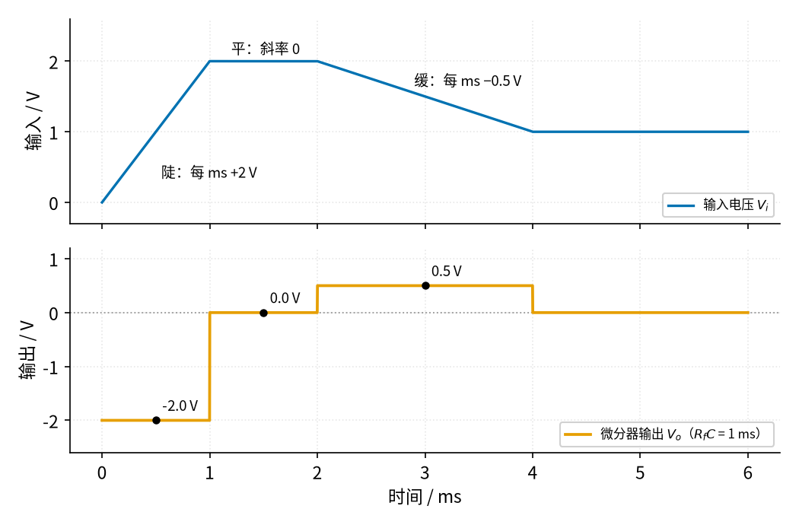
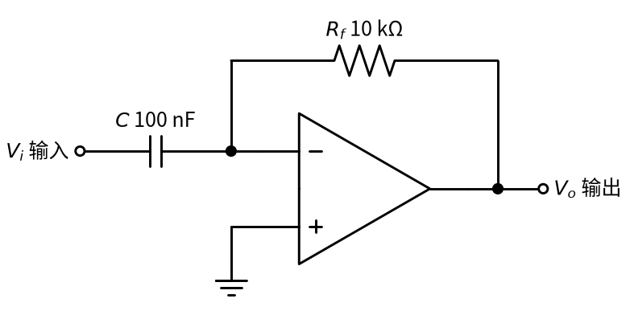
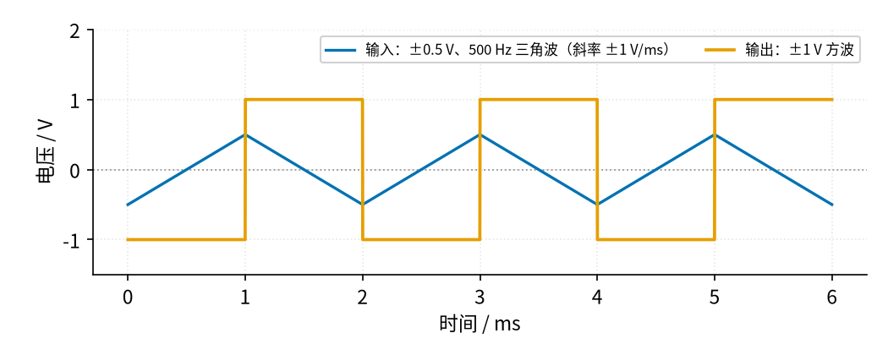
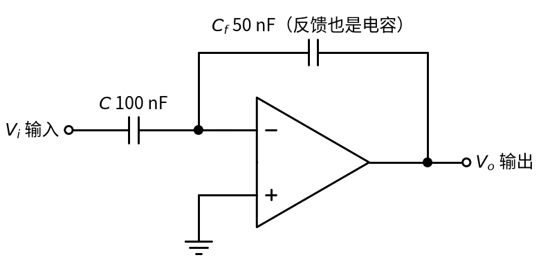
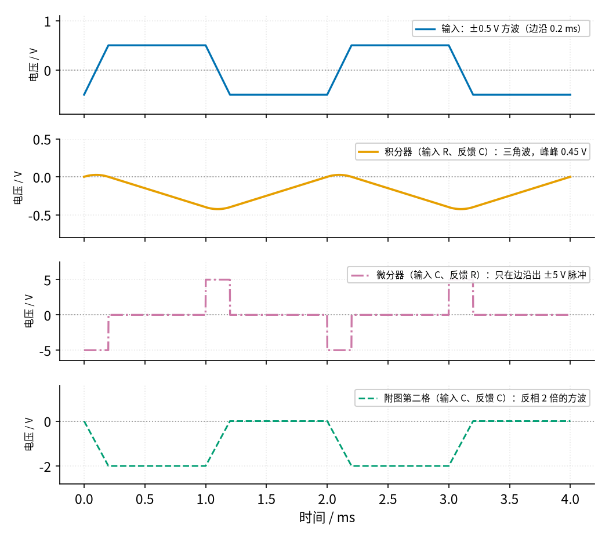

# 13 微分电路 · 直觉篇

[上一页：10 稳压管稳压 · 参数与调试篇](../10-zener-regulator/page3.md) · 本页：直觉篇 · [原理与实现篇](page2.md) · [参数与调试篇](page3.md) · [下一页：原理与实现篇](page2.md) · 前置节点：[P1 元件速成](../P1-components-basics/page1.md) · [12 积分电路](../12-integrator/page1.md)

## 痛点：电路要知道「变得有多快」

[12 积分电路](../12-integrator/page1.md) 回答的是「一共攒了多少」，可很多时候我们关心的恰好相反：不是这个量现在有多大，而是**它此刻变化得有多快**。

- 一个电位器装在机械臂关节上，输出电压代表角度。控制系统想知道关节**转得多快**，好在快撞到限位之前提前减速；
- 一路信号平时稳稳当当，你想在它**突然跳变**的那一瞬间得到一个脉冲，去触发别的电路（「边沿检测」）；
- 一个温度传感器的读数缓慢上升，你想知道**升温速率**是不是超过了安全值。

这些问题说的都是「斜率」：同样一段时间里，电压变化得越多，斜率越大；电压不变，斜率就是 0。数学上求斜率叫**微分**，干这件事的电路叫**微分电路**（微分器）。你不需要会求导，只要会看「这条线有多陡」就够了。

为什么不直接用一只电容加一只电阻（电容串在信号路上、电阻接地）来做？这种无源接法确实也叫「微分电路」，但它只在输出很小的时候才准：电阻上的电压一旦变大，电容两端的电压差就不再等于输入的变化，流过电容的电流也就不再只由输入的斜率决定。用运放以后，电容的右端被钉在 0 V 的虚地上，电容两端的电压永远等于输入电压，流过它的电流就严格等于「电容量 × 输入的斜率」，输出想要多大都可以（只要不超过电源）。这和 [12 积分电路](../12-integrator/page1.md) 用运放代替无源 RC 的理由是同一个。

## 类比：看速度表，而不是看里程表

开车时仪表盘上有两块表：**里程表**记录一共走了多少公里——这是积分器做的事，把一路的速度「攒」起来；**速度表**告诉你此刻每小时走多少公里——这就是微分器做的事，它只看位置**变化的快慢**。车停着不动，里程表停在原来的读数，速度表却是 0；车一脚油门冲出去，里程表才刚开始慢慢涨，速度表已经一下子跳了上来。

所以微分器有一个很鲜明的性格：**它对「不变」毫无反应，对「突变」反应强烈**。这既是它的本事，也是它的毛病——后面会看到，信号里那些又小又快的毛刺，在它眼里恰恰是「变化最剧烈」的东西。

## 图：斜率变成电压

下面这张图的上半部分是输入：先用 1 ms 从 0 V 陡升到 2 V，然后保持 1 ms，再用 2 ms 缓缓降到 1 V，最后不动。下半部分是微分器的输出。

*图 13-p1-1　微分器输出只看输入的斜率：陡就大，平就为零，方向反了符号就反（Rf·C = 1 ms，输出带一个负号）*

读图 13-p1-1：① 0～1 ms 输入每毫秒升 2 V，输出是 −2.0 V；② 1～2 ms 输入不动，不管它停在 2 V 还是别的值，输出都是 0；③ 2～4 ms 输入每毫秒降 0.5 V，输出是 +0.5 V；④ 4 ms 以后输入又不动了，输出回到 0。规律是：**输出 = −（输入的斜率）× $R_f C$**。注意输出看的不是输入「有多高」，只是「有多陡」。

电路和积分器正好是一对：把积分器的 R 和 C **对调位置**——电容放到输入端，电阻放到反馈支路上。

*图 13-p1-2　反相微分器：输入经电容 C 接到反相端，反馈支路是电阻 Rf*

图 13-p1-2 的工作过程是：电容只有在**两端电压变化**时才会有电流流过（[P1 元件速成](../P1-components-basics/page1.md) 讲过，电容电流正比于电压变化的快慢）。输入变得越快，流过电容的电流越大；这股电流全部流过 $R_f$ ，在 $R_f$ 上产生的电压就是输出。

> **关于附图的提醒**：教程依据的「20 种常见电路」附图里，微分电路画了两格。第一格（输入串电容、反馈接电阻）就是图 13-p1-2；第二格的输入端和反馈支路上画的**都是电容**。这种画法容易让人以为「反馈上有电容就是积分电路」，或者「它也是一种微分电路」，其实两样都不是。本页后半部分专门讲它。

最经典的演示是把三角波变成方波：三角波一半时间以固定斜率上升，一半时间以同样的斜率下降，斜率只有「正的定值」和「负的定值」两种，输出自然就是方波。

*图 13-p1-3　±0.5 V、500 Hz 三角波（斜率 ±1 V/ms）经 Rf·C = 1 ms 的微分器，得到 ±1 V 方波*

图 13-p1-3 恰好是积分器那张「方波变三角波」图的反过程：积分器把方波「攒」成三角波，微分器把三角波「拆」回方波。输入上升时输出为 −1 V，下降时为 +1 V，负号同样来自反相接法。

## 附图第二格：反馈位置上画的是电容

先把附图第二格照原样画出来，看 图 13-p1-4：输入端串一只 100 nF 的电容 C，反馈支路上只有一只 50 nF 的电容 $C_f$ ，没有任何电阻。

*图 13-p1-4　附图第二格的画法：输入支路和反馈支路都是电容*

图 13-p1-4 和积分电路、微分电路都只差一个元件，最容易混在一起。判断的办法只有一个：**看输入支路和反馈支路上各放的是什么**。

| 接法 | 输入支路 | 反馈支路 | 输出取决于输入的什么 |
|---|---|---|---|
| [12 积分电路](../12-integrator/page1.md) | 电阻 R | 电容 C | 输入曲线下的面积 |
| 13 微分电路（本节） | 电容 C | 电阻 $R_f$ | 输入的斜率 |
| 附图第二格 | 电容 C | 电容 $C_f$ | 输入本身的变化量 |

第三行为什么是「变化量」？还是用虚地和虚断来想。输入一变，就有电流流过 C，C 上的电荷变化了「C × 输入的变化量」；这些电荷不能流进运放，只能原封不动地搬到 $C_f$ 上， $C_f$ 上的电压就变化了「电荷 ÷ $C_f$ 」。两只电容之间搬的是同一份电荷，所以

$$\Delta V_o = -\frac{C}{C_f}\thinspace \Delta V_i$$

中文意思：**输出的变化量 = 负的「两只电容之比」× 输入的变化量**。代数：C = 100 nF、 $C_f$ = 50 nF，比值是 2，输入升高 1 V，输出就下降 2 V。这和 [01 反相放大](../01-inverting-amp/page1.md) 的 $-R_f/R_1$ 是同一个样子，只是两只电阻换成了两只电容（注意比值是「输入电容 ÷ 反馈电容」，因为电容越大，对变化信号的阻碍越小）。所以附图第二格本质上是一个**用电容做的反相放大器**：它既不攒面积，也不看斜率。

图 13-p1-5 把同一个方波（±0.5 V、500 Hz，每个边沿用 0.2 ms 完成）分别送进三种接法，差别一目了然。

*图 13-p1-5　同一个方波送进积分电路、微分电路和电容–电容接法*

从上往下看 图 13-p1-5。第二行橙色是积分电路（R = 10 kΩ，C = 100 nF），方波被攒成峰峰 0.45 V 的三角波；边沿是斜的，面积比理想方波少一点，所以不到 0.5 V。第三行红紫色点划线是微分电路（ $R_f C$ = 1 ms），方波的平顶斜率为 0，输出也是 0，只在每个 0.2 ms 的边沿上出现 ±5 V 的脉冲：边沿斜率是 1 V ÷ 0.2 ms = 5 V/ms，乘以 1 ms 正好 5 V。第四行蓝绿色虚线是附图第二格，输出仍然是方波，只是上下颠倒、幅度变成 2 倍，在 0 V 和 −2 V 之间跳。它把输入「复制」了一份，没有做任何运算。

这个接法还藏着一个隐患：反馈支路上没有电阻，直流完全没有通路。运放输入端那一点点偏置电流（按 20 nA 的示意值）只能流进 $C_f$ ，输出会以 0.40 V/s 的速度慢慢漂移，大约 34 s 后撞到 13.5 V 的饱和电压。这和理想积分电路「一点直流就攒到饱和」是同一个毛病，示波器上要把时基拉到秒级才看得出来。真正用到电容–电容接法的地方（比如测压电传感器电荷的「电荷放大器」），都会在 $C_f$ 旁边并一只很大的电阻，或者定时用开关把 $C_f$ 放电。

那附图为什么把它算作微分电路？比较合理的解释是：画图时省略了实用微分器反馈支路里的 $R_f$ ，只留下了和它并联的小电容 $C_f$ 。实用微分器的反馈支路上确实有电容，但它一定和 $R_f$ **并联**，作用是压住高频噪声；起微分作用的始终是「输入串电容 + 反馈接电阻」。所以照着附图第二格焊电路，得到的不是微分电路；下一页会把正确的实用版本画出来。

## 在示波器上会看到什么

假设你在面包板上搭好了图 13-p1-2（ $R_f$ = 10 kΩ，C = 100 nF，±15 V 供电），信号发生器接输入，示波器通道 1 看输入、通道 2 看输出。按下面的顺序操作，每一步都先猜再看：

1. **送入 ±0.5 V、500 Hz 的三角波**。通道 2 是 ±1 V 的方波，而且输入往上爬的时候输出在 −1 V，往下走的时候在 +1 V，负号又一次出现。
2. **幅度不变，把频率调到 1 kHz**。三角波变陡了一倍（每毫秒升 2 V），方波幅度也跟着变成 ±2 V。注意：输入的「高度」一点没变，变的只是「陡度」。
3. **换成 159 Hz、幅度 0.5 V 的正弦波**。输出还是正弦波，幅度也约 0.5 V，但整体错开了四分之一个周期：输入在波峰（最平的地方）时输出为 0，输入过零（最陡的地方）时输出最大。
4. **换成方波**。方波的边沿极陡，输出在每个边沿处出现一根顶到电源附近的窄脉冲，平顶处则贴着 0 V。这就是「边沿检测」的样子。
5. **靠近一点看平顶**。用真实运放搭的理想微分器，平顶上往往有一串衰减的振荡，甚至整条线都在高频抖动；信号线一靠近手机充电器，平顶就变「毛」。这两个毛病正是下一页和第三页要解决的。

## 一句话总结

**微分电路 = 输入串电容、反馈接电阻，输出 = −（输入的斜率）× $R_f C$ ；它对不变的信号视而不见，对变化快的信号反应强烈，所以又快又小的噪声会被它放得很大，实用电路必须给它「降降火」；反馈上只有电容、输入也是电容的接法不是微分电路，而是电容做的反相放大**。
