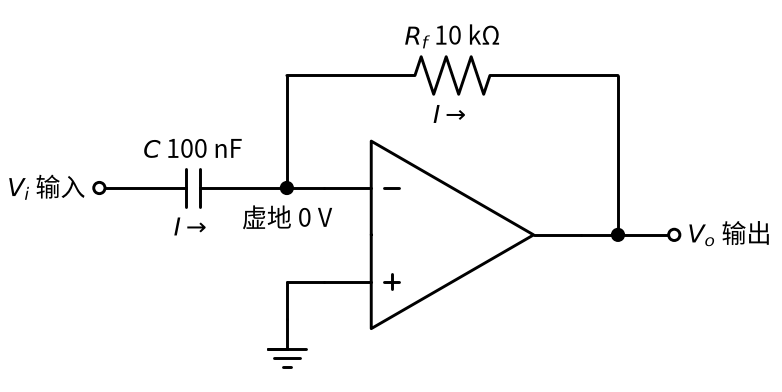
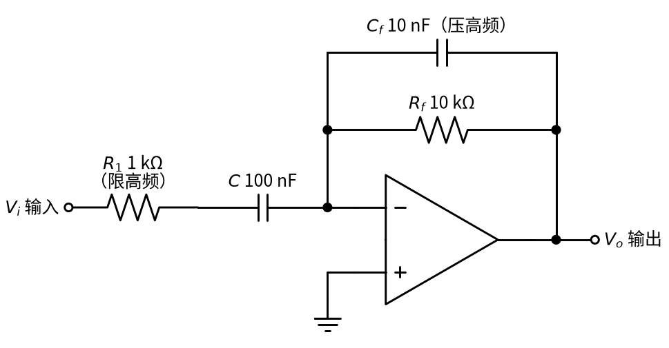
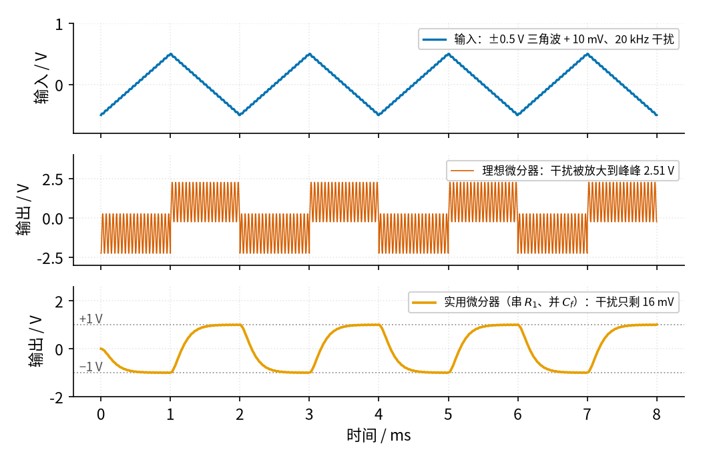

# 13 微分电路 · 原理与实现篇

[上一页：直觉篇](page1.md) · [直觉篇](page1.md) · 本页：原理与实现篇 · [参数与调试篇](page3.md) · [下一页：参数与调试篇](page3.md) · 前置节点：[P1 元件速成](../P1-components-basics/page1.md) · [12 积分器](../12-integrator/page1.md)

## 先补一点最小知识

1. **虚地和虚断**：和 [12 积分器](../12-integrator/page1.md) 一样，同相端接地、加了负反馈，反相端就是约 0 V 的「虚地」，运放输入端不取电流。
2. **电容的电流公式**：[P1 元件速成](../P1-components-basics/page1.md) 讲过 $I = C \cdot \Delta V / \Delta t$ 。中文意思：**流过电容的电流 = 电容量 × 电容电压变化的快慢**。电压不变，电流为 0；电压变得越快，电流越大。
3. **斜率的记号**：数学上用 $\dfrac{dV_i}{dt}$ 表示「 $V_i$ 在这一时刻的变化快慢」，也就是曲线在这一点的斜率，单位是 V/s。你只要把它读成「斜率」就行。

## 推导：三步得到输出公式

请对照下面的推导图，它就是直觉篇的微分器，只是把电流和虚地标了出来。



*图 13-p2-1　微分器中的电流 I：流过输入电容 C，再全部流过反馈电阻 Rf*

**第一步：输入电容上的电流**。在图 13-p2-1 中，电容左端是 $V_i$ ，右端是虚地 0 V，电容两端的电压就是 $V_i$ 本身，所以

$$I = C \frac{dV_i}{dt}$$

中文意思：**输入变化得越快，流过电容的电流越大；输入不变，电流为 0**。这一步把「斜率」翻译成了「电流」。

**第二步：电流全部流过 $R_f$**。运放反相端不取电流，电流 I 只能继续流过 $R_f$ ，流向输出端。

**第三步：读出输出**。 $R_f$ 左端是虚地 0 V，电流从左往右流，右端（输出）就比 0 V 低 $I R_f$ ：

$$V_o = -R_f I = -R_f C \frac{dV_i}{dt}$$

中文意思：**输出 = −（输入的斜率）× $R_f C$**。 $R_f C$ 单位是秒（10 kΩ × 100 nF = 1 ms），它决定「多大的斜率换多大的电压」。和积分器一比就清楚了：积分器是「面积 ÷ RC」，微分器是「斜率 × RC」，两者互为逆运算；电路上，就是把 R 和 C 的位置对调。

## 代数：两个结论，一个隐患

**结论一：直线输入得到恒定输出**。输入是一条斜率为 k 的直线时，输出恒为 $-R_f C \cdot k$ 。三角波斜率是 $\pm 4V_m f$ （ $V_m$ 是幅度、f 是频率，一个周期里上升 $2V_m$ 用半个周期），所以输出是幅度为 $4V_m f R_f C$ 的方波。±0.5 V、500 Hz 的三角波斜率为 ±1 V/ms，输出 ±1 V。

**结论二：越快的信号，被放得越大**。幅度为 A、频率为 f 的正弦波，最陡的地方斜率是 $2\pi f A$ ，所以经过微分器后幅度变成

$$A_{out} = 2\pi f R_f C \cdot A$$

中文意思：**微分器的「放大倍数」随频率成正比增长**。对 $R_f C$ = 1 ms 的电路，159 Hz 的正弦波放大 1 倍，1.59 kHz 放大 10 倍，20 kHz 放大约 126 倍。

**隐患：高频噪声被放大，而且电路容易「自己振起来」**。真实信号里总有又小又快的干扰（开关电源的纹波、无线电的耦合）。一个只有 10 mV 的 20 kHz 干扰，按上式会变成约 1.26 V 的输出波动，比我们想要的 ±1 V 方波还大。更麻烦的是，真实运放在高频时自身的放大能力会下降（[P3 运放入门](../P3-opamp-basics/page1.md) 讲的增益带宽积），它和外面的微分网络凑在一起，会在某个频率上来回「倒腾能量」，表现为振铃甚至持续振荡。TI 的微分器设计手册直接写道：理想微分器从根本上就是不稳定的，必须加入输入电阻、反馈电容或两者，电路才能稳定；而这些元件同时也限制了微分功能的工作频率范围（[TI SBOA276C](https://www.ti.com/lit/an/sboa276c/sboa276c.pdf)）。

于是有了**实用微分器**：



*图 13-p2-2　实用微分器：输入在 C 前再串一个 R1，反馈电阻 Rf 旁并一个小电容 Cf*

图 13-p2-2 里两个新元件的作用都是「只管高频」：

- **$R_1$**：频率低时，电容的「阻碍作用」很大， $R_1$ 可以忽略，电路照常微分；频率很高时，电容几乎相当于短路，输入电流被 $R_1$ 限住，电路退化成放大倍数为 $-R_f/R_1$ 的反相放大（[01 反相放大](../01-inverting-amp/page1.md)），不再随频率无限增长。本例 $R_f/R_1$ = 10，高频放大被封顶在 10 倍左右。
- **$C_f$**：频率高时它把 $R_f$ 短路掉一部分，让高频的放大倍数进一步下降。本例取 $R_f C_f = R_1 C$ = 0.1 ms，两者在同一个频率附近开始起作用。

这两个元件共同决定了一个「上限频率」 $f_H = \dfrac{1}{2\pi R_1 C}$ （本例约 1.59 kHz）：远低于它的信号被正常微分，远高于它的干扰被压住。

## 仿真：理想微分器 vs 实用微分器

下面的代码给三角波叠加 10 mV、20 kHz 的干扰，比较理想微分器（直接按公式求斜率）和只串了 $R_1$ 的实用版。实用版用「一小段一小段往前推」的办法计算：电容电压每一步的变化 = 电流 × 时间 ÷ C。

```python
import numpy as np                      # 数值计算
import matplotlib                       # 画图库
matplotlib.use("Agg")                   # 不弹窗口，直接存图
import matplotlib.pyplot as plt

C, RF, R1 = 100e-9, 10e3, 1e3           # 输入电容 100 nF，反馈 10 kΩ，串联 1 kΩ
dt = 1e-7                               # 每一小段 0.1 μs
t = np.arange(0, 4e-3, dt)              # 仿真 4 ms
ph = (t * 500) % 1                      # 500 Hz 三角波的相位（0～1）
tri = np.where(ph < 0.5, -0.5 + 2 * ph, 1.5 - 2 * ph)   # ±0.5 V 三角波，斜率 ±1 V/ms
vin = tri + 0.01 * np.sin(2 * np.pi * 20e3 * t)          # 叠加 10 mV、20 kHz 干扰

vo_ideal = -RF * C * np.gradient(vin, dt)  # 理想微分器：输出 = −斜率 × R_f·C

vo_r1 = np.empty_like(vin)              # 只串 R1 的实用微分器
q = vin[0]                              # 电容电压初值（假设电路早已稳定）
for k in range(len(t)):
    i = (vin[k] - q) / R1               # 流过 R1 和 C 的电流（右端是虚地 0 V）
    vo_r1[k] = -RF * i                  # 电流全部流过 R_f，输出 = −R_f × 电流
    q += i * dt / C                     # 电容电压变化 = 电流 × 时间 ÷ C

flat = (t > 1.5e-3) & (t < 2e-3)        # 方波平顶的后半段（避开边沿），只看干扰造成的波动
print(f"理想微分器平顶波动 {np.ptp(vo_ideal[flat]):.2f} V")
print(f"串 R1 后平顶波动 {np.ptp(vo_r1[flat]):.2f} V")

fig, ax = plt.subplots(2, 1, figsize=(7, 5), sharex=True)   # 上下两张子图
ax[0].plot(t * 1e3, vo_ideal)           # 理想微分器输出
ax[0].set_ylabel("ideal Vo / V")
ax[1].plot(t * 1e3, vo_r1)              # 串 R1 的输出
ax[1].set_ylabel("with R1  Vo / V")
ax[1].set_xlabel("t / ms")
fig.savefig("differentiator_noise.png", dpi=120)   # 存到当前目录
```

运行后终端打印两行：理想微分器的平顶波动约 2.51 V，串了 $R_1$ 以后降到约 0.21 V（与参数与调试篇扫描中 R1 = 1 kΩ 的 199 mV 基本一致）。教程配图由 `code/13_sim.py` 生成，其中实用版同时串了 $R_1$ 、并了 $C_f$ ：



*图 13-p2-3　上：输入三角波，10 mV 干扰几乎看不出；中：理想微分器把干扰放大到峰峰 2.51 V；下：实用微分器的干扰只剩约 16 mV*

读图 13-p2-3：第一行的输入里，10 mV 的干扰只是三角波上一层细细的「毛边」。第二行理想微分器的输出中，方波的平顶被一片峰峰值 2.51 V 的锯齿淹没，和公式 $2 \times 2\pi f R_f C \cdot A$ = 2 × 2π × 20 kHz × 1 ms × 10 mV ≈ 2.51 V 完全一致——**一个肉眼看不见的干扰，在输出端比有用信号还大**。第三行的实用微分器方波干净得多，干扰只剩约 16 mV；代价是方波的边沿不再是笔直的竖线，而是用大约 0.2 ms 才「爬」到位，这是 $R_1$ 、 $C_f$ 削掉高频的必然结果。参数与调试篇会把这个取舍讲清楚。

## 例题

**例题 1（完整示范）**： $R_f$ = 10 kΩ，C = 100 nF，输入是 ±2 V、250 Hz 的三角波。求输出方波的幅度。

- 第一步， $R_f C$ = 10 kΩ × 100 nF = 1 ms。
- 第二步，三角波半个周期是 2 ms，从 −2 V 升到 +2 V 共 4 V，斜率 = 4 V ÷ 2 ms = 2 V/ms。
- 第三步，输出 = −1 ms × (±2 V/ms) = ∓2 V，即 ±2 V 方波（输入上升时为 −2 V）。

**例题 2（留空练习）**： $R_f$ = 47 kΩ，C = 22 nF，输入 ±1 V、1 kHz 三角波。

$R_f C$ = ____ ms；三角波斜率 = ____ V/ms；输出方波幅度 = ____ V。

<details><summary>答案</summary>

$R_f C$ = 47 kΩ × 22 nF ≈ 1.03 ms；半周期 0.5 ms 内升 2 V，斜率 4 V/ms；输出幅度约 1.03 × 4 ≈ 4.1 V。

</details>

**例题 3（变体迁移：边沿检测）**：把一个 0 V → 5 V 的方波（边沿用 10 μs 完成跳变）送进 $R_f C$ = 1 ms 的**理想**微分器，输出会是什么样子？这对「边沿检测」意味着什么？实际电路里会怎样？

<details><summary>答案</summary>

方波的平顶斜率为 0，输出为 0；只有在跳变的那 10 μs 里斜率很大：5 V ÷ 10 μs = 500 V/ms，理想输出应为 −500 V。实际运放输出不可能超过电源，于是在上升沿处输出一个顶到负饱和的窄脉冲，下降沿处一个顶到正饱和的窄脉冲。这正是「边沿检测」：只在信号跳变时给出脉冲。实际做边沿检测时，常常不用运放，而直接用「串联电容 + 对地电阻」的无源 RC 电路，再接比较器或逻辑门整形；如果用运放微分器，必须加 $R_1$ 限制峰值电流、让输出不至于硬撞电源轨。

</details>
