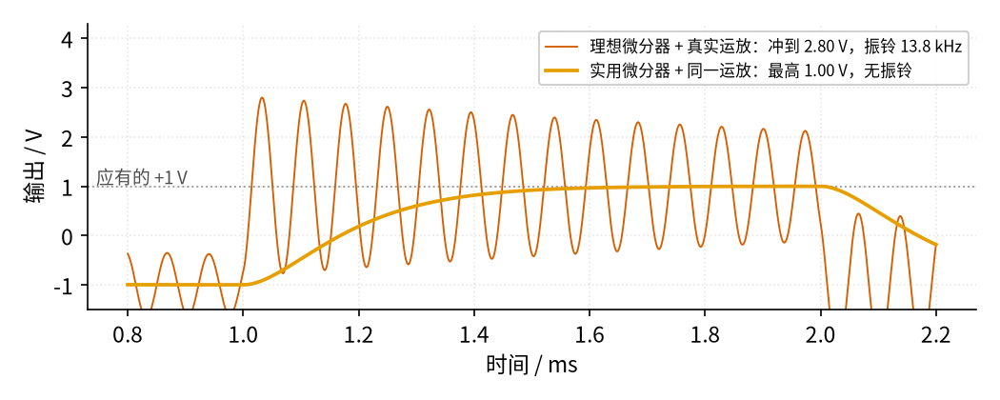
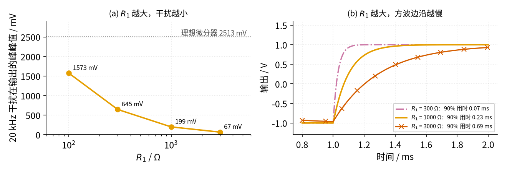

# 13 微分电路 · 参数与调试篇

[上一页：原理与实现篇](page2.md) · [直觉篇](page1.md) · [原理与实现篇](page2.md) · 本页：参数与调试篇 · [下一页：07 射极跟随器](../07-emitter-follower/page1.md) · 前置节点：[P1 元件速成](../P1-components-basics/page1.md) · [12 积分器](../12-integrator/page1.md)

## 参数表：每个元件管什么

| 参数 | 作用 | 本教程取值 | TI 设计示例（SBOA276C） | 取值思路 |
|---|---|---|---|---|
| $R_f$ （TI 记作 R2） | 把电容电流变成电压；和 C 一起决定「斜率换电压」的比例 | 10 kΩ | 499 kΩ | TI 建议取大一些，这样 C 不必很大 |
| C（TI 记作 C1） | 把输入斜率变成电流 | 100 nF | 15 nF | 由 $R_f C$ 和工作频率下限定 |
| $R_1$ | 限制高频增益（上限约 $R_f/R_1$ ），帮助稳定 | 1 kΩ | 1 kΩ | 上限频率 $\dfrac{1}{2\pi R_1 C}$ 至少比最高工作频率高半个数量级（约 3.5 倍） |
| $C_f$ | 与 $R_f$ 并联，滤掉高频噪声 | 10 nF | 示例电路未用，设计说明中提到 | 截止频率 $f_c = \dfrac{1}{2\pi R_f C_f}$ ；本教程让它与 $R_1 C$ 对齐 |
| 运放增益带宽积 GBP | 运放够不够快，决定电路能否稳定 | LM358B 约 1.2 MHz（见 [P3 运放入门](../P3-opamp-basics/page1.md)） | TLV9061，10 MHz | TI 给出的稳定条件： $GBP \gt \dfrac{R_1 + R_f}{2\pi R_1^2 C}$ |
| 同相端参考电压 | 单电源时把输出「抬」到电源中点 | 双电源，接地 | 5 V 单电源，R3 = R4 = 100 kΩ 分压出 2.5 V | 输出围绕参考电压上下摆动 |

这些设计规则都出自 TI 的应用手册《Differentiator Circuit》（[SBOA276C](https://www.ti.com/lit/an/sboa276c/sboa276c.pdf)）。它的示例电路工作在 100 Hz～2.5 kHz，设计步骤如下：先把 R2 取为较大的标准值 499 kΩ；按「最低微分频率比最低工作频率至少低半个数量级」算出 C1 ≥ 11.1 nF，取 15 nF；按「上限截止频率比最高工作频率至少高半个数量级」算出 R1 ≤ 1.2 kΩ，取 1 kΩ；再验算 GBP 要大于 5.3 MHz，所选 10 MHz 的 TLV9061 满足要求。手册还提醒：并联在 R2 上的电容从其截止频率往下约半个数量级（约 3.5 倍）的地方就开始削弱微分作用；输出应保持在运放的线性摆幅以内。

把同样的稳定条件套到本教程的参数上： $\dfrac{1\text{ kΩ} + 10\text{ kΩ}}{2\pi \times (1\text{ kΩ})^2 \times 100\text{ nF}}$ ≈ 17.5 kHz，LM358B 的 1.2 MHz 远远够用。要说明的是，本教程的取值是为了让波形好读（ $R_f C$ = 1 ms，三角波换成 ±1 V 方波），并没有完整走一遍 TI 的「半个数量级」流程；做正式设计时应按上面的步骤来。

## 扫描图一：为什么理想微分器「自己会振」

下面把运放换成增益带宽积 1.2 MHz 的真实模型，分别接理想微分器和实用微分器，输入同样的三角波，看 1 ms 处三角波拐角之后的输出。

*图 13-p3-1　同一只 1.2 MHz 运放：理想微分器在拐角后冲到 2.80 V 并以 13.8 kHz 振铃，实用微分器平稳爬到 1.00 V*

图 13-p3-1 中，理想微分器在三角波拐弯的地方本该从 −1 V 干净地跳到 +1 V，结果却冲到 2.80 V，然后以约 13.8 kHz 的频率来回摆动，过了 1 ms 都还没停下来。原因可以这样理解：真实运放在高频时自身就像一个「积分器」（放大能力随频率下降），外面的微分网络又是一个「储能元件」，两者凑在一起就像弹簧挂着重物，被拐角「踢一脚」就上下弹个不停。振铃频率可以用经验式 $f \approx \sqrt{\dfrac{GBW}{2\pi R_f C}}$ 估算： $\sqrt{1.2\text{ MHz} \div (2\pi \times 1\text{ ms})}$ ≈ 13.8 kHz，和仿真一致。这个模型里振荡会慢慢衰减；真实运放内部还有更多延迟，常常干脆变成停不下来的持续振荡。加了 $R_1$ 、 $C_f$ 的实用版则完全没有振铃，最高 1.00 V——这正是 TI 手册所说「理想微分器从根本上不稳定，必须加输入电阻、反馈电容或两者」的直观样子。

## 扫描图二： $R_1$ 的取舍

$R_1$ 越大，高频被压得越狠，但方波的边沿也越慢。下面在理想运放、不加 $C_f$ 的条件下扫描 $R_1$ ：

*图 13-p3-2　(a) R1 从 100 Ω 增大到 3 kΩ，20 kHz 干扰在输出的峰峰值从 1573 mV 降到 67 mV；(b) 方波边沿到达 90% 的时间从 0.07 ms 拉长到 0.69 ms*

图 13-p3-2 的数据整理成表：

| $R_1$ | $R_1 C$ | 干扰峰峰值 | 边沿 90% 用时 |
|---|---|---|---|
| 100 Ω | 0.01 ms | 1573 mV | 0.02 ms |
| 300 Ω | 0.03 ms | 645 mV | 0.07 ms |
| 1 kΩ | 0.10 ms | 199 mV | 0.23 ms |
| 3 kΩ | 0.30 ms | 67 mV | 0.69 ms |
| 不加（理想） | 0 | 2513 mV | 0 |

规律很清楚：边沿 90% 用时大约是 $2.3 R_1 C$ ，干扰大致与 $R_1$ 成反比。**抗干扰和响应速度是一对矛盾**，选 $R_1$ 时要先问：信号里最快的有用变化有多快？干扰在什么频率？让上限频率夹在两者之间。再并上 $C_f$ （原理与实现篇的仿真里， $R_1$ = 1 kΩ 加 $C_f$ = 10 nF，干扰降到约 16 mV），可以在不额外拖慢边沿太多的情况下进一步压噪声。

## 排查表

| 现象 | 原因 | 怎么查 | 怎么改 |
|---|---|---|---|
| 输入什么都不接，输出仍有几十 kHz 的正弦振荡 | 理想微分器没有 $R_1$ 、 $C_f$ ，与运放内部延迟构成振荡 | 示波器看输出，频率接近 $\sqrt{GBW/(2\pi R_f C)}$ | 串 $R_1$ 、并 $C_f$ ；按 $GBP \gt (R_1+R_f)/(2\pi R_1^2 C)$ 验算运放 |
| 方波平顶上布满毛刺 | 高频干扰被放大 $2\pi f R_f C$ 倍 | 看毛刺频率；把输入短路到地，毛刺是否消失 | 加大 $R_1$ 或并 $C_f$ ；缩短输入走线、做好接地和屏蔽 |
| 输出顶在电源附近不动 | 斜率 × $R_f C$ 超过运放摆幅，或输入有阶跃跳变 | 估算最大斜率 × $R_f C$ ，和电源电压比较 | 减小 $R_f$ 或 C；用 $R_1$ 限制跳变时的峰值 |
| 方波边沿圆钝、变成「梯形」 | $R_1 C$ 或 $R_f C_f$ 太大，上限频率太低 | 量边沿 90% 用时，约等于 $2.3 R_1 C$ | 减小 $R_1$ 、 $C_f$ （同时接受更多噪声） |
| 输出波形像三角波，而不是方波 | R 与 C 位置接反，成了积分器 | 对照电路：电容应串在输入端，反馈支路主元件是电阻 | 交换 R、C 位置 |
| 单电源供电，输出一半波形被削掉 | 同相端接地，输出无法低于 0 V | 量同相端电压和输出直流电平 | 同相端接电源中点分压（如 2.5 V）作参考 |

## 练习

**练习 1**： $R_f C$ = 1 ms，运放用 ±15 V 供电（最大输出约 ±13.5 V）。输入 ±2 V、1 kHz 三角波时输出多大？换成 ±2 V、2 kHz 呢？

答案

1 kHz：半周期 0.5 ms 内变化 4 V，斜率 8 V/ms，输出 ±8 V 方波，在摆幅之内。2 kHz：斜率 16 V/ms，理论输出 ±16 V，超过 ±13.5 V，方波被削顶在约 ±13.5 V，输出不再正比于斜率。

**练习 2**：理想微分器 $R_f C$ = 1 ms，输入中混有 5 mV、50 kHz 的干扰，输出端干扰幅度是多少？换成 $R_1$ = 1 kΩ、 $R_f$ = 10 kΩ 的实用版，高频增益大约被限制在多少倍？

答案

理想版： $2\pi \times 50\text{ kHz} \times 1\text{ ms} \times 5\text{ mV}$ ≈ 1.57 V（峰峰约 3.14 V）。实用版高频增益约封顶在 $R_f/R_1$ = 10 倍，干扰幅度不超过约 50 mV；再并 $C_f$ 后还会更小。

**练习 3**：C = 100 nF， $R_f$ = 10 kΩ，希望上限频率约 2 kHz。求 $R_1$ （取标准值）和与之对齐的 $C_f$ ，并用 TI 的条件验算 LM358B 是否够快。

答案

$R_1 = \dfrac{1}{2\pi \times 100\text{ nF} \times 2\text{ kHz}}$ ≈ 796 Ω，取 820 Ω（实际上限约 1.94 kHz）。 $C_f = R_1 C / R_f$ = 820 Ω × 100 nF ÷ 10 kΩ = 8.2 nF。GBP 条件： $(820 + 10000) \div (2\pi \times 820^2 \times 100\text{ nF})$ ≈ 25.6 kHz，LM358B 的 1.2 MHz 足够。

**练习 4（变体迁移：测速度）**：直线导轨上的电位器输出 50 mV/mm（位置 0～100 mm 对应 0～5 V）。想用微分器得到「速度信号」，要求滑块以 100 mm/s 运动时输出幅度为 1 V。 $R_f C$ 应取多少？给出一组元件值，并说出至少一个实际要注意的问题。

答案

100 mm/s × 50 mV/mm = 5 V/s，这就是输入斜率。要输出 1 V， $R_f C$ = 1 V ÷ 5 V/s = 0.2 s，例如 $R_f$ = 200 kΩ、C = 1 μF（输出为 −1 V，方向由负号决定）。要注意：① 电位器滑动时的接触噪声会被强烈放大，必须加 $R_1$ 、 $C_f$ 把上限频率压到几十赫兹；② 单电源时同相端要接参考电压，才能同时表示正、负两个方向的速度；③ 1 μF 应选漏电小的薄膜电容。

