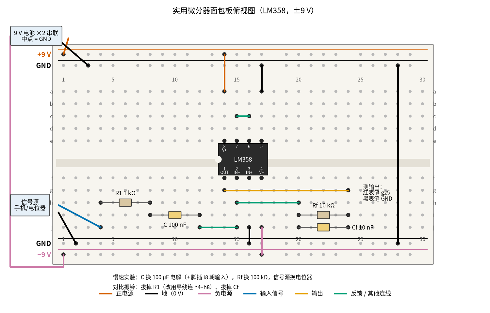
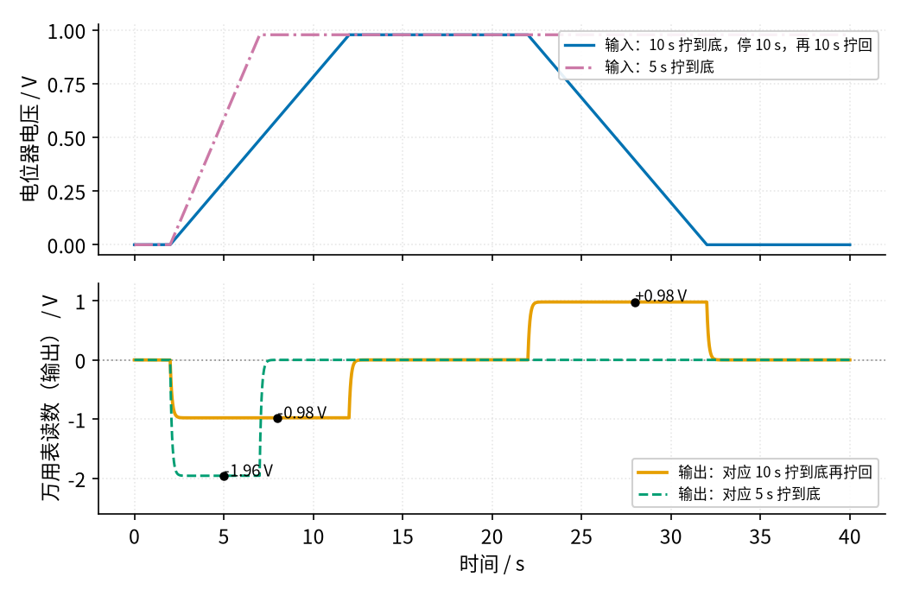

# 13 微分电路 · 动手实验篇

[上一页：参数与调试篇](page3.md) · [直觉篇](page1.md) · [原理与实现篇](page2.md) · [参数与调试篇](page3.md) · 本页：动手实验篇 · [下一页：07 射极跟随器 · 直觉篇](../07-emitter-follower/page1.md) · 前置节点：[P1 元件速成 · 直觉篇](../P1-components-basics/page1.md) · [12 积分电路 · 直觉篇](../12-integrator/page1.md)

## 这次实验要验证什么

用 LM358 在面包板上搭出带 $R_1$ 和 $C_f$ 的实用微分器，亲手验证 [13 微分电路 · 原理与实现篇](page2.md) 里「结论一」：**输入是一条直线时，输出是一个恒定电压，大小等于 −斜率 × $R_f C$**。然后拆掉 $R_1$ 和 $C_f$ ，对比理想微分器会不会自己振——这一步要看示波器，没有示波器时只能讲道理，本页会照实说明。

## ⚠️ 安全须知

- **只用 12 V 及以下的直流电**。本实验用两节 9 V 叠层电池串联，得到 ±9 V；不要用任何从插座直接取电、没有标明输出电压的电源。
- **电解电容分正负极**。慢速实验里的 100 µF 电解电容，外壳上印着「−」那条白带的一脚是负极，要朝运放的反相端（虚地）一侧，正极朝输入；接反了会发热、鼓包，严重时会炸开。
- **电阻、运放可能发烫，不要用手摸**。正常接法下它们只是微温；如果手靠近就感觉烫，说明电源接反或短路了，马上断电。
- **接线、改线之前先断电**。拆 $R_1$ 、 $C_f$ 或者换电容之前，先把两节电池的扣子都拔下来，改好、核对一遍再接上。
- 两节电池串联后，正负两端之间有 18 V，不要让 +9 V 的导线和 −9 V 的导线直接碰在一起，也不要让电池扣的两根线互碰。

## 器材清单

| 元件 | 型号或数值 | 数量 | 说明 |
|---|---|---|---|
| 运放 | LM358（DIP-8 直插） | 1 | 内有两路运放，本实验用 A 路，B 路接成跟随器闲置 |
| 电阻 $R_1$ | 1 kΩ，1/4 W | 1 | 输入串联电阻，压住振铃 |
| 电阻 $R_f$ | 10 kΩ，1/4 W | 1 | 反馈电阻，和 C 一起决定 $R_f C$ = 1 ms |
| 电阻 | 100 kΩ，1/4 W | 1 | 慢速实验时替换 $R_f$ |
| 电阻 | 82 kΩ，1/4 W | 1 | 慢速实验时和电位器分压，把电位器顶端降到约 1 V |
| 电容 C | 100 nF 薄膜或瓷片（印 104） | 1 | 输入电容 |
| 电容 $C_f$ | 10 nF 瓷片（印 103） | 1 | 反馈并联电容，压住振铃 |
| 电解电容 | 100 µF / 16 V 或更高耐压 | 1 | 慢速实验时替换 C，注意极性 |
| 电位器 | 10 kΩ 线性（B10K） | 1 | 慢速实验的「手摇斜坡」信号源 |
| 电池 | 9 V 叠层电池 + 电池扣 | 2 | 串联得 ±9 V，中点当地线 |
| 手机 + 3.5 mm 音频线 | 装一个「信号发生器」类 App | 1 | 交流实验的信号源；没有可跳过交流实验 |
| 万用表 | 带直流 200 mV / 2 V / 20 V 和交流挡 | 1 | 有「True RMS」字样的更好 |
| 面包板、杜邦线 | 830 孔或 400 孔 | 1 套 | 导线颜色尽量按下图：红接正、黑接地、紫接负 |

## 搭建步骤

电路就是 [13 微分电路 · 原理与实现篇](page2.md) 里的实用微分器（输入在 C 前再串 $R_1$ ，反馈 $R_f$ 旁并 $C_f$ ），下面的接线图把它摊到面包板上。面包板同一列的 a–e 五个孔是连通的，f–j 五个孔也是连通的，但 e 和 f 之间隔着中间的凹槽，不通；上下两边的电源轨整条横向连通。

1. **断电状态下插运放**。LM358 缺口朝左，跨在中间凹槽上：第 1–4 脚依次插在 f14、f15、f16、f17，第 8–5 脚依次插在 e14、e15、e16、e17。第 1 脚是输出，第 2 脚是反相端，第 3 脚是同相端，第 4 脚接负电源，第 8 脚接正电源。
2. **接电源轨**。上边外侧的轨当 +9 V，内侧当地；下边内侧当地，外侧当 −9 V。第一节电池的正极接上边 +9 V 轨，它的负极和第二节电池的正极拧在一起作中点，接上边地轨；第二节电池的负极接下边 −9 V 轨。再用一根黑线把上下两条地轨连起来（图中第 28 列）。
3. **给运放供电**。红线 a14 → 上边 +9 V 轨（第 8 脚）；紫线 j17 → 下边 −9 V 轨（第 4 脚）；黑线 j16 → 下边地轨（第 3 脚，同相端接地）。
4. **处理闲置的 B 路**。黑线 a17 → 上边地轨（第 5 脚接地），蓝绿色短线 c15–c16（第 6、7 脚短接）。这样 B 路成了一个输入接地的跟随器，不会自己乱振、也不会额外耗电。
5. **插输入元件**。 $R_1$ 1 kΩ 插 h4 和 h8；C 100 nF 插 i8 和 i12；蓝绿色线 j12 → j15，把 C 的右脚接到第 2 脚。
6. **插反馈元件**。蓝绿色线 h15 → h20，把反相端引到第 20 列； $R_f$ 10 kΩ 插 i20 和 i24， $C_f$ 10 nF 插 j20 和 j24；橙色线 g14 → g24，把第 1 脚的输出也接到第 24 列。于是 $R_f$ 、 $C_f$ 并联在输出和反相端之间。
7. **接信号源**。信号源的信号线（蓝线）接 j4，地线接下边地轨。交流实验用手机音频线：线的尖端（左声道）是信号，最后一节是地。
8. **通电前核对**：第 8 脚到 +9 V、第 4 脚到 −9 V 有没有接反；两条地轨有没有连起来；电解电容（如果插了）正极是否朝输入。核对完再扣上电池。

下面的 图 13-p4-1 是按上面步骤画出的面包板俯视图，列号印在上下两边，排号 a–j 印在左右两边。



*图 13-p4-1　实用微分器的面包板接线（LM358，两节 9 V 电池给出 ±9 V）*

面包板上输入支路和反馈支路分在凹槽下半区的两头，先对照 图 13-p4-3 的电路原理图认清每一列是哪个节点，再核对接线。


*图 13-p4-3　图 13-p4-1 对应的电路原理图（灰色小字是面包板孔位，蓝、橙、蓝绿色与面包板图导线一致，虚线框是第④步慢速实验的换件）*

**对照看**：面包板的连通规则见 [P1 元件速成 · 动手实验篇](../P1-components-basics/page4.md)：同一列的 a–e、f–j 各自连通，凹槽两边不通。所以 R1 的右脚和 C 的左脚同插在第 8 列就串在了一起，C 的右脚（第 12 列）要靠蓝绿线 j12 → j15 才能到 2 脚。反相端第 15 列又经 h15 → h20 引到第 20 列，输出第 14 列经 g14 → g24 引到第 24 列，于是 Rf、Cf 并联在第 20 列和第 24 列之间，也就是并在输出和反相端之间。整个第 24 列都是输出节点，表笔插在空着的 h24 上；面包板图右侧小字写的 g25 在第 25 列，什么也没接。原理图的结构和 [13 微分电路 · 原理与实现篇](page2.md) 「代数：两个结论，一个隐患」里的实用微分器相同，拆掉 R1、Cf 后就回到同一页「推导：三步得到输出公式」里的理想微分器。

图里导线按颜色分工：朱红色接正电源，黑色接地，红紫色接负电源，蓝色是输入信号，橙色是输出，蓝绿色是其他连线。图下方两行小字是后面两个实验要做的改动：慢速实验换 C、换 $R_f$ 、换信号源；对比振铃时拔掉 $R_1$ （用一根导线连 h4–h8 代替）和 $C_f$ 。

## 测量表

下表的「应该读到」来自 [review/spice/13.md](../review/spice/13.md) 的面包板读数表；那张表按 ±15 V 写，本页换成 ±9 V 后重新用 code/13_sim.py 的 LM358B 模型跑过，交流读数没有变化（运放输出只有 ±1 V，离 ±9 V 的电源还远）。慢速实验的数值由 code/figs/13_figs.py 按公式和逐步计算给出。

| 步骤 | 测什么 | 红表笔 | 黑表笔 | 挡位 | 应该读到 | 读不到时先查 |
|---|---|---|---|---|---|---|
| ① 通电 | 正电源 | a14（第 8 脚） | 上边地轨 | 直流 20 V | +9 V 左右（就是电池实际电压） | 电池扣是否扣紧、电池是否亏电 |
| ① 通电 | 负电源 | j17（第 4 脚） | 下边地轨 | 直流 20 V | −9 V 左右 | 第二节电池是否接反、两条地轨是否连通 |
| ② 静态 | 同相端 | j16（第 3 脚） | 地轨 | 直流 200 mV | 0 mV | j16 到地的黑线是否插到底 |
| ② 静态 | 反相端（虚地） | h15（第 2 脚） | 地轨 | 直流 200 mV | 几 mV 以内（失调电压不超过 ±3 mV） | 读到几伏：运放饱和，查反馈线 h15–h20、g14–g24 |
| ② 静态 | 无输入时的输出 | h24 | 地轨 | 直流 200 mV | 几 mV（直流增益为 1，只放大失调） | 信号线 j4 先接地再测；读到 ±7 V 以上说明反馈断了 |
| ③ 交流 | 手机送 ±0.5 V、500 Hz 三角波，输入端 | j4 | 地轨 | 交流 2 V | 约 0.29 V（三角波真有效值 = 峰值 ÷ √3） | 手机音量调大或调小，直到读数接近 0.29 V |
| ③ 交流 | 同上，输出 | h24 | 地轨 | 交流 2 V（真有效值表） | 约 0.82 V（理想 ±1 V 方波应为 1.0 V，边沿被 $R_1$ 、 $C_f$ 拉缓后变小） | 平均值型表在三角波、方波上会读偏；先确认表的交流挡能测 500 Hz |
| ③ 交流 | 同上，输出 | h24 | 地轨 | 直流 2 V | ≈ 0 V（仿真 −8 mV，方波上下对称） | 读到明显的直流：手机输出带直流偏置，或输入线接触不良 |
| ④ 慢速 | 10 s 匀速拧到底时的输出 | h24 | 地轨 | 直流 2 V | 约 −0.98 V（−100 kΩ × 100 µF × 0.978 V ÷ 10 s） | 电位器顶端是否约 0.98 V；电解电容是否接反 |
| ④ 慢速 | 5 s 拧到底 | h24 | 地轨 | 直流 20 V | 约 −1.96 V（快一倍，读数大一倍） | 拧的速度不匀：看读数中间最稳的那一段 |
| ④ 慢速 | 停手 | h24 | 地轨 | 直流 2 V | 1 s 内回到 0 附近 | 停不回 0：电解电容漏电，读数会差零点几十毫伏到 0.1 V |
| ④ 慢速 | 10 s 拧回来 | h24 | 地轨 | 直流 2 V | 约 +0.98 V（斜率反向，符号反向） | 同上 |

共 12 个测量点。第④步要把 C 换成 100 µF 电解电容（正极插 i8）、 $R_f$ 换成 100 kΩ，信号源换成电位器：电位器两端一端接地、另一端经 82 kΩ 接 +9 V，中间抽头（滑动端）接 j4。这样拧满一圈，抽头从 0 V 走到约 0.98 V。

## 没有示波器怎么办

**办法一：把 $R_f C$ 放大到秒级，用直流挡看「斜率变电压」**。原电路 $R_f C$ 只有 1 ms，信号必须几百赫兹才看得出效果，万用表的直流挡根本跟不上。把 C 换成 100 µF、 $R_f$ 换成 100 kΩ 后， $R_f C$ = 10 s，于是用手拧电位器就能造出「每秒变化零点一伏」的慢斜坡，万用表每秒刷新两三次，完全看得清。下面的 图 13-p4-2 是按这组元件逐步算出的读数变化。



*图 13-p4-2　手拧电位器做慢速微分：万用表直流挡应看到的读数*

上图蓝色是 10 s 拧到底、停 10 s、再 10 s 拧回来的输入，红紫色点划线是 5 s 拧到底的输入；下图橙色、蓝绿色虚线是对应的输出。关键在于：输出只跟「拧得多快」有关，跟「拧到了哪儿」无关——拧到一半停下，读数照样回到 0；拧得快一倍，读数大一倍；倒着拧，符号翻过来。手拧不可能绝对匀速，读数会有些晃动，看中间最稳的一段就行。

**办法二：直流挡读的是平均值**。在交流实验里，把表切到直流挡测输出，读到接近 0 V，说明方波的上半段和下半段一样长、一样高；如果读到明显偏离 0，就是电路或信号源出了问题。

**办法三：交流挡读真有效值**。±1 V 的理想方波，真有效值是 1.0 V；实用版因为边沿变成斜坡，读数约 0.82 V。如果你的表不是真有效值表，读数会偏，这时只把它当成「有没有、大概多大」的参考。

**拆掉 $R_1$ 和 $C_f$ 对比振铃：这一步只能讲道理**。断电，拔掉 $C_f$ ，用一根导线代替 $R_1$ （连 h4–h8），再通电送同样的三角波。按 LM358B 模型在 ±9 V 下的仿真，输出会冲到约 +5.3 V，并在方波上叠着约 13 kHz 的持续振荡，真有效值从 0.82 V 涨到约 1.77 V。可是这层振荡的频率太高：多数普通万用表交流挡只保证几百赫兹到一两千赫兹以内准确（看你的表的说明书），对 13 kHz 的读数既不准也不可信，所以**万用表读数的变化不能当作「看到了振铃」的证据**。真正的样子请看 [13 微分电路 · 直觉篇](page1.md) 里「先打个预防针」一节的四行波形图：第一行只有 C 和 $R_f$ ，平顶上是一层停不下来的振荡；后三行加了 $R_1$ 或 $C_f$ ，振铃完全消失。为什么会振，那一节用「老房子里调水温」讲得很清楚：运放和 $R_f C$ 两道延迟叠在一起，纠正总是过头。有示波器的同学，通道 1 接 j4、通道 2 接 h24，就能直接看到那张图第一行的样子。

## 用 Python 核对你的读数

把你量到的电阻值、电位器顶端电压、拧到底用的秒数、交流读数填进去。代码算出这次应该读到多少，偏差超过 10% 时打印提示。交流部分用理想运放把三角波拆成一个个正弦分量、逐个乘上实用微分器的放大倍数再合起来；LM358B 模型的结果比它小约 2%（0.82 V 对 0.84 V）。

```python
import sys, pathlib
sys.path.insert(0, str(pathlib.Path("code/figs").resolve()))  # 在仓库根目录运行
import numpy as np

# ===== 把下面换成你自己的实测值（这里是一组示例） =====
V_POS = 9.42          # 第 8 脚对地，V
R82 = 81.6e3          # 82 kΩ 电阻实测，Ω
R_POT = 9.85e3        # 电位器两端之间实测，Ω
RF_SLOW = 99.3e3      # 慢速实验的 100 kΩ 实测，Ω
C_SLOW = 100e-6       # 100 µF 电解电容；表有电容挡就填实测值，没有就填标称值
T_SWEEP = 10.4        # 从头拧到底用的秒数（手机秒表）
VO_SLOW = -0.90       # 拧的时候输出的读数，V

R1 = 0.987e3          # 1 kΩ 实测，Ω
RF = 9.93e3           # 10 kΩ 实测，Ω
C, CF = 100e-9, 10e-9 # 两个小电容用标称值
F = 500               # 手机 App 设的频率，Hz
VIN_AC = 0.291        # 输入端交流读数，V
VO_AC = 0.81          # 输出端交流读数，V


def check(name, measured, expected):
    dev = (measured - expected) / expected * 100
    flag = "  <-- 偏差超过 10%，先按测量表最后一列排查" if abs(dev) > 10 else ""
    print(f"{name}: 实测 {measured:+.3f} V，计算 {expected:+.3f} V，偏差 {dev:+.1f}%{flag}")


# 慢速实验：输出 = −R_f·C × 斜率，斜率 = 电位器顶端电压 ÷ 拧到底的时间
v_top = V_POS * R_POT / (R82 + R_POT)
check("慢速实验输出", VO_SLOW, -RF_SLOW * C_SLOW * v_top / T_SWEEP)


# 交流实验：三角波峰值 = 有效值 × √3，再求实用微分器输出的真有效值
def ac_rms(vm, f, n=4096):
    t = np.arange(n) / n / f
    x = vm * (2 * np.abs(2 * ((t * f) % 1) - 1) - 1)          # 峰值 vm 的三角波
    X = np.fft.rfft(x)
    w = 2 * np.pi * f * np.arange(len(X))                     # 各个正弦分量的角频率
    H = -1j * w * RF * C / ((1 + 1j * w * R1 * C) * (1 + 1j * w * RF * CF))
    y = np.fft.irfft(X * H, n)
    return np.sqrt(np.mean((y - y.mean()) ** 2))


check("交流实验输出", VO_AC, ac_rms(VIN_AC * np.sqrt(3), F))
```

示例数据里，慢速实验偏差约 −7%，没有触发提示，主要来自电解电容本身 ±20% 的误差和手拧不匀；交流实验偏差约 −3.5%，在 LM358 模型给出的 2% 差异附近。

## 实验记录表

| 项目 | 实测值 | 计算值 | 偏差 |
|---|---|---|---|
| 正电源（第 8 脚） |  | — | — |
| 负电源（第 4 脚） |  | — | — |
| 反相端（虚地） |  | 0 mV |  |
| 无输入时输出 |  | 几 mV |  |
| 交流实验：输入有效值 |  | — | — |
| 交流实验：输出有效值 |  |  |  |
| 交流实验：输出直流 |  | 0 V |  |
| 慢速实验：拧到底的秒数 |  | — | — |
| 慢速实验：输出 |  |  |  |
| 慢速实验：拧回来时的输出 |  |  |  |

**思考题 1**：慢速实验你量到的输出比计算值小了 15%，可电阻都量过、没有问题。最可能的原因是什么？

<details><summary>答案</summary>

最可能是电解电容的容量。普通铝电解电容的容量误差常见 ±20%，而输出正比于 $R_f C$ ，容量小 15%，读数就小 15%。另一个原因是拧得不匀：前半段慢、后半段快，读数中间就会偏小。用有电容挡的表量一下实际容量，再把它填进 Python 里重算。

</details>

**思考题 2**：交流实验里，把手机的三角波从 500 Hz 调到 1 kHz，幅度不变，输出的交流读数大约会怎么变？

<details><summary>答案</summary>

三角波斜率变成两倍，理想情况下输出方波幅度也变成两倍，读数接近翻倍。但每半个周期只剩 0.5 ms，斜坡边沿占的比例更大，读数会比两倍略少一些，和 [13 微分电路 · 直觉篇](page1.md) 示波器第 2 步「只爬到约 ±1.8 V」是同一个原因。可以把 F 改成 1000 用上面的代码算一算。

</details>

**思考题 3**：拆掉 $R_1$ 和 $C_f$ 后，你发现交流挡读数从 0.82 V 变成了 1.1 V。能不能据此说「我看到振铃了」？

<details><summary>答案</summary>

不能。读数变大说明输出里多了东西，但普通万用表交流挡对 13 kHz 左右的成分既不准，也可能被滤掉一部分，1.1 V 和仿真的 1.77 V 对不上就是这个原因。读数变化只能说明「有异常」，振荡的频率和形状必须用示波器看；没有示波器时，就以 [13 微分电路 · 直觉篇](page1.md) 里四行波形图的第一行为准。

</details>

## 自测清单

- 我能把 LM358 正确插在面包板上，说出第 1、2、3、4、8 脚各接什么。
- 我能用万用表直流挡确认虚地只有几毫伏，并知道读到几伏时该先查反馈线。
- 我能用电位器和 100 µF 电容做出秒级微分，用读数说明「输出只跟变化快慢有关」。
- 我能解释为什么万用表测不出振铃，以及 $R_1$ 、 $C_f$ 各自是怎么把振铃压住的。
