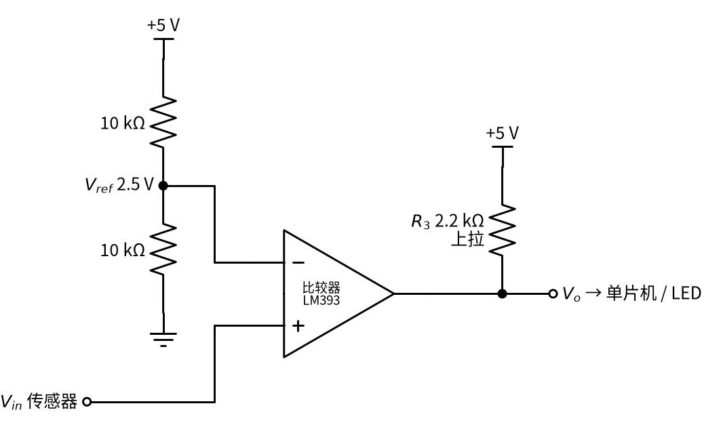
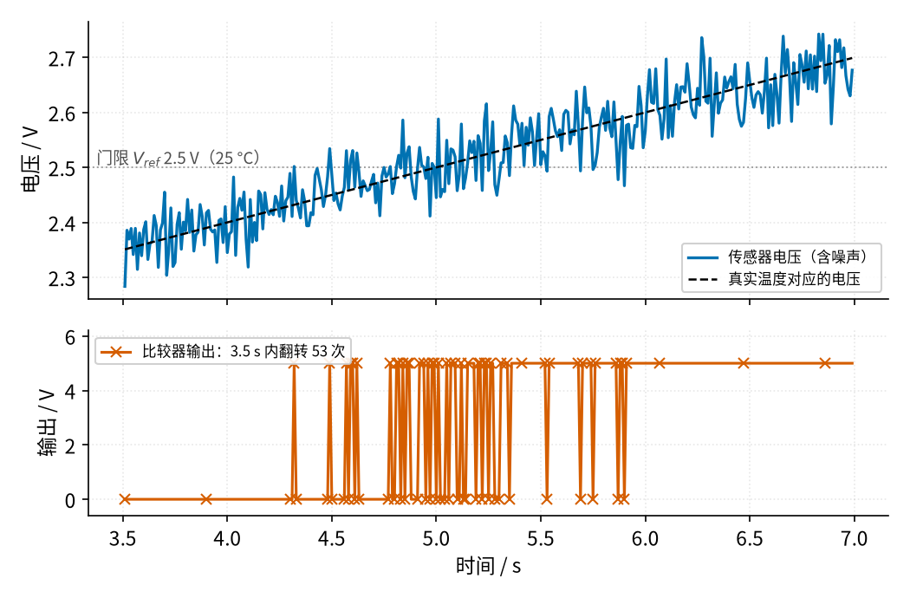
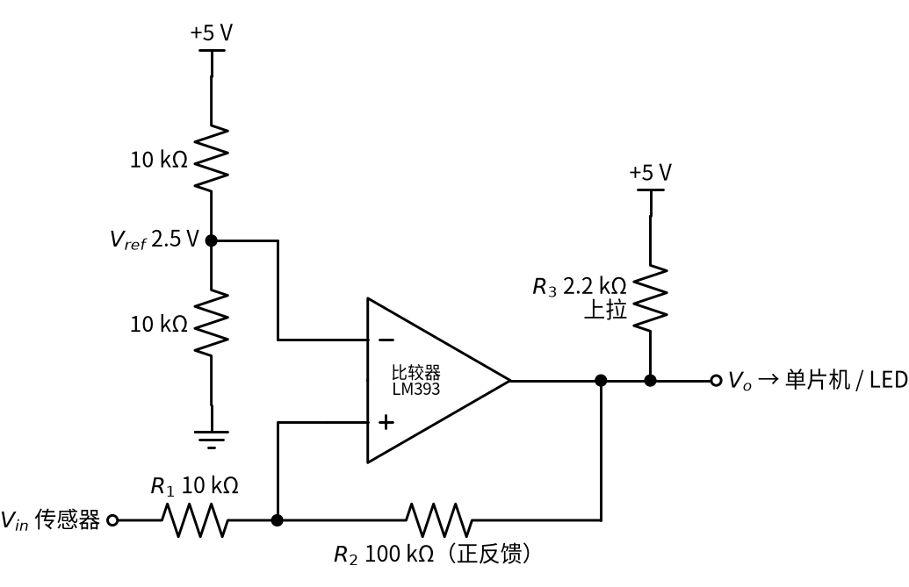

# 14 电压比较器 · 直觉篇

[上一页：05 精密整流 · 参数与调试篇](../05-precision-rectifier/page3.md) · 本页：直觉篇 · [原理与实现篇](page2.md) · [参数与调试篇](page3.md) · [下一页：原理与实现篇](page2.md) · 前置节点：[P3 运放入门 · 直觉篇](../P3-opamp-basics/page1.md)

## 痛点：电路要回答一个「是」或「否」

前面的放大电路都在做「按比例」的事：输入大一点，输出就跟着大一点。可很多时候我们根本不关心「大多少」，只关心一个是非题：

- 温度超过 27 °C 了吗？超过就开风扇。
- 电池电压低于 3.3 V 了吗？低于就亮报警灯。
- 水位到了没有？到了就关水泵。

这类问题的答案只有两个，正好对应单片机能读懂的「高电平」和「低电平」。把一个连续变化的电压，变成「是 / 否」两种状态，这就是**电压比较器**的工作。

本节用一个贯穿全节的例子：一只温度传感器，输出电压按 0.1 V/°C 变化（这是为了好算而取的示意值，25 °C 对应 2.5 V），我们想在温度超过设定值时让输出变高，去开风扇。

你也许会问：单片机本来就有 ADC（模数转换器），读出电压再用一行 `if` 判断不就行了，何必多一块芯片？有三个理由让比较器至今到处都是：

- **快**。LM393 的数据手册给出的典型响应时间约 1.3 µs，而单片机读一次 ADC、再执行判断，一轮下来通常要几十微秒到几毫秒。像 [11 过载保护 · 直觉篇](../11-overload-protection/page1.md) 那样要在电流冲上去的瞬间切断负载，等不了软件慢慢轮询。
- **不依赖程序**。单片机可能在休眠、可能死机、程序也可能写错；一块比较器加几只电阻，只要通电就一直在「盯着」那根线，适合做最后一道硬件保护。
- **省**。很多小产品（温控风扇、电池低压报警、水位开关）根本没有单片机，比较器的输出直接推三极管和继电器，几毛钱就能完成任务。

## 类比：一把只看「过没过线」的尺子

想象跳高比赛的横杆。裁判不管你跳了 2.01 米还是 2.30 米，只看「过没过杆」。比较器也一样：

- 它有两个输入端。一个接要判断的电压 $V_{in}$ ，另一个接「横杆高度」，也就是基准电压 $V_{ref}$ 。
- 接在同相端（+）的电压比接在反相端（−）的高，输出就是高电平；反过来就是低电平。

[P3 运放入门 · 直觉篇](../P3-opamp-basics/page1.md) 讲过，运放不加反馈时，两输入端只要差几十微伏，输出就会顶到头（饱和）。在放大电路里这是毛病，在比较器里却正是我们要的：输出只有「顶到上面」和「顶到下面」两种状态，干脆利落。

下面的 图 14-p1-1 是最基本的接法：两只 10 kΩ 电阻把 +5 V 分成 2.5 V，作为横杆，接到反相端；传感器电压接到同相端。

*图 14-p1-1　基本电压比较器：反相端接 2.5 V 基准，同相端接传感器*

从 图 14-p1-1 可以读出它的规则：温度高于 25 °C 时， $V_{in}$ 高于 2.5 V，输出为高（约 5 V）；温度低于 25 °C 时，输出为低（约 0 V）。图里输出端还有一只 2.2 kΩ 的「上拉电阻」接到 +5 V，这是因为 LM393 这类比较器的输出级只会「往地拉」，不会「往上推」（叫开集电极输出），需要外接电阻把高电平拉起来，第二页会细讲。

## 麻烦来了：在门限附近，输出会「抽风」

真实的传感器电压不是一条光滑的线。导线会拾取干扰，传感器本身也有噪声，电压总在真实值附近上下抖几十毫伏。温度又变得很慢，可能好几秒才升 1 °C。

这两件事碰在一起就出问题了。看 图 14-p1-2：温度慢慢升过 25 °C 的那几秒里，带噪声的电压在 2.5 V 这条线附近反复穿来穿去。

*图 14-p1-2　单一门限遇上噪声：输出在门限附近反复翻转*

图 14-p1-2 下半部分是比较器的输出：真实温度只「越线」了一次，可输出在 3.5 秒里翻转了 53 次。如果这个输出去控制继电器和风扇，继电器会啪嗒啪嗒地连响，触点很快就会烧坏；如果送给单片机计数，就会数出几十次「超温」。这种现象叫**抖动**。

## 解决办法：上、下用两条线

日常生活里早就有办法了。家里的空调设在 26 °C，并不是 26.0 °C 一到就开、一低于就关，而是升到约 27 °C 才启动制冷，降到约 25 °C 才停。两条线之间留出一段「缓冲带」，温度在缓冲带里怎么抖，空调都保持原来的状态。

比较器里这段缓冲带叫**回差**（也叫迟滞），做法是从输出端接一只电阻回到同相端，形成**正反馈**，就是 图 14-p1-3 里的 $R_2$ 。

*图 14-p1-3　施密特比较器：R2 把输出的一部分送回同相端，形成上、下两个门限*

图 14-p1-3 的道理可以这样理解：输出为低时， $R_2$ 把同相端往下「拽」一点，输入必须升得更高（约 2.75 V，即 27.5 °C）才能翻高；一旦输出变高， $R_2$ 又把同相端往上「托」一点，输入必须降得更低（约 2.25 V，即 22.5 °C）才能翻回低。（精确地说，开集电极输出经上拉电阻 $R_3$ 输出高电平，把它算进去后下门限约 2.26 V，下一页会算这一点差别。）噪声只有几十毫伏，跨不过这将近 0.5 V 的缓冲带，输出就干净了。这种带回差的比较器叫**施密特比较器**（施密特触发器）。

## 在示波器上会看到什么

用电位器代替温度传感器（电位器两端接 5 V 和地，中间抽头送同相端），按 图 14-p1-1 搭好电路，示波器通道 1 看 $V_{in}$ 、通道 2 看输出。依次做下面几件事：

1. **慢慢拧电位器**。 $V_{in}$ 低于 2.5 V 时，输出贴着 0 V；一过 2.5 V，输出「啪」地跳到约 5 V。中间没有「半高」的状态，这和放大电路完全不同。
2. **把电位器停在 2.5 V 附近**。通道 2 不再是一条干净的线，而是一条又粗又毛的亮带：输出在高、低之间快速乱跳，这就是 图 14-p1-2 里的抖动，只不过此刻的噪声来自电位器触点和导线。
3. **换成信号发生器：1 kHz 正弦波，中心 2.5 V，幅度 0.5 V**。输出变成 1 kHz 的方波，高、低各占一半。把中心抬到 2.75 V，正弦波有三分之二的时间在 2.5 V 以上（2.5 V 比中心低 0.25 V，正好是幅度的一半；一周 360° 里 $\sin\theta \gt -0.5$ 的范围是 −30° 到 210°，共 240°，占 2/3），方波的高电平就变宽到约 67%：比较器把「电压高低」变成了「方波宽窄」。
4. **放大看方波的边沿**。下降沿很陡，上升沿却略显圆钝，因为输出管只负责「往地拉」，往上全靠 2.2 kΩ 上拉电阻给导线和输入端的小电容充电。上拉电阻越大，上升沿越慢。
5. **改成 图 14-p1-3 的施密特接法，再送中心 2.5 V、幅度 0.5 V 的正弦波**。输出仍是方波，高电平约占 49.8%，但两次翻转都比普通比较器晚了约 0.08 ms：上升时要等到 2.75 V，下降时要等到 2.26 V。0.08 ms 是这样来的：2.75 V 比中心高 0.25 V，即 $\sin\theta = 0.5$ ， $\theta$ = 30°，而 1 kHz 一周是 1 ms，30° 对应 1 ms × 30/360 ≈ 0.083 ms；下降那一次同理。再把幅度减到 0.2 V，正弦波始终在 2.3～2.7 V 之间，一次也够不着上门限，输出就停在原来的状态不动了。这说明回差同时也是一道「门槛」：比回差还小的变化会被当成噪声忽略掉。

## 一句话总结

**比较器就是不加负反馈的运放：同相端高于反相端输出高，反之输出低；输入慢、噪声多时，用正反馈做出上、下两个门限（回差），输出才不会抖**。

下一页我们推导上、下门限的公式，解释为什么这里不能用「虚短」，再用仿真对比普通比较器和施密特比较器在同一段噪声下的表现。
