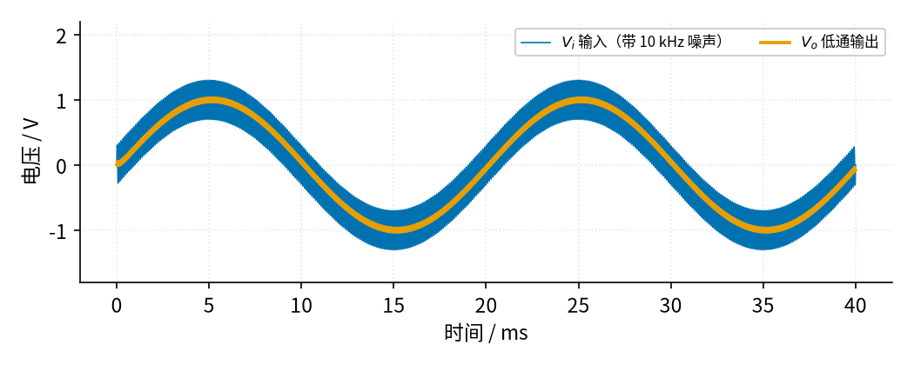
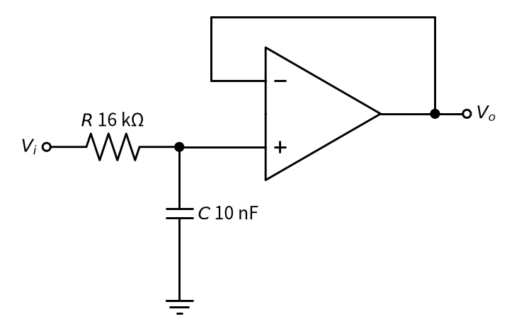

# 15 有源滤波 · 直觉篇

[上一页：07 参数与调试篇](../07-emitter-follower/page3.md) · 本页：直觉篇 · [原理与实现篇](page2.md) · [参数与调试篇](page3.md) · [下一页：原理与实现篇](page2.md) · 前置节点：[P1 元件速成](../P1-components-basics/page1.md)、[02 同相放大](../02-noninverting-amp/page1.md)、[03 电压跟随器](../03-voltage-follower/page1.md)

## 痛点：有用的信号上骑着一层"毛刺"

传感器送来的信号常常很慢，比如温度、心跳、50 Hz 的电网波形；可导线上总会混进高频干扰，比如开关电源、电机电刷、数字电路打出来的几千到几万赫兹的噪声。用示波器一看，原本光滑的曲线变成了一条"毛毛虫"。后面的单片机去采样，读数会跳来跳去。

我们想要一个"筛子"：慢的信号放过去，快的噪声挡下来。这个筛子就叫**滤波器**；放过低频、挡住高频的叫**低通滤波器**。

## 直觉：电容对快变化"开门"

在 [P1 元件速成](../P1-components-basics/page1.md) 里我们知道，电容两端电压不能突变，变化越快，电容吸进、吐出的电流越大。换一种说法：**频率越高，电容越像一根导线；频率越低，电容越像断开**。

把一个电阻串在信号路上，再把一个电容并到地上，就得到最简单的 RC 低通：

- 慢信号来了，电容像断开，信号几乎原样留在电容上；
- 快噪声来了，电容像导线，把噪声"倒"进地里，电容上几乎看不到它。

放过和挡住的分界叫**截止频率**，记作 $f_c$ （下标 c 是"截止"的意思），单位赫兹（Hz）。它只由电阻 $R$ 和电容 $C$ 决定，下一页会给出公式。

## 为什么要加运放："有源"两个字

只用 R 和 C 的滤波器叫**无源滤波器**。它有两个毛病：

1. **怕负载。** 电容上的电压一接后级就会被拉低，截止频率也跟着变。这和 [03 电压跟随器](../03-voltage-follower/page1.md) 里分压器一接负载就掉电压是同一个问题。
2. **不能放大。** 无源电路的输出最多等于输入。

在电容后面接一个运放就解决了：接成跟随器，后级再重也不影响 RC；接成 [02 同相放大](../02-noninverting-amp/page1.md)，还能顺手把信号放大。带运放的滤波器就叫**有源滤波器**（运放需要电源，"有源"由此得名）。

下面 图 15-p1-1 是一个仿真：一个 50 Hz、幅度 1 V 的正弦信号，叠加了一个 10 kHz、幅度 0.3 V 的噪声，送进截止频率约 1 kHz 的一阶有源低通。

*图 15-p1-1　带高频噪声的信号经过低通滤波*

图中蓝色是输入 $V_i$ ，因为噪声上下抖得太快，看起来像一条粗带子；橙色是输出 $V_o$ ，几乎是一条干净的正弦波。仿真打印出：输出上剩下的噪声只有约 0.03 V，是原来 0.3 V 的十分之一；而 50 Hz 的有用信号几乎没被削弱。

## 电路长什么样

图 15-p1-2 是本节最基本的电路：电阻 $R$ = 16 kΩ 串在路上，电容 $C$ = 10 nF 接地，电容上的电压送进一个接成跟随器的运放。

*图 15-p1-2　一阶有源低通（RC + 跟随器）*

图 15-p1-2 左半边就是无源 RC 低通，右半边的运放只负责"传话"：同相端几乎不取电流，所以 RC 不受后级影响；输出端能带负载。如果想放大，把跟随器换成同相放大即可，通带内的倍数就是 02 里的 $1 + R_f/R_1$ 。

## 一句话记住

**电阻 + 电容决定"在哪儿分界"，运放负责"不被打扰"和"放大"。** 下一页我们推出截止频率公式，看看"挡住"到底能挡多少，以及为什么有时要用两级 RC 的二阶电路。
