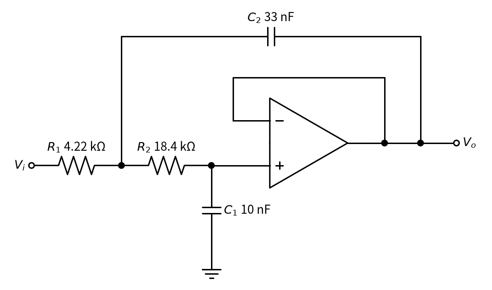
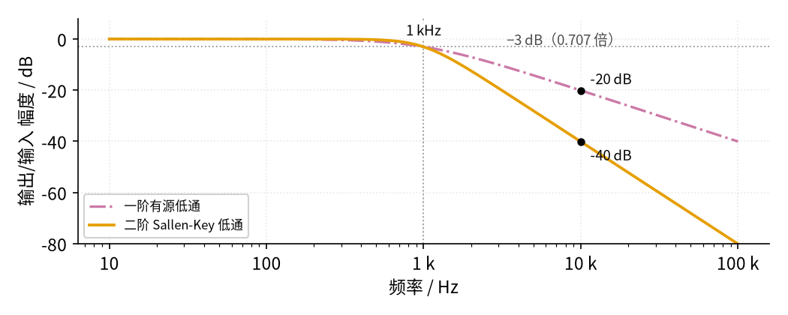
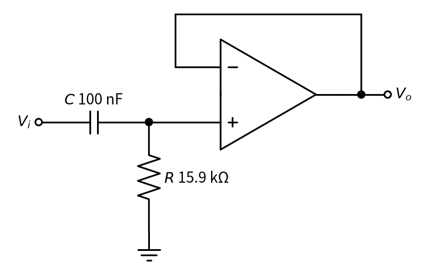

# 15 有源滤波 · 原理与实现篇

[上一页：直觉篇](page1.md) · [直觉篇](page1.md) · 本页：原理与实现篇 · [参数与调试篇](page3.md) · [下一页：参数与调试篇](page3.md) · 前置节点：[P1 元件速成](../P1-components-basics/page1.md)、[02 同相放大](../02-noninverting-amp/page1.md)、[03 电压跟随器](../03-voltage-follower/page1.md)

## 这一页要解决的问题

直觉篇说"电阻和电容决定分界"。这一页回答三个问题：分界频率怎么算？一级 RC 挡得够不够？不够时怎么用 Sallen-Key 电路做成二阶？最后三道例题，从照着算到自己改成高通。

## 一、一阶低通：截止频率公式

**意思**：电容的"阻碍"随频率升高而变小。当电容的阻碍和电阻 $R$ 一样大时，输出降到输入的约 0.707 倍，这个频率就是截止频率 $f_c$ 。

电容的阻碍叫**容抗**，记作 $X_C$ ，单位欧姆：

$$X_C = \frac{1}{2\pi f C}$$

其中 $f$ 是信号频率， $C$ 是电容量， $2\pi$ 来自正弦波转一圈是 $2\pi$ 弧度。令 $X_C = R$ ，解出：

$$f_c = \frac{1}{2\pi R C}$$

**代数**： $R$ = 16 kΩ， $C$ = 10 nF，

$$f_c = \frac{1}{2\pi \times 16000 \times 10 \times 10^{-9}} \approx 995\ \text{Hz}$$

**一步一步推（不用复数）**。为什么"容抗等于电阻"时是 0.707 倍，而不是一半？

1. **电阻和电容串联，流过同一个电流**。电阻上的电压幅度是 $V_R = I R$ ，电容上的电压幅度是 $V_C = I X_C$ ，这里 $I$ 是电流的幅度。
2. **但两者"不同步"**。电阻电压和电流同时到达最大；电容电压要等电流把它充满之后才最大，恰好晚四分之一个周期。两个正弦"错开四分之一周期"相加时，合成的幅度不是简单相加，而是像直角三角形的两条直角边求斜边：

$$V_i^2 = V_R^2 + V_C^2$$

3. **输出取自电容**。跟随器把电容电压原样送出，所以 $V_o = V_C$ 。把第 1 步代入第 2 步：

$$\frac{V_o}{V_i} = \frac{I X_C}{\sqrt{(I R)^2 + (I X_C)^2}} = \frac{1}{\sqrt{1 + (R/X_C)^2}}$$

4. **把 $R/X_C$ 写成频率之比**。 $R/X_C = 2\pi f R C$ ，而 $f_c = 1/(2\pi R C)$ ，所以 $R/X_C = f/f_c$ 。

代数验证：当 $X_C = R$ 时，直角三角形两条直角边相等，斜边是直角边的 $\sqrt{2}$ 倍，输出就是 $1/\sqrt{2} \approx 0.707$ 倍，而不是一半。这正是"−3 dB 点"的来历。

**挡住多少**？把第 4 步代回第 3 步，一阶低通（跟随器倍数为 1）在任意频率 $f$ 下的输出幅度与输入幅度之比是

$$\frac{V_o}{V_i} = \frac{1}{\sqrt{1 + (f/f_c)^2}}$$

代数：在 $f = f_c$ 处是 $1/\sqrt{2} \approx 0.707$ ；在 10 kHz（约 10 倍 $f_c$ ）处是 $1/\sqrt{1+101} \approx 0.099$ ，大约只剩十分之一。

**分贝**。工程上常把倍数换成**分贝**（dB）： $20\lg(V_o/V_i)$ 。0.707 倍是 −3 dB，0.1 倍是 −20 dB，0.01 倍是 −40 dB。所以截止频率又叫"−3 dB 点"。一阶低通在 $f_c$ 以上频率每升高 10 倍，输出再降 10 倍，也就是**每十倍频程 −20 dB**。

## 二、二阶 Sallen-Key 低通

一阶的下降太"温柔"：10 kHz 的噪声只压到十分之一。把两级 RC 串起来能降得更快，但简单串联时第二级会拖累第一级。**Sallen-Key** 电路用一个跟随器解决这个问题，并且把第一个电容接到输出端，借输出"推一把"，让拐角更陡。

看 图 15-p2-1：输入经 $R_1$ 、 $R_2$ 两个电阻到运放同相端， $C_1$ 从同相端接地， $C_2$ 从两电阻中间的节点接到输出。



*图 15-p2-1　单位增益 Sallen-Key 二阶低通*

图 15-p2-1 中的运放输出直接接反相端，就是 [03 电压跟随器](../03-voltage-follower/page1.md)：它让 $C_1$ 上的电压原样出现在输出端，再经 $C_2$ 送回中间节点。元件值取自 TI 应用笔记 SLOA049 表 10-1 的 1 kHz 巴特沃斯设计。

**意思**：二阶电路有两个参数。一个是**特征频率** $f_0$ ，相当于一阶的 $f_c$ ，由四个元件的乘积决定；另一个是**品质因数** $Q$ ，管拐角处"鼓不鼓"。 $Q$ = 0.707 时通带最平、又不过冲，这种设计叫**巴特沃斯**（Butterworth）。

$$f_0 = \frac{1}{2\pi\sqrt{R_1 R_2 C_1 C_2}}, \qquad Q = \frac{\sqrt{R_1 R_2 C_1 C_2}}{C_1 (R_1 + R_2)}$$

**代数**： $R_1 R_2 C_1 C_2 = 4220 \times 18400 \times 10 \times 10^{-9} \times 33 \times 10^{-9} \approx 2.56 \times 10^{-8}$ ，开方约 $1.60 \times 10^{-4}$ ，所以 $f_0 \approx 1/(2\pi \times 1.60 \times 10^{-4}) \approx 994$ Hz； $Q \approx 1.60 \times 10^{-4} / (10 \times 10^{-9} \times 22620) \approx 0.71$ 。

**为什么两个电容不一样大**？试试四个元件都取相等： $R_1 = R_2 = R$ 、 $C_1 = C_2 = C$ 。代入 $Q$ 的公式，分子是 $RC$ ，分母是 $C \times 2R$ ，得 $Q$ = 0.5，比 0.707 小，拐角会"发软"，在 $f_0$ 处已经降到一半（−6 dB）。要把 $Q$ 抬高，就要让接到输出的 $C_2$ 比接地的 $C_1$ 大：本例 $C_2$ 是 $C_1$ 的 3.3 倍，输出"推一把"的作用更强， $Q$ 才到 0.71。

**幅度公式**：

$$\frac{V_o}{V_i} = \frac{1}{\sqrt{\left(1 - (f/f_0)^2\right)^2 + \left(f/(Q f_0)\right)^2}}$$

代数：在 10 kHz， $f/f_0 \approx 10$ ，第一项约 $(1-100)^2 \approx 9800$ ，第二项约 $(10/0.71)^2 \approx 200$ ，开方约 100，输出只剩约 0.01 倍，即 −40 dB。**二阶每十倍频程 −40 dB**，比一阶陡一倍。

## 三、仿真：两种低通的幅频曲线

下面的代码按上面两个幅度公式，从 10 Hz 扫到 100 kHz，画出两种低通的输出/输入幅度（以 dB 表示），并检查 10 kHz 处二阶确实约 −40 dB。代码里的 a、b 两项就是 Sallen-Key 幅度公式分母里的两项，只是没有先除成 $f/f_0$ 的形式。代码与仓库里的 code/15_sim.py 完全一致，需要和仓库的 code/figs 目录放在一起运行。

```python
# 15 有源滤波最小仿真：截止频率都约 1 kHz 的一阶有源低通和二阶 Sallen-Key 低通，比较幅频特性（输出幅度 / 输入幅度）。
import sys, os                                     # 下一行让 Python 找到 code/figs 里的共享画图样式
sys.path.insert(0, os.path.join(os.path.dirname(os.path.abspath(__file__)), "figs"))
import numpy as np                                 # 数组运算
import matplotlib.pyplot as plt                    # 画图
import figstyle as fs                              # 全书统一的颜色、轴标签、保存函数

f = np.logspace(1, 5, 800)                         # 频率从 10 Hz 扫到 100 kHz
w = 2 * np.pi * f                                  # 角频率 ω = 2πf（公式里要用）

R, C = 16e3, 10e-9                                 # 一阶：R = 16 kΩ，C = 10 nF
fc1 = 1 / (2 * np.pi * R * C)                      # 截止频率 fc = 1/(2πRC) ≈ 995 Hz
H1 = 1 / np.sqrt(1 + (f / fc1) ** 2)               # 一阶低通的幅值（运放接成跟随器，倍数 1）

R1, R2 = 4.22e3, 18.4e3                            # 二阶 Sallen-Key（TI SLOA049 表 10-1 巴特沃斯，fc = 1 kHz）
C1, C2 = 10e-9, 33e-9                              # C1 接地，C2 接到输出（反馈电容）
a = 1 - w ** 2 * R1 * R2 * C1 * C2                 # 幅值公式分母里的第一项
b = w * C1 * (R1 + R2)                             # 幅值公式分母里的第二项
H2 = 1 / np.sqrt(a ** 2 + b ** 2)                  # 二阶 Sallen-Key 低通的幅值（倍数 1）

dB = lambda h: 20 * np.log10(h)                    # 幅值换成分贝：每 20 dB 等于 10 倍
for fx in (1e3, 10e3):                             # 打印 1 kHz 和 10 kHz 处的衰减
    h1 = 1 / np.sqrt(1 + (fx / fc1) ** 2)
    wx = 2 * np.pi * fx
    h2 = 1 / np.sqrt((1 - wx ** 2 * R1 * R2 * C1 * C2) ** 2 + (wx * C1 * (R1 + R2)) ** 2)
    print(f"{fx/1e3:g} kHz：一阶 {h1:.3f} 倍（{dB(h1):.0f} dB），二阶 {h2:.3f} 倍（{dB(h2):.0f} dB）")
print(f"一阶截止频率 {fc1:.0f} Hz")
assert abs(fc1 - 995) < 1                          # 1/(2π × 16 kΩ × 10 nF) ≈ 995 Hz
assert abs(dB(1 / np.sqrt((1 - (2e4*np.pi) ** 2 * R1*R2*C1*C2) ** 2 + (2e4*np.pi*C1*(R1+R2)) ** 2)) + 40) < 1  # 10 kHz 处二阶约 −40 dB

fig, ax = plt.subplots(figsize=fs.SIZE["single"])  # 一张图
ax.semilogx(f, dB(H1), **fs.LS["third"], label="一阶有源低通")             # 红紫色点划线
ax.semilogx(f, dB(H2), **fs.LS["vout"], label="二阶 Sallen-Key 低通")      # 橙色
fs.ref_h(ax, -3, "−3 dB（0.707 倍）", x=0.62, ha="left")                 # 灰色点线：截止频率处的幅值
fs.ref_v(ax, 1e3, "1 kHz")                         # 灰色点线：截止频率
for fx in (10e3,):                                 # 标出 10 kHz 处两条曲线的数值
    fs.mark(ax, fx, dB(1 / np.sqrt(1 + (fx / fc1) ** 2)), fmt="{:.0f}", unit=" dB", dx=6, dy=4)
    wx = 2 * np.pi * fx
    fs.mark(ax, fx, dB(1 / np.sqrt((1 - wx**2*R1*R2*C1*C2) ** 2 + (wx*C1*(R1+R2)) ** 2)), fmt="{:.0f}", unit=" dB", dx=6, dy=-12)
fs.axlabels(ax, "频率", "Hz", "输出/输入 幅度", "dB")                    # 轴标签
ax.set_xticks([10, 100, 1e3, 1e4, 1e5]); ax.set_xticklabels(["10", "100", "1 k", "10 k", "100 k"])
ax.set_ylim(-80, 8); ax.legend(loc="lower left", fontsize=8)              # 纵轴范围和图例
fs.save(fig, "15", "15_p2_2_freq_response.png")    # 保存到 15-active-filter/img/
```

运行后打印 1 kHz 处两种低通都约 0.705 倍（−3 dB）；10 kHz 处一阶 0.099 倍（−20 dB），二阶 0.010 倍（−40 dB）。曲线见 图 15-p2-2。



*图 15-p2-2　一阶与二阶低通的幅频曲线*

图 15-p2-2 横轴是频率（每一大格是 10 倍），纵轴是输出/输入幅度的分贝值。灰色点线一条是 −3 dB（0.707 倍），一条是 1 kHz，两条曲线都在两线交点附近穿过，说明截止频率都设计在 1 kHz。往右看，红紫色点划线（一阶）在 10 kHz 处是 −20 dB，橙色（二阶）是 −40 dB：同样 10 kHz 的噪声，二阶比一阶多压 10 倍。

## 四、例题

**例 1（完整示范）** 用 10 nF 电容做截止频率约 1 kHz 的一阶低通，电阻取多少？10 kHz 的噪声能压到多少？

第 1 步，意思：截止时 $X_C = R$ 。公式 $f_c = 1/(2\pi R C)$ 变形为 $R = 1/(2\pi f_c C)$ 。

第 2 步，代数： $R = 1/(2\pi \times 1000 \times 10 \times 10^{-9}) \approx 15.9$ kΩ，取标准值 16 kΩ，实际 $f_c \approx 995$ Hz。

第 3 步，检查效果：10 kHz 时 $f/f_c \approx 10$ ， $V_o/V_i = 1/\sqrt{1 + 100} \approx 0.1$ 。0.3 V 的噪声剩约 0.03 V，和直觉篇的仿真一致。

第 4 步，检查有用信号：50 Hz 时 $f/f_c \approx 0.05$ ， $V_o/V_i = 1/\sqrt{1.0025} \approx 0.999$ ，几乎不受影响。

**例 2（填空）** 用 10 nF 电容做截止频率 2 kHz 的一阶低通，并算出 20 kHz 噪声剩多少倍。

第 1 步： $R = 1/(2\pi \times$ ____ $\times 10 \times 10^{-9}) \approx$ ____ kΩ。

第 2 步：20 kHz 时 $f/f_c$ = ____， $V_o/V_i \approx$ ____ 。

<details><summary>答案</summary>

第 1 步：2000 Hz；约 7.96 kΩ（频率翻倍，电阻减半），可取标准值 8.2 kΩ 或 7.87 kΩ。

第 2 步： $f/f_c$ = 10， $V_o/V_i = 1/\sqrt{101} \approx 0.1$ ：只要频率比相同，衰减倍数就相同。

</details>

**例 3（变式迁移：高通）** 想挡住低频（比如传感器的缓慢漂移），只放过 100 Hz 以上的信号，怎么改？

把 R 和 C **对调位置**：电容串在路上，电阻接地，见 图 15-p2-3。



*图 15-p2-3　一阶有源高通（C + R + 跟随器）*

图 15-p2-3 中，低频时电容像断开，信号过不去；高频时电容像导线，信号几乎全部到达同相端。截止频率公式不变： $f_c = 1/(2\pi \times 15.9\ \text{k}\Omega \times 100\ \text{nF}) \approx 100$ Hz。幅度公式变成

$$\frac{V_o}{V_i} = \frac{f/f_c}{\sqrt{1 + (f/f_c)^2}}$$

代数：在 10 Hz 处 $0.1/\sqrt{1.01} \approx 0.1$ ，低频被压到十分之一。接地的电阻还有一个作用：给同相端提供直流通路，否则运放的输入偏置电流没有地方流，输出会慢慢漂走。

## 本页小结

**一阶低通的截止频率 $f_c = 1/(2\pi RC)$ ，来自"容抗等于电阻"，此时输出是输入的 0.707 倍（−3 dB），之后每十倍频程 −20 dB；二阶 Sallen-Key 的 $f_0 = 1/(2\pi\sqrt{R_1R_2C_1C_2})$ ， $Q$ = 0.707 为巴特沃斯，每十倍频程 −40 dB；运放在这里是跟随器（03），需要放大时换成同相放大（02）**。
