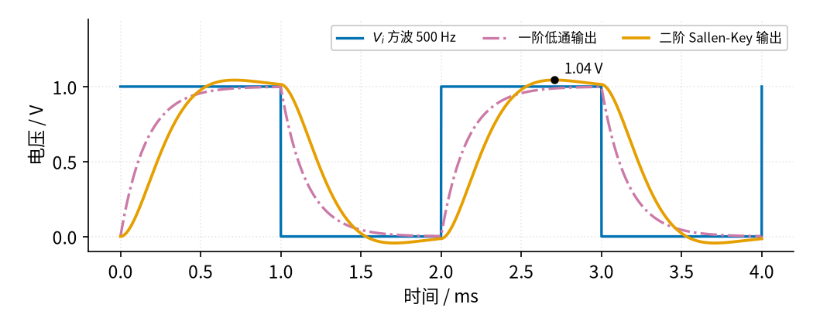
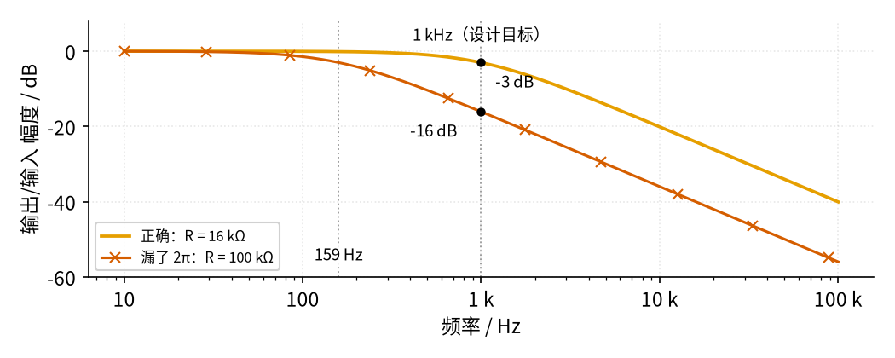

# 15 有源滤波 · 参数与调试篇

[上一页：原理与实现篇](page2.md) · [直觉篇](page1.md) · [原理与实现篇](page2.md) · 本页：参数与调试篇 · [下一页：15 有源滤波 · 动手实验篇](page4.md) · 前置节点：[P1 元件速成 · 直觉篇](../P1-components-basics/page1.md)、[02 同相放大 · 直觉篇](../02-noninverting-amp/page1.md)、[03 电压跟随器 · 直觉篇](../03-voltage-follower/page1.md) · 后续：[16 振荡器 · 直觉篇](../16-oscillator/page1.md)

## 这一页解决什么问题

公式会算了，焊出来却"不对劲"：要么有用的信号也被削弱，要么噪声挡不干净，要么波形边沿出现小鼓包。这一页先看两张图——方波经过两种低通会怎样、算截止频率漏掉 $2\pi$ 会怎样——再讨论元件误差和取值，最后给出故障排查表和四道练习。

## 一、方波：看清"一阶"和"二阶"的性格

方波的边沿里含有很多高频成分，所以用低通处理方波，最能看出滤波器的"性格"。图 15-p3-1 把 0～1 V、500 Hz 的方波分别送进截止频率都约 1 kHz 的一阶低通和二阶 Sallen-Key 低通。

*图 15-p3-1　500 Hz 方波经过一阶与二阶低通*

图 15-p3-1 中蓝色是输入方波 $V_i$ 。红紫色点划线（一阶）一开始爬得最快，越接近 1 V 越慢，是 P1 里熟悉的 RC 充电曲线。橙色（二阶）起步稍晚，但中段更陡，并且冲到 1.04 V 后才回落，过冲约 4%。这是巴特沃斯（ $Q$ = 0.707）的正常表现： $Q$ 再大，鼓包会更高，还会来回振荡几下。所以**处理数字脉冲、怕过冲的场合，二阶要选更小的 $Q$ （贝塞尔型）**（贝塞尔型就是 $Q$ 比 0.707 再小一些的同一种电路，拐角更软，但过冲更小；电路结构不变，只是元件值不同，了解即可），SLOA049 表 10-1 给了对应元件值。

## 二、最常见的错误：算截止频率漏了 2π

很多人记成" $f_c = 1/(RC)$"。用 10 nF 电容设计 1 kHz 时，就会算出 $R$ = 1/(1000 × 10 nF) = 100 kΩ，比正确的 16 kΩ 大了约 6.3 倍（就是 $2\pi$ ）。结果见 图 15-p3-2。

*图 15-p3-2　漏了 2π：截止频率低了约 6 倍*

图 15-p3-2 中橙色是正确设计，1 kHz 处 −3 dB。朱红色带 × 的是漏了 $2\pi$ 的设计：实际截止频率只有 $1/(2\pi \times 100\ \text{k}\Omega \times 10\ \text{nF}) \approx 159$ Hz（左边那条灰色点线），1 kHz 处已经是 −16 dB，约 0.16 倍。如果有用信号正好在几百赫兹，它会被当成噪声削掉。**验算方法**：算完马上把 $R$ 、 $C$ 代回 $f_c = 1/(2\pi RC)$ 看看是不是目标值。

## 三、运放带宽也会"偷偷当滤波器"

[02 同相放大 · 参数与调试篇](../02-noninverting-amp/page3.md) 讲过：运放的放大能力随频率下降，闭环带宽约等于增益带宽积 GBW 除以倍数。LM358B 的 GBW 约 1.2 MHz，跟随器（倍数 1）带宽约 1.2 MHz，做 1 kHz 滤波绰绰有余；但如果做 100 kHz 的滤波、再让它放大 10 倍，带宽只剩约 120 kHz，曲线会比设计提前往下掉。Microchip 的应用笔记 [ADN003](https://ww1.microchip.com/downloads/en/DeviceDoc/adn003.pdf) 给了一条好记的经验：Sallen-Key 选 GBW ≥ 100 × 倍数 × 截止频率，MFB 选 GBW ≥ 100 ×（倍数 + 1）× 截止频率。按它算，1 kHz 的跟随器型低通要 100 × 1 × 1 kHz = 100 kHz，LM358B 的 1.2 MHz 足够；100 kHz、10 倍的低通要 100 × 10 × 100 kHz = 100 MHz，是 LM358B 的约 83 倍，只能换高速运放或降低单级倍数。这个 100 倍是偏保守的余量：TI 的 [SBOA588](https://www.ti.com/lit/pdf/sboa588) 说，常见设计工具推荐 100 倍；如果按运放的实际带宽修正电阻电容，余量可以小很多。但不修正时余量太小会出明显误差，它的例子里 GBW 只有滤波器带宽的 2.5 倍，误差约 17%。另外 TI 的 SLOA049 指出，多重反馈（MFB，另一种二阶结构：运放接成反相放大，两只电容分别接在反馈和对地位置；本教程不展开，了解即可）结构的高频特性比 Sallen-Key 好，对远高于截止频率的衰减要求严格时可以考虑它。

## 四、元件误差与取值：截止频率有多"准"

**意思**： $f_c = 1/(2\pi RC)$ 里 $R$ 和 $C$ 是相乘的，所以哪一个偏大几个百分点，截止频率就大约偏小同样的百分点。

**代数**： $R$ = 16 kΩ 用了 5% 的电阻，偏大到 16.8 kΩ， $f_c$ 变成 995 ÷ 1.05 ≈ 948 Hz；电容偏小 10%（9 nF）， $f_c$ 变成 995 ÷ 0.9 ≈ 1105 Hz。两个误差碰巧同方向时会叠加。

由此得到几条实用的取值原则：

1. **电阻用 1% 的就够，误差主要来自电容**。常用的 X7R 瓷片电容，按 [KEMET X7R 手册](https://media.digikey.com/pdf/Data%20Sheets/Kemet%20PDFs/X7R_Dielectric_Comm_Rev_2019.pdf)，出厂误差有 ±5%、±10%、±20% 几挡，从 −55 °C 到 +125 °C 容量还会变 ±15%。KEMET 的[另一份手册](https://content.kemet.com/datasheets/F3101_MIL-PRF-11015.pdf)还说，这类电容加上 5 V 以上的直流电压后容量会变小，放久了也会慢慢变小（老化）。同一份手册里的 C0G（也叫 NP0）电容，温度系数只有 0 ± 30 ppm/°C（温度变 100 °C 才变 0.3%），而且容量不随电压、频率和时间变化。所以 TI 的 [SLOA049](https://www.ti.com/lit/an/sloa049b/sloa049b.pdf) 第 12 节建议：滤波器的电容用 C0G、误差 1%，电阻用 1% 的金属膜电阻。举个例子，Sallen-Key 的截止频率和 $\sqrt{C_1 C_2}$ 成反比，两只 X7R 电容如果都在低温端少了 15%，截止频率就高出约 18%。
2. **电阻不要太小**。第一个电阻和信号源内阻串联，信号源内阻相当于让 $R$ 变大；电阻取几千欧以上，几十欧的内阻影响就不到 1%。电阻太小，信号源还要提供更大的电流。
3. **电阻也不要太大**。几百千欧以上时，运放的输入偏置电流流过它会产生可观的直流误差，电阻本身的噪声也变大。先在几千欧到一百千欧里选电阻，再算电容，是常见的做法。
4. **二阶对比例更敏感**。Sallen-Key 的 $Q$ 取决于两个电容之比和两个电阻之比，比例一歪，拐角处就会"鼓"起来或"塌"下去（见下表第三行）。

**滤波器只能挡"频率不同"的干扰**。如果干扰和有用信号的频率差不多，例如 50 Hz 工频干扰叠在 50 Hz 附近的信号上，再好的低通也分不开它们；这时要靠 [04 差分放大 · 直觉篇](../04-differential-amp/page1.md) 抵消两根线上相同的干扰，或者从源头屏蔽。

## 五、故障排查表

| 现象 | 原因 | 怎么查 | 怎么改 |
|---|---|---|---|
| 有用信号也被削弱，截止频率低了约 6 倍 | 计算时漏了 $2\pi$ | 扫频找 −3 dB 点；把 R、C 代回公式复算 | 按 $R = 1/(2\pi f_c C)$ 重算 |
| 截止频率偏了 10% 以上 | 电容误差大或随温度变化 | 用电容表量实际容量，对比标称值 | 换精度高、温漂小的电容，如 C0G（NP0）、1%（SLOA049 的建议） |
| 二阶拐角变"钝"，1 kHz 处约 −13 dB | Sallen-Key 两个电容接反， $Q$ 由 0.71 变成约 0.21 | 对照原理图：接地的应是 10 nF，接输出的应是 33 nF | 按 [原理与实现篇](page2.md) 的 Sallen-Key 电路改回 |
| 高频端衰减不够，或比设计提前下降 | 运放带宽不足（GBW/倍数 太小） | 示波器看高频处输出幅度和相位 | 换 GBW 更大的运放，或降低单级倍数 |
| 输出顶部或底部被削平 | 超出运放输出摆幅，或单电源没有偏置 | 看削平的电压是否接近电源轨 | 减小输入或倍数；单电源时把信号偏置到中点（见 03） |
| 输出上有一个与输入无关的高频振荡 | 运放直接驱动长电缆或大电容负载，出现自激（没有输入也自己振荡） | 断开负载看振荡是否消失 | 在运放输出串一个小电阻再接负载（TI 的 TIDU032C 用 6.2 Ω 驱动 0.1 μF） |
| 50 Hz 干扰怎么也滤不掉 | 干扰频率落在通带内，低通本来就放它过去 | 对比干扰频率和截止频率 | 用差分放大（04）抵消，或加屏蔽、改走线 |
| 截止频率随温度漂移 | 电容的容量随温度变化 | 用热风轻吹电容，看 −3 dB 点是否移动 | 换温度稳定的电容 |
| 高通输出慢慢漂到电源一边 | 同相端对地的电阻漏接，偏置电流无通路 | 断开输入，量同相端直流电压 | 补上接地电阻（[原理与实现篇](page2.md) 例 3 高通中的 R） |

## 六、练习

**练习 1（容易）** 一阶低通用 $R$ = 10 kΩ、 $C$ = 100 nF，截止频率是多少？

答案

$f_c = 1/(2\pi \times 10000 \times 100 \times 10^{-9}) \approx 159$ Hz。

**练习 2（中等）** 用本节的两个 1 kHz 低通，计算 3 kHz 处的输出/输入幅度，各约多少分贝？哪一个对 3 kHz 的干扰更有效？

答案

一阶： $1/\sqrt{1 + (3000/995)^2} \approx 0.31$ ，约 −10 dB。

二阶： $f/f_0 \approx 3.02$ ，分母第一项 $(1 - 9.1)^2 \approx 66$ ，第二项 $(3.02/0.71)^2 \approx 18$ ，开方约 9.2，幅度约 0.11，约 −19 dB。

二阶更有效，同样 3 kHz 的干扰压得多约 3 倍。

**练习 3（提高）** 有用信号 50 Hz，干扰 2 kHz，要求干扰压到原来的 1/20 以下。(1) 用一阶低通，截止频率最高能取多少？此时 50 Hz 的信号还剩多少？(2) 改用二阶巴特沃斯（ $Q$ = 0.707），截止频率又能取多少？50 Hz 剩多少？提示：巴特沃斯二阶的幅度可以化简为 $1/\sqrt{1 + (f/f_0)^4}$ 。

答案

(1) 要 $1/\sqrt{1 + (2000/f_c)^2} \le 0.05$ ，即 $1 + (2000/f_c)^2 \ge 400$ ， $2000/f_c \ge \sqrt{399} \approx 20$ ， $f_c$ 最高约 100 Hz。这时 50 Hz 处 $1/\sqrt{1 + 0.25} \approx 0.89$ ，有用信号也被削掉约 11%。

(2) 要 $(2000/f_0)^4 \ge 399$ ， $2000/f_0 \ge 4.47$ ， $f_0$ 最高约 447 Hz。50 Hz 处 $(50/447)^4 \approx 0.00016$ ，幅度约 0.9999，几乎不受影响。这就是二阶的好处：衰减更陡，截止频率可以离有用信号远一些。

**练习 4（变体迁移）** 传感器信号 $V_i$ 很小，而且有缓慢的直流漂移。请设计一个一阶有源**高通**：截止频率约 100 Hz，通带内放大 2 倍。画出电路思路并给出元件值。

答案

沿用 [原理与实现篇](page2.md) 例 3 的高通：电容 $C$ = 100 nF 串在路上， $R$ = 15.9 kΩ 接地，得到 $f_c \approx 100$ Hz。

把跟随器换成 [02 同相放大 · 直觉篇](../02-noninverting-amp/page1.md)：倍数 $1 + R_f/R_1 = 2$ ，取 $R_f = R_1$ = 10 kΩ。

通带内（远高于 100 Hz）输出约是输入的 2 倍；100 Hz 处约 2 × 0.707 ≈ 1.41 倍；直流漂移被电容挡住。注意 15.9 kΩ 接地电阻不能省，它给同相端提供直流通路。

## 本页小结

**方波最能看出滤波器的性格：一阶圆滑无过冲，二阶巴特沃斯更陡但有约 4% 过冲；算截止频率千万别漏 $2\pi$ ；截止频率的误差主要来自电容，R、C 各偏几个百分点，截止频率就偏几个百分点；运放带宽不够时，它自己也会变成一个滤波器**。
