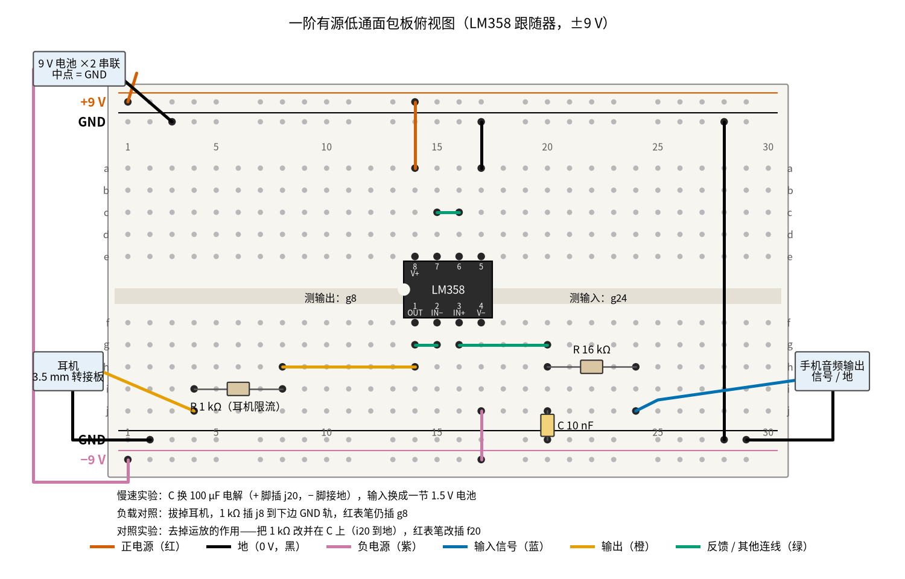
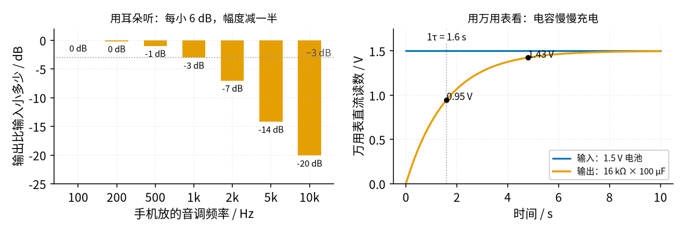

# 15 有源滤波 · 动手实验篇

[上一页：参数与调试篇](page3.md) · [直觉篇](page1.md) · [原理与实现篇](page2.md) · [参数与调试篇](page3.md) · 本页：动手实验篇 · [下一页：08 线性稳压 · 直觉篇](../08-linear-regulator/page1.md) · 前置节点：[P1 元件速成 · 直觉篇](../P1-components-basics/page1.md)、[03 电压跟随器 · 直觉篇](../03-voltage-follower/page1.md)

## 这次实验要验证什么

搭出 16 kΩ + 10 nF + LM358 跟随器的一阶有源低通，验证 [15 有源滤波 · 原理与实现篇](page2.md) 第一节的结论：**截止频率约 995 Hz，低频原样通过，高频按 $1/\sqrt{1+(f/f_c)^2}$ 衰减，而且运放让滤波器不怕负载**。没有信号发生器和示波器，我们用手机放音调、用耳机听，再用一个秒级的慢速版让万用表也能「看」到电容充电。

## ⚠️ 安全须知

- **只用 12 V 及以下的直流电**。本实验用两节 9 V 叠层电池串联、中点接地，得到 ±9 V。每节电池都只有 9 V，但正负电源之间是 18 V：两条电源轨千万不能直接碰在一起，否则电池会迅速发烫。
- **电解电容分正负极**。慢速版用到 100 µF 电解电容，长脚（正极）插滤波节点 j20，白带一侧（负极）接地；输入用的 1.5 V 电池也是正极朝输入，这样电容两端始终是正向电压。
- **元件、电池发烫时不要用手摸**，先断电再找原因。
- **接线、改线之前先断电**：拔下两节 9 V 电池的扣子，再换电容、换负载。
- **保护耳朵**：第一次听时先别把耳机塞进耳朵，放在桌上或拿得离耳朵远一点，手机音量从最小开始往上加。耳机一律经过 1 kΩ 电阻再接到运放输出，不要直接接。

## 器材清单

| 元件 | 型号或数值 | 数量 | 说明 |
|---|---|---|---|
| 运放 | LM358（DIP-8 直插） | 1 | 只用 A 路，B 路接成跟随器、同相端接地 |
| 电阻 $R$ | 16 kΩ，1/4 W，1% | 1 | 买不到 16 kΩ 可用 15 kΩ + 1 kΩ 串联 |
| 电容 $C$ | 10 nF 薄膜电容（标 103） | 1 | 不用陶瓷 X7R，它的容量误差大 |
| 电容（慢速版） | 100 µF / 25 V 电解电容 | 1 | 有极性 |
| 电阻 | 1 kΩ，1/4 W | 2 | 一只做耳机限流，一只做负载对照 |
| 电池 | 9 V 叠层电池和电池扣 | 2 | 串联得到 ±9 V |
| 电池 | 1.5 V 五号电池（带电池盒） | 1 | 慢速版的阶跃输入 |
| 音频线 | 3.5 mm 公对公音频线、3.5 mm 母座转接板 2 块 | 1 套 | 一块接手机，一块接耳机；手机没有耳机孔时加 USB-C 转 3.5 mm 转接头 |
| 耳机或小扬声器 | 普通有线耳机（约 32 Ω） | 1 | 也可以用带 3.5 mm 输入的有源小音箱 |
| 手机 | 装一个「信号发生器 / 音调发生器」应用 | 1 | 能放指定频率的正弦音调即可 |
| 万用表 | 带交流 2 V、直流 2 V / 20 V / 200 mV | 1 | 交流挡只信几百 Hz 以下的读数 |
| 面包板、杜邦线 | 830 孔 | 1 套 | 导线颜色尽量按下图 |

## 搭建步骤

电路就是 [15 有源滤波 · 直觉篇](page1.md) 里的「一阶有源低通（RC + 跟随器）」那张电路图：输入经 16 kΩ 到滤波节点，节点经 10 nF 接地，节点接运放同相端，运放输出直接接回反相端。公式推导见 [15 有源滤波 · 原理与实现篇](page2.md) 第一节。

1. **断电插芯片**。LM358 缺口朝左跨在凹槽上：第 1–4 脚插 f14、f15、f16、f17，第 8–5 脚插 e14、e15、e16、e17。
2. **接电源**。两节 9 V 电池串联：上面那节的正极接上边外侧轨（+9 V），两节之间的中点接上边内侧轨（GND），下面那节的负极接下边外侧轨（−9 V）。第 28 列用黑线把上下两条地轨连起来。红线 a14 → +9 V 轨（第 8 脚）；紫色线 j17 → −9 V 轨（第 4 脚）。
3. **处理闲置的 B 路**。黑线 a17 → 上边地轨（第 5 脚接地），绿色短线 c15–c16（第 6、7 脚短接）。闲置运放不处理会自己乱振，白白耗电。
4. **把 A 路接成跟随器**。绿色短线 g14–g15（第 1 脚输出接第 2 脚反相端）。
5. **插 RC**。绿色线 g16 → g20，把同相端引到第 20 列（滤波节点）。16 kΩ 插 h20–h24，第 24 列就是输入；10 nF 插 j20 和下边地轨之间。
6. **接输出和耳机**。橙色线 h14 → h8 把输出引到第 8 列；1 kΩ 插 i8–i4；耳机转接板的信号脚（L、R 两脚并在一起）接 j4，地脚接下边地轨。
7. **接手机**。音频线一头插手机，另一头插转接板：L 脚（蓝线）接 j24，地脚接下边地轨。
8. **通电前核对**：第 8 脚是 +9 V、第 4 脚是 −9 V，没有接反；+9 V 和 −9 V 两条轨之间没有任何导线直接相连。

下面的 图 15-p4-1 是按上面步骤画的面包板俯视图。



*图 15-p4-1　一阶有源低通的面包板接线（LM358 跟随器，±9 V）*

面包板上手机在右、耳机在左，信号是从右往左走的；先对照 图 15-p4-3 的电路原理图认清每一列是哪个节点，再核对接线。


*图 15-p4-3　图 15-p4-1 对应的电路原理图（灰色小字是面包板孔位，蓝、橙、绿色与面包板图导线一致，灰色虚线是第⑤、⑥步对照时才接的 1 kΩ）*

**对照看**：面包板的连通规则见 [P1 元件速成 · 动手实验篇](../P1-components-basics/page4.md)：同一列的 a–e、f–j 各自连通，凹槽两边不通。R 的右脚插 h24，和手机蓝线 j24、测量点 g24 同在第 24 列，所以第 24 列整列都是输入；R 的左脚、C 的上脚和绿线 g20 同在第 20 列，这一列就是 RC 的滤波节点，再由 g16 → g20 送到 3 脚。绿短线 g14–g15 让 1 脚和 2 脚相连，运放就成了跟随器，输出电压等于滤波节点电压，却不从节点取电流。输出经橙线 h14 → h8 移到第 8 列，第⑤步的负载 1 kΩ 并在这里（j8 到下边 GND 轨，红表笔仍插 g8），读数不变；第⑥步改并在 C 上（i20 到地，红表笔改插 f20），读数就掉一大截，两个位置在原理图里一眼就能分清。这张原理图就是 [15 有源滤波 · 直觉篇](page1.md) 「电路长什么样」里的一阶有源低通，截止频率的来历见 [15 有源滤波 · 原理与实现篇](page2.md) 「一、一阶低通：截止频率公式」。

图中红色线接 +9 V，黑色线接地，紫色线接 −9 V，蓝色线是手机送来的输入，橙色线是运放输出，绿色线是芯片周围的短接和连线。凹槽里标出了两个测量点：输出在 g8，输入在 g24。图下方三行小字是后面要用到的慢速版、负载对照和去掉运放的对照实验的改法。

## 测量表

「应该读到」的 100 Hz、负载、对照几行取自 [review/spice/15.md](../review/spice/15.md) 的面包板读数表（那张表按 ±15 V 计算；这个电路是线性的，换成 ±9 V 读数不变）；200 Hz 一行、慢速版和听音几行由 code/figs/15_figs.py 按公式算出。表里假设你把手机音量调到输入交流读数正好 0.707 V；读数不同时，按「输出 = 倍数 × 你的输入读数」换算。

| 步骤 | 测什么 | 红表笔 | 黑表笔 | 挡位 | 应该读到 | 读不到时先查 |
|---|---|---|---|---|---|---|
| ① 通电 | 正电源 | a14（第 8 脚） | 地轨 | 直流 20 V | 约 +9 V（新电池可到 9.5 V） | 电池扣、上边外侧轨 |
| ① 通电 | 负电源 | j17（第 4 脚） | 地轨 | 直流 20 V | 约 −9 V | 下面那节电池是不是负极接轨 |
| ② 静态 | 无输入时输出直流（拔掉手机，j24 用黑线接地） | g8 | 地轨 | 直流 200 mV | 几 mV（失调 ≤ ±3 mV） | 读到接近 ±8 V：第 1、2 脚没短接 |
| ③ 100 Hz | 输入 | g24 | 地轨 | 交流 2 V | 0.707 V（手机放 100 Hz，调音量） | 读数乱跳：转接板地线没接 |
| ③ 100 Hz | 输出 | g8 | 地轨 | 交流 2 V | 约 0.70 V（0.995 倍） | 接近 0：g16 → g20 那根绿色线没接 |
| ④ 200 Hz | 输出 | g8 | 地轨 | 交流 2 V | 约 0.69 V（0.980 倍） | 明显更小：C 插成了 100 nF（标 104） |
| ⑤ 负载 | 拔掉耳机，把一只 1 kΩ 插在 j8 和下边 GND 轨之间（g8 留给红表笔），再测 100 Hz 输出 | g8 | 地轨 | 交流 2 V | 仍约 0.70 V | 掉很多：输出线接到了第 20 列而不是第 14 列 |
| ⑥ 对照 | 把那只 1 kΩ 改并在 C 上（i20 到地；j20 已插着 C），测 100 Hz 节点电压 | f20 | 地轨 | 交流 200 mV | 约 42 mV（0.059 倍） | 这一行「掉一大截」才是对的 |
| ⑦ 慢速版 | 换 100 µF、输入接 1.5 V 电池后 1.6 s 时的输出 | g8 | 地轨 | 直流 2 V | 约 0.95 V（1τ） | 一下就到 1.5 V：电容没插好 |
| ⑦ 慢速版 | 4.8 s 时的输出 | g8 | 地轨 | 直流 2 V | 约 1.43 V（3τ），最终等于电池电压 | 停在一半不动：电解电容漏电大，换一只 |
| ⑧ 听音 | 手机依次放 1 kHz、5 kHz、10 kHz，耳机听输出 | 耳朵 | — | — | 比 100 Hz 时分别小 3 dB、14 dB、20 dB | 高音一点不变小：耳机接到了输入一侧 |

共 11 个测量点，其中第 ⑧ 行用耳朵代替表。为什么 1 kHz 以上不用万用表？普通万用表的交流挡只在几百 Hz 以下准确，在 5 kHz 读到的小数字，有一部分是表自己「听不清」造成的，分不清是滤波器在衰减还是表在衰减。

## 没有示波器怎么办

本页的三个替代办法都画在 图 15-p4-2 里。



*图 15-p4-2　没有示波器时用耳朵听衰减、用万用表看充电*

左图是每个音调经过滤波器后小了多少分贝，右图是慢速版输出随时间上升的样子。左图里，每小 6 dB 幅度减一半，每小 20 dB 幅度只剩十分之一。

**用耳朵听**。手机应用放一个 200 Hz 的音调，记住它在耳机里有多响；然后换成 1 kHz、2 kHz、5 kHz、10 kHz，每换一次就拔下耳机，把它插回手机直接听一下，再插回电路的输出听一下，比较两者的差别。200 Hz 时两者几乎一样响；到 5 kHz 以上，电路输出明显变小、变「远」。再让手机放一首有镲片声的歌：经过滤波器后，镲片、齿音变闷，鼓和人声的低音还在。这就是 [15 有源滤波 · 直觉篇](page1.md) 里「把毛刺去掉、留下光滑正弦」在声音上的样子。手机里如果有「白噪声」或「扫频」功能也可以试试：白噪声经过滤波器后从「嘶嘶」变成「呼呼」。耳朵对 3 dB 的变化不太敏感，所以 1 kHz 附近听不出明显差别是正常的，**耳朵判断的是「趋势」，不是截止频率的精确值**。

**用万用表看充电**。把 10 nF 换成 100 µF 电解电容，RC 就从 0.16 毫秒放大到 1.6 秒。拔下手机，换成一节 1.5 V 电池：电池负极接地，正极接一根导线，导线一碰到 g24 就开始计时（手机秒表）。万用表接在输出 g8，你会看到读数从 0 慢慢爬升，1.6 s 左右到 0.95 V，5 s 左右到 1.43 V，之后几乎停在电池电压上。把导线从电池正极换到地，读数又会按同样的速度降下来。这就是低通滤波器的本质：输出追不上快变化，只能「慢慢跟」。

**只能讲道理的部分**。正弦波过了截止频率以后输出比输入「晚到」、即 [15 有源滤波 · 直觉篇](page1.md) 示波器第 2、3 步里的相位滞后，以及 [15 有源滤波 · 参数与调试篇](page3.md) 第一节方波实验里一阶边沿的圆角形状，万用表和耳朵都分辨不出来，需要示波器才能看到。理论曲线见 [15 有源滤波 · 原理与实现篇](page2.md) 第三节的幅频曲线图。

## 用 Python 核对你的读数

把实际的 R、C（能用万用表电容挡量就填实测值），以及 100 Hz、200 Hz 的输入输出读数和慢速版到 0.95 V 所用的时间填进去。

```python
import sys, pathlib
sys.path.insert(0, str(pathlib.Path("code/figs").resolve()))  # 在仓库根目录运行
import math

# ===== 把下面换成你自己的实测值（这里是一组示例） =====
R = 15.95e3           # 实测电阻，Ω
C = 10.2e-9           # 实测电容，F（量不了就填 10e-9）
C_SLOW = 98e-6        # 慢速版电解电容，F
V_BAT = 1.55          # 1.5 V 电池实测，V
READINGS = {          # 频率 Hz: (输入交流读数 V, 输出交流读数 V)
    100: (0.712, 0.704),
    200: (0.712, 0.690),
}
T_1TAU = 1.7          # 慢速版输出升到 0.632 × V_BAT 用了多少秒


def check(name, measured, expected, unit):
    dev = (measured - expected) / expected * 100
    flag = "  <-- 偏差超过 10%，先按测量表最后一列排查" if abs(dev) > 10 else ""
    print(f"{name}: 实测 {measured:.3f} {unit}，计算 {expected:.3f} {unit}，偏差 {dev:+.1f}%{flag}")


fc = 1 / (2 * math.pi * R * C)                     # 截止频率
print(f"截止频率 fc = {fc:.0f} Hz")
for f, (vin, vout) in READINGS.items():
    gain = 1 / math.sqrt(1 + (f / fc) ** 2)        # 一阶低通的幅值比
    check(f"{f} Hz 输出", vout, gain * vin, "V")
tau = R * C_SLOW
check("慢速版 1τ 时间", T_1TAU, tau, "s")
print(f"1τ 时输出应约 {V_BAT * (1 - math.exp(-1)):.2f} V")
for f in (1000, 5000, 10000):                      # 听音时的参考
    print(f"{f} Hz 应比 100 Hz 小 {-20 * math.log10(1 / math.sqrt(1 + (f / fc) ** 2)):.1f} dB")
```

示例数据三项偏差都在 10% 以内。慢速版的时间最容易偏：电解电容的容量误差常有 ±20%，再加上看表、按秒表的反应时间，偏 10% 左右是正常的，可以多做几次取平均。

## 实验记录表

| 项目 | 实测值 | 计算值 | 偏差 |
|---|---|---|---|
| 正 / 负电源 |  | ±9 V | — |
| 无输入时输出直流 |  | 几 mV | — |
| 100 Hz 输入 |  | — | — |
| 100 Hz 输出 |  |  |  |
| 200 Hz 输出 |  |  |  |
| 接 1 kΩ 负载后的 100 Hz 输出 |  |  |  |
| 1 kΩ 并在电容上的节点电压 |  |  |  |
| 慢速版 1τ 时间 |  |  |  |
| 慢速版最终电压 |  |  |  |
| 听感：从哪个音调开始明显变小 |  | 约 2–5 kHz | — |

**思考题 1**：第 ⑤ 步接了 1 kΩ 负载输出不变，第 ⑥ 步把同一只 1 kΩ 并在电容上，节点电压却从 0.70 V 掉到 42 mV。为什么？

<details><summary>答案</summary>

并在电容上时，1 kΩ 和 16 kΩ 组成了分压器，100 Hz 下电容几乎不分流，节点电压约是 1 ÷ 17 ≈ 0.059 倍，也就是 42 mV。接在运放输出上时，电流由运放的电源提供，不从 16 kΩ 里走，RC 节点完全不知道外面接了什么。这就是「有源」的意义，见 [03 电压跟随器 · 直觉篇](../03-voltage-follower/page1.md)。

</details>

**思考题 2**：想让滤波器只挡住 5 kHz 以上的声音，把 10 nF 换成多大的电容最合适？

<details><summary>答案</summary>

按 $f_c = 1/(2\pi R C)$ 反算：C = 1 ÷ (2π × 16 kΩ × 5 kHz) ≈ 2.0 nF。手边常见的 2.2 nF（标 222）可以，截止频率约 4.5 kHz。换上以后再听，5 kHz 只小约 3.5 dB，10 kHz 小约 7.7 dB，比原来「亮」很多。

</details>

**思考题 3**：慢速版为什么不能用 100 µF 配 16 kΩ 去「听」？

<details><summary>答案</summary>

截止频率变成 1 ÷ (2π × 1.6 s) ≈ 0.1 Hz，人耳能听到的 20 Hz 以上的声音全部被衰减到几百分之一以下，耳机里几乎没有声音。慢速版只适合配合万用表看「慢慢跟」的过程，听音必须用 10 nF 这种让截止频率落在声音范围内的电容。

</details>

## 自测清单

- 我能按图在面包板上搭出一阶有源低通，并说清楚 ±9 V 两节电池怎么接、哪两条轨绝不能碰。
- 我能用手机放音调、用耳机听，说出滤波器从哪个频率开始明显挡住声音。
- 我能用 100 µF 慢速版和万用表量出 RC 时间常数，并和 R × C 对比。
- 我能演示「有运放」和「没有运放」时接 1 kΩ 负载的区别，并解释原因。
- 我知道哪些现象（相位滞后、方波圆角）只能用示波器看到。
