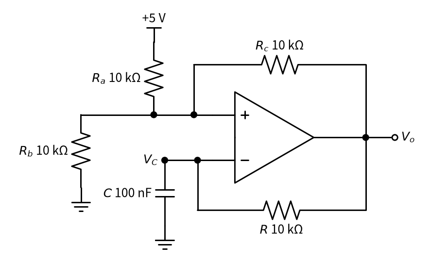
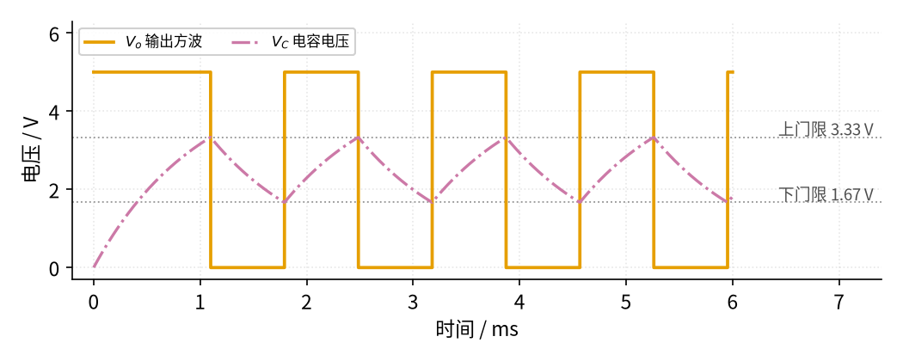

# 16 振荡器 · 直觉篇

[上一页：23 参数与调试篇](../23-optocoupler/page3.md) · 本页：直觉篇 · [原理与实现篇](page2.md) · [参数与调试篇](page3.md) · [下一页：原理与实现篇](page2.md) · 前置节点：[14 电压比较器](../14-voltage-comparator/page1.md)、[15 有源滤波](../15-active-filter/page1.md)

## 痛点：谁来给电路"打拍子"

单片机要时钟，蜂鸣器要几千赫兹的方波，测试滤波器要一个干净的正弦信号。前面的电路都是"有输入才有输出"：放大器放大别人的信号，滤波器筛选别人的信号。现在我们要一个**没有输入、自己就能产生周期信号**的电路，这就是**振荡器**。

## 直觉：荡秋千

推秋千的人不会乱推，而是每次秋千荡回来时**顺着方向**推一把。这里有两个要点：

1. **顺着推**：推的力和秋千的运动方向一致，越推越高。电路里这叫**正反馈**：输出的一部分送回输入，而且是"帮着"输入变化，而不是像 [02 同相放大](../02-noninverting-amp/page1.md) 那样的负反馈"拉回来"。
2. **按节奏推**：秋千有自己固定的节奏，推的人跟着这个节奏。电路里要有一个**选频**环节，用电阻和电容决定节奏，也就是频率。

所以一句话：**振荡 = 正反馈 + 选频**。

## 最简单的振荡器：电容 + 施密特比较器

[14 电压比较器](../14-voltage-comparator/page1.md) 里的施密特比较器有两个门限：电压涨过上门限才翻转，跌破下门限才翻回来。把它的输出经电阻 $R$ 给电容 $C$ 充电，再把电容电压 $V_C$ 送回比较器的反相端，就得到 图 16-p1-1 的**弛张振荡器**（"弛张"指电容一张一弛地充电、放电）。

*图 16-p1-1　RC + 施密特比较器组成的弛张方波振荡器*

图 16-p1-1 中，同相端通过三个相等的电阻 $R_a$ 、 $R_b$ 、 $R_c$ 分别接 +5 V、地和输出 $V_o$ ，所以同相端电压是这三个电压的平均值。输出为 5 V 时，门限是 (5 + 0 + 5)/3 ≈ 3.33 V；输出为 0 V 时，门限是 (5 + 0 + 0)/3 ≈ 1.67 V。门限跟着输出变，这就是正反馈。

它是这样"自己转起来"的：

- 刚上电，电容是 0 V，比同相端低，输出为高（5 V），经 $R$ 给电容充电；
- 电容涨到 3.33 V，超过同相端，输出翻成 0 V，门限也降到 1.67 V；
- 电容经 $R$ 往 0 V 放电，跌到 1.67 V 时输出又翻回 5 V……如此循环。

仿真结果见 图 16-p1-2。

*图 16-p1-2　弛张振荡器的电容电压与输出方波*

图 16-p1-2 中，红紫色点划线是电容电压 $V_C$ ，它在两条灰色点线（下门限 1.67 V、上门限 3.33 V）之间来回爬；橙色是输出 $V_o$ ，每碰到一条线就翻转一次。仿真打印出周期约 1.39 ms，频率约 721 Hz，高电平正好占一半。这里电容就是"选频"的部分： $R$ 、 $C$ 越大，充放电越慢，频率越低。

## 想要正弦波怎么办

方波里有很多谐波，做音频、测试信号时我们往往要正弦波。这时用**文氏桥振荡器**：用一个 RC 网络只让某一个频率"顺着推"，再用一个放大倍数约为 3 的同相放大器补上网络的损耗。它的 RC 网络和 [15 有源滤波](../15-active-filter/page1.md) 一样，靠电容的频率特性挑出一个频率。下一页我们推导它的频率公式，并用仿真看它怎样从一点点噪声"荡"起来。

## 一句话记住

**正反馈让信号自己维持，RC 决定节奏。** 方波用"RC + 施密特"，正弦用"文氏桥 + 约 3 倍放大"。
