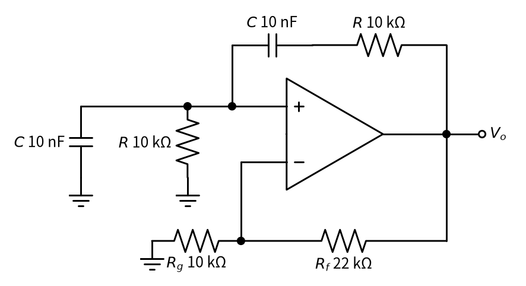
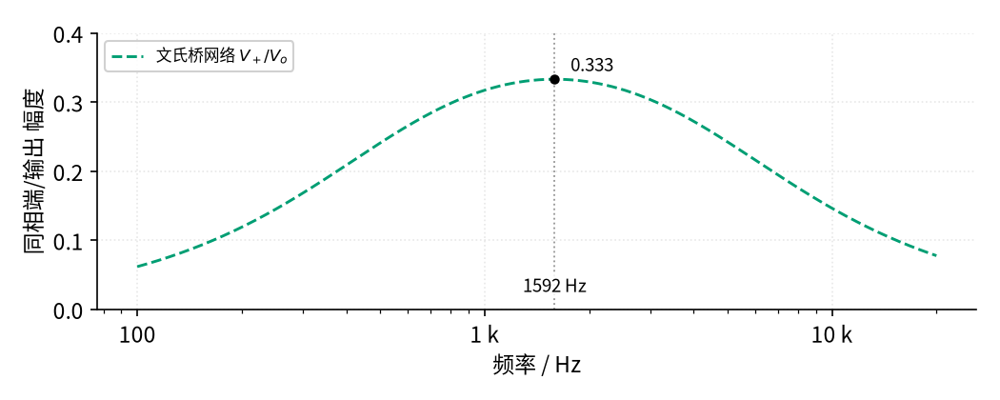
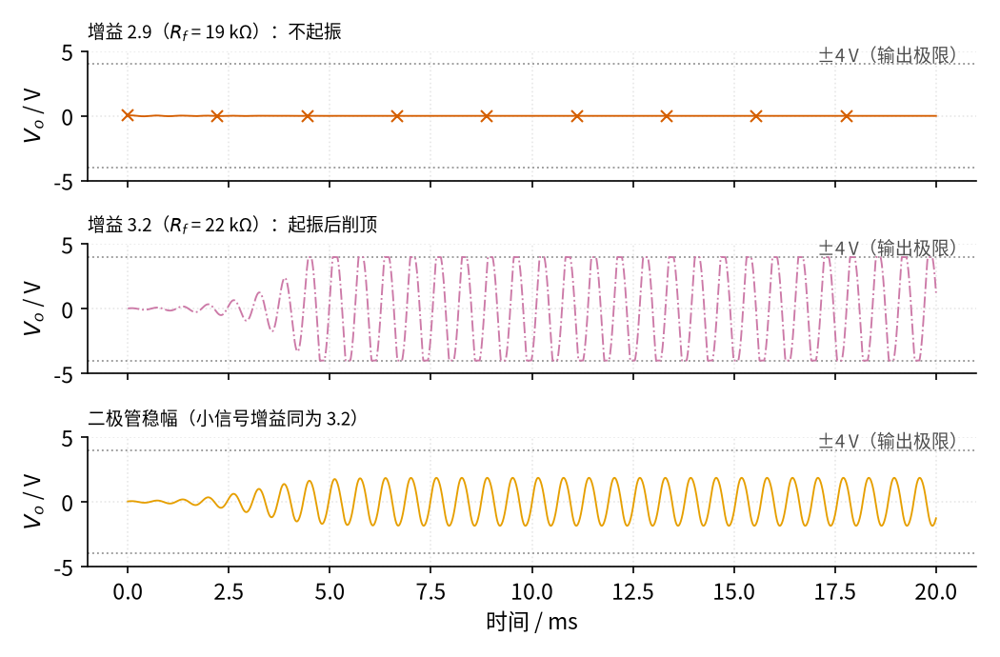
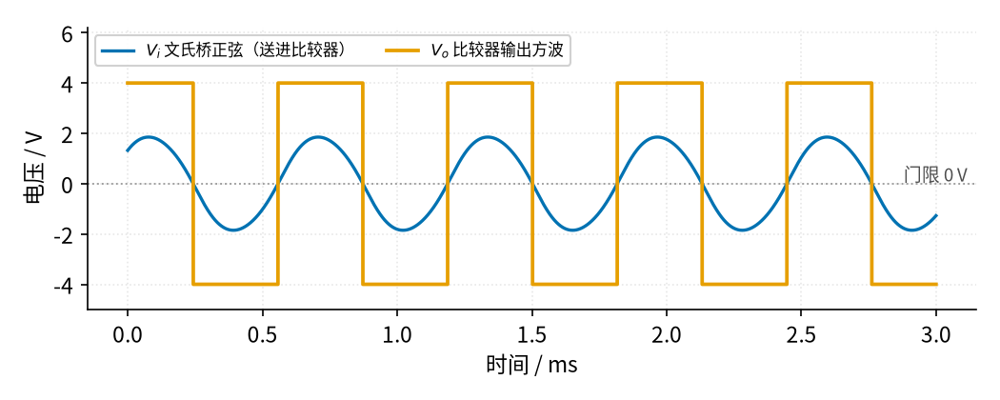

# 16 振荡器 · 原理与实现篇

[上一页：直觉篇](page1.md) · [直觉篇](page1.md) · 本页：原理与实现篇 · [参数与调试篇](page3.md) · [下一页：参数与调试篇](page3.md) · 前置节点：[14 电压比较器](../14-voltage-comparator/page1.md)、[15 有源滤波](../15-active-filter/page1.md)

## 这一页要解决的问题

直觉篇说"振荡 = 正反馈 + 选频"。这一页回答：文氏桥振荡器的频率怎么算？为什么放大倍数要"约等于 3"？倍数不对会怎样？怎样把正弦变成方波？最后算出弛张振荡器的周期，并做三道例题。

## 一、文氏桥振荡器的电路

看 图 16-p2-1。运放和下面的 $R_g$ 、 $R_f$ 组成 [02 同相放大](../02-noninverting-amp/page1.md) ；上面的 RC 网络把输出送回同相端，这就是正反馈。



*图 16-p2-1　文氏桥正弦振荡器*

图 16-p2-1 中，输出到同相端的路上是**串联**的 $R$ 和 $C$ ，同相端到地是**并联**的 $R$ 和 $C$ ，两个 $R$ 都是 10 kΩ，两个 $C$ 都是 10 nF。下面的 $R_g$ （接地电阻）= 10 kΩ、 $R_f$ （反馈电阻）= 22 kΩ 决定放大倍数 $1 + R_f/R_g$ = 3.2。

## 二、RC 网络只"偏爱"一个频率

**意思：** 低频时串联电容像断开，信号过不去；高频时并联电容像导线，把信号短路到地。只有在中间某个频率 $f_0$ ，网络送到同相端的信号最大，而且和输出**步调一致**（不超前也不落后），这时正反馈才是"顺着推"。

$$f_0 = \frac{1}{2\pi R C}$$

**代数：** $f_0 = 1/(2\pi \times 10000 \times 10 \times 10^{-9}) \approx 1592$ Hz。

网络的输出（同相端电压 $V_+$ ）与输入（运放输出 $V_o$ ）的幅度之比是

$$\frac{V_+}{V_o} = \frac{1}{\sqrt{9 + (f/f_0 - f_0/f)^2}}$$

代数：在 $f = f_0$ 处括号为 0，比值是 1/3；在 $f_0$ 的 10 倍或十分之一处，括号约为 9.9，比值约 0.097。曲线见 图 16-p2-2。



*图 16-p2-2　文氏桥网络的选频特性*

图 16-p2-2 中，蓝绿色虚线（反馈网络）在 1592 Hz 处达到最高点 0.333，两边都下降。所以网络把输出"打折"成三分之一送回去。要让信号一圈下来不变小，放大器必须把它放大 **3 倍**：

$$1 + \frac{R_f}{R_g} \geq 3 \quad\Longrightarrow\quad R_f \geq 2R_g$$

倍数小于 3，每转一圈信号都缩小，振荡慢慢消失；大于 3，每转一圈都变大，直到碰到运放的输出极限被削平。

## 三、仿真：从噪声"荡"起来

下面的程序用最朴素的方法求解电路：每 0.2 µs 算一步电容的充放电（这正是 [P1 元件速成](../P1-components-basics/page1.md) 里"电流 = 电容 × 电压变化快慢"的关系）。同相端一开始有 10 mV 的扰动，模拟上电时的噪声。比较三种放大器：

1. $R_f$ = 19 kΩ，倍数 2.9；
2. $R_f$ = 22 kΩ，倍数 3.2，输出超过 ±4 V 就被削平（假设运放输出最大 ±4 V）；
3. **二极管稳幅**： $R_f$ 由 12 kΩ 和"10 kΩ 并一对反向并联二极管"串联组成。小信号时二极管不导通，倍数也是 3.2；信号大了二极管导通，把 10 kΩ 短路掉一部分，倍数自动降回 3 附近。程序里用 $0.6 \tanh(\cdot)$ 近似"二极管两端最多约 0.6 V"。

代码与仓库里的 code/16_sim.py 完全一致，需要和仓库的 code/figs 目录放在一起运行。

```python
# 16 振荡器最小仿真：文氏桥正弦振荡器的起振过程，比较「增益不足」「增益过大」「有稳幅」三种情况。
import sys, os                                     # 下一行让 Python 找到 code/figs 里的共享画图样式
sys.path.insert(0, os.path.join(os.path.dirname(os.path.abspath(__file__)), "figs"))
import numpy as np                                 # 数组运算
import matplotlib.pyplot as plt                    # 画图
import figstyle as fs                              # 全书统一的颜色、轴标签、保存函数

R, C = 10e3, 10e-9                                 # 文氏桥：两个 R = 10 kΩ，两个 C = 10 nF
f0 = 1 / (2 * np.pi * R * C)                       # 振荡频率 f0 = 1/(2πRC) ≈ 1.59 kHz
Rg, VMAX = 10e3, 4.0                               # 反相端接地电阻 10 kΩ；假设运放输出最大 ±4 V
dt, T = 0.2e-6, 20e-3                              # 每 0.2 µs 算一步，共算 20 ms
t = np.arange(0, T, dt)                            # 时间轴

def vo_fixed(vx, Rf):                              # 普通同相放大：Vo = (1 + Rf/Rg)·V+，超出 ±4 V 就被削平
    return np.clip((1 + Rf / Rg) * vx, -VMAX, VMAX)

def vo_diode(vx):                                  # 有稳幅：Rf = 12 kΩ + (10 kΩ 并一对反向并联二极管)
    i = vx / Rg                                    # 虚短：反相端电压 = V+，流过 Rg 和 Rf 的电流 = V+/Rg
    vb = 0.6 * np.tanh(i * 10e3 / 0.6)             # 10 kΩ 两端电压：小时按欧姆定律，大时被二极管限在约 0.6 V（近似模型）
    return np.clip(vx + i * 12e3 + vb, -VMAX, VMAX)  # 输出 = 反相端电压 + 两段反馈电阻上的压降

def run(amp):                                      # 给定放大规律，数值求解文氏桥电路
    vc, vx = 0.0, 0.01                             # 串联电容电压 0；同相端有 10 mV 的初始扰动（模拟噪声）
    out = np.empty_like(t)
    for k in range(len(t)):
        vo = amp(vx)                               # 运放输出
        i = (vo - vx - vc) / R                     # 串联支路（R 与 C 串联）里的电流
        vc += i / C * dt                           # 串联电容充电
        vx += (i - vx / R) / C * dt                # 并联支路：电流一部分走 R 到地，其余给并联 C 充电
        out[k] = vo
    return out

cases = [("增益 2.9（$R_f$ = 19 kΩ）：不起振", run(lambda v: vo_fixed(v, 19e3)), "bad"),
         ("增益 3.2（$R_f$ = 22 kΩ）：起振后削顶", run(lambda v: vo_fixed(v, 22e3)), "third"),
         ("二极管稳幅（小信号增益同为 3.2）", run(vo_diode), "vout")]
late = t > 15e-3                                   # 取最后 5 ms 看稳定后的幅度
for name, y, _ in cases:
    print(f"{name}：最后 5 ms 峰值 {np.max(np.abs(y[late])):.2f} V")
assert np.max(np.abs(cases[0][1][late])) < 0.01    # 增益不足：振荡衰减到几乎为零
assert np.max(np.abs(cases[1][1][late])) > 3.99    # 增益过大：顶到 ±4 V 被削平
assert 1.0 < np.max(np.abs(cases[2][1][late])) < 3.9  # 稳幅：幅度停在削顶以下
mid = (t > 10e-3) & (t < 15e-3)                    # 再取 10～15 ms 比较，确认幅度已经稳定
assert abs(np.max(np.abs(cases[2][1][mid])) - np.max(np.abs(cases[2][1][late]))) < 0.05
n = np.sum(np.diff(np.sign(cases[2][1][late])) > 0)   # 数最后 5 ms 里有几次向上过零
print(f"振荡频率 理论 {f0:.0f} Hz，仿真约 {n / 5e-3:.0f} Hz")
assert abs(n / 5e-3 - f0) < 0.1 * f0

fig, axs = plt.subplots(3, 1, figsize=fs.SIZE["tall"], sharex=True)  # 三行，共用时间轴
for ax, (name, y, ls) in zip(axs, cases):
    ax.plot(t * 1e3, y, **{**fs.LS[ls], "lw": 0.9})  # 输出电压波形
    ax.set_title(name, fontsize=9, loc="left")     # 每行标题说明是哪种情况
    ax.set_ylim(-5, 5); ax.set_ylabel("$V_o$ / V")
    fs.ref_h(ax, VMAX, "±4 V（输出极限）", x=0.99)   # 灰色点线：输出极限
    fs.ref_h(ax, -VMAX)
fs.axlabels(axs[2], "时间", "ms")                   # 横轴标签
fs.save(fig, "16", "16_p2_3_wien_startup.png")     # 保存到 16-oscillator/img/
```

运行后打印：倍数 2.9 时最后 5 ms 的峰值为 0.00 V；倍数 3.2 时峰值顶在 4.00 V；二极管稳幅时峰值稳定在 1.85 V，频率理论值 1592 Hz，仿真约 1600 Hz（按 5 ms 内的过零次数粗算）。波形见 图 16-p2-3。



*图 16-p2-3　文氏桥起振过程：增益不足、增益过大、二极管稳幅*

图 16-p2-3 第一行（朱红色带 ×）：倍数 2.9，最初的 10 mV 扰动一圈圈变小，电路"不起振"。第二行（红紫色点划线）：倍数 3.2，大约 4 ms 就长到灰色点线 ±4 V 并被削平，波形顶部是平的。第三行（橙色）：起振一样快，但长到约 1.85 V 后就不再长了，顶部仍是圆的。**稳幅的意思是：起振时倍数略大于 3，振起来后倍数自动回到 3。**

## 四、正弦变方波：接一个比较器

有时同一个信号既要正弦也要方波。把文氏桥输出接到 [14 电压比较器](../14-voltage-comparator/page1.md) 的同相端，反相端接 0 V，正半周输出高、负半周输出低，见 图 16-p2-4。



*图 16-p2-4　文氏桥正弦经比较器整形成方波*

图 16-p2-4 中，蓝色是送进比较器的正弦 $V_i$ ，橙色是比较器输出 $V_o$ ：每当正弦穿过灰色点线（门限 0 V），方波就翻转一次，频率与正弦相同。正弦上如果有噪声，就换成施密特比较器，防止过零附近来回抖。

## 五、弛张振荡器的周期

**意思：** 电容从下门限充到上门限所用的时间，加上从上门限放到下门限的时间，就是一个周期。直觉篇的电路里，电容从电源电压（5 V）的 1/3 出发，朝 5 V 充电，到 2/3 为止；按 P1 的 RC 充电规律，所用时间是 $RC \ln 2 \approx 0.69RC$ 。放电过程对称，也是 0.69 $RC$ ：

$$T = 2RC\ln 2 \approx 1.39RC$$

**代数：** $R$ = 10 kΩ， $C$ = 100 nF， $RC$ = 1 ms， $T \approx 1.39$ ms，频率约 721 Hz，与 [直觉篇](page1.md) 的仿真一致。

## 六、例题

**例 1（完整示范）** 文氏桥用 $R$ = 10 kΩ、 $C$ = 10 nF， $R_g$ = 10 kΩ。频率是多少？ $R_f$ 至少取多大？

意思：频率由 RC 决定，倍数至少为 3。代数： $f_0 = 1/(2\pi \times 10\ \text{k}\Omega \times 10\ \text{nF}) \approx 1592$ Hz； $R_f \geq 2R_g$ = 20 kΩ，实际取略大的 22 kΩ 并加稳幅。

**例 2（填空）** 弛张振荡器用 $R$ = 10 kΩ、 $C$ = 1 µF（三个门限电阻相等）。

$RC$ = ____ ms， $T \approx 1.39 \times$ ____ = ____ ms，频率约 ____ Hz。

<details><summary>答案</summary>

$RC$ = 10 ms； $T \approx 1.39 \times 10$ = 13.9 ms；频率约 72 Hz。

</details>

**例 3（变式迁移）** 只有 10 nF 电容，想让文氏桥振在 1 kHz，两个 $R$ 取多大？

<details><summary>答案</summary>

把公式变形： $R = 1/(2\pi f_0 C) = 1/(2\pi \times 1000 \times 10 \times 10^{-9}) \approx 15.9$ kΩ，两个 $R$ 必须相等（两个 $C$ 也相等），否则频率公式和"3 倍"的条件都会变。放大部分不用改。

</details>

## 小结

- 文氏桥： $f_0 = 1/(2\pi RC)$ ，网络在 $f_0$ 处衰减到 1/3，放大倍数需 ≥ 3，要加稳幅。
- 弛张振荡器：门限 1/3 与 2/3 电源时， $T \approx 1.39RC$ 。
- 正弦接比较器即可得到同频方波。
