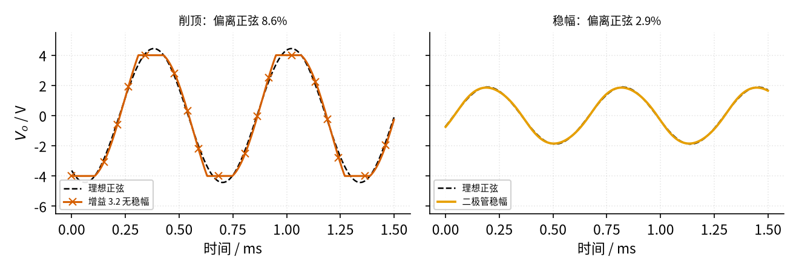
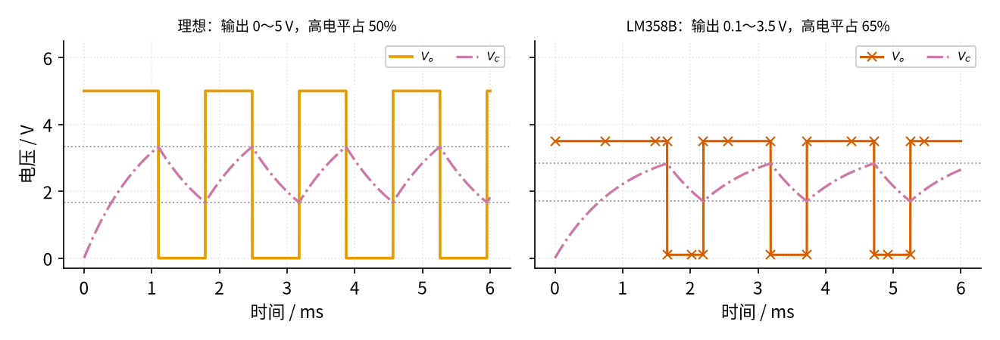

# 16 振荡器 · 参数与调试篇

[上一页：原理与实现篇](page2.md) · [直觉篇](page1.md) · [原理与实现篇](page2.md) · 本页：参数与调试篇 · [下一页：09 开关电源](../09-switching-power-supply/page1.md) · 前置节点：[14 电压比较器](../14-voltage-comparator/page1.md)、[15 有源滤波](../15-active-filter/page1.md)

## 痛点：电路"不振"或者"振得很难看"

振荡器搭好后最常见的三种抱怨：示波器上一条直线（不起振）；有波形但顶部是平的（削顶）；频率或占空比和算的不一样。这一页先用两张仿真图看"削顶"和"实际运放"的影响，再讨论倍数余量、运放速度和元件取值，最后给出故障排查表和四道练习。

## 一、削顶到底有多"不正弦"

[原理与实现篇](page2.md) 例 1 的文氏桥，如果只用 $R_f$ = 22 kΩ 而不加稳幅，波形会长到运放输出极限后被削平。我们把仿真波形与同频率、同振幅的理想正弦逐点相减，用"差值的均方根 ÷ 正弦的均方根"衡量**偏离正弦的比例**，结果见 图 16-p3-1。

*图 16-p3-1　无稳幅削顶与二极管稳幅的波形对比*

图 16-p3-1 左图：朱红色带 × 的削顶波形在 ±4 V 处被压平，和黑色虚线的理想正弦相比偏离 8.6%，而且频率被拖慢到 1562 Hz（理论 1592 Hz）。右图：二极管稳幅的橙色波形偏离只有 2.9%，频率 1589 Hz。TI 的应用笔记 SLOA060 也报告了同样的规律：输出顶到电源轨的基本文氏桥，设计 1.59 kHz、实测 1.57 kHz，失真 2.8%；换成灯泡做非线性反馈后失真低于 0.1%，用场效应管做自动增益控制（AGC）后低于 0.2%（它用的失真指标与本页的"偏离比例"算法不同，只能比较量级）。二极管稳幅也不是"完美"的：二极管导通是渐变的，波形仍有轻微变形，要更干净的正弦就用灯泡或 AGC。

## 二、真实运放让占空比跑偏

直觉篇的弛张振荡器假设输出能到 0 V 和 5 V。常用的 LM358 用 5 V 单电源时，输出高电平只有约 3.5 V（数据手册标称比电源低约 1.5 V），低电平约 0.1 V。门限是三个电压的平均值，于是变成 (5 + 0.1)/3 = 1.70 V 和 (5 + 3.5)/3 = 2.83 V，对比见 图 16-p3-2。

*图 16-p3-2　理想运放与 LM358 的弛张振荡波形对比*

图 16-p3-2 左图是理想情况：周期 1.39 ms，高电平占 50%。右图是 LM358：输出高电平变低了，电容往 3.5 V 充得慢，要爬到 2.83 V 用的时间变长；放电则朝 0.1 V 走，从 2.83 V 掉到 1.70 V 反而快。结果周期变成 1.53 ms，高电平占 65%。**占空比不是 50%，先看输出能不能到电源轨**；需要准确的 50% 就换"轨到轨"输出的运放。

## 三、几个关键参数怎么选

**1. 倍数余量：比 3 大多少**？SLOA060 的实验很能说明问题：一个刚好起振的文氏桥，把 $R_f$ 减小 0.8%，振荡就停了。也就是说"正好 3 倍"是一个非常窄的刀刃：倍数略小就停，略大就削顶。所以不要指望靠精确电阻停在 3 上，而是**故意留几个百分点到一成的余量**（本节取 3.2），再交给稳幅电路去"自动微调"。余量太大（例如 4 倍）时，稳幅元件要把倍数压下来很多，波形变形也更明显。

**2. 运放的速度：增益带宽积**。运放并不是在所有频率都一样能放大，增益带宽积 GBW 越大越"快"。SLOA060 建议文氏桥用的运放 GBW 大于振荡频率的 43 倍，并指出运放带来的额外相位延迟会让实际频率比 $1/(2\pi RC)$ 偏低。代数：本节 1592 Hz 需要 GBW 大于 43 × 1592 ≈ 68 kHz；LM358 的 GBW 约 1.2 MHz，反过来算，它做文氏桥最高大约到 1.2 MHz ÷ 43 ≈ 28 kHz。

**3. 运放的速度：压摆率**。压摆率是运放输出电压每微秒最多能变化多少伏。正弦波在过零处变化最快，峰值为 $V_p$ 、频率为 $f_0$ 时，要求压摆率大于 $2\pi V_p f_0$ （SLOA060 给出同样的条件）。代数：峰值 1.85 V、1592 Hz 需要约 0.019 V/µs；LM358 的压摆率约 0.5 V/µs，绰绰有余。但对弛张振荡器的方波，LM358 输出从 0.1 V 翻到 3.5 V 要约 3.4 ÷ 0.5 ≈ 7 µs，频率到几十千赫时边沿就明显变"斜"了。

**4. 占空比能不能调**？三个门限电阻相等时门限对称。SNOA998A 指出，改变门限那几只电阻的比例就能改变占空比；本页第二节的 LM358 例子则说明，输出电平不对称也会"无意中"改变占空比。想要稳定的 50%，先选轨到轨输出的运放，再用相等的电阻。

**5. 元件取值**。两个 $R$ 太小（几百欧），运放输出要给 RC 网络和 $R_f$ 、 $R_g$ 提供较大的电流；太大（几兆欧），运放输入电流和杂散电容的影响变大。一般先在几千欧到一百千欧里选 $R$ ，再算 $C$ 。

## 四、故障排查表

| 现象 | 原因 | 怎么查 | 怎么改 |
|---|---|---|---|
| 文氏桥输出一条直线 | 放大倍数小于 3（ $R_f \lt 2R_g$ ） | 量 $R_f$ 、 $R_g$ ，算 $1 + R_f/R_g$ | $R_f$ 取略大于 $2R_g$ ，并加稳幅 |
| 文氏桥正弦顶部被削平 | 倍数明显大于 3 且没有稳幅 | 示波器看波形顶部是否平；峰值是否贴近输出极限 | 加二极管稳幅，或把倍数调到略大于 3 |
| 频率与计算值差很多 | 两个 $R$ 或两个 $C$ 不相等；元件误差大；忘了公式里的 $2\pi$ | 用表量每个 $R$ 、 $C$ ；按 $1/(2\pi RC)$ 重算 | 换成配对的精密元件；陶瓷电容选温度稳定的 C0G（NP0）型 |
| 弛张振荡占空比不是 50% | 运放输出到不了电源轨，高低电平不对称 | 量输出高、低电平，代入三电阻平均值算门限 | 换轨到轨输出运放，或用双电源 |
| 加了稳幅后振幅很小，偶尔停振 | 倍数余量太小，二极管一导通倍数就跌到 3 以下 | 断开二极管看能否稳定起振；算小信号倍数 | 把 $R_f$ 中与二极管串联的那部分电阻加大一点，让小信号倍数到 3.1～3.3 |
| 方波边沿是斜的，频率越高越像三角波 | 运放压摆率不够，输出翻转需要几微秒 | 用示波器放大边沿，量翻转用时 | 降低频率，或换压摆率更大的运放、专用比较器 |
| 频率随温度慢慢漂移 | 电容容量随温度变化 | 用热风轻吹电容，看频率是否移动 | 换 C0G（NP0）陶瓷电容或薄膜电容 |
| 两种电路都完全不振 | 运放同相端、反相端接反，正反馈变成负反馈 | 对照电路图查 RC 网络（文氏桥）或电容（弛张）接在哪个输入端 | 文氏桥 RC 网络接同相端；弛张振荡器电容接反相端 |
| 频率偏低、波形失真 | 运放太慢（增益带宽积不够），跟不上信号 | 降低频率试试，若波形变好说明运放太慢 | 换增益带宽积更大的运放：SLOA060 建议文氏桥用的运放增益带宽积大于振荡频率的 43 倍 |

## 五、练习

**练习 1（易）** 文氏桥两个 $R$ 都换成 4.7 kΩ，两个 $C$ 仍是 10 nF，频率约多少？

答案

$f_0 = 1/(2\pi \times 4700 \times 10 \times 10^{-9}) \approx 3386$ Hz。电阻变为原来的 0.47 倍，频率变为原来的 1/0.47 ≈ 2.13 倍（1592 × 2.13 ≈ 3386）。

**练习 2（中）** 文氏桥 $R_g$ = 10 kΩ，手头有 18 kΩ 和 22 kΩ 两种电阻做 $R_f$ 。各会怎样？

答案

18 kΩ：倍数 1 + 18/10 = 2.8 < 3，信号一圈圈变小，不起振。

22 kΩ：倍数 3.2 > 3，能起振；但没有稳幅时会一直长到运放输出极限而削顶（见 图 16-p3-1 左图）。应选 22 kΩ 并加二极管稳幅。

**练习 3（提高）** 想把文氏桥做到 20 kHz、峰值 4 V，仍用 LM358（GBW 约 1.2 MHz，压摆率约 0.5 V/µs）。按本页第三节的两条要求检查，行不行？

答案

增益带宽积：需要大于 43 × 20 kHz = 860 kHz，LM358 的 1.2 MHz 勉强满足，但余量很小，实际频率会比计算值偏低。

压摆率：需要大于 $2\pi \times 4 \times 20000 \approx 0.50$ V/µs，正好等于 LM358 的 0.5 V/µs，没有任何余量，波形会被"拉斜"成近似三角波。

结论：不行。可以把峰值降到 1～2 V，或换一个更快的运放。

**练习 4（变式迁移）** 用直觉篇的弛张振荡器让 LED 每秒闪一次（1 Hz），电容取 10 µF，三个门限电阻仍相等。 $R$ 取多大？如果用 LM358 搭，闪烁会有什么变化？

答案

$T \approx 1.39RC$ = 1 s，所以 $R = 1/(1.39 \times 10 \times 10^{-6}) \approx 72$ kΩ。取常见的 75 kΩ， $T \approx 1.39 \times 0.75$ ≈ 1.04 s，约 0.96 Hz。

用 LM358 时，门限和充电目标都变了。门限只取决于电压比例，所以周期和占空比的变化比例与 图 16-p3-2 相同：周期约变为 1.53/1.39 ≈ 1.1 倍（约 1.15 s），LED 亮的时间约占 65%，不再是一半亮一半灭。

## 本页小结

**不起振先查倍数（ $R_f \geq 2R_g$ ）和正负输入端，削顶就加稳幅；"正好 3 倍"是刀刃，要留几个百分点的余量再交给稳幅；运放的增益带宽积要大于振荡频率的约 43 倍、压摆率要大于 $2\pi V_p f_0$ ；弛张振荡的占空比取决于运放能否输出到电源轨和门限电阻的比例**。
