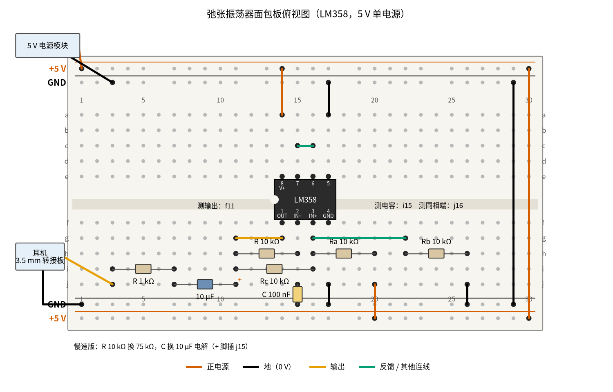
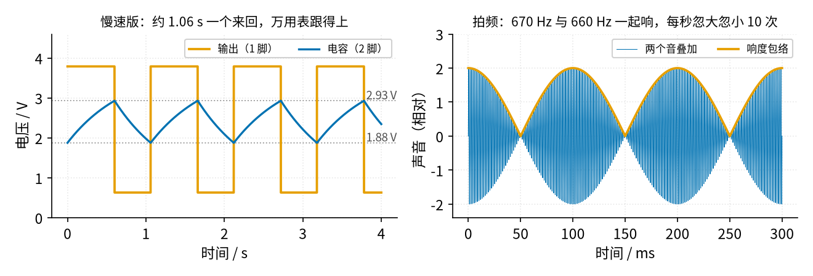

# 16 振荡器 · 动手实验篇

[上一页：参数与调试篇](page3.md) · [直觉篇](page1.md) · [原理与实现篇](page2.md) · [参数与调试篇](page3.md) · 本页：动手实验篇 · [下一页：09 开关电源 · 直觉篇](../09-switching-power-supply/page1.md) · 前置节点：[14 电压比较器 · 直觉篇](../14-voltage-comparator/page1.md)、[15 有源滤波 · 直觉篇](../15-active-filter/page1.md)

## 这次实验要验证什么

用 LM358 搭出 [16 振荡器 · 直觉篇](page1.md) 的「RC + 施密特比较器」弛张振荡器，验证 [16 振荡器 · 原理与实现篇](page2.md) 第五节的结论：**周期只由 RC 和门限决定，10 kΩ × 100 nF 振在七百赫兹左右，RC 翻倍频率减半**；再按 [16 振荡器 · 参数与调试篇](page3.md) 第二节的说法，确认真实 LM358 的高电平到不了 5 V、占空比偏离 50%。频率用耳朵和手机来判断，慢速版用万用表直接看翻转。

## ⚠️ 安全须知

- **只用 12 V 及以下的直流电**。本实验用 5 V：USB 面包板电源模块或 5 V 直流电源。LM358 第 8 脚接 +5 V、第 4 脚接地，接反芯片会发烫损坏。
- **电解电容分正负极**。耳机前面的 10 µF 隔直电容，长脚（正极）插 j11 朝运放输出（这里平均约 2.4 V），白带一侧朝耳机；慢速版的 10 µF 定时电容，正极插 j15，负极接地。电容上的电压始终在 0.6 V 以上，正向不会反。
- **元件发烫不要用手摸**。正常时所有元件都是常温；芯片烫手，马上断电查电源极性。
- **接线、改线之前先断电**：换定时电阻、换电容之前先关电源模块。
- **保护耳朵**：方波的声音比正弦刺耳得多。第一次听时先别把耳机塞进耳朵，放在桌上听；耳机必须经过 10 µF 和 1 kΩ 再接到输出。

## 器材清单

| 元件 | 型号或数值 | 数量 | 说明 |
|---|---|---|---|
| 运放 | LM358（DIP-8 直插） | 1 | A 路做振荡器，B 路接成跟随器、同相端接地 |
| 定时电阻 $R$ | 10 kΩ；另备 20 kΩ、75 kΩ | 各 1 | 后两只用于改频率和慢速版 |
| 定时电容 $C$ | 100 nF 薄膜电容（标 104） | 1 | |
| 门限电阻 $R_a$ 、 $R_b$ 、 $R_c$ | 10 kΩ，1/4 W | 3 | 把门限设在电源的约 1/3 和 2/3 |
| 电解电容 | 10 µF / 25 V | 2 | 一只做耳机隔直，一只做慢速版定时电容 |
| 电阻 | 1 kΩ，1/4 W | 1 | 耳机限流 |
| 耳机或小音箱 | 普通有线耳机，3.5 mm 母座转接板 | 1 套 | 转接板 L、R 两脚并在一起接信号 |
| 手机 | 装「音调发生器」和「调音器 / 频谱」类应用 | 1 | 用来比音高、读频率 |
| 电源 | 5 V 面包板电源模块 | 1 | |
| 万用表 | 带直流 20 V；有 Hz 挡更好 | 1 | |
| 面包板、杜邦线 | 830 孔 | 1 套 | 导线颜色尽量按下图 |

## 搭建步骤

电路就是 [16 振荡器 · 直觉篇](page1.md) 第一张图（RC + 施密特比较器组成的弛张方波振荡器）：输出经 $R$ 给电容 $C$ 充放电，电容接反相端； $R_a$ 、 $R_b$ 、 $R_c$ 三只 10 kΩ 汇在同相端，分别接 +5 V、地和输出。周期公式见 [16 振荡器 · 原理与实现篇](page2.md) 第五节。

1. **断电插芯片**。LM358 缺口朝左：第 1–4 脚插 f14、f15、f16、f17，第 8–5 脚插 e14、e15、e16、e17。
2. **接电源**。电源模块的 +5 V 接上边外侧轨、GND 接上边内侧轨；第 29 列黑线连上下地轨，第 30 列红线连上下 +5 V 轨。红线 a14 → +5 V 轨（第 8 脚），黑线 j17 → 下边地轨（第 4 脚）。
3. **处理 B 路**：黑线 a17 → 上边地轨，蓝绿色短线 c15–c16。
4. **定时部分**。橙色线 g14 → g11，把输出引到第 11 列；定时电阻 $R$ 插 h11–h15（输出到第 2 脚）；定时电容 $C$ 插 j15 和下边地轨之间。
5. **门限部分**。 $R_c$ 插 i11–i16（输出到第 3 脚）； $R_a$ 插 h16–h20，红线 j20 → 下边 +5 V 轨；蓝绿色线 g16 → g22， $R_b$ 插 h22–h26，黑线 j26 → 下边地轨。
6. **耳机部分**。10 µF 电解电容正极插 j11、负极插 j7；1 kΩ 插 i7–i3；耳机转接板信号脚接 j3，地脚接下边地轨。
7. **通电前核对**：第 8 脚接 +5 V、第 4 脚接地；电解电容的白带朝耳机一侧；三只门限电阻都插在第 16 列（第 3 脚所在列）。

下面的 图 16-p4-1 是按上面步骤画的面包板俯视图。



*图 16-p4-1　弛张振荡器的面包板接线（LM358，5 V 单电源）*

图中朱红色线接 +5 V，黑色线接地，橙色线是输出，蓝绿色线是同相端和 B 路的连线。凹槽里标出了三个测量点：输出 f11、电容 i15、同相端 j16。图下方的小字是慢速版的改法：只换两个元件。

## 测量表

「应该读到」取自 [review/spice/16.md](../review/spice/16.md) 的弛张振荡器读数表（5 V、LM358B 厂家模型）；门限、慢速版周期和听音几行由 code/figs/16_figs.py 用同一组高低电平（3.79 V / 0.63 V）计算。注意：万用表直流挡在方波上读到的是**平均值**。

| 步骤 | 测什么 | 红表笔 | 黑表笔 | 挡位 | 应该读到 | 读不到时先查 |
|---|---|---|---|---|---|---|
| ① 通电 | 电源 | a14（第 8 脚） | j17（第 4 脚） | 直流 20 V | 5.0 V | 电源模块开关、跳线帽是否在 5 V |
| ② 振荡 | 输出平均值 | f11 | 地轨 | 直流 20 V | 约 2.4 V（理想 50% 占空比时 2.5 V） | 读到约 3.8 V 或 0.6 V 不动：没振，查 $C$ 、 $R$ 是否接在第 15 列 |
| ② 振荡 | 电容平均电压 | i15（第 2 脚） | 地轨 | 直流 20 V | 约 2.4 V（在 1.86–2.95 V 之间来回） | 读到 0 V： $R$ 没接到第 11 列 |
| ② 振荡 | 同相端平均电压 | j16（第 3 脚） | 地轨 | 直流 20 V | 约 2.4 V | 读到 2.5 V 且输出不动： $R_c$ 没插 |
| ③ 频率 | 输出频率（表有 Hz 挡时） | f11 | 地轨 | Hz 挡 | 约 670 Hz（周期 1.48 ms） | 读数乱跳：表的灵敏度不够，改用手机 |
| ④ 听音 | 耳机里的音高，用手机比对 | 耳朵 | — | — | 和手机放的 670 Hz 音调几乎同音，一起响时每秒「哇哇」不到几次 | 没声音：电解电容插反、1 kΩ 没接到 j3 |
| ⑤ 改频率 | $R$ 换成 20 kΩ 后的音高 | 耳朵 / Hz 挡 | 地轨 | Hz 挡 | 低一个八度，约为原来的一半 | 音高不变：换错了 $R_c$ |
| ⑥ 慢速版 | $R$ 换 75 kΩ、 $C$ 换 10 µF 后的输出 | f11 | 地轨 | 直流 20 V | 在约 3.8 V 和 0.6 V 之间跳，约 1 s 一个来回（计算 1.06 s） | 只在一个值上停着：电解电容插反或没插到 j15 |
| ⑥ 慢速版 | 同相端（门限） | j16 | 地轨 | 直流 20 V | 在约 2.93 V 和 1.88 V 之间跳 | 只有 2.5 V：第 3 脚到输出的 $R_c$ 断了 |
| ⑥ 慢速版 | 电容电压 | i15 | 地轨 | 直流 20 V | 在 1.88 V 和 2.93 V 之间慢慢爬升、下降 | 一直往上爬到 3.8 V：同相端没接好 |
| ⑥ 慢速版 | 数 10 个来回所用时间 | 秒表 | — | — | 约 10.6 s（高约 0.60 s、低约 0.46 s） | 明显更长：电解电容容量偏大，属正常误差 |

共 11 个测量点。第 ② 步三处平均值都约 2.4 V 不是巧合：电容在两个门限之间来回，同相端在两个门限之间跳，输出在高低之间跳，它们的平均都靠近中间。

## 没有示波器怎么办

**用耳朵听频率**。670 Hz 落在人耳最敏感的范围里，接上耳机就能听到一个「嘟——」的长音。它是方波，所以听起来比纯音更「扎」，带着很多高音。要判断它到底多少赫兹，用**拍频法**：手机音调发生器放一个 600 Hz 的音，和耳机里的声音同时听，你会听到声音忽大忽小地「哇哇」响；慢慢把手机的频率往上调，「哇哇」越来越慢，调到某个频率时几乎不再起伏，这个频率就是振荡器的频率。如 图 16-p4-2 右图所示，两个音相差 10 Hz，每秒就忽大忽小 10 次；相差 2 Hz 时每秒只起伏 2 次，耳朵很容易分辨。手机里如果有调音器或频谱应用，把手机靠近耳机，屏幕上也能直接读出主频率。

**用万用表看翻转**。把 RC 放大到 0.75 s，振荡慢到约 1 s 一个来回，万用表的刷新速度就跟得上了。



*图 16-p4-2　没有示波器时看慢速版的翻转、用拍频比对频率*

左图就是你在万用表上看到的过程：输出那支表的读数在 3.8 V 和 0.6 V 之间跳，电容那支表的读数在两条门限线之间慢慢爬升、下降，碰到门限的一刻输出就翻转。右图里细蓝线是两个音叠加后的声音，橙色线是它的响度，每秒起伏的次数等于两个频率之差。

**只能讲道理的部分**。快速版方波边沿的形状、电容电压的「锯齿」弧线，以及 [16 振荡器 · 参数与调试篇](page3.md) 第二节说的高低两段不一样长，在 670 Hz 下需要示波器才能看到，左图的慢速版是它的放大版。文氏桥正弦振荡器（[16 振荡器 · 原理与实现篇](page2.md) 第一至三节）本页没有安排搭建：它的 1.56 kHz 超出多数万用表交流挡的频响，起振、削顶和稳幅的差别都要靠示波器看，读数参考 [review/spice/16.md](../review/spice/16.md) 的文氏桥一节。

## 用 Python 核对你的读数

先做慢速版，把输出高、低两个读数填进去（快速版用同一颗芯片，高低电平基本一样），再填快速版用拍频法听出的频率和慢速版 10 个来回的时间。

```python
import sys, pathlib
sys.path.insert(0, str(pathlib.Path("code/figs").resolve()))  # 在仓库根目录运行
import math

# ===== 把下面换成你自己的实测值（这里是一组示例） =====
VCC = 5.03                     # 第 8 脚对第 4 脚，V
RA, RB, RC = 9.95e3, 10.02e3, 9.98e3   # 接 +5 V、接地、接输出的三只门限电阻，Ω
VOH, VOL = 3.82, 0.62          # 慢速版输出的高、低读数，V
R_FAST, C_FAST = 10.0e3, 100e-9        # 快速版 R、C
F_HEARD = 680                  # 拍频法听出的频率，Hz
R_SLOW, C_SLOW = 75.2e3, 10.3e-6       # 慢速版 R、C
T10_SLOW = 11.2                # 慢速版 10 个来回的秒数


def check(name, measured, expected, unit):
    dev = (measured - expected) / expected * 100
    flag = "  <-- 偏差超过 10%，先按测量表最后一列排查" if abs(dev) > 10 else ""
    print(f"{name}: 实测 {measured:.3f} {unit}，计算 {expected:.3f} {unit}，偏差 {dev:+.1f}%{flag}")


def thr(vo):                   # 三只电阻汇在同相端：节点电压 = 加权平均
    return (VCC / RA + vo / RC) / (1 / RA + 1 / RB + 1 / RC)


vth, vtl = thr(VOH), thr(VOL)
k_up = math.log((VOH - vtl) / (VOH - vth))     # 充电半周 = k_up × RC
k_dn = math.log((vth - VOL) / (vtl - VOL))     # 放电半周 = k_dn × RC
k = k_up + k_dn
print(f"门限 {vtl:.2f} V / {vth:.2f} V，周期 = {k:.3f} × RC，占空比 {k_up / k * 100:.0f}%")
check("快速版频率", F_HEARD, 1 / (k * R_FAST * C_FAST), "Hz")
check("慢速版周期", T10_SLOW / 10, k * R_SLOW * C_SLOW, "s")
```

示例数据两项偏差都在 10% 以内。快速版的计算值没有考虑 LM358 输出翻转所需的时间（压摆率），所以真实频率通常比算出来的低几个百分点，[review/spice/16.md](../review/spice/16.md) 的 SPICE 结果是 670 Hz；慢速版一次翻转（约十微秒）只占周期的十万分之一左右，没有这个问题。

## 实验记录表

| 项目 | 实测值 | 计算值 | 偏差 |
|---|---|---|---|
| 电源 |  | 5.0 V | — |
| 输出平均值 |  | 约 2.4 V |  |
| 电容平均电压 |  | 约 2.4 V |  |
| 快速版频率（Hz 挡或拍频法） |  |  |  |
| $R$ = 20 kΩ 时的频率 |  |  |  |
| 慢速版输出高 / 低 |  | 3.79 V / 0.63 V |  |
| 慢速版门限高 / 低 |  |  |  |
| 慢速版周期 |  |  |  |

**思考题 1**：第 ② 步输出平均值约 2.4 V，而不是 5 V 的一半 2.5 V。这说明了什么？

<details><summary>答案</summary>

平均值 = 高电平 × 高电平所占比例 + 低电平 × 低电平所占比例。LM358 高电平只有约 3.79 V、低电平约 0.63 V，高电平约占 57%，平均约 0.57 × 3.79 + 0.43 × 0.63 ≈ 2.4 V。高低电平都没有到电源轨，而且两段时间不一样长，这正是 [16 振荡器 · 参数与调试篇](page3.md) 第二节说的「真实运放让占空比跑偏」。

</details>

**思考题 2**：拍频法里，手机放 660 Hz 时听到每秒起伏 10 次，放 680 Hz 时也是每秒 10 次。振荡器的频率是多少？只听一次能分出是 660 + 10 还是 660 − 10 吗？

<details><summary>答案</summary>

是 670 Hz。只听一次分不出：拍频只告诉你「两个频率差多少」，不告诉你谁高谁低。所以要像这样在两边各试一次，或者一边调一边听：起伏变慢说明在靠近，变快说明在远离。

</details>

**思考题 3**：想做一个每秒闪一次的「心跳灯」，用慢速版的 10 µF，定时电阻大约要多大？

<details><summary>答案</summary>

周期约等于 1.41 × RC（用 LM358 的高低电平算），要 1 s 就需要 RC ≈ 0.71 s，R ≈ 0.71 ÷ 10 µF ≈ 71 kΩ，用 68 kΩ 或 75 kΩ 都可以。真想接 LED，要另外用一个三极管或 B 路比较器去驱动，否则 LED 的电流会把输出高电平拉低、改变门限。

</details>

## 自测清单

- 我能按图在面包板上搭出弛张振荡器，并说清楚两只电解电容的正极朝哪边。
- 我能用耳机听出振荡频率，并用手机拍频法把它比对到十几赫兹以内。
- 我能用慢速版和万用表看到输出翻转、门限跳变和电容来回充放电。
- 我能用实测的高低电平算出周期，解释它为什么和理想的 1.39 × RC 不一样。
