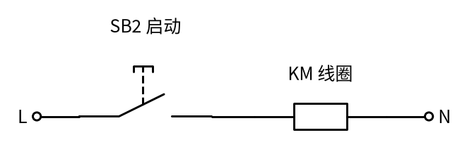
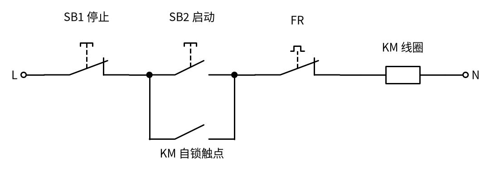
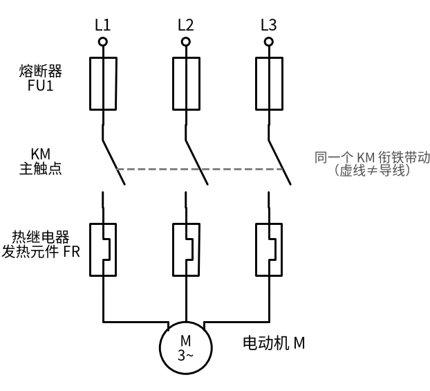
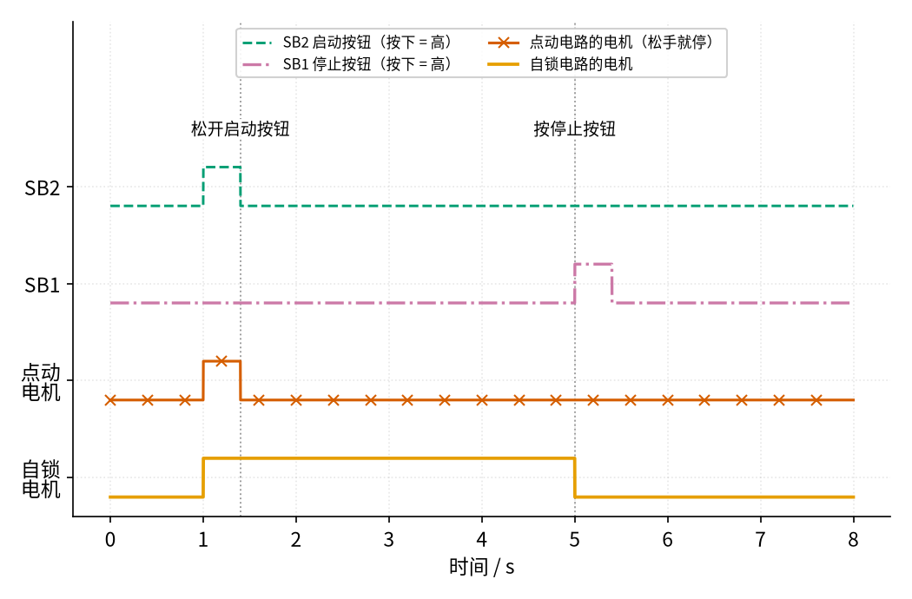

# 17 自锁控制 · 直觉篇

[上一页：P2 半导体入门 · 参数与调试篇](../P2-semiconductor-basics/page3.md) · 本页：直觉篇 · [原理与实现篇](page2.md) · [参数与调试篇](page3.md) · [下一页：原理与实现篇](page2.md) · 前置节点：[P1 元件速成](../P1-components-basics/page1.md)

> [!WARNING]
> **市电危险**：本电路的实际版本接 220V/380V 市电，触电可能致命。本页的仿真和动手实验只在 12V 以下的低压电源上进行；任何接线、改线都必须在断电并验电后操作，由持证电工完成。
>
> 本节点特有的危险点：① 电动机的主电路是 **380 V 三相**；② 控制回路（按钮、线圈）也常常直接接 **220 V 或 380 V**，按钮盒里的端子同样带电，"只是个按钮"不等于安全；③ 按下停止按钮、电机停转，只是线圈断电，**主电路和控制回路的进线仍然带电**，检修前必须断开上级断路器并验电。

## 一、痛点：一松手，电机就停了

工厂里的传送带、水泵、风机，都由三相电动机带动。电动机电流大，不能让人手直接去通断，而是用 P1 里讲过的**接触器**：按钮只管给接触器线圈通电，线圈把主触点吸合，主触点再去接通电动机。

最直接的接法是把一个启动按钮和接触器线圈串起来，看 图 17-p1-1。

*图 17-p1-1　点动控制：按钮和线圈串联*

图 17-p1-1 里只有一条路：L → 启动按钮 SB2 → KM 线圈 → N。按下按钮，路通了，线圈吸合，电机转；一松手，按钮弹回去，路断了，电机停。这种"按住才转"的方式叫**点动**，用来微调位置很好用，比如行车吊钩往下放一点点。可如果是一台要连续运行八小时的水泵，总不能让工人一直按着按钮吧？

我们想要的是：**按一下启动，松手后电机继续转；按一下停止，电机才停。**

## 二、类比：推门和顶门

想象你推开一扇很重的弹簧门：你一松手，门就自己关上——这就是点动。

现在门里站着一个帮手。你一把门推开，他马上用手把门顶住。之后你走开了，门也不会关，因为帮手在顶着它。这只"顶门的手"，就是**自锁触点**：它是接触器自己的一个常开辅助触点，接触器一吸合，它也跟着闭合，替你"按住"启动按钮。

那怎么关门？需要有人把帮手的手拍掉。这就是**停止按钮**：它平时是接通的（常闭），按一下就把整条路断开，线圈失电，帮手的手（自锁触点）也松开了。之后就算你松开停止按钮，门也不会自己再打开，因为已经没人顶着它了。

## 三、看图：自锁电路长什么样

把这个类比画成电路，就是 图 17-p1-2。

*图 17-p1-2　自锁控制回路：KM 自锁触点与启动按钮 SB2 并联*

请在 图 17-p1-2 里找三样东西。第一，**停止按钮 SB1** 是常闭的，串在最前面，平时接通。第二，**启动按钮 SB2** 是常开的，它下面并着一个 **KM 自锁触点**，两条路只要有一条通，电流就能过去。第三，**FR** 是热继电器的常闭触点，电机过载发热时它会断开，作用和"自动按停止"一样。

本书沿用电路图库里的编号：SB1 = 停止，SB2 = 启动。注意有些中文教材和电工资料的编号正好相反（SB1 启动、SB2 停止），读别的图时要先看清楚哪个是常开、哪个是常闭，别只看编号。

接触器的另一半在主电路里，看 图 17-p1-3。

*图 17-p1-3　主电路：三相电经熔断器、KM 主触点、热继电器接到电动机*

图 17-p1-3 是真正通大电流的部分，三根线之间的线电压是 380 V。三个 KM 主触点和 图 17-p1-2 里的 KM 线圈、KM 自锁触点属于**同一个接触器**：线圈一吸合，三个主触点和自锁触点同时闭合。灰色虚线只表示"被同一个衔铁带动"，不是导线。FR 在这里串的是发热元件，在控制回路里用的是它的常闭触点，同样是一个元件分在两个回路里画。

## 四、点动和自锁对比

把同样的按按钮过程分别交给点动电路和自锁电路，结果画在 图 17-p1-4。

*图 17-p1-4　同样的按钮操作：点动电路和自锁电路的电机状态对比*

图 17-p1-4 最上面蓝绿色虚线是启动按钮 SB2，第二行红紫色点划线是停止按钮 SB1，第三行朱红色带×的线是点动电路的电机，最下面橙色线是自锁电路的电机。1 s 按下启动，1.4 s 松手：点动电路在 1.4 s 立刻停了，自锁电路却一直转到 5 s 按下停止为止。

自锁还有一个"附赠"的好处。假如电机正在转，突然停电，线圈失电，自锁触点也松开了；等来电时，因为没人按启动按钮，电机**不会自己突然转起来**，避免伤人。这叫**失压保护**（也叫零压保护）。电压降得太低时线圈吸不住、也会释放，叫**欠压保护**。这两点我们在原理篇里用仿真演示。

## 一句话总结

**把接触器自己的常开辅助触点并在启动按钮两端，线圈就能"自己按住自己"；串在前面的常闭停止按钮负责把这条路剪断。**

## 参考资料

- 三线控制与自锁触点并联在启动按钮两端：<https://eepower.com/technical-articles/understanding-three-wire-control/>
- 自锁触点在手指松开前已经闭合、失压保护：<https://opentextbc.ca/basicmotorcontrol/chapter/manual-circuit/>
- 自锁（自保）触头、欠压与失压保护：<https://www.dgjs123.com/jcq/12029.htm>
- 控制回路取自 L1、L2，热继电器发热元件在主电路、常闭触点在控制回路：<https://www.jcpeixun.com/knowledge/detail/23610.html>
