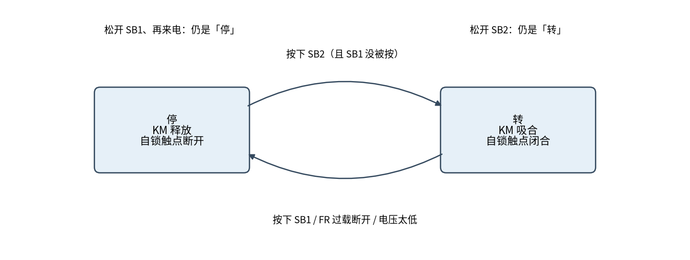
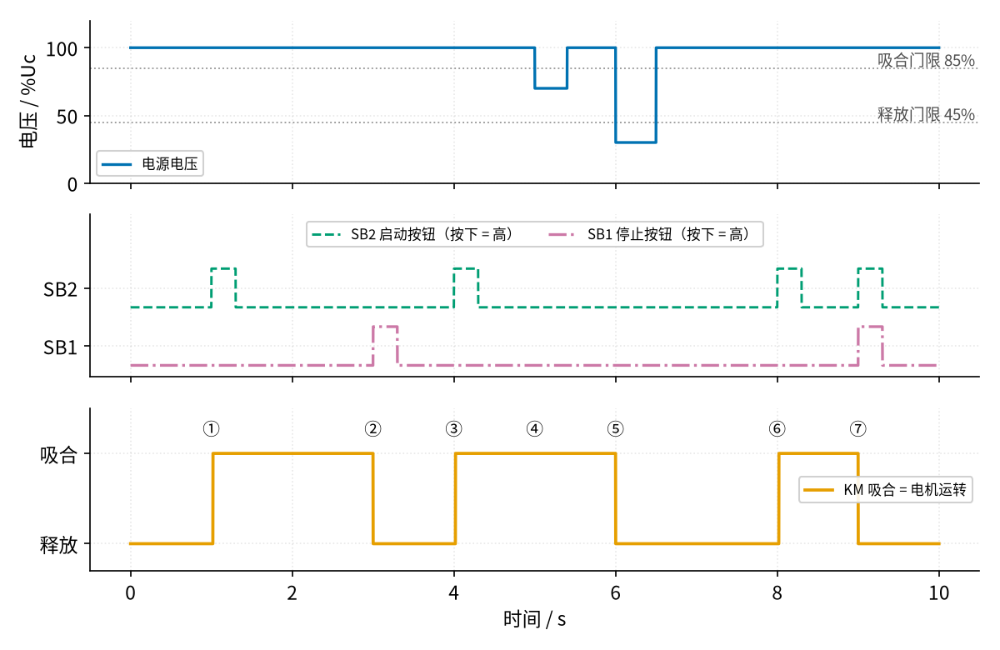
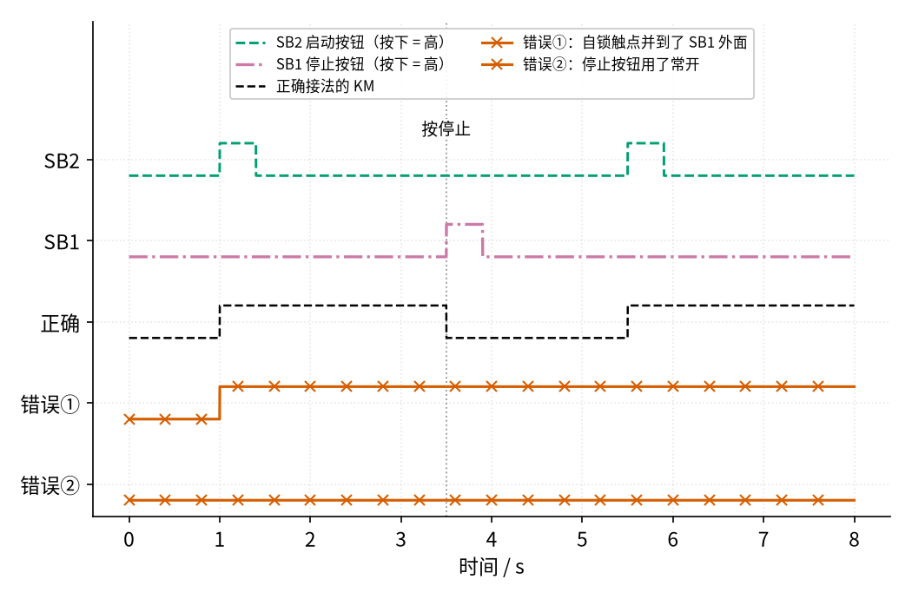

# 17 自锁 · 原理与实现篇

[上一页：直觉篇](page1.md) · [直觉篇](page1.md) · 本页：原理与实现篇 · [参数与调试篇](page3.md) · [下一页：参数与调试篇](page3.md) · 前置节点：[P1 元件速成 · 直觉篇](../P1-components-basics/page1.md)

> [!WARNING]
> **市电危险**：本电路的实际版本接 220V/380V 市电，触电可能致命。本页的仿真和动手实验只在 12V 以下的低压电源上进行；任何接线、改线都必须在断电并验电后操作，由持证电工完成。

## 一、最小知识：触点就是"是 / 否"

在控制回路里，每个触点只有两种状态：通（记作 1）或断（记作 0）。几个触点怎么连，就决定了整条路通不通：

- **串联 = "并且"**：两个触点都通，整条路才通。
- **并联 = "或者"**：两个触点只要有一个通，整条路就通。
- **常闭按钮 = "不"**：按下按钮（按钮信号为 1）时，它反而断开（通断为 0）。

我们约定：按钮按下记作 1，松开记作 0；接触器线圈吸合记作 1，释放记作 0。自锁触点是 KM 自己的常开辅助触点，所以**它的通断就等于 KM 的状态**。还要记住 P1 讲过的一点：线圈得电以后，衔铁要过一小段时间（十几到二十几毫秒）才吸合到位，触点才会动作。

## 二、推导：把电路图翻译成一行式子

**中文意思**：KM 下一刻会不会吸合？看线圈回路通不通。回路通 = 停止按钮没有被按下，**并且**（启动按钮被按下，**或者**自锁触点已经闭合）。

**写成公式**：用 $S_1$ 表示停止按钮 SB1 是否按下， $S_2$ 表示启动按钮 SB2 是否按下， $K$ 表示 KM 现在的状态， $K'$ 表示下一刻的状态：

$$
K' = \overline{S_1} \cdot (S_2 + K)
$$

这里 $\overline{S_1}$ 读作"非 $S_1$"，"·"是"并且"，"+"是"或者"。

**代数推一推**：分四种情况，把数代进去。

| 情况 | $S_1$ | $S_2$ | $K$ | $K'$ | 意思 |
|---|---|---|---|---|---|
| 停着，按启动 | 0 | 1 | 0 | $1\cdot(1+0)=1$ | 启动 |
| 转着，松开启动 | 0 | 0 | 1 | $1\cdot(0+1)=1$ | 自己保持（自锁） |
| 转着，按停止 | 1 | 0 | 1 | $0\cdot(0+1)=0$ | 停止 |
| 停着，松开停止 | 0 | 0 | 0 | $1\cdot(0+0)=0$ | 保持停 |

第二行就是自锁的全部秘密： $S_2$ 已经变回 0，可是 $K$ 本身是 1，"或者"的结果仍然是 1，于是 KM 永远把自己留在吸合状态，直到 $\overline{S_1}$ 变成 0。最后一行说明停止按钮松开后不会自己再启动。还有一种情况：两个按钮同时按， $S_1=1$ ， $K'$ 一定是 0，所以**停止优先**。

把这张表画成两个状态之间的跳转，就是 图 17-p2-1。



*图 17-p2-1　自锁电路只有两个状态：停和转*

图 17-p2-1 告诉我们：自锁电路是一个有"记忆"的电路，它记住的就是自己当前在哪个方框里。只有上面那条箭头（按下启动按钮）能把它从"停"带到"转"；下面那条箭头有三种触发方式：按停止、热继电器 FR 过载断开、电源电压低到线圈吸不住。两个方框上方的文字说明：松开按钮、来电，都不会让它换方框。

## 三、仿真：逐毫秒推演一遍

下面的程序把 10 s 切成 1 ms 一段，每一段都套用上面那行式子，再加上两个真实接触器的特性：**线圈电压到额定值的 85% 以上并坚持 20 ms 才吸合；吸合后电压降到 45% 以下才释放**。这几个数取自接触器手册的典型范围（见参数篇）。程序还模拟了两次电源故障：5 s 时电压跌到 70%，6 s 时跌到 30%（相当于停电）。

```python
# 17 自锁电路的最小仿真：把时间切成 1 ms 一小段，每一段都按"控制回路通不通 → 线圈电压够不够 → 衔铁吸没吸"推一步。
# 控制回路：电源 → SB1 停止按钮（常闭）→ [SB2 启动按钮（常开） 并联 KM 自锁触点（常开）] → KM 线圈 → 电源另一端
import sys, os                                     # 下一行让 Python 找到 code/figs 里的共享画图样式
sys.path.insert(0, os.path.join(os.path.dirname(os.path.abspath(__file__)), "figs"))
import numpy as np                                 # 数组运算
import matplotlib.pyplot as plt                    # 画图
import figstyle as fs                              # 全书统一的颜色、轴标签、保存函数

dt = 1e-3                                          # 每一小段 1 ms
t = np.arange(0, 10, dt)                           # 一共仿真 10 s
PICK, DROP = 0.85, 0.45                            # 吸合门限 85%、释放门限 45%（相对额定电压 Uc）
T_PICK = 0.020                                     # 线圈电压够了以后，衔铁还要 20 ms 才能吸合到位

def pressed(t0, t1):                               # 生成"在 t0 到 t1 秒之间按住"的按钮信号
    return (t >= t0) & (t < t1)

sb2 = pressed(1.0, 1.3) | pressed(4.0, 4.3) | pressed(8.0, 8.3) | pressed(9.0, 9.3)  # 启动按钮被按下的时段
sb1 = pressed(3.0, 3.3) | pressed(9.0, 9.3)                                          # 停止按钮被按下的时段（9 s 时两个一起按）
supply = np.ones_like(t)                           # 电源电压，用额定值的倍数表示：1 就是 100%
supply[pressed(5.0, 5.4)] = 0.70                   # 5.0 s：电压跌到 70%（还在释放门限以上）
supply[pressed(6.0, 6.5)] = 0.30                   # 6.0 s：电压跌到 30%（低于释放门限，相当于"停电"）

km = np.zeros_like(t, dtype=bool)                  # KM 衔铁状态：True = 吸合（主触点、自锁触点都闭合）
timer = 0.0                                        # 记录"线圈电压已经够了"持续了多久
for k in range(1, len(t)):
    aux = km[k - 1]                                # 自锁触点跟着衔铁走：上一刻吸合，这一刻就是闭合的
    path = (not sb1[k]) and (sb2[k] or aux)        # 回路通 = 停止按钮没被按 并且（启动按钮按着 或者 自锁触点闭合）
    v_coil = supply[k] if path else 0.0            # 回路通，线圈就拿到电源电压；不通就是 0
    if not km[k - 1]:                              # 原来没吸合：要电压 ≥ 85% 并且坚持 20 ms 才吸得上
        timer = timer + dt if v_coil >= PICK else 0.0
        km[k] = timer >= T_PICK
    else:                                          # 原来已吸合：只要电压不低于 45% 就继续吸着（这就是"回差"）
        km[k] = v_coil >= DROP
        timer = 0.0

def km_at(x):                                      # 查表：t = x 秒时 KM 是否吸合
    return bool(km[int(round(x / dt))])

t_on = t[np.argmax(km)]                            # 第一次吸合的时刻
print(f"第一次吸合：t = {t_on:.3f} s（按下启动按钮后 {(t_on - 1.0) * 1e3:.0f} ms）")
for x, want, why in [(2.0, True, "松开启动按钮后仍吸合（自锁）"), (3.5, False, "按停止后释放"),
                     (5.2, True, "电压跌到 70% 仍吸合"), (6.2, False, "电压跌到 30% 释放"),
                     (7.5, False, "来电后不会自己再启动（失压保护）"), (8.5, True, "重新按启动"),
                     (9.5, False, "启动、停止一起按：停止优先")]:
    print(f"t = {x:.1f} s：KM {'吸合' if km_at(x) else '释放'} —— {why}")
    assert km_at(x) == want                        # 每条结论都断言一遍，参数改错会直接报错
assert abs(t_on - 1.020) < 0.002                   # 吸合比按下晚 20 ms

fig, axs = plt.subplots(3, 1, figsize=(8, 5.2), sharex=True)
axs[0].plot(t, supply * 100, **fs.LS["vin"], label="电源电压")
fs.ref_h(axs[0], PICK * 100, "吸合门限 85%", x=0.995)
fs.ref_h(axs[0], DROP * 100, "释放门限 45%", x=0.995)
axs[0].set_ylim(0, 120); axs[0].set_ylabel("电压 / %Uc"); axs[0].legend(loc="lower left", fontsize=8)
axs[1].plot(t, sb2 * 1.0 + 1.5, **fs.LS["fb"], label="SB2 启动按钮（按下 = 高）")
axs[1].plot(t, sb1 * 1.0, **fs.LS["third"], label="SB1 停止按钮（按下 = 高）")
axs[1].set_yticks([0.5, 2.0]); axs[1].set_yticklabels(["SB1", "SB2"]); axs[1].set_ylim(-0.3, 3.9)
axs[1].legend(loc="upper center", fontsize=8, ncol=2)
axs[2].plot(t, km * 1.0, **fs.LS["vout"], label="KM 吸合 = 电机运转")
axs[2].set_yticks([0, 1]); axs[2].set_yticklabels(["释放", "吸合"]); axs[2].set_ylim(-0.3, 1.5)
axs[2].legend(loc="center right", fontsize=8)
for x, s in [(1.0, "①"), (3.0, "②"), (4.0, "③"), (5.0, "④"), (6.0, "⑤"), (8.0, "⑥"), (9.0, "⑦")]:
    axs[2].text(x, 1.2, s, ha="center", fontsize=10)  # 七个事件的编号，正文逐一讲解
fs.axlabels(axs[2], "时间", "s")
fs.save(fig, "17", "17_p2_2_sim.png")
```

运行后打印：

```text
第一次吸合：t = 1.019 s（按下启动按钮后 19 ms）
t = 2.0 s：KM 吸合 —— 松开启动按钮后仍吸合（自锁）
t = 3.5 s：KM 释放 —— 按停止后释放
t = 5.2 s：KM 吸合 —— 电压跌到 70% 仍吸合
t = 6.2 s：KM 释放 —— 电压跌到 30% 释放
t = 7.5 s：KM 释放 —— 来电后不会自己再启动（失压保护）
t = 8.5 s：KM 吸合 —— 重新按启动
t = 9.5 s：KM 释放 —— 启动、停止一起按：停止优先
```

设定的吸合时间是 20 ms，打印出来是 19 ms，只是因为程序按 1 ms 一格计数，第一格从按下后的下一毫秒开始算，差了一格，并不是物理现象。

结果画在 图 17-p2-2 里。



*图 17-p2-2　自锁电路逐毫秒仿真：电源电压、按钮和 KM 状态*

图 17-p2-2 最上面一行蓝色线是电源电压，两条灰色点线分别是吸合门限 85% 和释放门限 45%；中间一行蓝绿色虚线是 SB2，红紫色点划线是 SB1；最下面一行橙色线是 KM。按编号读：

- ① 1 s 按启动，19 ms 后 KM 吸合；1.3 s 松手，KM 照样吸合——自锁生效。
- ② 3 s 按停止，KM 立刻释放；松开停止后也不会再吸合。
- ③ 4 s 再按启动，又转起来。
- ④ 5 s 电压跌到 70%：低于吸合门限，但高于释放门限，已经吸合的 KM **继续吸着**。
- ⑤ 6 s 电压跌到 30%：低于释放门限，KM 释放，自锁触点也断开。6.5 s 电压恢复，但没有人按启动，KM **不会自己再吸合**——这就是失压保护。
- ⑥ 8 s 按启动，重新运行。
- ⑦ 9 s 两个按钮一起按：停止优先，KM 释放。

第 ④ 条和第 ⑤ 条放在一起看，就能明白为什么吸合门限比释放门限高：衔铁吸上以后磁路的气隙变小，维持它需要的电压比吸上它需要的低很多 [待核实]。这种"上去和下来的门限不一样"叫**回差**，参数篇会单独画出来。

## 四、两种典型接错

逻辑式还能帮我们一眼看出接错的后果，看 图 17-p2-3。



*图 17-p2-3　正确接法与两种典型错误接法的对比*

图 17-p2-3 里黑色虚线是正确接法，两条朱红色带×的线是错误接法：

- **错误①：自锁触点的并联点接错了位置**，并到了"SB1 和 SB2 串联"的两端，绕过了停止按钮。式子变成 $K' = \overline{S_1}\cdot S_2 + K$ ：一旦 $K=1$ ，不管怎么按停止， $K'$ 都是 1。图中 3.5 s 按停止，它纹丝不动，只能拉闸。
- **错误②：停止按钮用了常开触点**。式子变成 $K' = S_1\cdot(S_2 + K)$ ：平时 $S_1=0$ ，整条路永远是断的，按启动没有反应。

所以接完线，第一件事就是用逻辑式核对：停止按钮必须是常闭、必须串在最前面，自锁触点必须只并在启动按钮两端。

## 五、渐隐例题

**例 1（完整示范）**：电机正在运转，这时热继电器 FR 因过载断开，过了一会儿 FR 冷却后自动复位。电机会怎样？

解：FR 常闭触点和 SB1 串在一起，作用相当于又一个"非"。FR 断开那一刻，回路断了， $K'=0$ ，KM 释放，自锁触点断开。FR 复位后， $S_2=0$ 、 $K=0$ ，所以 $K' = 1\cdot(0+0) = 0$ ，电机**不会**自己重新启动，需要人检查原因后再按启动。这和失压保护是同一个道理。

**例 2（留空）**：如果误把自锁触点并在了"SB1 + SB2"整体的两端（错误①），写出逻辑式： $K' =$ ____。电机运转时按下停止按钮，代入 $S_1=1$ 、 $S_2=0$ 、 $K=1$ ，得 $K' =$ ____，所以电机 ____（会 / 不会）停下来。

<details><summary>答案</summary>

$K' = \overline{S_1}\cdot S_2 + K$ ；代入得 $0\cdot 0 + 1 = 1$ ；电机**不会**停下来。

</details>

**例 3（变体迁移）**：在 KM 线圈两端并联一盏运行指示灯 HL1，再用 KM 的一个**常闭**辅助触点串一盏停机指示灯 HL2 接在 L、N 之间。分别写出 HL1、HL2 亮不亮的逻辑式，并说明电机运转时哪盏灯亮。

<details><summary>答案</summary>

HL1 和线圈并联，线圈有电它就亮： $HL_1 = K$ 。HL2 串的是 KM 常闭触点，KM 释放时才接通： $HL_2 = \overline{K}$ 。电机运转时 $K=1$ ，HL1 亮、HL2 灭；停机时反过来。两盏灯永远一亮一灭，正好可以用来检查 KM 是否真的动作了。

</details>

## 六、低压动手实验

> [!WARNING]
> **市电危险**：本电路的实际版本接 220V/380V 市电，触电可能致命。本页的仿真和动手实验只在 12V 以下的低压电源上进行；任何接线、改线都必须在断电并验电后操作，由持证电工完成。
>
> 本实验只用 **12 V 直流电源（或电池组）+ 线圈 12 V 的小继电器**，绝对不要把它接到插座上，也不要拿真接触器去试。

器材：12 V 电源、一个线圈 12 V 且有两组常开触点的小继电器、一个常闭按钮（停止）、一个常开按钮（启动）、一个 LED 加 1 kΩ 电阻（代替电动机）、一只 1N4007 二极管反并在继电器线圈两端（P1 讲过：电感断电会产生高压尖峰）。

接法：照着直觉篇里那张自锁控制回路图把控制回路接好，L 换成 12 V 正极，N 换成负极，FR 省略；继电器第一组常开触点并在启动按钮两端作自锁，第二组常开触点串 LED 和电阻接在电源上作"电机"。验证：按一下启动，LED 常亮；按一下停止，LED 灭；拔掉电源再插上，LED 不会自己亮。

## 参考资料

- 自锁触点与启动按钮并联、停止优先：<https://eepower.com/technical-articles/understanding-three-wire-control/>
- 自锁触点在手指离开按钮前已经闭合、失压保护：<https://opentextbc.ca/basicmotorcontrol/chapter/manual-circuit/>
- 欠压释放、失压（零压）保护：<https://www.dgjs123.com/jcq/12029.htm>
- 停止按钮用常闭、串联的原因（导线断了也会让电机停，属于故障安全设计）：<https://workforce.libretexts.org/Bookshelves/Electronics_Technology/Electric_Circuits_IV_-_Digital_Circuitry_(Kuphaldt)/06%3A_Ladder_Logic/6.05%3A_Fail-safe_Design>
- 接触器吸合 / 释放电压和吸合时间（施耐德 TeSys D 手册）：<https://nanologicautomation.com/pdf/switch-gears/contractors/Schneider-Contactors-TesysD-Nano-Logic-Automation.pdf>
