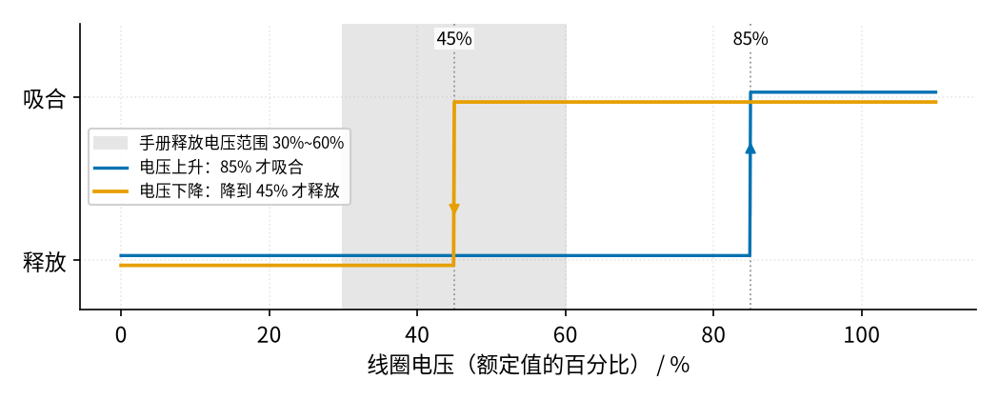
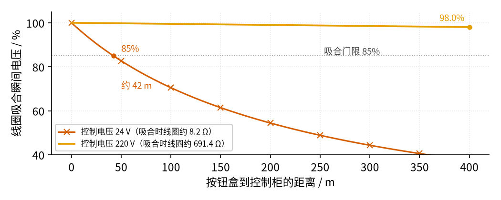
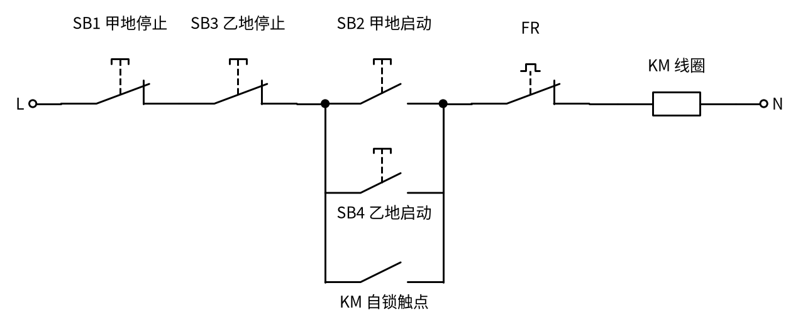

# 17 自锁 · 参数与调试篇

[上一页：原理与实现篇](page2.md) · [直觉篇](page1.md) · [原理与实现篇](page2.md) · 本页：参数与调试篇 · [下一页：01 反相放大 · 直觉篇](../01-inverting-amp/page1.md) · 前置节点：[P1 元件速成 · 直觉篇](../P1-components-basics/page1.md)

> [!WARNING]
> **市电危险**：本电路的实际版本接 220V/380V 市电，触电可能致命。本页的仿真和动手实验只在 12V 以下的低压电源上进行；任何接线、改线都必须在断电并验电后操作，由持证电工完成。
>
> 排查故障时尤其注意：控制回路断开（按了停止）≠ 主电路断电；量电压、拆按钮盒之前，必须断开上级断路器并用验电笔确认无电。下面"怎么查"一栏里凡是要带电测量的步骤，都只能由持证电工完成。

## 一、关键参数

自锁电路本身的"设计"很简单，真正要选的是接触器线圈和按钮。下表列出与本节点相关的参数，数值以施耐德 TeSys D 系列小型接触器（LC1D09～D25）的手册为例。

| 参数 | 典型值 | 对自锁电路的影响 |
|---|---|---|
| 线圈额定电压 Uc | 24 V、110 V、220 V、380 V 等，交流或直流 | 必须和控制回路电源一致；接错电压不是吸不上就是烧线圈 |
| 吸合电压 | 0.85～1.1 Uc（50/60 Hz 通用线圈用在 60 Hz 时；只用于 50 Hz 或只用于 60 Hz 的线圈是 0.8～1.1 Uc） | 电压低于下限，按启动可能吸不上或抖动 |
| 释放电压 | 0.3～0.6 Uc | 电压跌到这个范围以下，KM 释放，实现欠压 / 失压保护 |
| 吸合时间 | 12～22 ms（D25 为 15～24 ms） | 按钮只要按住比这长，自锁触点就来得及闭合 |
| 释放时间 | 4～19 ms | 按停止后主触点多久断开 |
| 线圈功率（交流） | 吸合瞬间约 70 VA，保持约 7 VA | 吸合瞬间电流大，长导线上的压降主要发生在这时 |
| 辅助触点 | 至少一个常开（作自锁） | 自锁、指示灯、互锁都要占用辅助触点 |

国际标准 IEC 60947-4-1 对接触器的要求也是 0.85～1.1 Uc 范围内可靠吸合；ABB 的手册给出的释放电压范围是 0.20～0.75 Uc。不同厂家、不同型号差别很大，实际使用请以手头型号的手册为准。原理篇的仿真用了 85% 吸合、45% 释放，就是从这些范围里挑的典型值。

### 1. 回差：吸合门限和释放门限不一样

把线圈电压从 0 慢慢升到 110%，再慢慢降回 0，KM 的状态画在 图 17-p3-1。

*图 17-p3-1　接触器的回差：上升到 85% 才吸合，下降到 45% 才释放*

图 17-p3-1 里蓝色线是电压上升的路径，到 85% 才跳到"吸合"；橙色线是电压下降的路径，一直保持吸合，降到 45% 才跳回"释放"。灰色阴影是手册给出的释放范围 30%～60%。中间这一段（比如 70%）KM 是吸合还是释放，**取决于它原来的状态**，这正是原理篇仿真里事件 ④ 的情况：已经在转的电机，电压跌到 70% 还能继续转；可如果这时按启动，KM 却吸不上。

### 2. 控制线太长：吸合瞬间的压降

按钮盒常常装在离控制柜很远的地方，线圈电流要走"去一根、回一根"两倍长的导线。吸合瞬间线圈功率约 70 VA，如果控制电压只有 24 V，电流就有约 3 A，导线电阻上的压降不能忽略。图 17-p3-2 是用 1 mm² 铜线（电阻率 0.01724 Ω·mm²/m）估算的结果。

*图 17-p3-2　控制线长度对线圈吸合电压的影响（1 mm² 铜线）*

图 17-p3-2 里朱红色带×的线是 24 V 控制：把吸合瞬间的线圈看成约 8.2 Ω 的负载，距离约 42 m 时线圈电压就降到 85%，再远就可能吸不上或抖动。橙色线是 220 V 控制：线圈约 691.4 Ω，同样的电流功率下电流只有 24 V 时的约九分之一，400 m 处仍有 98.0%。这个估算把线圈阻抗和导线电阻直接相加，忽略了相位，所以算出来的压降偏大，是偏保守的。这就是很多现场把控制电压选成 220 V 的原因之一；如果必须用低压控制，就要加粗导线或者在近处加一级中间继电器。

## 二、故障排查

| 现象 | 原因 | 怎么查 | 怎么改 |
|---|---|---|---|
| 按住启动才转，一松手就停 | 自锁触点没接、接成了常闭，或接到了别的接触器上 | 断电后用万用表蜂鸣档量 SB2 两端：按下 KM 衔铁（手动压下）时应导通 | 用 KM 自己的常开辅助触点，只并在 SB2 两端 |
| 按停止停不下来 | 自锁触点并到了 SB1 外面（并联点位置错），或 SB1 触点熔焊 | 对照图纸看自锁触点两端分别接在哪里；断电量 SB1 是否能断开 | 把自锁触点的一端改接到 SB1 之后；更换损坏的按钮 |
| 按启动完全没反应 | 停止按钮误用了常开触点；FR 已脱扣没复位；线圈电压与电源不符；熔断器断 | 断电量 SB1 平时是否导通；看 FR 复位按钮；核对线圈铭牌电压 | SB1 改用常闭触点；查明过载原因后复位 FR；换对电压的线圈 |
| 一送电电机就自己转 | 用了带自锁的"旋钮 / 拨动开关"代替按钮（二线控制），没有失压保护 | 看启动元件是不是会弹回的按钮 | 改用会自动复位的按钮加自锁触点（三线控制） |
| 接触器嗡嗡响、抖动 | 线圈电压偏低，处在吸合门限附近；交流接触器短路环断裂 | 由持证电工在吸合时测量线圈两端电压，与 85% Uc 比较 | 查电源和接线压降；更换接触器 |
| 近处正常，远处的按钮盒按了吸不上 | 低压控制线太长，吸合瞬间压降过大 | 按本页的估算，用距离、线径、线圈功率算压降 | 加粗导线、提高控制电压，或就近加中间继电器 |
| 运行一段时间后自己停，过一会又能启动 | 电机过载，FR 动作 | 看 FR 是否脱扣；查负载、电流 | 排除机械卡阻；按电机额定电流整定 FR |

最后一行里提醒一句：FR 是**过载**保护，动作要几秒到几分钟；它不能代替熔断器或断路器做短路保护。

## 三、练习

**练习 1**：电机停着。小明先按住停止按钮不放，再按下启动按钮，然后先松开启动按钮，最后松开停止按钮。电机会转吗？用原理篇的逻辑式说明。

答案

不会转。按住停止时 $S_1=1$ ，不管 $S_2$ 是什么， $K' = 0\cdot(S_2+K) = 0$ 。松开启动按钮后 $S_2=0$ 、 $K=0$ ；再松开停止时 $K' = 1\cdot(0+0) = 0$ ，仍然停着。

**练习 2**：某控制回路用 220 V 线圈的接触器，吸合门限 85%、释放门限 45%。电网电压跌到 180 V 时：(a) 原来停着的电机按启动能否启动？(b) 原来在转的电机会不会停？

答案

180 ÷ 220 ≈ 82%。(a) 82% 低于吸合门限 85%，可能吸不上，按启动不一定能启动，还可能抖动；(b) 82% 高于释放门限 45%，已经吸合的接触器继续吸着，电机不会停。这就是回差的作用。

**练习 3**：图 17-p3-2 用的是 1 mm² 导线。如果 24 V 控制改用 1.5 mm² 导线，吸合电压降到 85% 的距离变成多少？（提示：导线电阻和截面积成反比。）

答案

导线电阻变为原来的 1/1.5，允许的距离就变成 1.5 倍：约 42 m × 1.5 ≈ 63 m（画图脚本打印的精确值是 63 m）。加粗导线有用，但改成 220 V 控制效果大得多。

**练习 4（变体迁移）**：一台水泵要求在"甲地"（控制柜旁）和"乙地"（泵房）都能启动、都能停止。只给你两个常闭停止按钮 SB1、SB3 和两个常开启动按钮 SB2、SB4，画出控制回路。提示：想一想"并且"和"或者"分别对应停止和启动。

答案

任何一个停止按钮按下都要停，所以两个停止按钮**串联**（并且）；任何一个启动按钮按下都要启动，所以两个启动按钮和 KM 自锁触点三者**并联**（或者）。逻辑式是 $K' = \overline{S_1}\cdot\overline{S_3}\cdot(S_2 + S_4 + K)$ ，接法如 图 17-p3-3。

*图 17-p3-3　两地控制：停止按钮串联，启动按钮与自锁触点并联*

图 17-p3-3 里最上面一行是两个串联的停止按钮，中间是三条并联的路：SB2、SB4 和 KM 自锁触点。乙地的两根按钮线要从控制柜拉过去，如果是低压控制，还要按练习 3 的方法核算导线压降。

## 参考资料

- 施耐德 TeSys D 接触器手册（吸合 / 释放电压、吸合 / 释放时间、线圈功率）：<https://nanologicautomation.com/pdf/switch-gears/contractors/Schneider-Contactors-TesysD-Nano-Logic-Automation.pdf>
- ABB 手册引用的 IEC 60947-4-1 吸合范围与释放电压范围：<https://www.ourdoconline.com/lpcp/1SBC100192C02/files/basic-html/page109.html>
- 铜导线电阻率 0.017241 Ω·mm²/m（IEC 60028）：<https://www.cabledatasheet.com/general-cable-information/notes-from-iec-60028/>
- 三线控制与二线控制（旋钮开关来电自启）：<https://eepower.com/technical-articles/understanding-three-wire-control/>
- 热继电器是过载保护、不是短路保护：<https://www.jcpeixun.com/knowledge/detail/23610.html>
