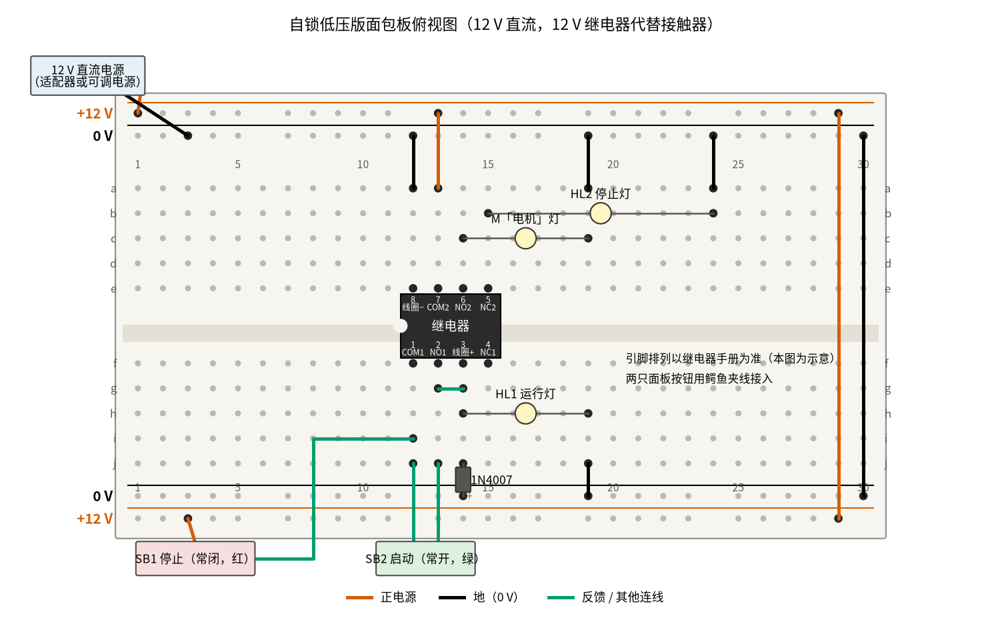
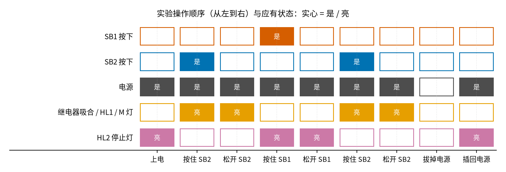

# 17 自锁 · 动手实验篇

[上一页：参数与调试篇](page3.md) · [直觉篇](page1.md) · [原理与实现篇](page2.md) · [参数与调试篇](page3.md) · 本页：动手实验篇 · [下一页：01 反相放大 · 直觉篇](../01-inverting-amp/page1.md) · 前置节点：[P1 元件速成 · 直觉篇](../P1-components-basics/page1.md)

> [!WARNING]
> **市电危险：不要接 220 V/380 V，市电接线请电工。** 本页只做 12 V 直流低压版：用 12 V 继电器代替接触器，用 12 V 小灯泡代替电动机。真实的自锁电路接在 220 V/380 V 市电上，触电可能致命；任何接市电的接线、改线，都必须断电、验电后由持证电工完成。不要把本页的电路接到插座上，也不要拿真接触器来试。

## 这次实验要验证什么

用一只 12 V 继电器、两个按钮和三只小灯泡，亲手验证 [17 自锁 · 原理与实现篇](page2.md) 第二节的那一行式子 $K' = \overline{S_1}\cdot(S_2 + K)$ ：**按一下启动就一直转，按一下停止就停，断电再来电不会自己转**（失压保护）。本页是 [17 自锁 · 原理与实现篇](page2.md) 第六节「低压动手实验」的展开版：接法相同，多加了运行灯、停止灯和逐点测量。

## ⚠️ 安全须知

- **只用 12 V 及以下的直流电**：12 V 直流适配器、12 V 可调直流电源，或者 8 节五号电池串联。**不要接 220 V/380 V，市电接线请电工。**
- 本实验没有电解电容；但 **1N4007 二极管有方向**：带白圈的一端（阴极）接继电器线圈的正端，另一端接 0 V。接反了，一通电就是把 12 V 直接短路，二极管会烫手。
- **发热元件不要摸**：小灯泡点亮几分钟后玻璃壳很烫；继电器线圈长时间通电也会温热，这是正常的。
- **接线、改线前先断电**：拔掉适配器插头（或关掉可调电源输出）再动导线。可调电源先把电流限制调到 0.5 A 左右，短路时它会自动限流。
- 继电器、按钮的触点电流要大于灯泡电流。12 V、1 W 的小灯泡电流约 1 ÷ 12 ≈ 0.08 A，普通小继电器和面包板都承受得了；不要换成汽车大灯泡。

## 器材清单

| 元件 | 型号或数值 | 数量 | 说明 |
|---|---|---|---|
| 继电器 KA | 线圈 12 V 直流、双刀双掷（两组转换触点）、可插面包板 | 1 | 代替接触器 KM；第一组常开作自锁，第二组的常开接「电机」灯、常闭接停止灯 |
| 停止按钮 SB1 | 自复位常闭按钮（红色） | 1 | 面板式按钮，用鳄鱼夹线接入 |
| 启动按钮 SB2 | 自复位常开按钮（绿色） | 1 | 也可以用面包板轻触按键 |
| 二极管 | 1N4007 | 1 | 反并在线圈两端，吸收断电时的电压尖峰 |
| 小灯泡 M | 12 V、1 W 以下，带灯座 | 1 | 代替电动机；也可按第六节用 LED 加 1 kΩ |
| 运行灯 HL1 | 12 V 小灯泡 | 1 | 并在线圈上，继电器吸合时亮 |
| 停止灯 HL2 | 12 V 小灯泡 | 1 | 串继电器常闭触点，停机时亮 |
| 电源 | 12 V 直流适配器或可调直流电源 | 1 | 做失压演示需要可调电源 |
| 万用表 | 带直流 20 V、200 mV、电阻挡、蜂鸣挡 | 1 | |
| 面包板、杜邦线、鳄鱼夹线 | 830 孔 | 1 套 | 导线颜色尽量按下图 |

## 搭建步骤

电路就是 [17 自锁 · 直觉篇](page1.md) 第三节的自锁控制回路图：L 换成 +12 V，N 换成 0 V，热继电器 FR 省略，KM 换成继电器 KA。每一步都在**断电**状态下完成。

1. **插继电器**。继电器跨在凹槽上，左端在第 12 列。下排 f12 是第一组公共端 COM1、f13 是第一组常开 NO1、f14 是线圈正端、f15 是第一组常闭 NC1（不用）；上排 e12 是线圈负端、e13 是第二组公共端 COM2、e14 是第二组常开 NO2、e15 是第二组常闭 NC2。**不同型号的引脚排列不一样**，先用万用表蜂鸣挡和手册确认：不通电时 COM 和 NC 之间响，COM 和 NO 之间不响。
2. **接电源轨**。适配器正极接上边外侧轨（+12 V），负极接上边内侧轨（0 V）；第 29 列红线连上下 +12 V 轨，第 30 列黑线连上下 0 V 轨。
3. **线圈和二极管**。黑线 a12 → 上边 0 V 轨（线圈负端）；蓝绿色短线 g13–g14（NO1 接线圈正端，这一点就是「启动后的那一侧」）。1N4007 插在 j14 和下边 0 V 轨之间，白圈朝 j14。
4. **停止按钮 SB1（常闭）**。一根线从下边 +12 V 轨 B+3 接到 SB1 的一端，SB1 的另一端用蓝绿色线接到 i12（COM1）。
5. **启动按钮 SB2（常开）**。SB2 两端分别接 j12（COM1）和 j13（NO1）。这样 SB2 和自锁触点 COM1–NO1 并联，符合 [17 自锁 · 原理与实现篇](page2.md) 第四节说的「自锁触点只并在启动按钮两端」。
6. **运行灯 HL1**。插在 h14–h19，黑线 j19 → 下边 0 V 轨。它和线圈并联，线圈有电它就亮。
7. **「电机」灯和停止灯**。红线 a13 → 上边 +12 V 轨（COM2）；M 灯插 c14–c19，黑线 a19 → 0 V 轨；HL2 停止灯插 b15–b24，黑线 a24 → 0 V 轨。
8. **通电前核对**：用万用表电阻挡量 +12 V 轨和 0 V 轨之间，应该是几百欧以上（灯泡冷态电阻和线圈），不能是 0 Ω；二极管白圈朝 j14。

下面的 图 17-p4-1 是按上面步骤画的面包板俯视图。



*图 17-p4-1　自锁低压版的面包板接线（12 V 直流，12 V 继电器代替接触器）*

面包板图上看不出哪根线属于控制回路、哪根属于灯的回路，先对照 图 17-p4-3 的电路原理图把两条回路分开，再核对接线。


*图 17-p4-3　图 17-p4-1 对应的电路原理图（灰色小字是面包板孔位和继电器引脚，蓝绿、朱红色与面包板图导线一致，点线是「磁力带动」，不是导线）*

**对照看**：面包板的连通规则见 [P1 元件速成 · 动手实验篇](../P1-components-basics/page4.md)：同一列的 a–e、f–j 各自连通，凹槽两边不通。继电器跨在凹槽上，所以第 12 列下半区是 COM1，上半区却是线圈负端；SB1 的蓝绿线插 i12、SB2 的一端插 j12，都落在 COM1 这一列，SB2 另一端插 j13，正好和自锁触点 COM1–NO1 两头相接，于是两者在原理图里并联。第 14 列下半区是线圈正端，蓝绿短线 g13–g14、1N4007 的阴极 j14 和 HL1 的 h14 都插在这里，所以二极管和运行灯都并在线圈两端；上半区第 14、15 列分别是 NO2、NC2，M 灯和 HL2 只走右边的负载回路，和线圈之间没有导线，只靠点线表示的磁力带动。原理图的控制回路就是 [17 自锁 · 直觉篇](page1.md) 「三、看图：自锁电路长什么样」里的那张图，把 L 换成 +12 V、N 换成 0 V；它对应的式子见 [17 自锁 · 原理与实现篇](page2.md) 「二、推导：把电路图翻译成一行式子」。

图中朱红色线接 +12 V，黑色线接 0 V，蓝绿色线是控制回路里按钮、触点之间的连线。两只按钮画在面包板外面，因为面板式按钮要用鳄鱼夹线接进来。继电器芯片体上的脚名只是示意，以你手里那只继电器的手册为准。

## 测量表

「应该读到」取自 [review/spice/17.md](../review/spice/17.md) 的「面包板低压版」读数表；吸合 / 释放电压一行按常见 12 V 小继电器手册的比例（吸合不大于 75%、释放不小于 10%）换算。

| 步骤 | 测什么 | 红表笔 | 黑表笔 | 挡位 | 应该读到 | 读不到时先查 |
|---|---|---|---|---|---|---|
| ① 上电 | 电源 | 上边 +12 V 轨 | 上边 0 V 轨 | 直流 20 V | 12 V | 断电，查适配器插头和两条轨的跨接线 |
| ② 停机 | 线圈电压 | j14（线圈正端） | 0 V 轨 | 直流 20 V | 0 V；HL2 亮，两端 12 V | 线圈有电：断电，查 SB2 是否接成了常闭 |
| ③ 启动 | 按一下 SB2 再松开后的线圈电压 | j14 | 0 V 轨 | 直流 20 V | 约 12 V（自锁保持），HL1、M 灯亮，HL2 两端 0 V | 一松手就灭：断电，查 g13–g14 和 j13 两处 |
| ③ 启动 | 运转时 SB2 两端 | j12 | j13 | 直流 200 mV | ≈ 0 mV（被自锁触点短接） | 读到 12 V：自锁触点没闭合，断电后查 COM1、NO1 |
| ③ 启动 | 运转时 SB1 两端 | SB1 进线端 | i12 | 直流 200 mV | ≈ 0 mV（常闭，导通） | 读到 12 V：断电，SB1 用成了常开 |
| ④ 停止 | 按住 SB1 时 SB1 两端 | SB1 进线端 | i12 | 直流 20 V | ≈ 12 V，继电器「咔」地释放，HL2 亮 | 停不下来：断电，自锁触点并到了 SB1 外面 |
| ⑤ 失压 | 运转中拔掉电源再插回，线圈电压 | j14 | 0 V 轨 | 直流 20 V | 0 V，不会自己吸合，HL2 亮 | 自己又转起来：断电，查 SB2 是否被短接 |
| ⑥ 失压（可调电源） | 运转中把电压降到约 4 V 再调回 12 V | j14 | 0 V 轨 | 直流 20 V | 降压后为 0 V；调回 12 V 后仍为 0 V | 降到 4 V 仍吸着：继电器释放电压更低，再往下调 |
| ⑦ 吸合 / 释放（可调电源，选做） | 按住 SB2，从 0 V 慢慢升到「咔」一声；再慢慢降到释放 | 电源输出 | 电源 − | 直流 20 V | 吸合不高于约 9 V（75%），释放不低于约 1.2 V（10%），以手册为准 | 12 V 还不吸：断电，查线圈两端是否接反、二极管是否短路 |
| ⑧ 断电检查 | 自锁触点 COM1–NO1 | f12 一侧（i12） | j13 | 蜂鸣挡 | 平时不响；用手压下衔铁时响 | 一直响：断电，触点粘连或引脚认错 |
| ⑧ 断电检查 | 线圈电阻 | j14 | a12 | 电阻 2 kΩ | 按继电器规格，12 V 小继电器一般几百欧 | 0 Ω：二极管反了；无穷大：线圈断 |

共 11 个测量点。注意第 ⑧ 步量线圈电阻时，二极管、HL1 都和线圈并联，读数会比单独量线圈小；要量准，先把 HL1 拔掉。

## 没有示波器怎么办

这个节点的大部分现象本来就是「亮 / 灭」「咔 / 不咔」，**灯和继电器的声音就是你的显示器**。按 图 17-p4-2 的顺序一格一格地操作，每做一步就对照一次三只灯的状态。



*图 17-p4-2　实验操作顺序与三只灯应有的状态*

图中每一列是一个操作，每一行是一个按钮或一只灯，实心格表示「按下」「有电」或「亮」。它由 code/figs/17_figs.py 按 $K' = \overline{S_1}\cdot(S_2 + K)$ 逐步推出来，和 [17 自锁 · 原理与实现篇](page2.md) 第三节逐毫秒仿真图的结论一致。最后两列就是失压保护：来电以后继电器不吸合，只有停止灯亮。

**只能讲道理的部分**：继电器从通电到吸合只要几毫秒到十几毫秒，没有 1N4007 时断开瞬间线圈两端的高压尖峰只有微秒级，都快得万用表来不及读，只有示波器能看到。尖峰的波形对比见 [P1 元件速成 · 原理与实现篇](../P1-components-basics/page2.md) 第五节。本实验**不要**为了「看尖峰」拔掉二极管：尖峰虽然只有微秒级，但会在触点和按钮上打火，缩短寿命。接触器那种 85% 吸合、45% 释放的回差，你可以用第 ⑦ 步的可调电源做一个继电器版：升、降两次的读数不一样，就是 [17 自锁 · 参数与调试篇](page3.md) 第一节回差曲线的低压版本，只是比例换成了继电器手册上的数。

## 用 Python 核对你的读数

先把你每一步看到的「继电器有没有吸合」按 0 / 1 填进去，代码按逻辑式推一遍，告诉你哪一步和理论不符；再填线圈电阻和吸合、释放电压，换算成百分比并检查偏差。

```python
import sys, pathlib
sys.path.insert(0, str(pathlib.Path("code/figs").resolve()))  # 在仓库根目录运行

# ===== 把下面换成你自己的实测值（这里是一组示例） =====
STEPS = ["上电", "按住 SB2", "松开 SB2", "按住 SB1", "松开 SB1", "拔电源", "插回电源"]
S1 = [0, 0, 0, 1, 0, 0, 0]          # 1 = 按住停止
S2 = [0, 1, 0, 0, 0, 0, 0]          # 1 = 按住启动
PWR = [1, 1, 1, 1, 1, 0, 1]         # 1 = 有电
SEEN = [0, 1, 1, 0, 0, 0, 0]        # 你看到的：1 = 继电器吸合 / HL1 亮
V_SUPPLY = 12.1                     # 电源实测，V
V_COIL_RUN = 11.9                   # 运转时线圈电压实测，V
R_COIL = 400                        # 拔掉 HL1 后量到的线圈电阻，Ω
V_PICK, V_DROP = 8.2, 2.9           # 第 ⑦ 步：吸合电压、释放电压，V
V_RATED = 12.0                      # 线圈额定电压，V

k = 0
for name, a, b, p, seen in zip(STEPS, S1, S2, PWR, SEEN):
    k = int(p and (not a) and (b or k))      # K' = 电源 · 非S1 · (S2 + K)
    mark = "" if k == seen else "  <-- 和理论不符，断电后按测量表查线"
    print(f"{name}: 理论 {k}，你看到 {seen}{mark}")

dev = (V_COIL_RUN - V_SUPPLY) / V_SUPPLY * 100
flag = "  <-- 偏差超过 10%，触点或导线接触不良" if abs(dev) > 10 else ""
print(f"线圈电压: 实测 {V_COIL_RUN:.2f} V，计算 {V_SUPPLY:.2f} V，偏差 {dev:+.1f}%{flag}")
print(f"线圈电流约 {V_COIL_RUN / R_COIL * 1000:.0f} mA，功率约 {V_COIL_RUN ** 2 / R_COIL:.2f} W")
pick, drop = V_PICK / V_RATED * 100, V_DROP / V_RATED * 100
print(f"吸合 {pick:.0f}%（手册上限 75%）、释放 {drop:.0f}%（手册下限 10%）")
if pick > 75 or drop < 10:
    print("  <-- 超出常见手册范围，先核对你那只继电器的手册")
```

示例数据里，逻辑七步全部吻合，线圈电压偏差 −1.7%，吸合 68%、释放 24%，都在手册范围内。示例的 400 Ω 只是举例，你的继电器以实测为准。

## 实验记录表

| 项目 | 实测值 | 计算值 | 偏差 |
|---|---|---|---|
| 电源电压 |  | 12 V |  |
| 运转时线圈电压 |  | 等于电源 |  |
| 运转时 SB2、SB1 两端 |  | ≈ 0 mV | — |
| 按住 SB1 时 SB1 两端 |  | ≈ 12 V |  |
| 失压后再来电，继电器是否吸合 |  | 不吸合 | — |
| 线圈电阻 |  | 手册值 |  |
| 线圈电流 |  | 电压 ÷ 电阻 |  |
| 吸合电压 / 释放电压 |  | ≤ 9 V / ≥ 1.2 V | — |

**思考题 1**：如果把自锁触点的公共端 COM1 另用一根线直接接到 +12 V 轨（SB2 仍然从 SB1 的出线端接到 NO1），实验中哪一步会和 图 17-p4-2 不一样？

<details><summary>答案</summary>

这就是 [17 自锁 · 原理与实现篇](page2.md) 第四节的「错误①」：自锁触点并到了「SB1 和 SB2 串联」的两端，自锁电流可以绕过停止按钮。第 ④ 步「按住 SB1」时继电器不释放，灯一直亮，只能拔电源才能停。

</details>

**思考题 2**：为什么「电机」灯接在第二组触点上，而不是直接和线圈并在一起（像 HL1 那样）？

<details><summary>答案</summary>

真实电路里，接触器线圈在控制回路（可能只有 24 V），电动机在主电路（380 V），两者必须分开，靠主触点把电机接上。第二组触点就相当于接触器的主触点，它让「电机」那一路和线圈那一路是两条独立的电路，将来电机那一路换成别的电压也不影响控制回路。HL1 并在线圈上，只是一个「线圈有电」的指示。

</details>

**思考题 3**：做第 ⑥ 步时，电压降到 4 V 继电器释放了；如果你只把电压降到 10 V 再升回 12 V，会怎样？这说明了失压保护的什么局限？

<details><summary>答案</summary>

10 V 高于释放电压，继电器一直吸着，升回 12 V 后照常运转。失压保护只在电压跌到释放电压以下才动作；电压只是「偏低」时它不会停，电机可能在低电压下吃力运转。所以真实电路还要配热继电器 FR，见 [17 自锁 · 直觉篇](page1.md) 第三节的主电路图。

</details>

## 自测清单

- 我能说清楚为什么本页只用 12 V，并且知道市电接线必须请电工。
- 我能用万用表蜂鸣挡认出继电器的公共端、常开和常闭触点。
- 我能按图搭出低压自锁电路，并按操作顺序预测三只灯的状态。
- 我能用测量结果说明「自锁」和「失压保护」是怎么发生的。
- 我能量出继电器的吸合、释放电压，并解释它和接触器回差的关系。
