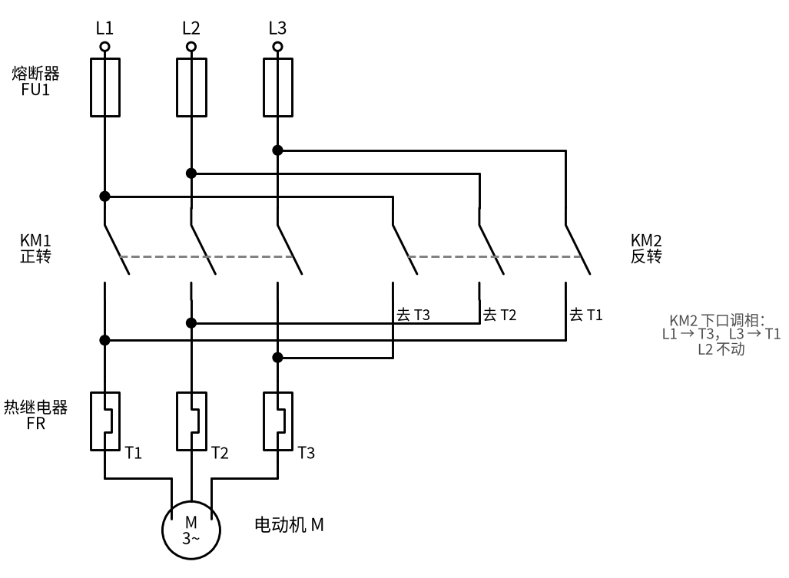
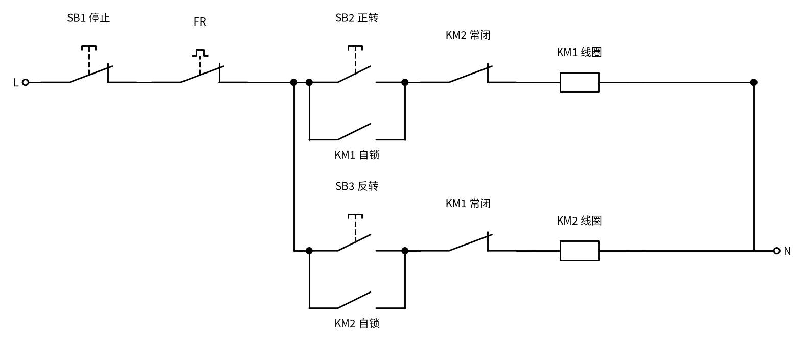
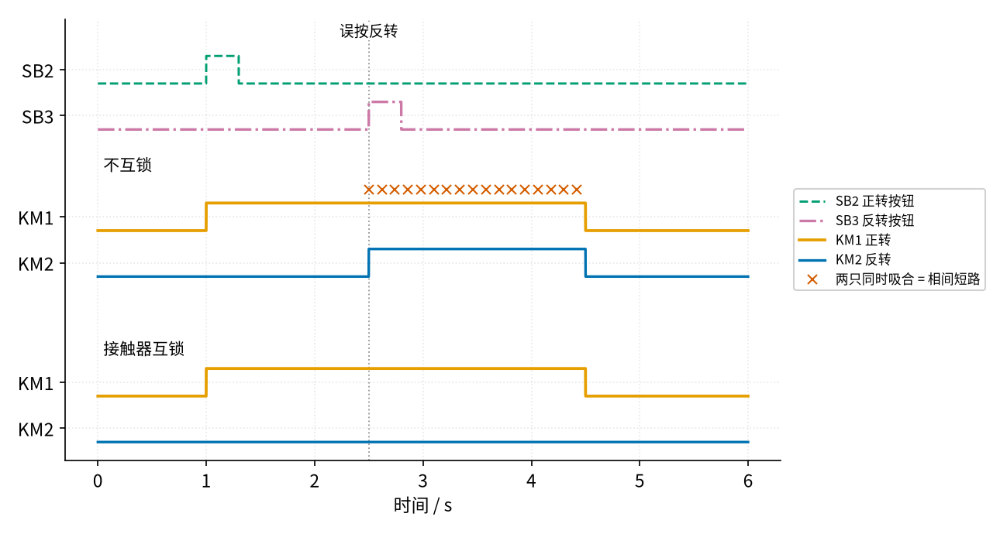

# 18 互锁 · 直觉篇

[上一页：14 电压比较器 · 参数与调试篇](../14-voltage-comparator/page3.md) · 本页：直觉篇 · [原理与实现篇](page2.md) · [参数与调试篇](page3.md) · [下一页：原理与实现篇](page2.md) · 前置节点：[17 自锁 · 直觉篇](../17-self-locking/page1.md)

> [!WARNING]
> **市电危险**：本电路的实际版本接 220V/380V 市电，触电可能致命。本页的仿真和动手实验只在 12V 以下的低压电源上进行；任何接线、改线都必须在断电并验电后操作，由持证电工完成。
>
> 本节点特有的危险点：① 正反转电动机的主电路是 **380 V 三相**，两只接触器一旦同时吸合，就是两根相线被触点直接短接，电流极大，会产生强烈电弧、烧熔触点，在场的人有被电弧灼伤的危险；② 控制回路（按钮、线圈、辅助触点）也常常直接接 **220 V 或 380 V**，互锁触点所在的端子同样带电；③ 和 17 一样，按下停止按钮只是让线圈断电，**主电路仍然带电**；如果主触点已经熔焊，按停止连电机都停不下来，检修前必须断开上级断路器并验电；④ 新装或改过线的正反转电路，第一次试车时要先**断开电动机的接线**，只看接触器动作对不对。

## 一、痛点：让电机倒着转，最怕两只接触器一起吸合

17 里我们用一只接触器 KM 加一个自锁触点，让电动机"按一下就一直转"。可是很多机器要能**正着转、也能倒着转**：行车要能上能下，卷帘门要能开能关，机床工作台要能进能退。

三相电动机怎么反转？办法出奇地简单：**把三根电源线里任意两根对调**，电动机里旋转磁场的方向就反过来，转子跟着反转。于是工厂里的做法是装两只接触器：KM1 负责"正着接"，KM2 负责"对调两根线再接"。看 图 18-p1-1：

*图 18-p1-1　正反转主电路：KM1 正着接，KM2 在下口把两相对调*

图 18-p1-1 左边三列是 KM1：L1 接 T1，L2 接 T2，L3 接 T3，电动机正转。右边三列是 KM2：它的上口和 KM1 接同样的三根线，下口却把 L1 送到了 T3、把 L3 送到了 T1，于是电动机反转。

问题就藏在这张图里。假如 KM1 和 KM2 **同时吸合**，电动机端子 T1 一边经 KM1 接到 L1，一边经 KM2 接到 L3，等于用一段铜排把 L1 和 L3 两根相线直接连在一起，这叫**相间短路**。两根相线之间是 380 V，中间几乎没有电阻，电流只受电源变压器和导线那一点点阻抗限制。画图脚本举了一个示意数字：短路回路阻抗只有 0.1 Ω 时，电流约 3800 A。这样的电流会把触点烧熔、把熔断器炸断，严重时引起电弧和火灾。

所以正反转电路的头等大事是：**任何时候，KM1 和 KM2 最多只能吸合一只**。

## 二、类比：银行门口的"互锁门"

很多银行、实验室的入口有两道门，中间是一个小隔间。规矩是：**外门开着的时候，内门锁死；内门开着的时候，外门锁死**。这样风、灰尘、坏人都没法一口气穿过去。

这两道门是怎么做到的？每道门的锁都"看着"另一道门：另一道门只要没关好，这道门的锁就不放行。注意，它不需要一个"总指挥"，两道门互相盯着对方就够了。

互锁电路就是把这个规矩搬到接触器上：

- KM1 的线圈回路里，串一个 **KM2 的常闭辅助触点**。KM2 不吸合时，这个触点闭合，不影响 KM1；KM2 一吸合，它就断开，KM1 再怎么按也通不了电。
- 反过来，KM2 的线圈回路里串一个 **KM1 的常闭辅助触点**。

还记得 P1 里讲的吗？接触器除了主触点，还有一些**辅助触点**，它们和主触点由同一个衔铁带动；常闭辅助触点平时闭合，接触器一吸合就断开。互锁用的正是"对方的常闭辅助触点"。

## 三、看图：互锁的控制回路和它的效果

把 17 的自锁回路复制成两份，再在每份里串入对方的常闭触点，就得到 图 18-p1-2：

*图 18-p1-2　接触器互锁：每只线圈前面串着对方的常闭触点*

图 18-p1-2 上下两行各是一个完整的自锁回路，共用一个停止按钮 SB1 和一个热继电器触点 FR。上面一行管正转：SB2 和 KM1 自锁触点并联，然后经过 **KM2 常闭** 到 KM1 线圈。下面一行管反转，结构一样，只是换成 SB3、KM2 自锁触点和 **KM1 常闭**。这两个交叉串进去的常闭触点就是"互锁"，书上也叫"联锁"或"接触器互锁"。

它到底管不管用？最危险的操作是：电动机正在正转，有人误按了反转按钮。图 18-p1-3 把"不互锁"和"接触器互锁"两种接法放在一起比：

*图 18-p1-3　正转中误按反转：不互锁会短路，接触器互锁什么也不发生*

图 18-p1-3 里蓝绿色虚线是正转按钮，红紫色点划线是反转按钮，橙色是 KM1，蓝色是 KM2。中间"不互锁"那组：第 1 s 按正转，KM1 吸合；第 2.5 s 误按反转，KM2 也吸合了，两条线同时在高位，上面一串朱红色 × 表示这 2.0 s 里一直是相间短路（实际上熔断器早就炸了）。下面"接触器互锁"那组：误按反转时 KM1 正吸着，它的常闭触点是断开的，KM2 的线圈根本没电，蓝色线纹丝不动。想要反转，必须先按停止，让 KM1 释放、常闭触点复位，再按反转。

如果两个按钮几乎同时按下呢？先按下的那只接触器先吸合，一吸合就把对方的回路切断，后按的那只吸不上去。原理与实现篇会把这个过程放大到毫秒来看。

## 四、一句话总结

**互锁就是"你吸我就断"：在两只接触器的线圈回路里各串入对方的常闭辅助触点，保证正反转接触器永远不会同时吸合，从而避免相间短路**。

## 参考资料

- 正反转主电路的接法、电气互锁与机械互锁必须同时具备：<https://pressbooks.bccampus.ca/basicmotorcontrol/chapter/forward-reverse-control-circuits/>
- 接触器互锁、按钮互锁、双重互锁的中文说明，调试时先断开电动机：<https://www.dgjs123.com/diandongji/1573.html>
