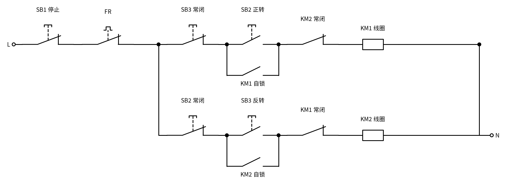
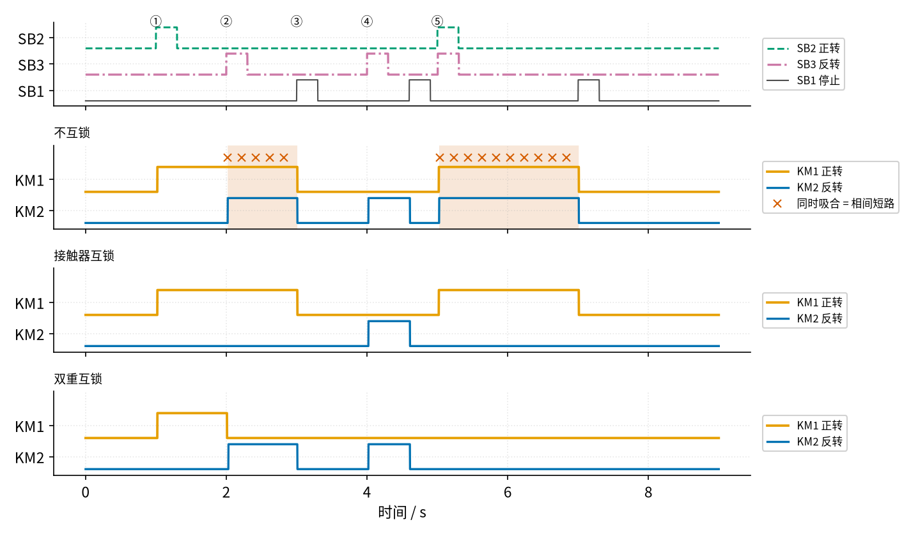
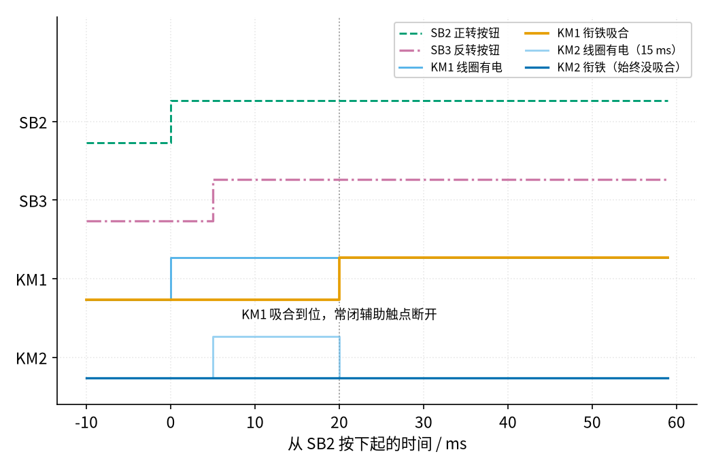

# 18 互锁 · 原理与实现篇

[上一页：直觉篇](page1.md) · [直觉篇](page1.md) · 本页：原理与实现篇 · [参数与调试篇](page3.md) · [下一页：参数与调试篇](page3.md) · 前置节点：[17 自锁 · 直觉篇](../17-self-locking/page1.md)

> [!WARNING]
> **市电危险**：本电路的实际版本接 220V/380V 市电，触电可能致命。本页的仿真和动手实验只在 12V 以下的低压电源上进行；任何接线、改线都必须在断电并验电后操作，由持证电工完成。
>
> 本节点特有的危险点：① 正反转接触器同时吸合 = 380 V 相间短路，电弧可能伤人；② 互锁触点在控制回路里，控制回路常接 220 V 或 380 V，改互锁线同样要断电验电；③ 按停止只是让线圈断电，主电路仍带电，主触点熔焊时电机甚至停不下来。

## 一、最小知识：三件要先知道的事

1. **常闭辅助触点跟着衔铁走**（P1、17）：接触器线圈通电、衔铁吸合，常开触点闭合，常闭触点**断开**；衔铁释放，二者复位。互锁用的就是对方的常闭辅助触点。
2. **接触器动作要时间**：从线圈通电到主触点闭合叫吸合时间，从线圈断电到主触点断开叫释放时间。施耐德 TeSys D 小型接触器的手册给出的闭合时间是 12 ms 到 22 ms，断开时间是 4 ms 到 19 ms。本页仿真取吸合 20 ms、释放 10 ms 这两个落在范围之内的示意值。
3. **复合按钮**：一个按钮里同时有一对常开触点和一对常闭触点，按下时常闭触点断开、常开触点闭合，二者由同一根推杆带动。把它的常闭触点串到对方回路里，就是**按钮互锁**。

## 二、推导：把互锁翻译成式子

**中文意思**：KM1 下一刻会不会吸合？要同时满足三件事：停止按钮没被按；正转按钮按着，或者 KM1 自己已经吸着（这是 17 的自锁）；**并且 KM2 没有吸合**（这是新加的互锁）。KM2 同理。

**写成公式**：沿用 17 的记号，用 $S_1$ 、 $S_2$ 、 $S_3$ 表示停止、正转、反转按钮是否按下（按下 = 1），用 $K_1$ 、 $K_2$ 表示两只接触器现在的状态（吸合 = 1），带撇的表示下一刻：

$$
K_1' = \overline{S_1} \cdot (S_2 + K_1) \cdot \overline{K_2}
$$

$$
K_2' = \overline{S_1} \cdot (S_3 + K_2) \cdot \overline{K_1}
$$

和 17 相比，每个式子只多了最后一个因子 $\overline{K_2}$ 或 $\overline{K_1}$ ，它就是串进去的那个"对方的常闭辅助触点"：对方吸合（等于 1）时，常闭触点断开（取反等于 0）。

**代数推一推**：

| 情况 | $S_2$ | $S_3$ | $K_1$ | $K_2$ | $K_1'$ | $K_2'$ | 意思 |
|---|---|---|---|---|---|---|---|
| 停着，按正转 | 1 | 0 | 0 | 0 | $1\cdot(1+0)\cdot 1=1$ | $1\cdot(0+0)\cdot 1=0$ | 正转启动 |
| 正转中，误按反转 | 0 | 1 | 1 | 0 | $1\cdot(0+1)\cdot 1=1$ | $1\cdot(1+0)\cdot 0=0$ | 反转按钮无效 |
| 停着，按反转 | 0 | 1 | 0 | 0 | $1\cdot(0+0)\cdot 1=0$ | $1\cdot(1+0)\cdot 1=1$ | 反转启动 |
| 停着，两个一起按 | 1 | 1 | 0 | 0 | $1$ | $1$ | 两个都想吸合！ |

前三行说明：只要有一只已经吸合，另一只的式子里就乘上了 0，**无论怎么按都吸不上**。把两个式子相乘还能看得更清楚：如果此刻 $K_1 = 1$ ，那么 $K_2'$ 里的 $\overline{K_1} = 0$ ，乘积 $K_1' \cdot K_2'$ 必然是 0。

最后一行是个漏洞：两只都没吸合时，两个按钮"同时"按下，两个式子都等于 1。好在真实的接触器吸合要十几毫秒，人的两根手指不可能精确到同一毫秒按下。先通电的那只先吸合到位，它的常闭触点一断开，后按的那只线圈立刻失电，衔铁还没走完就退了回去。下一节的仿真会把这个"赛跑"放大来看。

**再加一重：按钮互锁**。如果在 KM1 回路里再串入 SB3 的常闭触点、在 KM2 回路里串入 SB2 的常闭触点，式子变成

$$
K_1' = \overline{S_1} \cdot \overline{S_3} \cdot (S_2 + K_1) \cdot \overline{K_2}
$$

按反转按钮 $S_3 = 1$ 的那一刻，KM1 的回路先被切断；等 KM1 释放、 $K_1$ 变回 0，KM2 才通电。这样不用先按停止就能直接换向。接触器互锁加按钮互锁，叫**双重互锁**，接法见 图 18-p2-1：



*图 18-p2-1　双重互锁：按钮的常闭触点和接触器的常闭触点各串一个*

图 18-p2-1 和直觉篇那张接触器互锁的回路相比，每一行最前面多了一个按钮常闭触点：上面一行是 SB3 常闭，下面一行是 SB2 常闭。SB2 正转按钮的常开触点在上面一行、常闭触点在下面一行，它们是同一个复合按钮的两对触点，一按同时动作；SB3 也一样。注意 SB3 常闭必须串在"SB2 并联自锁触点"这一组的外面，否则按反转切不断 KM1 的自锁。

## 三、仿真：三种接法跑同一套按键

下面的程序沿用 17 的逐毫秒推演，同时跑"不互锁""接触器互锁""双重互锁"三种接法。按键安排是：① 1 s 按正转；② 2 s 正转中按反转；③ 3 s 按停止；④ 4 s 按反转，4.6 s 停止；⑤ 5.000 s 按正转、5.005 s 按反转（相差 5 ms），7 s 停止。

程序要在**仓库根目录**运行（第二行靠这个找到 `code/figs` 里的共享画图样式），它会重新生成 图 18-p2-2 和 图 18-p2-3。完整版是 `code/18_sim.py`，比下面多打印一行燃弧余量（参数与调试篇用到）。想改参数做实验，先复制一份：`cp code/18_sim.py my_18.py`，再改 `my_18.py`。

```python
# 18 正反转互锁的最小仿真：沿用 17 的写法，时间切成 1 ms 一小段，两只接触器 KM1（正转）、KM2（反转）各算各的。
# KM1 回路：SB1 停止（常闭）→ [SB2 正转（常开） 并联 KM1 自锁触点] →（按钮互锁时串 SB3 常闭）→（接触器互锁时串 KM2 常闭辅助触点）→ KM1 线圈
import sys, pathlib
sys.path.insert(0, str(pathlib.Path("code/figs").resolve()))  # 在仓库根目录运行
import numpy as np                                 # 数组运算
import matplotlib.pyplot as plt                    # 画图
import figstyle as fs                              # 全书统一的颜色、轴标签、保存函数

dt = 1e-3                                          # 每一小段 1 ms
t = np.arange(0, 9, dt)                            # 一共仿真 9 s
T_PICK, T_DROP = 0.020, 0.010                      # 线圈通电后 20 ms 才吸合到位；断电后 10 ms 才释放到位

def pressed(t0, t1):                               # 生成"在 t0 到 t1 秒之间按住"的按钮信号
    return (t >= t0) & (t < t1)                    # 返回一串 True/False

sb2 = pressed(1.0, 1.3) | pressed(5.000, 5.300)    # SB2 正转按钮：1 s 按一次；5.000 s 和 SB3 几乎同时按
sb3 = pressed(2.0, 2.3) | pressed(4.0, 4.3) | pressed(5.005, 5.305)  # SB3 反转按钮：2 s 在正转时按；4 s 停机后按；5.005 s 晚 5 ms 按
sb1 = pressed(3.0, 3.3) | pressed(4.6, 4.9) | pressed(7.0, 7.3)       # SB1 停止按钮

def run(mode):                                     # mode："none" 不互锁、"elec" 接触器互锁、"double" 按钮 + 接触器双重互锁
    km1 = np.zeros_like(t, dtype=bool)             # KM1 衔铁状态：True = 吸合（主触点闭合、常闭辅助触点断开）
    km2 = np.zeros_like(t, dtype=bool)             # KM2 衔铁状态
    coil1 = np.zeros_like(t, dtype=bool)           # KM1 线圈有没有通电（用来看"白白通电"的那十几毫秒）
    coil2 = np.zeros_like(t, dtype=bool)           # KM2 线圈有没有通电
    n1 = n2 = 0.0                                  # 两只线圈各自的计时器：通电（或断电）已经持续了多久
    for k in range(1, len(t)):                     # 一小段一小段往前推
        n1 = n1 + dt if coil1[k - 1] != km1[k - 1] else 0.0  # 第一步：衔铁跟着线圈走——"线圈和衔铁不一致"持续了多久
        n2 = n2 + dt if coil2[k - 1] != km2[k - 1] else 0.0  # 同上，给 KM2
        km1[k] = (not km1[k - 1] and n1 >= T_PICK - 1e-9) or (km1[k - 1] and n1 < T_DROP - 1e-9)  # 通电够 20 ms 才吸合；断电不到 10 ms 仍吸着
        km2[k] = (not km2[k - 1] and n2 >= T_PICK - 1e-9) or (km2[k - 1] and n2 < T_DROP - 1e-9)  # 同上，给 KM2
        a1, a2 = km1[k], km2[k]                    # 第二步：辅助触点跟着衔铁走，再判断两个线圈回路通不通
        stop_ok = not sb1[k]                       # 停止按钮没被按，公共部分才通
        p1 = stop_ok and (sb2[k] or a1)            # KM1 回路：启动按钮或自锁触点（和 17 一样）
        p2 = stop_ok and (sb3[k] or a2)            # KM2 回路：同理
        if mode == "double":                       # 按钮互锁：复合按钮的常闭触点串在对方回路里
            p1 = p1 and not sb3[k]                 # 按着 SB3 时，KM1 回路被 SB3 常闭断开
            p2 = p2 and not sb2[k]                 # 按着 SB2 时，KM2 回路被 SB2 常闭断开
        if mode in ("elec", "double"):             # 接触器互锁：对方的常闭辅助触点串在自己回路里
            p1 = p1 and not a2                     # KM2 吸着，KM2 常闭辅助触点就是断开的
            p2 = p2 and not a1                     # KM1 吸着，KM1 常闭辅助触点就是断开的
        coil1[k], coil2[k] = p1, p2                # 记下这一刻两只线圈有没有电
    return km1, km2, coil1, coil2                  # 返回四条波形

def at(x, arr):                                    # 查表：t = x 秒时 arr 的值
    return bool(arr[int(round(x / dt))])           # 秒换成下标

res = {m: run(m) for m in ("none", "elec", "double")}  # 三种接法跑同一套按键
for m, name in [("none", "不互锁"), ("elec", "接触器互锁"), ("double", "双重互锁")]:
    k1, k2, c1, c2 = res[m]                        # 取出这一种接法的结果
    short = k1 & k2                                # 两只同时吸合 = 两相被主触点直接接通 = 相间短路
    print(f"[{name}] 两只接触器同时吸合的总时长 {short.sum() * dt * 1e3:.0f} ms")  # 打印短路时长
    for x in (1.5, 2.5, 3.5, 4.4, 5.5):            # 五个检查时刻
        print(f"   t = {x:.1f} s：KM1 {'吸' if at(x, k1) else '放'}  KM2 {'吸' if at(x, k2) else '放'}")  # 打印状态

k1, k2, c1, c2 = res["elec"]                       # 下面细看接触器互锁这一种
assert not (k1 & k2).any()                         # 结论 1：接触器互锁时，任何时刻都不会两只同时吸合
assert at(2.5, k1) and not at(2.5, k2)             # 结论 2：正转时按反转，什么也不发生
assert at(4.4, k2) and at(5.5, k1) and not at(5.5, k2)  # 结论 3：停机后能反转；两个按钮相差 5 ms 按下，只有先按的 KM1 吸合
assert (res["none"][0] & res["none"][1]).sum() > 0 # 结论 4：不互锁时会出现同时吸合
d1, d2 = res["double"][0], res["double"][1]        # 双重互锁的两条衔铁波形
assert not (d1 & d2).any() and at(2.5, d2) and not at(5.5, d1) and not at(5.5, d2)  # 结论 5：双重互锁能直接反转；两个一起按则谁也不吸

on1 = np.argmax(k1[4900:]) + 4900                  # 5 s 附近 KM1 吸合的下标
w2 = c2[5000:5100].sum()                           # 5.0~5.1 s 之间 KM2 线圈一共通电了几毫秒
print(f"[竞赛] SB2 在 5.000 s、SB3 在 5.005 s 按下：KM1 在 {t[on1]:.3f} s 吸合，KM2 线圈白白通电 {w2:.0f} ms 后被切断")  # 打印竞赛过程
assert w2 == 15                                    # 20 ms − 5 ms = 15 ms
sw = np.argmax(d2[2000:]) + 2000                   # 双重互锁：2 s 按 SB3 后 KM2 吸合的下标
off = np.argmin(d1[2000:]) + 2000                  # 双重互锁：KM1 释放的下标
print(f"[双重互锁] 2.000 s 按 SB3：KM1 在 {t[off]:.3f} s 释放，KM2 在 {t[sw]:.3f} s 吸合，中间空档 {(t[sw] - t[off]) * 1e3:.0f} ms")  # 打印换向空档
assert t[sw] > t[off]                              # 先断后通

fig, axs = plt.subplots(4, 1, figsize=(9.5, 5.6), sharex=True)  # 四行：按钮、不互锁、接触器互锁、双重互锁
axs[0].plot(t, sb2 * 0.8 + 2.0, **fs.LS["fb"], label="SB2 正转")       # 正转按钮
axs[0].plot(t, sb3 * 0.8 + 1.0, **fs.LS["third"], label="SB3 反转")    # 反转按钮
axs[0].plot(t, sb1 * 0.8 + 0.0, color="0.3", lw=1.0, label="SB1 停止")  # 停止按钮（灰色细实线）
axs[0].set_yticks([0.4, 1.4, 2.4]); axs[0].set_yticklabels(["SB1", "SB3", "SB2"]); axs[0].set_ylim(-0.2, 3.0)  # 纵轴标注
axs[0].legend(loc="center left", bbox_to_anchor=(1.01, 0.5), fontsize=8)  # 图例放到图外右侧
for ax, m, name in [(axs[1], "none", "不互锁"), (axs[2], "elec", "接触器互锁"), (axs[3], "double", "双重互锁")]:
    a, b = res[m][0], res[m][1]                    # 这一种接法的 KM1、KM2
    ax.plot(t, a * 0.8 + 1.0, **fs.LS["vout"], label="KM1 正转")       # KM1 画在上面
    ax.plot(t, b * 0.8 + 0.0, **fs.LS["vin"], label="KM2 反转")        # KM2 画在下面
    s = a & b                                      # 同时吸合的时段
    if s.any():                                    # 有短路就用朱红色 × 标出来
        ax.fill_between(t, -0.2, 2.5, where=s, color=fs.C["bad"], alpha=0.15, lw=0)  # 短路时段衬一层淡底色
        ax.plot(t[s][::200], np.full(s.sum(), 2.1)[::200], color=fs.C["bad"], ls="none", marker="x", label="同时吸合 = 相间短路")  # 朱红色 ×
    ax.set_yticks([0.4, 1.4]); ax.set_yticklabels(["KM2", "KM1"]); ax.set_ylim(-0.2, 2.5)  # 纵轴标注
    ax.set_title(name, fontsize=9, loc="left")     # 子图标题
    ax.legend(loc="center left", bbox_to_anchor=(1.01, 0.5), fontsize=8)  # 图例放到图外右侧
for x, s in [(1.0, "①"), (2.0, "②"), (3.0, "③"), (4.0, "④"), (5.0, "⑤")]:
    axs[0].text(x, 2.85, s, ha="center", fontsize=9)  # 五个事件的编号，正文逐一讲解
fs.axlabels(axs[3], "时间", "s")                    # 横轴
fs.save(fig, "18", "18_p2_2_sim.png")              # 保存

z = slice(4990, 5060)                              # 放大 4.990~5.060 s
fig, ax = plt.subplots(figsize=fs.SIZE["tall"])    # 竞赛放大图
tm = (t[z] - 5.0) * 1e3                            # 横轴换成"从 5.000 s 起的毫秒数"
ax.plot(tm, sb2[z] * 0.8 + 6, drawstyle="steps-post", **fs.LS["fb"], label="SB2 正转按钮")       # 正转按钮
ax.plot(tm, sb3[z] * 0.8 + 4.5, drawstyle="steps-post", **fs.LS["third"], label="SB3 反转按钮")  # 反转按钮
ax.plot(tm, c1[z] * 0.8 + 3, drawstyle="steps-post", **fs.LS["cur"], label="KM1 线圈有电")      # KM1 线圈
ax.plot(tm, k1[z] * 0.8 + 3, drawstyle="steps-post", **fs.LS["vout"], label="KM1 衔铁吸合")     # KM1 衔铁
ax.plot(tm, c2[z] * 0.8 + 1.5, drawstyle="steps-post", **{**fs.LS["cur"], "alpha": 0.6}, label=f"KM2 线圈有电（{w2:.0f} ms）")       # KM2 线圈
ax.plot(tm, k2[z] * 0.8 + 1.5, drawstyle="steps-post", **fs.LS["vin"], label="KM2 衔铁（始终没吸合）")  # KM2 衔铁
fs.ref_v(ax, 20, "KM1 吸合到位，常闭辅助触点断开", y=0.25)                    # 20 ms 的竖线
ax.set_yticks([1.9, 3.4, 4.9, 6.4]); ax.set_yticklabels(["KM2", "KM1", "SB3", "SB2"])  # 纵轴
ax.set_ylim(1.0, 8.4); fs.axlabels(ax, "从 SB2 按下起的时间", "ms")       # 坐标
ax.legend(loc="upper right", fontsize=8, ncol=2)                          # 图例（右上角空着）
fs.save(fig, "18", "18_p2_3_race.png")             # 保存
```

运行结果：

```text
[不互锁] 两只接触器同时吸合的总时长 2975 ms
   t = 1.5 s：KM1 吸  KM2 放
   t = 2.5 s：KM1 吸  KM2 吸
   t = 3.5 s：KM1 放  KM2 放
   t = 4.4 s：KM1 放  KM2 吸
   t = 5.5 s：KM1 吸  KM2 吸
[接触器互锁] 两只接触器同时吸合的总时长 0 ms
   t = 1.5 s：KM1 吸  KM2 放
   t = 2.5 s：KM1 吸  KM2 放
   t = 3.5 s：KM1 放  KM2 放
   t = 4.4 s：KM1 放  KM2 吸
   t = 5.5 s：KM1 吸  KM2 放
[双重互锁] 两只接触器同时吸合的总时长 0 ms
   t = 1.5 s：KM1 吸  KM2 放
   t = 2.5 s：KM1 放  KM2 吸
   t = 3.5 s：KM1 放  KM2 放
   t = 4.4 s：KM1 放  KM2 吸
   t = 5.5 s：KM1 放  KM2 放
[竞赛] SB2 在 5.000 s、SB3 在 5.005 s 按下：KM1 在 5.020 s 吸合，KM2 线圈白白通电 15 ms 后被切断
[双重互锁] 2.000 s 按 SB3：KM1 在 2.010 s 释放，KM2 在 2.030 s 吸合，中间空档 20 ms
```

先看三种接法在 ①～⑤ 这五个事件后的状态，以及两只接触器同时吸合的总时长：

- **不互锁**：同时吸合 2975 ms。② 正转中按反转，两只一起吸合；⑤ 两个按钮先后按下，也是两只一起吸合。真实电路里这两次都是相间短路。
- **接触器互锁**：同时吸合 0 ms。② 按反转没有任何反应，KM1 照常吸着；④ 先停止再按反转，KM2 正常吸合；⑤ 先按下的 SB2 赢得"赛跑"，KM1 吸合、KM2 吸不上。
- **双重互锁**：同时吸合 0 ms。② 不用先按停止，按反转就直接换成了反转；⑤ 两个按钮都按着时，各自的常闭触点把对方切断，结果两只都不吸合。

这些状态画在 图 18-p2-2 里：



*图 18-p2-2　三种接法跑同一套按键：只有不互锁会出现同时吸合*

图 18-p2-2 最上面一行是按键：蓝绿色虚线是正转按钮 SB2，红紫色点划线是反转按钮 SB3，灰色细实线是停止按钮 SB1。下面三行里橙色是 KM1，蓝色是 KM2；只有"不互锁"那一行出现了朱红色 × 号（下面还衬了一层很淡的底色），那就是两只同时吸合、主电路短路的时段。对比第三行和第二行在 ② 处的差别：双重互锁让 KM1 先掉、KM2 再吸，接触器互锁则干脆不理会反转按钮。

事件 ⑤ 的两个按钮只差 5 ms，接触器互锁靠什么分出胜负？图 18-p2-3 把这一段放大到毫秒：



*图 18-p2-3　两个按钮相差 5 ms：先通电的 KM1 先吸合到位，切断了 KM2*

图 18-p2-3 里，SB2 在 5.000 s 按下，KM1 线圈先通电；5 ms 后 SB3 按下，KM2 线圈也通了电，此时两只衔铁都在往下走。KM1 在 5.020 s 吸合到位，灰色点线处它的常闭辅助触点断开，KM2 线圈白白通电 15 ms 就被切断，衔铁还没走完 20 ms 的路程，于是退回原位。换句话说，接触器互锁"谁先到谁赢"，赢家一到位就关门。

如果两个按钮**一毫秒都不差**呢？这个简化模型里两只线圈会同时走完 20 ms，同时吸合。现实中两只接触器的吸合时间不会完全相等，但"恰好打平"不能完全排除，触点粘连、按钮卡住也会让电气互锁失效。所以还需要最后一道防线，见下一节。

## 四、机械互锁：最后一道防线

电气互锁靠的是触点，而触点会出故障：它可能被电弧烧粘、被异物卡住，或者接线松了。加拿大 BCcampus 的电机控制教材明确说，正反转电路**电气互锁和机械互锁都必须有**，机械互锁是"最后的手段"。

机械互锁是一根装在两只接触器之间的杠杆：一只衔铁往下吸时，杠杆把另一只的衔铁顶住，让它在机械上吸不下去。即使两只线圈同时通电，也只有一只能吸合，另一只只会抖动、发出噪声。施耐德把这种零件做成套件：例如 LAD9R1 正反转接线套件里包含 LAD9V2 机械互锁装置和两组主电路连接排。

和这一点相关的还有一个概念，叫**镜像触点**（IEC 60947-4-1 附录 F）。它规定接触器的常闭辅助触点和主触点之间要有可靠的机械联系：只要有一个主触点粘住没断开，常闭辅助触点就**不能闭合**。正是因为这条规定，"KM1 主触点熔焊 → KM1 常闭触点保持断开 → KM2 吸不上"这条保护才成立。参数与调试篇会用仿真演示这个场景。

## 五、渐隐例题

**例 1（完整示范）**：接触器互锁电路，电动机正在正转（ $K_1 = 1$ ， $K_2 = 0$ ），有人按下反转按钮（ $S_3 = 1$ ），没按停止（ $S_1 = 0$ ）、没按正转（ $S_2 = 0$ ）。下一刻两只接触器的状态是什么？

解：代入第二节的两个式子：

$$
K_1' = \overline{0} \cdot (0 + 1) \cdot \overline{0} = 1 \cdot 1 \cdot 1 = 1
$$

$$
K_2' = \overline{0} \cdot (1 + 0) \cdot \overline{1} = 1 \cdot 1 \cdot 0 = 0
$$

KM1 继续吸合，KM2 不吸合，反转按钮无效。这和仿真里事件 ② 的"接触器互锁"一行完全一致。

**例 2（填空）**：把双重互锁电路里 KM2 的式子补完整（两个方框各填一个因子），并判断电动机正转时按下反转按钮的结果。

$$
K_2' = \overline{S_1} \cdot \square \cdot (S_3 + K_2) \cdot \square
$$

按下 SB3 的一瞬间，KM1 回路里的 $\overline{S_3}$ 等于 ____，KM1 释放后 $\overline{K_1}$ 等于 ____，于是 KM2 ____。

<details><summary>答案</summary>

两个方框分别是 $\overline{S_2}$ （SB2 的常闭触点）和 $\overline{K_1}$ （KM1 的常闭辅助触点）。按下 SB3 时 KM1 回路里 $\overline{S_3} = 0$ ，KM1 失电释放；释放后 $\overline{K_1} = 1$ ，KM2 的式子等于 $1 \cdot 1 \cdot 1 \cdot 1 = 1$ ，于是 KM2 吸合，电动机直接换成反转。仿真打印的时间是：KM1 在 2.010 s 释放，KM2 在 2.030 s 吸合，中间空档 20 ms。

</details>

**例 3（变体迁移）**：双重互锁电路，电动机停着，SB2 和 SB3 被同时按住不放，会发生什么？如果先松开 SB2、几毫秒后再松开 SB3 呢？

<details><summary>答案</summary>

两个都按住时，KM1 回路里的 $\overline{S_3} = 0$ ，KM2 回路里的 $\overline{S_2} = 0$ ，两只线圈都没电，**谁也不吸合**，这比接触器互锁的"谁先到谁赢"更保守。先松开 SB2 后，KM2 回路的 $\overline{S_2}$ 变回 1，KM2 线圈短暂通电；但仿真事件 ⑤ 里这段时间只有 5 ms，不够 20 ms 的吸合时间，SB3 一松开它又断电了，所以 5.5 s 时 KM1、KM2 仍然都是"放"。如果手指在 SB3 上多停留 20 ms 以上，KM2 就会吸合并自锁。

</details>

## 六、低压动手实验

> [!WARNING]
> **市电危险**：本电路的实际版本接 220V/380V 市电，触电可能致命。本页的仿真和动手实验只在 12V 以下的低压电源上进行；任何接线、改线都必须在断电并验电后操作，由持证电工完成。
>
> 本节点特有的危险点：① 真实的正反转主电路是 380 V 三相，两只接触器同时吸合就是相间短路；② 真实的控制回路常接 220 V 或 380 V；③ 按停止不等于断电。本实验只用 **12 V 直流电源 + 线圈 12 V 的小继电器**，不接任何电动机，绝对不要接到插座上。

器材：12 V 直流电源；两只线圈 12 V、带两组转换触点（每组有一对常开、一对常闭）的小继电器，分别当 KM1、KM2；一个常闭按钮当 SB1；两个常开按钮当 SB2、SB3；两只 LED 各串一个 1 kΩ 电阻，并在两只继电器线圈两端当"指示灯"；两只 1N4007 二极管，分别反并在两个线圈两端（线圈断电会产生高压尖峰，原理和二极管方向见 [22 三极管开关与继电器驱动 · 原理与实现篇](../22-bjt-relay-driver/page2.md)）。

接法：照着直觉篇里那张"接触器互锁"控制回路图接，L 换成 12 V 正极，N 换成负极，FR 省略。每只继电器的第一组常开触点并在自己的启动按钮两端作自锁，第二组的常闭触点串进**对方**的线圈回路作互锁。

验证：

1. 按 SB2，KM1 的灯亮并保持；再按 SB3，KM2 的灯不亮（接触器互锁有效）。
2. 按 SB1，灯灭；再按 SB3，KM2 的灯亮。
3. 先断开 12 V 电源，用一根跳线把**两只**继电器的互锁常闭触点都临时短接掉，再通电重复第 1 步，两盏灯会一起亮。这就是主电路里的"短路"，在低压上看到它没有危险，在 380 V 上就是事故。如果只短接其中一只（比如 KM2 回路里的 KM1 常闭），你会看到 KM1 被"挤掉"、KM2 接上，灯是一灭一亮；但两只交接时仍有一小段时间（取决于继电器的释放速度，几到十几毫秒）同时吸合，在 380 V 上这一小段就是相间短路，参数与调试篇的"换向空档"讲的正是它。**这个短接实验只在 12 V 实验板上做，真实的接触器柜里绝对不要这样试**。
4. 进阶：再找两个带常闭触点的复合按钮，照 图 18-p2-1 改成双重互锁，体验"不按停止直接换向"。

## 参考资料

- 正反转需要电气互锁和机械互锁；机械互锁是最后的手段，只让一只衔铁吸合、另一只抖动：<https://pressbooks.bccampus.ca/basicmotorcontrol/chapter/forward-reverse-control-circuits/>
- 接触器互锁、按钮互锁、双重互锁；同时按两个复合按钮时两只都不吸合：<https://www.dgjs123.com/diandongji/1573.html>
- 只做按钮互锁时主触点熔焊造成相间短路；双重互锁安全但接线复杂：<https://www.guifan.net/zhishi/2022/64180.html>
- 施耐德 LAD9R1 套件包含 LAD9V2 机械互锁：<https://www.se.com/uk/en/faqs/FA109542/>
- IEC 60947-4-1 附录 F 的镜像触点：<https://www.gt-engineering.it/en/insights/electrical-hazard-and-arc-flash-mitigation/contactors-used-in-safety-applications/power-contactors/>
- TeSys D 接触器闭合 / 断开时间：<https://nanologicautomation.com/pdf/switch-gears/contractors/Schneider-Contactors-TesysD-Nano-Logic-Automation.pdf>
