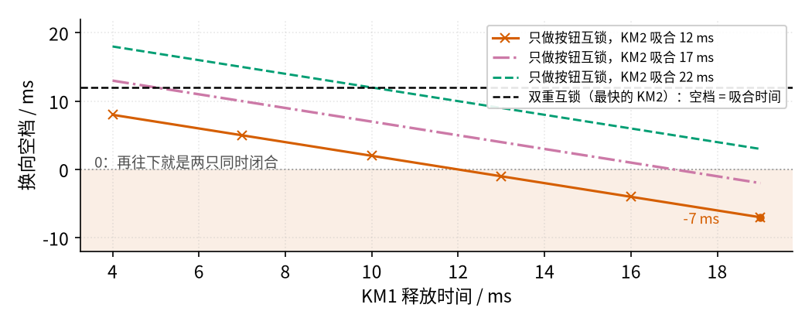
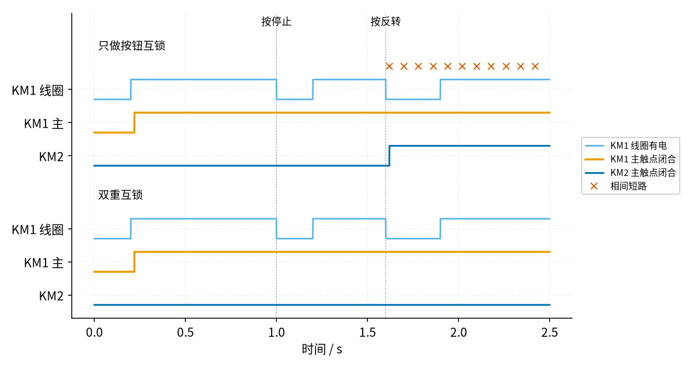

# 18 互锁 · 参数与调试篇

[上一页：原理与实现篇](page2.md) · [直觉篇](page1.md) · [原理与实现篇](page2.md) · 本页：参数与调试篇 · [下一页：03 电压跟随器 · 直觉篇](../03-voltage-follower/page1.md) · 前置节点：[17 自锁 · 直觉篇](../17-self-locking/page1.md)

> [!WARNING]
> **市电危险**：本电路的实际版本接 220V/380V 市电，触电可能致命。本页的仿真和动手实验只在 12V 以下的低压电源上进行；任何接线、改线都必须在断电并验电后操作，由持证电工完成。
>
> 本节点特有的危险点：① 主电路是 380 V 三相，正反转接触器同时吸合就是相间短路；② 控制回路常接 220 V 或 380 V，用万用表查互锁线时必须先断电；③ 按停止只是让线圈断电，主电路仍然带电，主触点熔焊时电动机甚至停不下来，检修前要断开上级断路器并验电；④ 改过线的正反转电路，第一次通电要先断开电动机，只看接触器动作。

## 一、关键参数

| 参数 | 典型值 | 本节点仿真取值 | 它影响什么 |
|---|---|---|---|
| 吸合电压 | 额定电压的 85% 以上保证吸合 | 沿用 17 | 电压不够时接触器吸不上，互锁照样有效 |
| 释放电压 | 额定电压的 0.3～0.6 倍（TeSys D） | 沿用 17 | 低于它衔铁释放，常闭触点复位 |
| 闭合（吸合）时间 | 12～22 ms（TeSys D） | 20 ms | 决定新方向的接触器多久接通 |
| 断开（释放）时间 | 4～19 ms（TeSys D） | 10 ms | 决定旧方向的接触器多久断开 |
| 触点断开后电弧持续时间（燃弧时间） | 10～20 ms（西门子 3RT2037 例子，见表下说明） | 未建模 | 电弧熄灭前电流其实还在流，实际空档比算出来的更小 |

表里最要紧的是后面两行：**换向时，一只接触器要断开、另一只要接通，二者谁快谁慢决定了会不会有一段"两只都闭合"的重叠**。

燃弧时间这一行要多说两句。TeSys D 手册没有给燃弧时间，所以借用另一款接触器的数：西门子 [3RT2037-1AR60 数据表](https://support.industry.siemens.com/teddatasheet/?caller=SIOS&format=pdf&language=en&mlfbs=3RT2037-1AR60)（65 A、AC 400 V 线圈）写着断开延时 10～18 ms、燃弧时间 10～20 ms。为什么电弧能"烧"这么久？ABB 的《[技术应用文集第 26 册](https://library.e.abb.com/public/619009ca06434972a40b3479a1ed3c69/AP_Apparecchi-manovra-MT(EN)C_1VCP000735.pdf)》解释，触点分开后电弧让电流继续流，交流电的电弧要等到电流自然过零才熄灭。50 Hz 交流电每 $\frac{1}{2 \times 50}$ s = 10 ms 过零一次，所以燃弧时间通常是半个周期上下。本节仿真里双重互锁的空档是 20 ms，扣掉最长 20 ms 的燃弧，最坏只剩 0 ms。这就是为什么只靠"时间差"不够，还要机械互锁兜底。注意：3RT2037 和 TeSys D 不是同一个型号，这里只用来说明量级。

### 1. 只做按钮互锁时的换向空档

只做按钮互锁、不做接触器互锁时，按下 SB3 的一瞬间，SB3 的常闭触点切断 KM1 线圈，SB3 的常开触点同时接通 KM2 线圈。两只接触器同时开始动作：

- KM1 的主触点在它的释放时间 $t_{\mathrm{drop}}$ 之后断开；
- KM2 的主触点在它的吸合时间 $t_{\mathrm{pick}}$ 之后闭合。

所以"旧的断开到新的闭合"之间的空档是

$$
t_{\mathrm{gap}} = t_{\mathrm{pick}} - t_{\mathrm{drop}}
$$

空档为正，中间有一段两只都断开的安全时间；空档为负，就是两只同时闭合，即相间短路。双重互锁时 KM2 的线圈要等 KM1 释放、常闭辅助触点复位后才通电，空档就等于 KM2 的吸合时间本身，永远是正的。按 TeSys D 的时间范围扫描一遍，得到 图 18-p3-1：

*图 18-p3-1　只做按钮互锁时，快吸合配慢释放会让空档变成负数*

图 18-p3-1 的横轴是 KM1 的释放时间，三条下降的线对应 KM2 不同的吸合时间。最坏的组合是"最快的 KM2（12 ms，朱红色带 × 的线）配最慢的 KM1（19 ms）"，空档是 -7 ms，也就是两只接触器同时闭合 7 ms；红紫色点划线（17 ms）右端也掉到了 0 以下，空档是 -2 ms。黑色虚线是双重互锁：即使用最快的 KM2，空档也有 12 ms，并且与 KM1 释放多慢无关，因为 KM2 根本要等 KM1 放开才开始动。别忘了表格最后一行：触点分开后电弧还要烧一会儿，真实的安全余量比图 18-p3-1 显示的更小。

### 2. 主触点熔焊：按钮互锁救不了

接触器频繁带载启停，主触点可能被电弧烧得**熔焊**（粘死）。图 18-p3-2 模拟了这样一个场景：KM1 在 0.8 s 熔焊，1.0 s 有人按停止，1.6 s 又按反转。

*图 18-p3-2　KM1 主触点熔焊后按反转：只有接触器互锁能拦住 KM2*

先看 图 18-p3-2 两组都一样的部分：1.0 s 按停止，天蓝色的 KM1 线圈断电了，可橙色的 KM1 主触点一直闭合，电动机根本停不下来。更麻烦的是，松开停止按钮后，和主触点一起粘住的自锁触点仍然闭合，KM1 线圈又重新通电。这正是危险点 ③ 说的"按停止 ≠ 断电"。

两组的差别在 1.6 s 按反转之后。上面"只做按钮互锁"那组，SB3 的常闭触点确实切断了 KM1 线圈，但 KM1 主触点焊死了不会断开；KM2 吸合，两只同时闭合 0.88 s（到仿真结束），一串朱红色 × 就是相间短路。下面"双重互锁"那组，KM1 的常闭辅助触点因为镜像触点结构一直保持断开，KM2 线圈始终没电，同时闭合 0.00 s。这说明**按钮互锁只能管"按钮"，接触器互锁才能管"接触器真实的状态"**，所以按钮互锁不能代替接触器互锁。

## 二、故障排查

| 现象 | 原因 | 怎么查 | 怎么改 |
|---|---|---|---|
| 按正转，接触器"叭哒"一声吸合又立刻掉下，反复抖动 | 互锁常闭触点接成了**自己的**常闭（自己锁自己）：一吸合就切断自己的线圈 | 断电后对照图纸，看 KM1 线圈回路里串的常闭触点是不是 KM2 的 | 改接对方的常闭辅助触点 |
| 按住按钮能转，手一松就停 | 自锁触点漏接或接错位置（17 的老问题） | 断电，查自锁常开触点是否并在本方向启动按钮两端 | 把本接触器的常开辅助触点并到启动按钮上 |
| 正转时按反转，熔断器熔断或打火 | 没接接触器互锁，或把互锁接成了常开触点 | 断电，万用表电阻挡测控制回路：正常应读到线圈的直流电阻；用手压下 KM2 的触点架，KM1 回路应变成开路 | 在每只线圈回路串入对方的**常闭**辅助触点 |
| 按正转、按反转，电动机都朝同一方向转 | KM2 下口没有换相，或者三根线"轮换"了一格 | 断开电动机，对照主电路逐根核对 KM1、KM2 下口到 T1～T3 的接线 | 只对调其中两相，第三相不动 |
| 接触器互锁电路里，正转时按反转没有反应 | 这是正常现象：KM1 的常闭触点断开着 | 先按停止，再按反转 | 想直接换向，改成双重互锁 |
| 换向时偶尔跳闸，触点烧蚀快 | 只做了按钮互锁，换向空档为负（见 图 18-p3-1） | 查接线里有没有接触器常闭互锁 | 加接触器互锁，并加装机械互锁 |
| 按停止电动机不停 | 主触点熔焊（见 图 18-p3-2） | **断开上级断路器并验电**，再检查触点 | 更换接触器；保留双重互锁和机械互锁 |

## 三、练习

**练习 1**：只做按钮互锁的电路，KM2 的吸合时间是 15 ms，KM1 的释放时间是 18 ms。换向空档是多少？会不会短路？如果改成双重互锁呢？

答案

$t_{\mathrm{gap}} = 15 - 18 = -3$ ms，空档为负，两只接触器会同时闭合 3 ms（状态机仿真核对的结果也是 3 ms），这 3 ms 就是相间短路。改成双重互锁后，KM2 要等 KM1 释放才开始吸合，空档等于 KM2 的吸合时间 15 ms。

**练习 2**：某正反转电路，按下正转按钮，KM1 发出"叭哒叭哒"的抖动声，就是吸不住；反转一切正常。最可能哪里接错了？

答案

KM1 线圈回路里串的互锁常闭触点接成了 KM1 **自己的**常闭辅助触点：线圈通电 → 衔铁吸合 → 自己的常闭断开 → 线圈断电 → 衔铁释放 → 常闭又闭合 → 再通电……于是反复抖动。断电后把这根线改接到 KM2 的常闭辅助触点上即可。

**练习 3**：一位电工想让 KM2 反转，在 KM2 下口把三根线"轮换"了一格：L1→T2，L2→T3，L3→T1。电动机会反转吗？

答案

不会。画图脚本对五种接法逐一判断：轮换一格、轮换两格都还是**正转**，只有"对调其中两根"（例如 L1、L3 对调，或 L1、L2 对调）才是反转。原因是三相的先后顺序 L1→L2→L3 绕一圈轮换后仍然是同一个转向，只有交换两相才会把顺序变成 L1→L3→L2。

**练习 4（变体迁移）**：一条传送线有两台电动机，要求 M2（KM2）**只有在 M1（KM1）已经运行时**才能启动，M1 停止时 M2 也要跟着停。每台都有自己的启动按钮和停止按钮。在 KM2 的线圈回路里应该串入 KM1 的哪种触点？和本节的互锁有什么不同？写出 KM2 的式子。

答案

串入 KM1 的**常开**辅助触点。设 $S_3$ 、 $S_4$ 为 KM2 的停止、启动按钮，KM2 的式子是 $K_2' = \overline{S_3} \cdot (S_4 + K_2) \cdot K_1$ 。

和互锁对比：互锁串的是对方的**常闭**触点，式子里乘的是 $\overline{K_1}$ ，意思是"你吸我就不能吸"（互相排斥）；顺序控制串的是对方的**常开**触点，乘的是 $K_1$ ，意思是"你吸了我才能吸"（依赖）。KM1 一释放，常开触点断开，KM2 也跟着释放。

## 参考资料

- 西门子 3RT2037-1AR60 数据表（断开延时 10～18 ms、燃弧时间 10～20 ms）：<https://support.industry.siemens.com/teddatasheet/?caller=SIOS&format=pdf&language=en&mlfbs=3RT2037-1AR60>
- ABB 技术应用文集第 26 册（交流电弧在电流自然过零时熄灭）：<https://library.e.abb.com/public/619009ca06434972a40b3479a1ed3c69/AP_Apparecchi-manovra-MT(EN)C_1VCP000735.pdf>
- TeSys D 接触器闭合时间、断开时间、释放电压：<https://nanologicautomation.com/pdf/switch-gears/contractors/Schneider-Contactors-TesysD-Nano-Logic-Automation.pdf>
- 只做按钮互锁时主触点熔焊造成相间短路；万用表检查控制回路的方法：<https://www.guifan.net/zhishi/2022/64180.html>
- "叭哒"一声又掉下（自己锁自己）、手松就停（自锁接错）、调试时先断开电动机：<https://www.dgjs123.com/diandongji/1573.html>
- 对调任意两相即可反转；必须同时有电气互锁和机械互锁：<https://pressbooks.bccampus.ca/basicmotorcontrol/chapter/forward-reverse-control-circuits/>
- IEC 60947-4-1 附录 F 镜像触点：<https://www.gt-engineering.it/en/insights/electrical-hazard-and-arc-flash-mitigation/contactors-used-in-safety-applications/power-contactors/>
- 吸合电压 85% 的出处见 17 参数与调试篇：<https://www.ourdoconline.com/lpcp/1SBC100192C02/files/basic-html/page109.html>
