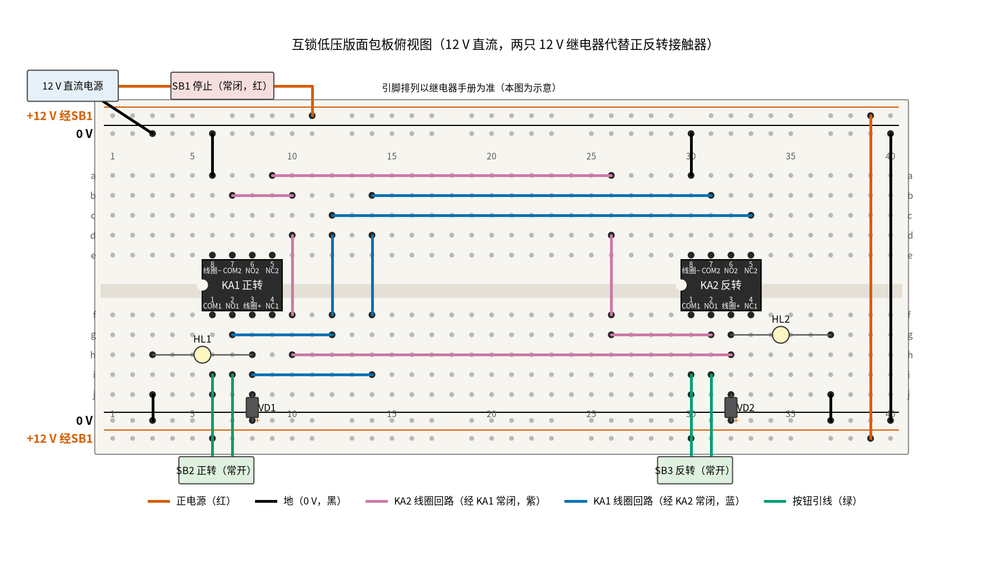
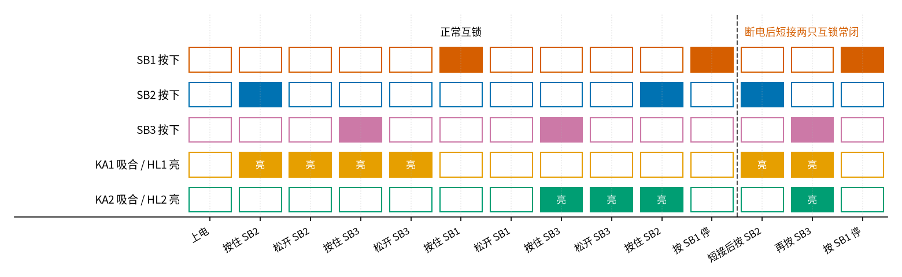

# 18 互锁 · 动手实验篇

[上一页：参数与调试篇](page3.md) · [直觉篇](page1.md) · [原理与实现篇](page2.md) · [参数与调试篇](page3.md) · 本页：动手实验篇 · [下一页：03 电压跟随器 · 直觉篇](../03-voltage-follower/page1.md) · 前置节点：[17 自锁 · 直觉篇](../17-self-locking/page1.md)

> [!WARNING]
> **市电危险：不要接 220 V/380 V，市电接线请电工。** 真实的正反转电路主电路是 380 V 三相，两只接触器同时吸合就是相间短路，电弧可能伤人；控制回路也常接 220 V 或 380 V。本页只做 12 V 直流低压版：两只 12 V 继电器代替 KM1、KM2，两只 12 V 小灯泡代替「正转」「反转」，不接任何电动机，绝对不要接到插座上。

## 这次实验要验证什么

用两只继电器亲手验证 [18 互锁 · 原理与实现篇](page2.md) 第二节的两行式子：每只线圈前面串着**对方的常闭触点**，于是「一只吸着，另一只怎么按都吸不上」。本页是 [18 互锁 · 原理与实现篇](page2.md) 第六节「低压动手实验」的展开版：器材、接法和四个验证步骤都和那里一致，只是把指示用的 LED 换成了更像「电机在转」的小灯泡，并给每一步配上万用表读数。如果你手边只有 LED，就照第六节用「LED 串 1 kΩ」并在线圈上，结论完全一样。

## ⚠️ 安全须知

- **只用 12 V 及以下的直流电**：12 V 适配器或可调直流电源。**不要接 220 V/380 V，市电接线请电工。**
- 本实验没有电解电容；但两只 **1N4007 有方向**：白圈（阴极）朝线圈正端，另一端接 0 V。接反了一通电就是短路。二极管为什么要加，见 [22 三极管开关与继电器驱动 · 原理与实现篇](../22-bjt-relay-driver/page2.md)。
- **灯泡会烫**：点亮几分钟后不要用手摸玻璃壳。
- **改线、插拔跳线前先断电**。第 ⑧ 步要用跳线短接互锁触点，必须先拔掉电源再插跳线，做完立刻拆掉。
- 短接实验在 12 V 上只是两盏灯同时亮；**在真实接触器柜里绝对不要这样试**，那就是 380 V 相间短路。

## 器材清单

| 元件 | 型号或数值 | 数量 | 说明 |
|---|---|---|---|
| 继电器 KA1、KA2 | 线圈 12 V 直流、双刀双掷（两组转换触点）、可插面包板 | 2 | 代替 KM1（正转）、KM2（反转）；第一组常开作自锁，第二组常闭作互锁 |
| 停止按钮 SB1 | 自复位常闭按钮（红色） | 1 | 接在电源和面包板之间 |
| 正转按钮 SB2、反转按钮 SB3 | 自复位常开按钮 | 2 | 面板式按钮用鳄鱼夹线接入，也可用轻触按键 |
| 二极管 VD1、VD2 | 1N4007 | 2 | 分别反并在两只线圈上 |
| 小灯泡 HL1、HL2 | 12 V、1 W 以下，带灯座 | 2 | 分别并在两只线圈上，当「正转」「反转」指示；可换成 LED 串 1 kΩ |
| 电源 | 12 V 直流适配器或可调直流电源，能给出 0.3 A 以上 | 1 | 短接实验时两路同时吸合要用约 0.23 A |
| 万用表 | 带直流 20 V、200 mA、电阻挡、蜂鸣挡 | 1 | |
| 面包板、杜邦线、鳄鱼夹线、短跳线 | 830 孔 | 1 套 | 短跳线留给第 ⑧ 步 |

## 搭建步骤

电路就是 [18 互锁 · 直觉篇](page1.md) 第三节那张「接触器互锁」控制回路图：L 换成 +12 V，N 换成 0 V，FR 省略。每一步都在**断电**状态下完成。

1. **核对继电器引脚**。用蜂鸣挡找出每只继电器的公共端、常开、常闭：不通电时 COM 和 NC 之间响。下面按「下排 COM1、NO1、线圈正、NC1，上排线圈负、COM2、NO2、NC2」的示意排列写，你的型号不同就按手册换位置。
2. **插继电器**。KA1 跨在凹槽上，左端第 6 列（f6 COM1、f7 NO1、f8 线圈正；e6 线圈负、e7 COM2、e9 NC2）；KA2 左端第 30 列（f30 COM1、f31 NO1、f32 线圈正；e30 线圈负、e31 COM2、e33 NC2）。
3. **电源和停止按钮**。12 V 负极接上边内侧 0 V 轨；12 V 正极先接 SB1 的一端，SB1 的另一端接上边外侧轨（这条轨叫「+12 V 经 SB1」）。第 39 列红色线连上下两条外侧轨，第 40 列黑线连上下两条 0 V 轨。
4. **线圈负端和公共端**。黑线 a6、a30 → 上边 0 V 轨；红色线 j6、j30 → 下边外侧轨（两只继电器的 COM1 都接「+12 V 经 SB1」）。
5. **启动按钮（与自锁触点并联）**。SB2 两端接 i6、i7；SB3 两端接 i30、i31。
6. **KA1 线圈回路（蓝色线）**：g7 → g12；f12 → d12 跨过凹槽；c12 → c33（到 KA2 的常闭 NC2）；b31 → b14（从 KA2 的 COM2 出来）；d14 → f14 跨回下半区；i14 → i8（到 KA1 线圈正）。
7. **KA2 线圈回路（紫色线）**：g31 → g26；f26 → d26；a26 → a9（到 KA1 的常闭 NC2）；b7 → b10（从 KA1 的 COM2 出来）；d10 → f10；h10 → h32（到 KA2 线圈正）。
8. **二极管和灯泡**。VD1 插在下边 0 V 轨第 8 列和 j8 之间，白圈朝 j8；VD2 插在 0 V 轨第 32 列和 j32 之间。HL1 插 h8–h3，黑线 j3 → 0 V 轨；HL2 插 g32–g37，黑线 j37 → 0 V 轨。
9. **通电前核对**：电阻挡量「+12 V 经 SB1」轨和 0 V 轨之间，不能是 0 Ω。

[17 自锁 · 动手实验篇](../17-self-locking/page4.md) 的单只自锁接法在这里被复制了两份，再用两组长跳线把「对方的常闭」串进来，接好后应该和 图 18-p4-1 一样。



*图 18-p4-1　互锁低压版的面包板接线（12 V 直流，两只 12 V 继电器）*

长跳线在面包板上交叉跨越，很难一眼看出哪根属于哪只继电器；先对照 图 18-p4-3 的电路原理图分清两条线圈回路，再逐根核对。


*图 18-p4-3　图 18-p4-1 对应的电路原理图（灰色小字是面包板孔位和继电器引脚，蓝线、紫线与面包板图同色，点线是「磁力带动」，不是导线）*

**对照看**：面包板的连通规则见 [P1 元件速成 · 动手实验篇](../P1-components-basics/page4.md)：同一列的 a–e、f–j 各自连通，凹槽两边不通。继电器跨在凹槽上，所以 COM1、NO1、线圈正端在下半区（f–j），COM2、NC2、线圈负端在上半区（a–e）；蓝线和紫线都要在第 12、14、26、10 列用竖跳线跨过凹槽，才能从一只继电器的下半区走到另一只的上半区。对照原理图看：KA1 的线圈电流从 NO1（第 7 列）出发，必须先穿过 KA2 的常闭 c33–b31 才能到 j8，所以 KA2 一吸合，这条路就断了；KA2 那边反过来串着 KA1 的常闭 a9–b7。测量表里量 a9–b7、c33–b31 两端电压，就是在看这两只互锁触点是通还是断。原理图的结构和 [18 互锁 · 直觉篇](page1.md) 「三、看图：互锁的控制回路和它的效果」里的接触器互锁图一样，L 换成 +12 V、N 换成 0 V；对应的两行式子见 [18 互锁 · 原理与实现篇](page2.md) 「二、推导：把互锁翻译成式子」。

图中红色线是 +12 V，黑色线是 0 V，蓝色线是 KA1 线圈回路里经过 KA2 常闭触点的那段，紫色线是 KA2 线圈回路里经过 KA1 常闭触点的那段，绿色线是按钮引线。长跳线会从别的孔上方跨过去，只有画了黑点的孔才真正插着线。芯片体上的脚名只是示意，以手册为准。

## 测量表

「应该读到」取自 [review/spice/18.md](../review/spice/18.md) 的「面包板万用表读数」表；灯泡电流由 code/figs/18_figs.py 按 1 W ÷ 12 V 算出约 83 mA。

| 步骤 | 测什么 | 红表笔 | 黑表笔 | 挡位 | 应该读到 | 读不到时先查 |
|---|---|---|---|---|---|---|
| ① 上电 | 电源 | 「+12 V 经 SB1」轨 | 0 V 轨 | 直流 20 V | 约 12.0 V | 0 V：断电，查 SB1 是否接成常开 |
| ② 按 SB2 正转 | KA1 线圈电压（松手后） | j8 | 0 V 轨 | 直流 20 V | 约 12 V，HL1 亮并保持 | 松手就灭：断电，查 i6、i7 和 f7 所在列 |
| ② 正转中 | KA2 线圈电压 | j32 | 0 V 轨 | 直流 20 V | 0 V，按住 SB3 也是 0 V | 读到 12 V：断电，互锁线 a26–a9 没接到 KA1 的常闭 |
| ③ 正转中按住 SB3 | KA1 常闭 NC2–COM2 两端 | a9 | b7 | 直流 20 V | 约 12 V（触点断开，电压全落在它上面） | 0 V：断电，接到的是常开而不是常闭 |
| ③ 正转中 | KA1 线圈回路里 KA2 常闭两端 | c33 | b31 | 直流 200 mV | ≈ 0 mV（KA2 没吸，常闭导通） | 读到 12 V：KA2 常闭认错脚，断电后重新核对 |
| ④ 按 SB1 再按 SB3 | KA2 线圈电压 | j32 | 0 V 轨 | 直流 20 V | 约 12 V，HL2 亮、HL1 灭 | KA2 不吸：断电，查 h10–h32 和 b7–b10 |
| ④ 反转中按住 SB2 | KA1 线圈电压 | j8 | 0 V 轨 | 直流 20 V | 0 V | 读到 12 V：断电，查蓝色线是否接到 KA2 的常开 |
| ⑤ 断电检查 | 线圈电阻（先拔掉同一列的灯泡） | j8 | a6 | 电阻 2 kΩ | 继电器标称值，12 V/30 mA 的约 400 Ω | 0 Ω：二极管接反 |
| ⑥ 正转中 | 一路电流（电流表串在 j6 那根线里） | 下边外侧轨 | j6 | 直流 200 mA | 约 12 V ÷ 线圈电阻，400 Ω 时约 30 mA，加上 1 W 灯泡约 113 mA | 远大于此：断电，查二极管和短路 |
| ⑦ 断电检查 | KA1 的互锁常闭（KA2 的同理量 c33、b31） | a9 | b7 | 蜂鸣挡 | 响（不通电时常闭导通） | 不响：引脚认错 |
| ⑧ 短接后 | 两只线圈电压（按 SB2 再按 SB3） | j8、j32 各量一次 | 0 V 轨 | 直流 20 V | 都约 12 V，两灯同亮 | 只亮一只：跳线没插到两只常闭的两端 |

共 11 个测量点。第 ⑥ 步量电流时，表笔要串进电路（拔掉 j6 那根线的一头，表笔接在断开处），**换挡、改接前先断电**；做完记得把电流表挡拨回电压挡。

## 没有示波器怎么办

和 [17 自锁 · 动手实验篇](../17-self-locking/page4.md) 一样，两盏灯和继电器「咔哒」的声音就是显示器。照 图 18-p4-2 的顺序一格一格操作，每一步对照一次两盏灯。



*图 18-p4-2　实验操作顺序与两只继电器应有的状态*

图中每一列是一个操作，实心格表示「按下」或「吸合、灯亮」。左边十一列由 code/figs/18_figs.py 按 [18 互锁 · 原理与实现篇](page2.md) 第二节的两行式子逐步推出；第四列「正转中按住 SB3」KA2 那一格是空的，这就是互锁。虚线右边去掉了式子里「对方常闭」那一项，第十三列两只同时吸合，在 380 V 上就是相间短路。

**只能讲道理的部分**：如果只短接其中一只的互锁（例如 KA2 回路里 KA1 的常闭），按 SB3 时你看到的是 HL1 灭、HL2 亮，好像没事；但两只交接的那几毫秒里其实同时吸着，万用表和眼睛都分辨不出，只有示波器能看到。这段重叠时间怎么算、为什么只做按钮互锁时可能是负的，见 [18 互锁 · 参数与调试篇](page3.md) 第一节的换向空档图；主触点熔焊时为什么只有接触器互锁救得了，也只能看那一节的熔焊图，本实验不模拟熔焊。

## 用 Python 核对你的读数

把你每一步看到的「哪盏灯亮」填进去，代码按两行式子推一遍，指出不符的步骤；再填线圈电阻和电流，检查偏差。

```python
import sys, pathlib
sys.path.insert(0, str(pathlib.Path("code/figs").resolve()))  # 在仓库根目录运行

# ===== 把下面换成你自己的实测值（这里是一组示例） =====
# 每一步：(名称, 按住 SB1, 按住 SB2, 按住 SB3, 你看到 HL1 亮, 你看到 HL2 亮)
STEPS = [("按住 SB2", 0, 1, 0, 1, 0), ("松开", 0, 0, 0, 1, 0), ("按住 SB3", 0, 0, 1, 1, 0),
         ("按住 SB1", 1, 0, 0, 0, 0), ("按住 SB3", 0, 0, 1, 0, 1), ("按住 SB2", 0, 1, 0, 0, 1)]
V_SUPPLY = 12.05      # 电源实测，V
R_COIL = 395          # 拔掉灯泡后量到的线圈电阻，Ω
I_COIL_MA = 29.6      # 拔掉灯泡后串表量到的线圈电流，mA

k1 = k2 = 0
for name, s1, s2, s3, see1, see2 in STEPS:
    for _ in range(4):        # 迭代到稳定：K1' = 非S1·(S2+K1)·非K2，K2' = 非S1·(S3+K2)·非K1
        k1, k2 = (int(not s1 and (s2 or k1) and not k2), int(not s1 and (s3 or k2) and not k1))
    ok = (k1, k2) == (see1, see2)
    print(f"{name}: 理论 HL1={k1} HL2={k2}，你看到 {see1} {see2}" + ("" if ok else "  <-- 不符，断电后查线"))

i_calc = V_SUPPLY / R_COIL * 1000
dev = (I_COIL_MA - i_calc) / i_calc * 100
flag = "  <-- 偏差超过 10%，查表笔接法或接触不良" if abs(dev) > 10 else ""
print(f"线圈电流: 实测 {I_COIL_MA:.1f} mA，计算 {i_calc:.1f} mA，偏差 {dev:+.1f}%{flag}")
```

示例数据里六步全部吻合，线圈电流计算值 30.5 mA，实测偏差 −3.0%。

## 实验记录表

| 项目 | 实测值 | 计算值 | 偏差 |
|---|---|---|---|
| 电源电压 |  | 12 V |  |
| 正转时 KA1 线圈电压 |  | 等于电源 |  |
| 正转中按住 SB3 时 KA2 线圈电压 |  | 0 V | — |
| 正转中按住 SB3 时 KA1 常闭两端 |  | 约 12 V |  |
| 线圈电阻 |  | 手册值 |  |
| 线圈电流 |  | 电压 ÷ 电阻 |  |
| 短接两只互锁后，两灯是否同亮 |  | 同亮 | — |

**思考题 1**：第 ③ 步正转中按住 SB3 时，为什么 KA1 常闭两端能读到约 12 V，而 KA2 线圈两端是 0 V？

<details><summary>答案</summary>

KA2 的回路从「+12 V 经 SB1」经 SB3、KA1 常闭、KA2 线圈到 0 V 是串联的。KA1 吸合时它的常闭断开，断开处电阻极大，串联回路里几乎全部 12 V 都落在断开的触点上，线圈分不到电压。这和 [P1 元件速成 · 原理与实现篇](../P1-components-basics/page2.md) 第一节的分压公式是同一件事：一个电阻趋于无穷大，它分走全部电压。

</details>

**思考题 2**：如果把蓝色的 c12 → c33 错插到了 c12 → c32（KA2 的常开 NO2 那一列），会出现什么现象？

<details><summary>答案</summary>

KA1 的回路要经过 KA2 的常开才能通，而 KA2 平时不吸，所以停机时按 SB2，KA1 根本吸不上，正转按钮「失灵」。反转中按 SB2 更糟：KA1 先吸合，它的常闭一断开就把 KA2 挤掉，KA2 一释放，它的常开又断开了 KA1 的回路，最后两只都停下；而在这一串动作中间，有一小段两只同时吸着。常开常闭认错，互锁不但没了，还会制造重叠，所以第 1 步一定要先用蜂鸣挡认脚。

</details>

**思考题 3**：本实验的接触器互锁在「正转中直接按反转」时什么也不发生，必须先按停止。怎样改才能不按停止直接换向？会多冒什么风险？

<details><summary>答案</summary>

换成带常闭触点的复合按钮，把 SB3 的常闭串进 KA1 回路、SB2 的常闭串进 KA2 回路，就是 [18 互锁 · 原理与实现篇](page2.md) 第二节的双重互锁。风险是换向时先断后通的空档变短，只做按钮互锁时甚至可能重叠，见 [18 互锁 · 参数与调试篇](page3.md) 第一节；所以按钮互锁只能加在接触器互锁之上，不能代替它。

</details>

## 自测清单

- 我能说清楚为什么本页只用 12 V，并且知道市电接线必须请电工。
- 我能用蜂鸣挡认出继电器的常开、常闭，并把「对方的常闭」串进自己的线圈回路。
- 我能按 图 18-p4-2 预测每一步两盏灯的状态，并用万用表说明互锁触点上的电压。
- 我能解释短接互锁后两灯同亮，在真实电路里意味着什么。
