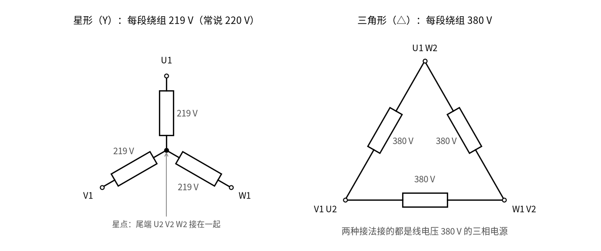
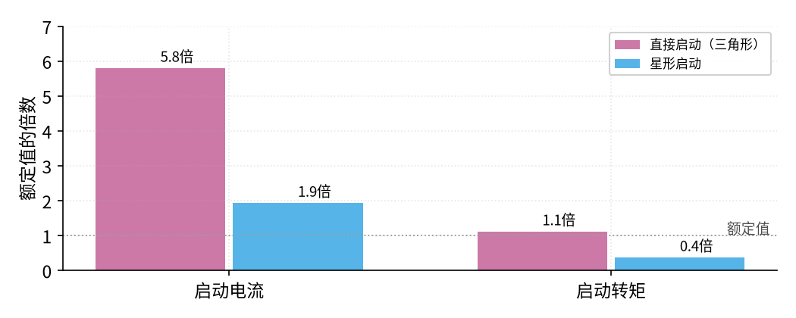
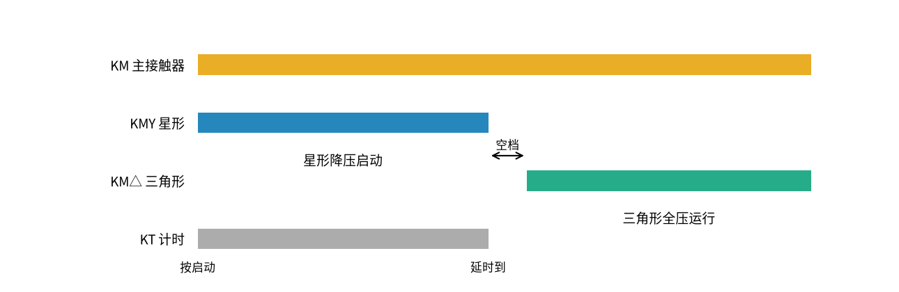

# 19 星三角降压启动 · 直觉篇

[上一页：12 积分电路 · 动手实验篇](../12-integrator/page4.md) · 本页：直觉篇 · [原理与实现篇](page2.md) · [参数与调试篇](page3.md) · [下一页：原理与实现篇](page2.md) · 前置节点：[P1 元件速成 · 直觉篇](../P1-components-basics/page1.md)、[18 互锁 · 直觉篇](../18-interlock/page1.md)

> [!WARNING]
> **市电危险**：本电路的实际版本接 220V/380V 市电，触电可能致命。本页的仿真和动手实验只在 12V 以下的低压电源上进行；任何接线、改线都必须在断电并验电后操作，由持证电工完成。
>
> 本节点特有的危险点：① 星三角的主电路是 **380 V 三相**，而且电动机有 **6 根出线**、接线盒里同时有星形和三角形两套接法，接错一根就可能把两相直接短接；② KMY（星形）和 KM△（三角形）一旦同时吸合，三根相线会经星点**直接短路**，电流极大、电弧强烈，这正是本页反复强调互锁的原因；③ 控制回路（按钮、线圈、时间继电器）常常直接接 **220 V 或 380 V**，时间继电器的调节旋钮旁边就是带电端子，**调延时也要断电**；④ 按下停止只是让线圈断电，主电路仍然带电；新装或改过线的电路，第一次试车要先**断开电动机接线**，只看三只接触器的动作顺序对不对。

## 一、痛点：电动机刚启动的那一下，电流大得吓人

17 和 18 里，我们按下启动按钮，接触器一吸合，电动机就直接接上了全部电压，这叫**直接启动**。小电动机这么做没问题，可是功率一大，麻烦就来了。

电动机静止的时候，转子还没转起来，绕组里几乎没有"反抗"电流的东西，就像一根粗导线接在电源上。资料给出的数字是：鼠笼式电动机（转子像一个用铝条或铜条做成的笼子，是工厂里最常见的三相电动机）直接启动时，启动电流通常是正常运行电流的 **5～7 倍**。这么大的电流一冲，同一条线路上的电压会被拉低，旁边的灯会一暗，别的设备可能被干扰；熔断器和断路器也得按这个大电流来选，很不划算。

能不能让电动机"起步时轻踩油门，跑起来再踩到底"？星三角降压启动就是工厂里最常用、最便宜的一种办法。它只需要三只接触器加一个时间继电器，不用任何电力电子器件。

## 二、类比：先用两个人推车，车动了再叫第三个人

想象一辆很重的车停在平地上。三个人一起猛推，车一下子就动了，但三个人都使出了全身力气，很吃力，这就是直接启动。换个做法：先用省力的姿势推，车慢慢动起来；等车有了速度，再换成全力推。起步时用力小，最后的速度还是一样。

电动机里的"姿势"就是三段绕组的接法。先看 图 19-p1-1：

*图 19-p1-1　同一台电动机的两种接法：星形每段绕组约 219 V，三角形每段 380 V*

图 19-p1-1 左边是**星形**接法：三段绕组的尾端接在一起，每段绕组一头接一根电源线，另一头接在星点上。你可能会想：两根电源线之间串着两段一样的绕组，按串联分压应该各分 380 ÷ 2 = 190 V。其实不对：三根电源线上的交流电不是同时到达最高点，而是一个接一个错开 1/3 个周期，所以两段绕组上的电压不能简单对半分。按三相电的规律，每段分到的是 380 V 除以根号 3，约 219 V，也就是平时常说的 220 V（家里插座的 220 V 就是这么来的）。根号 3 是怎么算出来的，[原理与实现篇](page2.md) 第一节用一张波形图说明。右边是**三角形**接法：三段绕组首尾相接，每段绕组直接跨在两根电源线之间，吃满 380 V。

同一台电动机，电源没换，只是换了接法，每段绕组上的电压就差了根号 3 倍。星三角启动就是：**启动时接成星形，转起来以后再改成三角形**。注意这只适用于平时本来就按三角形接法运行的电动机。

## 三、看图：电流降到三分之一，三只接触器接力

星形启动到底省了多少？看 图 19-p1-2：

*图 19-p1-2　一台示意电动机：直接启动与星形启动的启动电流和启动转矩*

图 19-p1-2 里，这台示意电动机直接启动时电流是额定电流的 5.8 倍，改成星形启动只有 1.9 倍，正好是三分之一。这个"三分之一"在原理篇里会推出来：每段绕组电压降到原来的根号 3 分之一，电流先降根号 3 倍；三角形接法线上的电流本来又是绕组电流的根号 3 倍，两样一乘，就是 3 倍。

天下没有白吃的午餐。图 19-p1-2 右边一组说明，启动转矩（转矩就是高中物理里的"力矩"，指让转子转起来的转动效果）也只剩三分之一，从 1.12 倍额定转矩掉到 0.37 倍。所以星三角只适合**轻载启动**，比如风机、水泵；如果一开始就要带很重的负载，星形可能根本推不动。

那么，谁来负责"先星形、后三角形"的切换？看 图 19-p1-3：

*图 19-p1-3　三只接触器的分工：KM 管通电，KMY 和 KM△ 接力，KT 负责计时*

图 19-p1-3 像一场接力赛。KM 是主接触器，把电送进电动机，从头到尾都吸合。KMY 先跑第一棒，把绕组尾端接在一起成星形；时间继电器 KT 同时开始计时。时间一到，KMY 先松开，**隔一小段空档**以后，KM△ 才接过第二棒，把绕组改成三角形。

这段空档叫**切换延时**，由时间继电器 KT 来安排：KT 到时先让 KMY 断电，等 KMY 的触点断开、电弧熄灭以后，KM△ 才通电吸合。专用的星三角延时模块会把这段延时固定下来，例如施耐德 LADS2 给的是 40 ms ± 15 ms（见参数与调试篇）。[18 互锁 · 直觉篇](../18-interlock/page1.md) 里学过的**互锁**是另一道保险，它不决定空档有多长：KMY 和 KM△ 的线圈回路里各串着对方的常闭辅助触点，只负责保证两只接触器绝不会同时吸合，否则三根相线会在星点上直接短路。图 19-p1-3 中空档画得很宽只是为了看清楚，实际只有几十毫秒。

## 四、一句话总结

**星三角启动 = 起步时把绕组接成星形，每段只吃 220 V，启动电流和转矩都降到直接启动的三分之一；时间继电器到点后，先断星形、隔一个空档再接三角形，星形和三角形接触器必须互锁**。

## 参考资料

- 电工天下：《电机星三角降压启动的控制电路图详解》（三只接触器加时间继电器、启动电流为直接启动的 1/3、只能用于三角形运行的电动机、Y 和 △ 两回路都要有闭锁）<https://www.dgjs123.com/diandongji/7411.html>
- 电工天下：《星三角控制电路原理图及星三角启动说明》（启动电流通常为运行电流的 5～7 倍，启动电流和力矩都只有全压的 1/3，适合轻载）<https://www.dgjs123.com/diandongji/13701.html>
- 电工天下：《电动机星三角启动的接线图》（U1–W2、V1–U2、W1–V2 的三角形接法，星形把尾端接在一起）<https://www.dgjs123.com/diandongji/2281.html>
- 网易号 · 防爆云平台：《电机星三角启动时间确定及启动电流计算方法》（星形每相绕组 220 V，三角形 380 V）<https://www.163.com/dy/article/HDRJC87G0518L5FC.html>
- Siemens：*Starting Motors* 白皮书（星三角用三只接触器，启动电流约为直接启动的 1/3）<https://assets.new.siemens.com/siemens/assets/api/uuid:6ba7593d-d8d0-481c-b029-a5987c11366f/startingmotors-whitepaper.pdf>
- Schneider Electric FAQ FA24956：LADS2 星三角延时模块的切换时间 40 ms ± 15 ms <https://www.se.com/uk/en/faqs/FA24956/>
