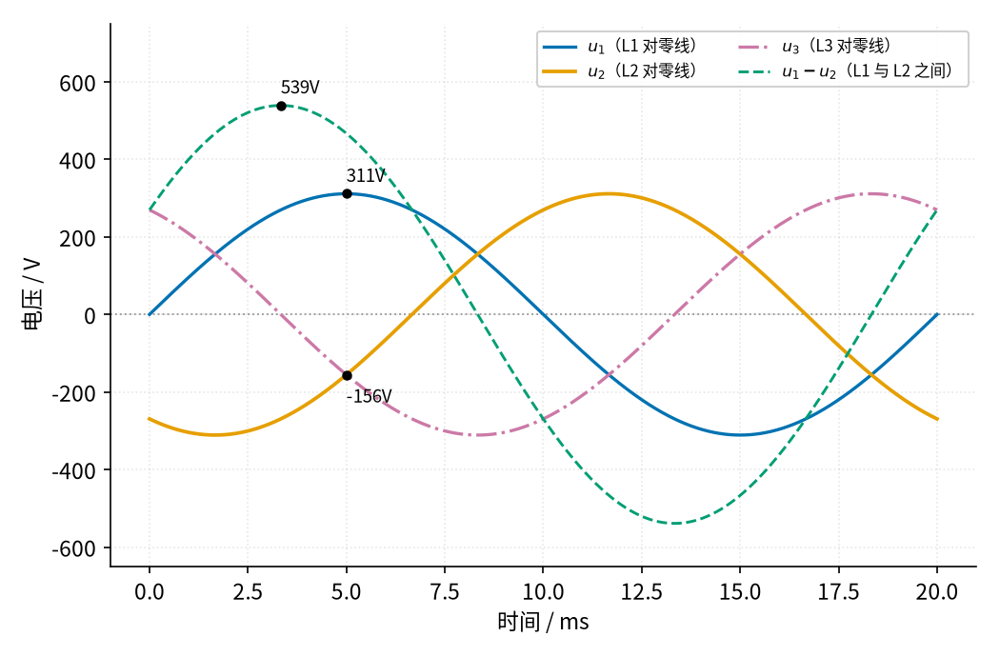
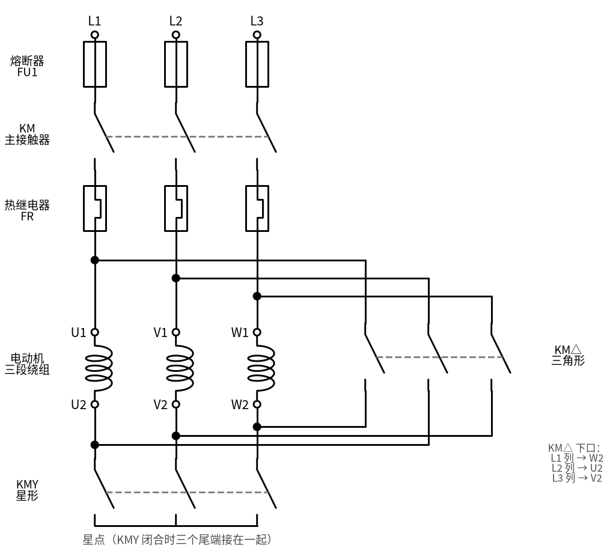
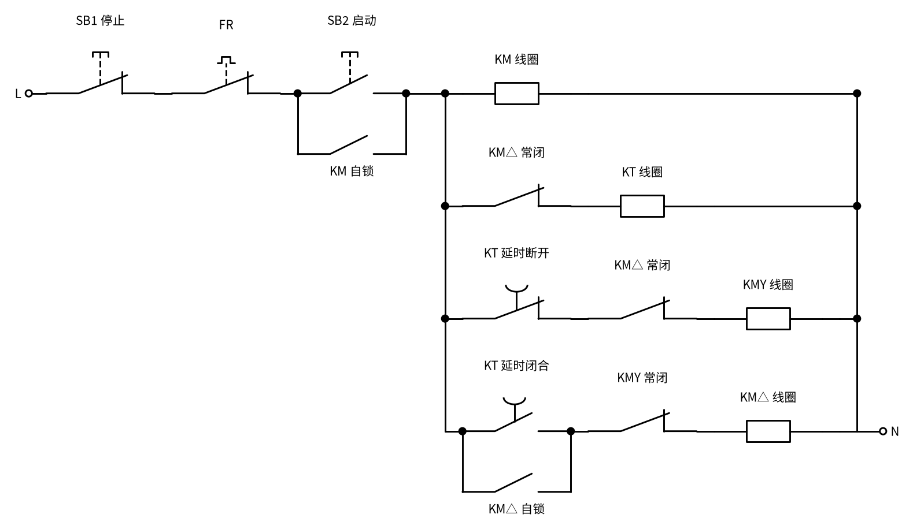
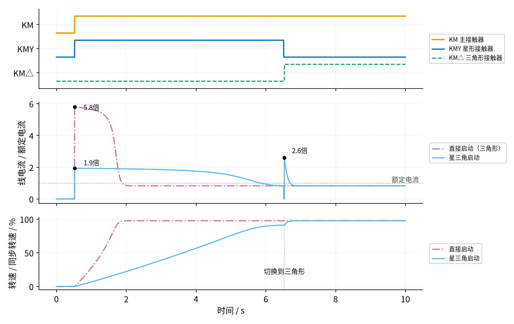
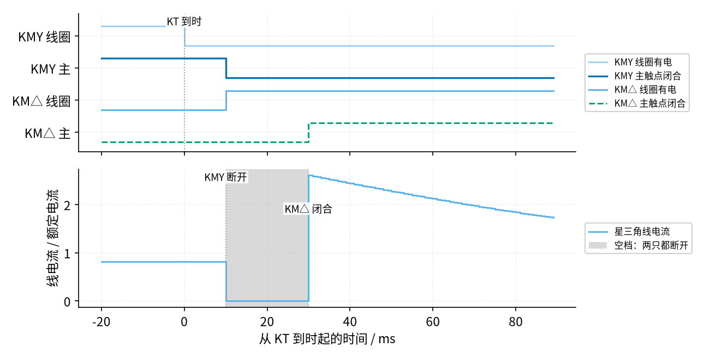
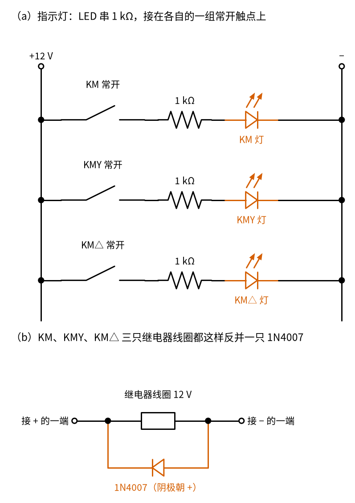
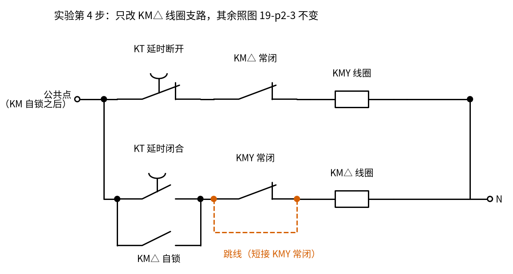

# 19 星三角降压启动 · 原理与实现篇

[上一页：直觉篇](page1.md) · [直觉篇](page1.md) · 本页：原理与实现篇 · [参数与调试篇](page3.md) · [下一页：参数与调试篇](page3.md) · 前置节点：[P1 元件速成 · 直觉篇](../P1-components-basics/page1.md)、[18 互锁 · 直觉篇](../18-interlock/page1.md)

> [!WARNING]
> **市电危险**：本电路的实际版本接 220V/380V 市电，触电可能致命。本页的仿真和动手实验只在 12V 以下的低压电源上进行；任何接线、改线都必须在断电并验电后操作，由持证电工完成。
>
> 本节点特有的危险点：① 星三角的主电路是 **380 V 三相**，而且电动机有 **6 根出线**、接线盒里同时有星形和三角形两套接法，接错一根就可能把两相直接短接；② KMY（星形）和 KM△（三角形）一旦同时吸合，三根相线会经星点**直接短路**，电流极大、电弧强烈，这正是本页反复强调互锁的原因；③ 控制回路（按钮、线圈、时间继电器）常常直接接 **220 V 或 380 V**，时间继电器的调节旋钮旁边就是带电端子，**调延时也要断电**；④ 按下停止只是让线圈断电，主电路仍然带电；新装或改过线的电路，第一次试车要先**断开电动机接线**，只看三只接触器的动作顺序对不对。

## 一、最小知识：三件要先知道的事

1. **线电压和相电压**。三相电源三根相线 L1、L2、L3 两两之间的电压叫**线电压**，我国低压配电是 380 V。电动机里每一段绕组两端的电压叫**相电压**。星形接法里，每段绕组一头接相线、一头接星点（星点和零线等电位），所以绕组电压就是 [17 自锁 · 直觉篇](../17-self-locking/page1.md) 小知识框里说的"相线对零线"的 220 V，线电压是它的根号 3 倍（为什么是根号 3，见下面的图 19-p2-1），线上的电流就是绕组里的电流；三角形接法里，每段绕组直接跨在两根相线之间，相电压就等于线电压，但每根相线要同时给两段绕组供电，线电流是绕组电流的根号 3 倍（同样是两个错开 1/3 个周期的量相减，道理和电压一样）。
2. **通电延时型时间继电器 KT**。线圈一通电就开始计时，计满整定时间后，它的**延时断开常闭**触点断开、**延时闭合常开**触点闭合；线圈一断电，触点立刻复位。它的普通线圈和触点画法跟 P1 里学的接触器一样，只是触点上多了一个表示"延时"的半圆记号。
3. **电动机转矩大致跟电压的平方成正比**。电压降到原来的几分之一，绕组电流按同样比例降，产生转矩的"磁场乘电流"就按平方降。星形让每段绕组电压变成三角形时的根号 3 分之一，转矩就降到三分之一。这里的**转矩**就是高中物理里的"力矩"，指让转子转起来的那个转动效果。

**根号 3 是怎么来的**？很多人第一反应是：星形里两根相线之间串着两段一样的绕组，按串联分压，每段应该分到 380 ÷ 2 = 190 V，怎么会是 380 ÷ 根号 3？关键在于三根相线上的交流电**不是同时到达最高点**。看 图 19-p2-1：



*图 19-p2-1　三相电压错开 1/3 个周期，两相之差的峰值是单相的 √3 倍*

图 19-p2-1 里蓝色、橙色、红紫色点划线分别是 L1、L2、L3 对零线的电压，有效值都是 220 V，峰值 $220 \times \sqrt{2} \approx 311$ V；L2 比 L1 晚 1/3 个周期（50 Hz 时是 6.67 ms），L3 再晚 1/3 个周期。蓝绿色虚线是 L1 和 L2 之间的电压 $u_1 - u_2$ ，也就是线电压。注意 5 ms 那一刻：蓝色到了最高的 311 V，橙色却只有 -156 V，并不在最低点，所以两者之差不是 $2 \times 311$ V。程序把一个周期逐点相减，打印出差值的最大值是 539 V，正好是 311 V 的 1.732 倍，也就是根号 3 倍；有效值同样按这个比例， $220 \times 1.732 \approx 381$ V，这就是常说的 380 V。学过三角函数和差化积公式的同学可以自己验证 $\sin a - \sin(a - 120^\circ) = \sqrt{3} \sin(a + 30^\circ)$ ；没学过也没关系，记住"两相错开 1/3 周期相减，结果是根号 3 倍"就够用。两个交流电在时间上错开一个周期的几分之几，叫它们的**相位差**，三相电相邻两相的相位差就是 1/3 个周期（也写作 120°）。

## 二、推导：三分之一是怎么来的

**先用中文说**。设每段绕组在启动瞬间的阻抗都是同一个值，叫它 Z。星形时，每段绕组只分到线电压的根号 3 分之一，所以绕组电流也小根号 3 倍；又因为星形的线电流就是绕组电流，线上的电流比"把整个线电压加在一段绕组上"小根号 3 倍。三角形时，每段绕组吃满线电压，绕组电流是满的；可每根相线还要再乘根号 3。两边一比，差了根号 3 乘根号 3，也就是 3 倍。

**再写成公式**。星形：

$$I_{L,Y} = I_{\mathrm{ph},Y} = \frac{U_L / \sqrt{3}}{Z} = \frac{U_L}{\sqrt{3}Z}$$

三角形：

$$I_{L,\Delta} = \sqrt{3} I_{\mathrm{ph},\Delta} = \sqrt{3} \frac{U_L}{Z}$$

**最后做代数**。两式相除，Z 和 $U_L$ 都约掉：

$$\frac{I_{L,Y}}{I_{L,\Delta}} = \frac{U_L / (\sqrt{3}Z)}{\sqrt{3} U_L / Z} = \frac{1}{3}$$

转矩跟相电压的平方成正比： $(1/\sqrt{3})^2 = 1/3$ ，所以启动转矩也只剩三分之一。

**主电路怎么改接法**？看 图 19-p2-2：



*图 19-p2-2　星三角主电路：KMY 把尾端接成星点，KM△ 把尾端接回另一根相线*

图 19-p2-2 里三段绕组单独画了出来。KM 一吸合，三根相线就接到了首端 U1、V1、W1。如果此时 KMY 吸合，尾端 U2、V2、W2 被接在一起，就是星形；如果改成 KM△ 吸合，L1 那一列接到 W2、L2 接到 U2、L3 接到 V2，正好是 U1–W2、V1–U2、W1–V2 首尾相连，就是三角形。

从 图 19-p2-2 也能一眼看出危险在哪：假如 KMY 和 KM△ 同时闭合，L1 经 KM△ 到 W2，再经 KMY 的星点到 U2，又经 KM△ 回到 L2——两根相线之间只隔着几只触点，就是**相间短路**。

**控制回路怎么保证顺序**？看 图 19-p2-3：



*图 19-p2-3　星三角控制回路：KT 计时，KMY 常闭和 KM△ 常闭互相锁住*

图 19-p2-3 的左半边就是 17 里的自锁：按 SB2，KM 线圈通电并自锁，"公共点"从此一直有电。右边四条支路可以写成逻辑式（和 18 一样，带撇号的表示"下一刻线圈有没有电"， $T$ 表示 KT 已经计满）：

$$\mathrm{KM}' = \overline{\mathrm{SB1}} \cdot (\mathrm{SB2} + \mathrm{KM})$$

$$\mathrm{KMY}' = \mathrm{KM}' \cdot \overline{T} \cdot \overline{\mathrm{KM\Delta}}$$

$$\mathrm{KM\Delta}' = \mathrm{KM}' \cdot (T + \mathrm{KM\Delta}) \cdot \overline{\mathrm{KMY}}$$

读法：KMY 要通电，必须 KT 还没到时，并且 KM△ 没吸合；KM△ 要通电，必须 KT 到时（或者已经自锁），并且 **KMY 已经释放**。最后这一项就是关键：KT 到时那一刻，KMY 线圈先断电，但 KM△ 线圈要等 KMY 的常闭辅助触点真正复位才能通电，所以空档至少等于 KM△ 的吸合时间。从 KT 到时算起，KMY 主触点在 $t_{\mathrm{drop,KMY}}$ 时断开，KM△ 线圈也在这时才通电，它的主触点要到 $t_{\mathrm{drop,KMY}} + t_{\mathrm{pick,KM\Delta}}$ 才闭合。两者相减：

$$t_{\mathrm{gap}} = (t_{\mathrm{drop,KMY}} + t_{\mathrm{pick,KM\Delta}}) - t_{\mathrm{drop,KMY}} = t_{\mathrm{pick,KM\Delta}}$$

KT 线圈前面串的 KM△ 常闭，作用是三角形接通以后让 KT 断电复位，不再一直耗电。

## 三、仿真：逐毫秒推演三只接触器和电动机

下面的程序把 图 19-p2-3 的控制回路按 18 的办法逐毫秒推演，再接上一个"示意"电动机模型（每相简化等效电路，参数是编的，只为看清趋势），同时跑一遍直接启动作为对照。

程序要在**仓库根目录**运行，它会重新生成 图 19-p2-4 和 图 19-p2-5。电动机模型那 20 来行用到了**复数**（代码里的 `1j`）、**标幺值**（把电流、转矩都写成"额定值的几倍"）和**转差率**（转子比旋转磁场慢多少，用比例表示；旋转磁场的转速叫**同步转速**，转子总是略慢于它），这部分超出本教程，不要求看懂，只看打印结果和图就行。完整版 `code/19_sim.py` 比下面多打印一行"切换尖峰 ÷ 直接启动峰值"，后文会用到。想改参数做实验，先复制一份：`cp code/19_sim.py my_19.py`，再改 `my_19.py`。

```python
# 19 星三角降压启动的最小仿真：控制回路沿用 17、18 的逐毫秒推演，再接一个"示意"电动机模型，看启动电流和转速。
# 控制回路（L → SB1 停止 → [SB2 启动 并联 KM 自锁] 之后叫"公共点"）：
#   KM 线圈：公共点 → KM 线圈
#   KT 线圈：公共点 → KM△ 常闭 → KT 线圈（时间继电器，通电延时）
#   KMY 线圈：公共点 → KT 延时断开常闭 → KM△ 常闭（互锁）→ KMY 线圈
#   KM△ 线圈：公共点 → [KT 延时闭合常开 并联 KM△ 自锁] → KMY 常闭（互锁）→ KM△ 线圈
import sys, pathlib
sys.path.insert(0, str(pathlib.Path("code/figs").resolve()))  # 在仓库根目录运行
import numpy as np                                 # 数组运算
import matplotlib.pyplot as plt                    # 画图
import figstyle as fs                              # 全书统一的颜色、轴标签、保存函数

dt = 1e-3                                          # 每一小段 1 ms
t = np.arange(0, 10, dt)                           # 一共仿真 10 s
T_PICK, T_DROP = 0.020, 0.010                      # 接触器：线圈通电 20 ms 吸合到位，断电 10 ms 释放到位（同 18）
T_SET = 6.0                                        # 时间继电器 KT 的延时整定值：6 s（示意值）
sb2 = (t >= 0.5) & (t < 0.8)                       # 0.5 s 按下启动按钮 SB2，按 0.3 s
sb1 = np.zeros_like(t, dtype=bool)                 # 本次不按停止

# ---------- 示意电动机：每相"简化等效电路"，全部用标幺值（额定电流 = 1、额定转矩 = 1） ----------
R1, R2, X, XM = 0.03, 0.03, 0.16, 3.0              # 定子电阻、转子电阻、漏电抗、励磁电抗（示意值）
def i_rotor(s):                                    # 转子支路电流（三角形全压时），s 是转差率 = 1 − 转速
    return 1 / (R1 + R2 / s + 1j * X)              # 欧姆定律：电压 1 除以支路阻抗
def i_line(s):                                     # 三角形全压时的线电流（转子支路 + 励磁支路）
    return abs(1 / (1j * XM) + i_rotor(s))         # 两条支路的电流相加后取大小
def torque(s):                                     # 三角形全压时的电磁转矩
    return abs(i_rotor(s)) ** 2 * R2 / s           # 转子电阻上"等效功率"除以同步转速（标幺值）
S_N = 0.03                                         # 额定转差率 3%：额定转速 = 同步转速的 97%
I_N, T_N = i_line(S_N), torque(S_N)                # 额定电流、额定转矩，用来做标幺化
J = 2.0                                            # 转动惯量（示意值，单位已折算成标幺）
def load(w):                                       # 负载转矩：风机类，转得越快阻力越大
    return 0.1 + 0.75 * w ** 2                     # 静止时 0.1，额定转速附近约 0.8 倍额定转矩

def motor(conn):                                   # conn[k] = 0 断电、1 星形、2 三角形；返回线电流和转速
    w = 0.0; I = np.zeros_like(t); W = np.zeros_like(t)  # 从静止开始
    for k in range(len(t)):                        # 逐毫秒推演
        s = max(1 - w, 1e-4)                       # 转差率（避免除以 0）
        f = {0: 0.0, 1: 1 / 3, 2: 1.0}[conn[k]]    # 星形：线电流和转矩都是三角形的 1/3（推导见正文）
        I[k] = f * i_line(s) / I_N                 # 线电流（额定电流的倍数）
        Tm = f * torque(s) / T_N                   # 电动机转矩（额定转矩的倍数）
        w = max(w + (Tm - load(w)) / J * dt, 0.0)  # 牛顿第二定律：转矩差使转速变化
        W[k] = w                                   # 记录转速（同步转速的倍数）
    return I, W

# ---------- 控制回路状态机（写法同 18：先按上一刻的线圈状态更新衔铁，再按此刻的触点算线圈） ----------
names = ["KM", "KMY", "KMD"]                       # KMD 代表 KM△
arm = {n: np.zeros_like(t, dtype=bool) for n in names}   # 衔铁（主触点、辅助触点跟着它）
coil = {n: np.zeros_like(t, dtype=bool) for n in names}  # 线圈是否有电
cnt = {n: 0.0 for n in names}                      # 每只接触器"线圈与衔铁不一致"已经持续了多久
kt_coil = np.zeros_like(t, dtype=bool); kt_done = np.zeros_like(t, dtype=bool)  # KT 线圈、KT 延时是否已到
kt_cnt = 0.0                                       # KT 已经计了多久
for k in range(1, len(t)):                         # 逐毫秒推演
    for n in names:                                # 第一步：更新三只接触器的衔铁
        cnt[n] = cnt[n] + dt if coil[n][k - 1] != arm[n][k - 1] else 0.0  # 不一致就累加，一致就清零
        a = arm[n][k - 1]                          # 上一刻衔铁的位置
        arm[n][k] = (not a and cnt[n] >= T_PICK - 1e-9) or (a and cnt[n] < T_DROP - 1e-9)  # 够时间才动
    kt_cnt = kt_cnt + dt if kt_coil[k - 1] else 0.0  # KT：线圈有电就计时，断电立刻清零（通电延时型）
    kt_done[k] = kt_cnt >= T_SET - 1e-9            # 计满 T_SET：延时常闭断开、延时常开闭合
    node = (not sb1[k]) and (sb2[k] or arm["KM"][k])  # 公共点有没有电：停止没按，并且（启动按着或 KM 自锁）
    coil["KM"][k] = node                           # KM 线圈
    kt_coil[k] = node and not arm["KMD"][k]        # KT 线圈：KM△ 吸合后被它的常闭切断，KT 复位
    coil["KMY"][k] = node and not kt_done[k] and not arm["KMD"][k]  # KMY 线圈：KT 延时断开常闭 + KM△ 常闭互锁
    coil["KMD"][k] = node and (kt_done[k] or arm["KMD"][k]) and not arm["KMY"][k]  # KM△：KT 延时闭合或自锁，KMY 常闭互锁

conn = np.where(arm["KM"] & arm["KMY"] & ~arm["KMD"], 1, 0)   # KM 与 KMY 吸合：星形
conn = np.where(arm["KM"] & arm["KMD"] & ~arm["KMY"], 2, conn)  # KM 与 KM△ 吸合：三角形
short = arm["KMY"] & arm["KMD"]                    # KMY 与 KM△ 同时吸合 = 三相短路
assert not short.any()                             # 结论 1：互锁让 KMY、KM△ 永远不会同时吸合

dol = np.where(t >= 0.5 + T_PICK, 2, 0)            # 对照组：直接启动，0.5 s 按下后 KM 吸合就接成三角形
I_d, W_d = motor(dol)                              # 直接启动的电流和转速
I_y, W_y = motor(conn)                             # 星三角启动的电流和转速

def first(x):                                      # 某个布尔数组第一次为真的时刻
    return t[np.argmax(x)]
t_y_on = first(arm["KMY"]); t_y_off = first(~arm["KMY"] & (t > 1))   # KMY 吸合、释放的时刻
t_d_on = first(arm["KMD"]); t_kt_off = first(~kt_coil & (t > 1))    # KM△ 吸合、KT 线圈断电的时刻
print(f"[时序] KM、KMY 在 {first(arm['KM']):.3f} s 吸合（星形启动）；KT 在 {0.5 + T_SET:.3f} s 到时")  # 打印时序
print(f"[时序] KMY 在 {t_y_off:.3f} s 释放，KM△ 在 {t_d_on:.3f} s 吸合，中间空档 {(t_d_on - t_y_off) * 1e3:.0f} ms；KT 线圈在 {t_kt_off:.3f} s 断电复位")  # 打印切换
assert abs(t_d_on - t_y_off - T_PICK) < 1.5e-3     # 空档 = KM△ 的吸合时间（KMY 常闭复位后 KM△ 线圈才通电）

pk_d = I_d.max(); pk_y = I_y[t < 0.5 + T_SET].max()  # 直接启动峰值、星形阶段峰值
print(f"[电流] 直接启动峰值 {pk_d:.1f} 倍额定电流；星形启动峰值 {pk_y:.1f} 倍，是直接启动的 {pk_y / pk_d:.3f}")  # 1/3
assert abs(pk_y / pk_d - 1 / 3) < 0.01             # 结论 2：星形启动电流 = 直接启动的 1/3
k95 = np.argmax(W_d > 0.95 * W_d[-1])              # 直接启动转速到 95% 的时刻
print(f"[转速] 直接启动 {t[k95] - 0.5:.1f} s 转到最终转速的 95%；星三角在切换前转到同步转速的 {W_y[np.searchsorted(t, t_y_off)] * 100:.0f}%")  # 打印转速
k_sw = np.searchsorted(t, t_d_on)                  # 三角形接通的下标
pk_sw = I_y[k_sw:k_sw + 200].max()                 # 切换到三角形后的电流尖峰
print(f"[电流] 切换前 {I_y[np.searchsorted(t, t_y_off) - 1]:.2f} 倍；空档里 0；接成三角形瞬间 {pk_sw:.1f} 倍（稳态模型的示意值），最后稳定在 {I_y[-1]:.2f} 倍")  # 打印切换电流
assert pk_sw < pk_d and I_y[k_sw - 5] == 0         # 结论 3：切换尖峰比直接启动小；空档里电流为 0
assert abs(I_y[-1] - I_d[-1]) < 0.01               # 结论 4：最后两种启动方式的运行电流一样

fig, axs = plt.subplots(3, 1, figsize=(9.5, 6.0), sharex=True, gridspec_kw=dict(height_ratios=[1.1, 1.4, 1.0]))  # 三行
ax = axs[0]                                        # 第一行：接触器状态
ax.plot(t, arm["KM"] * 0.7 + 2.0, **fs.LS["vout"], label="KM 主接触器")     # KM 橙色
ax.plot(t, arm["KMY"] * 0.7 + 1.0, **fs.LS["vin"], label="KMY 星形接触器")   # KMY 蓝色
ax.plot(t, arm["KMD"] * 0.7 + 0.0, **fs.LS["fb"], label="KM△ 三角形接触器")  # KM△ 蓝绿色虚线
ax.set_yticks([0.35, 1.35, 2.35]); ax.set_yticklabels(["KM△", "KMY", "KM"]); ax.set_ylim(-0.3, 3.0)  # 纵轴
ax.legend(loc="center left", bbox_to_anchor=(1.01, 0.5), fontsize=8)      # 图例放到右侧
ax = axs[1]                                        # 第二行：线电流
ax.plot(t, I_d, **fs.LS["third"], label="直接启动（三角形）")              # 直接启动：红紫色点划线
ax.plot(t, I_y, **fs.LS["cur"], label="星三角启动")                       # 星三角：天蓝色
fs.mark(ax, t[np.argmax(I_d)], pk_d, "{:.1f}", "倍", dx=12, dy=-4)        # 标直接启动峰值
fs.mark(ax, t[np.argmax(I_y[t < 6])], pk_y, "{:.1f}", "倍", dx=12, dy=4)  # 标星形峰值
fs.mark(ax, t[k_sw + np.argmax(I_y[k_sw:k_sw + 200])], pk_sw, "{:.1f}", "倍", dx=10, dy=6)  # 标切换尖峰
fs.ref_h(ax, 1.0, "额定电流", x=0.99)                                      # 额定电流参考线
fs.axlabels(ax, None, None, "线电流 / 额定电流")                          # 纵轴
ax.legend(loc="center left", bbox_to_anchor=(1.01, 0.5), fontsize=8)      # 图例
ax = axs[2]                                        # 第三行：转速
ax.plot(t, W_d * 100, **fs.LS["third"], label="直接启动")                  # 直接启动转速
ax.plot(t, W_y * 100, **fs.LS["cur"], label="星三角启动")                  # 星三角转速
fs.ref_v(ax, t_d_on, "切换到三角形", y=0.3)                               # 切换时刻
fs.axlabels(ax, "时间", "s", "转速 / 同步转速", "%")                       # 坐标
ax.legend(loc="center left", bbox_to_anchor=(1.01, 0.5), fontsize=8)      # 图例
fs.save(fig, "19", "19_p2_4_sim.png")              # 保存

z = (t >= t_y_off - 0.03) & (t < t_d_on + 0.06)    # 放大切换前后约 0.1 s
tm = (t[z] - (0.5 + T_SET)) * 1e3                  # 横轴：从 KT 到时算起的毫秒数
fig, axs = plt.subplots(2, 1, figsize=(8.6, 4.4), sharex=True)  # 两行：状态、电流
ax = axs[0]                                        # 状态
ax.plot(tm, coil["KMY"][z] * 0.6 + 3.0, drawstyle="steps-post", **{**fs.LS["cur"], "alpha": 0.6}, label="KMY 线圈有电")  # KMY 线圈
ax.plot(tm, arm["KMY"][z] * 0.6 + 2.0, drawstyle="steps-post", **fs.LS["vin"], label="KMY 主触点闭合")   # KMY 主触点
ax.plot(tm, coil["KMD"][z] * 0.6 + 1.0, drawstyle="steps-post", **fs.LS["cur"], label="KM△ 线圈有电")    # KM△ 线圈
ax.plot(tm, arm["KMD"][z] * 0.6 + 0.0, drawstyle="steps-post", **fs.LS["fb"], label="KM△ 主触点闭合")    # KM△ 主触点
ax.set_yticks([0.3, 1.3, 2.3, 3.3]); ax.set_yticklabels(["KM△ 主", "KM△ 线圈", "KMY 主", "KMY 线圈"]); ax.set_ylim(-0.3, 4.0)  # 纵轴
ax.legend(loc="center left", bbox_to_anchor=(1.01, 0.5), fontsize=8)      # 图例
ax = axs[1]                                        # 电流
ax.plot(tm, I_y[z], drawstyle="steps-post", **fs.LS["cur"], label="星三角线电流")  # 电流
ax.axvspan((t_y_off - 0.5 - T_SET) * 1e3, (t_d_on - 0.5 - T_SET) * 1e3, color="0.85", lw=0, label="空档：两只都断开")  # 空档
fs.ref_v(axs[0], 0, "KT 到时", y=0.98)                                    # KT 到时的竖线
fs.ref_v(axs[1], (t_y_off - 0.5 - T_SET) * 1e3, "KMY 断开", y=0.98)        # KMY 主触点断开
fs.ref_v(axs[1], (t_d_on - 0.5 - T_SET) * 1e3, "KM△ 闭合", y=0.75)        # KM△ 主触点闭合
fs.axlabels(ax, "从 KT 到时起的时间", "ms", "线电流 / 额定电流", None)          # 坐标
ax.legend(loc="center left", bbox_to_anchor=(1.01, 0.5), fontsize=8)      # 图例
fs.save(fig, "19", "19_p2_5_switch.png")           # 保存
```

运行结果：

```text
[时序] KM、KMY 在 0.520 s 吸合（星形启动）；KT 在 6.500 s 到时
[时序] KMY 在 6.510 s 释放，KM△ 在 6.530 s 吸合，中间空档 20 ms；KT 线圈在 6.530 s 断电复位
[电流] 直接启动峰值 5.8 倍额定电流；星形启动峰值 1.9 倍，是直接启动的 0.333
[转速] 直接启动 1.2 s 转到最终转速的 95%；星三角在切换前转到同步转速的 91%
[电流] 切换前 0.82 倍；空档里 0；接成三角形瞬间 2.6 倍（稳态模型的示意值），最后稳定在 0.83 倍
[数值] (0.52, 5.8倍)
[数值] (0.52, 1.9倍)
[数值] (6.53, 2.6倍)
```

看 图 19-p2-4 的整体过程：



*图 19-p2-4　直接启动与星三角启动：接触器状态、线电流、转速*

图 19-p2-4 第二行最能说明问题：直接启动的电流一上来就是 5.8 倍额定电流，星形阶段只有 1.9 倍，程序打印的比值是 0.333，和推导的三分之一一致。代价在第三行：星形转矩小，电动机要好几秒才转到同步转速的 91%，比直接启动慢得多。

图 19-p2-4 第二行在 6.5 s 附近还有一个 2.6 倍的小尖峰：电动机已经转得很快，接成三角形后电压升高，电流跳一下又很快回落，最后和直接启动一样稳定在 0.83 倍。这个尖峰的大小只是本模型的示意值：程序把它和直接启动峰值相比，得到 2.6 ÷ 5.8 ≈ 0.45。真实电动机还要多考虑一件事。西门子应用实例《[Star-delta (Wye-delta) Switching of 3-Phase Motors](https://cache.industry.siemens.com/dl/files/345/24499345/att_1039101/v1/CD_FE_III_001_V20_EN.pdf)》（条目号 24499345）讲到：在切换空档里转子还在转，它的磁场会在定子绕组里感应出一个逐渐衰减的**残余电压**。接成三角形的瞬间，这个残余电压和电源电压的相位差（两者错开了多少个周期，见本页第一节）决定了二者之差 $\Delta U$ ，差得越多，尖峰越大。手册把"切换尖峰 ÷ 启动电流峰值"叫作暂态电流系数 ℘，理论上最大可到 2。实测时接线顺序有利的是 0.8，不利的是 1.37。本模型没有残余电压（空档里电流直接为 0，再按稳态公式算），所以 0.45 只能当作"没有残余电压时"的参考。实际接线要按手册推荐的端子顺序接。还要注意，对调两相改转向后，有利接法会自动变成不利接法，反过来也一样。

切换那一瞬间放大来看，见 图 19-p2-5：



*图 19-p2-5　切换瞬间放大：KMY 先断开，空档 20 ms，KM△ 再闭合*

图 19-p2-5 里能看到推导出的顺序：KT 到时，KMY 线圈立刻断电；10 ms 后 KMY 衔铁释放，它的常闭辅助触点复位，KM△ 线圈这才通电；再过 20 ms，KM△ 主触点闭合。两只接触器之间留出的空档正好是 KM△ 的吸合时间 20 ms，程序里的断言也核对了这一点。

图 19-p2-5 下面一行的灰色空档里，电动机完全断电，电流为 0。空档太短，KMY 的电弧可能还没熄灭；空档太长，电动机会减速，接上三角形时冲击变大。参数篇会扫一遍空档长短来看这个取舍。

## 四、渐隐例题

**例题 1（完整示范）**。一台三角形运行的电动机，额定电流 20 A，直接启动电流按 7 倍算。求直接启动和星形启动时的线电流。

解：直接启动 $20 \times 7 = 140$ A。星形启动是三分之一： $140 / 3 \approx 46.7$ A。顺便核对一下推导：星形时绕组电流就是线电流 46.7 A；三角形时绕组电流是 $140 / \sqrt{3} \approx 80.8$ A，两者之比约 0.577，正好是根号 3 分之一，再乘上三角形线电流多出的根号 3，合起来就是三分之一。

**例题 2（填空）**。额定电流 16 A，直接启动 5 倍。直接启动线电流 $16 \times 5 = \square$ A；星形启动线电流 $\square / 3 \approx \square$ A。

<details><summary>答案</summary>

直接启动 80 A；星形启动 $80 / 3 \approx 26.7$ A。

</details>

**例题 3（变体迁移）**。某电动机直接启动转矩是额定转矩的 1.8 倍，它带的负载在起步时需要 0.7 倍额定转矩。能不能用星三角启动？

<details><summary>答案</summary>

星形启动转矩只有直接启动的三分之一： $1.8 / 3 = 0.6$ 倍，小于负载要的 0.7 倍，电动机推不动负载，转不起来，电流长时间停在星形启动值，热继电器最终会动作。这种重载起步的场合不适合星三角，要换别的启动方式。

</details>

## 五、低压动手实验

> [!WARNING]
> **市电危险**：本电路的实际版本接 220V/380V 市电，触电可能致命。本页的仿真和动手实验只在 12V 以下的低压电源上进行；任何接线、改线都必须在断电并验电后操作，由持证电工完成。
>
> 本实验**不接电动机、不接市电**，只用 12 V 电源验证三只接触器的动作顺序。不要把实验板上的继电器触点接到任何市电设备上。

**器材**：12 V 直流电源（带过流保护）；三只 12 V 线圈的小继电器，分别当 KM、KMY、KM△，每只至少有一组常开和一组常闭触点；一块 12 V 的"通电延时继电器模块"当 KT（延时可调到几秒，带一组转换触点即可）；两只按钮（一常闭当 SB1、一常开当 SB2）；三只发光二极管各串一个 1 kΩ 限流电阻，分别接在 KM、KMY、KM△ 的一组常开触点上当"指示灯"；三只 1N4007 二极管，分别反并在三只继电器线圈两端（线圈断电会产生高压尖峰，原理和二极管方向见 [22 三极管开关与继电器驱动 · 原理与实现篇](../22-bjt-relay-driver/page2.md)；成品延时模块通常已内置，不用另加）。

指示灯和二极管的接法见图 19-p2-6。



*图 19-p2-6　12 V 实验：（a）三只指示灯，（b）线圈反并二极管*

图 19-p2-6（a）的三条支路和控制回路是分开的：哪只继电器吸合，它的常开触点闭合，对应的 LED 就亮。（b）的接法三只继电器都一样，二极管阴极接线圈的正端，平时不导通，只在线圈断电时给电流留一条回路。

**步骤**：

1. 照着 图 19-p2-3 把四条支路接好，L 接 12 V 正极，N 接负极。延时先调到 5 s 左右。
2. 按下 SB2：KM 灯和 KMY 灯一起亮；数秒后 KMY 灯灭，紧接着 KM△ 灯亮，之后一直亮。
3. 按 SB1：三只灯全灭，KT 复位；再按 SB2，顺序应该重复一遍。
4. 先断开 12 V 电源，故意把 KM△ 线圈支路里的 KMY 常闭用导线短接掉，再通电试一次。**这个短接实验只在 12 V 实验板上做，真实的星三角柜里绝对不要这样试**。观察 KMY 灯和 KM△ 灯是否有过"一起亮"的瞬间（肉眼可能看不出来，可以用示波器两个通道分别接两只灯）。做完马上断电、拆掉短接线。按本页的时间（吸合 20 ms、释放 10 ms）算，这一步大概率**看不到**"一起亮"，但这并不说明这根常闭可以省掉。去掉 KMY 常闭以后，空档就等于"KM△ 的吸合时间减 KMY 的释放时间"：按 20 ms 和 10 ms 算还剩 +10 ms（仿真 KMY 在 6.510 s 断开、KM△ 在 6.520 s 闭合），所以灯不会一起亮；可是继电器线圈上反并了二极管，释放会变慢，换一只吸合更快的继电器，空档就可能变成负数（见 [19 星三角降压启动 · 参数与调试篇](page3.md) 练习 2 的 −7 ms）。能不能重叠全看两只继电器的快慢，这正是不能靠运气的原因。

第 4 步的短接位置见图 19-p2-7。



*图 19-p2-7　实验第 4 步：用跳线短接 KM△ 支路里的 KMY 常闭*

图 19-p2-7 只画了 KMY、KM△ 两条支路，KM 和 KT 两条支路照旧。朱红色跳线把 KMY 常闭两端接通以后，KM△ 线圈不再等 KMY 释放，KT 一到时就和 KMY 同时开始动作。
5. 把延时调短到 1 s 和调长到 10 s 各试一次，对照参数篇里星形时间的讨论想一想：真接电动机时会发生什么。

## 参考资料

- 电工天下：《电机星三角降压启动的控制电路图详解》（KM、KMY、KM△、KT 的控制过程，KT 的延时断开常闭在 Y 回路、延时闭合常开在 △ 回路，Y、△ 两回路都要有闭锁）<https://www.dgjs123.com/diandongji/7411.html>
- 电工天下：《电动机星三角启动的接线图》（U1–W2、V1–U2、W1–V2 三角形，尾端短接成星形）<https://www.dgjs123.com/diandongji/2281.html>
- 电工天下：《星三角控制电路原理图及星三角启动说明》（启动电流、力矩都为全压的 1/3）<https://www.dgjs123.com/diandongji/13701.html>
- Tutorialspoint：*Voltage and Currents in Star and Delta Connected Systems*（星形线电压 = √3 相电压、线电流 = 相电流；三角形线电压 = 相电压、线电流 = √3 相电流）<https://www.tutorialspoint.com/article/voltage-and-currents-in-star-and-delta-connected-systems>
- Siemens 应用实例 24499345：*Star-delta (Wye-delta) Switching of 3-Phase Motors*（残余电压与相位、暂态电流系数 ℘ 理论最大 2，实测 0.8 / 1.37）<https://support.industry.siemens.com/cs/ww/en/view/24499345>
- Siemens：*Starting Motors* 白皮书（切换到三角形时还有一个较小的电流尖峰）<https://assets.new.siemens.com/siemens/assets/api/uuid:6ba7593d-d8d0-481c-b029-a5987c11366f/startingmotors-whitepaper.pdf>
- 施耐德电气中国 FAQ FA421304（转换间隙过短会相间短路，过长转速下降、冲击大）<https://www.schneider-electric.cn/zh/faqs/FA421304/>
