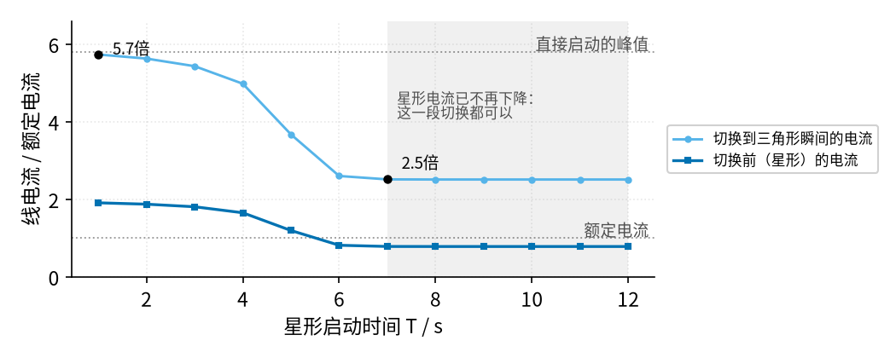
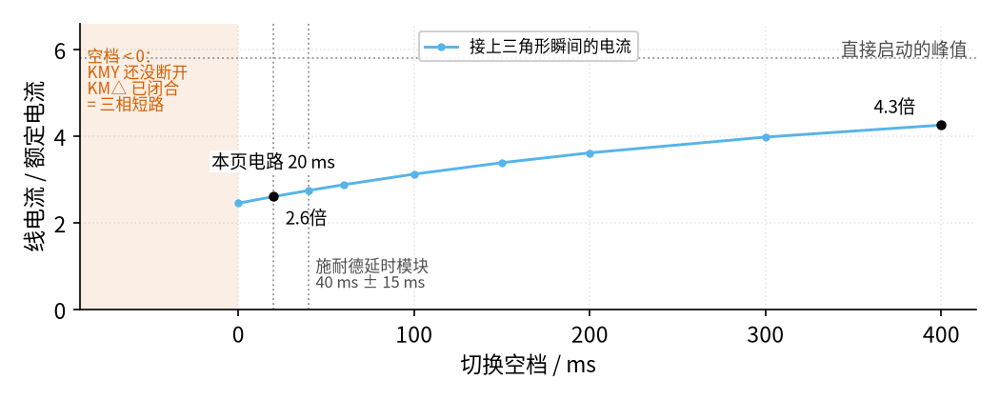

# 19 星三角降压启动 · 参数与调试篇

[上一页：原理与实现篇](page2.md) · [直觉篇](page1.md) · [原理与实现篇](page2.md) · 本页：参数与调试篇 · [下一页：19 星三角降压启动 · 动手实验篇](page4.md) · 前置节点：[P1 元件速成 · 直觉篇](../P1-components-basics/page1.md)、[18 互锁 · 直觉篇](../18-interlock/page1.md)

> [!WARNING]
> **市电危险**：本电路的实际版本接 220V/380V 市电，触电可能致命。本页的仿真和动手实验只在 12V 以下的低压电源上进行；任何接线、改线都必须在断电并验电后操作，由持证电工完成。
>
> 本节点特有的危险点：① 星三角的主电路是 **380 V 三相**，而且电动机有 **6 根出线**、接线盒里同时有星形和三角形两套接法，接错一根就可能把两相直接短接；② KMY（星形）和 KM△（三角形）一旦同时吸合，三根相线会经星点**直接短路**，电流极大、电弧强烈，这正是本页反复强调互锁的原因；③ 控制回路（按钮、线圈、时间继电器）常常直接接 **220 V 或 380 V**，时间继电器的调节旋钮旁边就是带电端子，**调延时也要断电**；④ 按下停止只是让线圈断电，主电路仍然带电；新装或改过线的电路，第一次试车要先**断开电动机接线**，只看三只接触器的动作顺序对不对。

## 一、关键参数

星三角电路里真正要"调"的只有两样：**星形启动时间 T**（时间继电器 KT 的整定值）和**切换空档**（KMY 断开到 KM△ 闭合之间的那段时间）。其余几样是选型时要核对的数。

| 参数 | 典型值 | 调大 / 调小的后果 | 出处 |
|---|---|---|---|
| 星形启动时间 T | 经验公式约为"2 倍根号容量（kVA）再加 4 s"，必须按实际调整。kVA 是千伏安，即"电压 × 电流"的单位；电动机容量可按 $\sqrt{3} \times$ 380 V × 额定电流估算，例如额定 20 A 约为 $1.732 \times 0.38 \times 20 \approx 13.2$ kVA，代入得 $2\sqrt{13.2} + 4 \approx 11.3$ s | 太短：转速还低就切换，冲击接近直接启动；太长：重载时转速可能掉下来，启动失败 | 网易号 · 防爆云平台；施耐德 FA421304 |
| 最佳切换时刻 | 星形电流随转速上升而下降，**不再下降**的时刻 | 用钳形电流表（钳口夹住一根导线就能测电流，不用断线）看星形电流，再定 T | 施耐德 FA421304 |
| 切换空档 | 本页电路等于 KM△ 吸合时间，仿真里 20 ms；施耐德 LADS2 延时模块 40 ms ± 15 ms | 太短：KMY 的电弧还没熄灭，KM△ 就合上，相间短路；太长：电动机断电减速，冲击变大 | 施耐德 FA24956、FA421304；本页仿真 |
| 直接启动电流 | 额定电流的 5～7 倍（另一来源给 4～7 倍） | 决定星形启动电流：除以 3 | 电工天下 13701；网易号 · 防爆云平台 |
| 星形启动电流、转矩 | 都是直接启动的 1/3 | 转矩小，只适合轻载起步 | 电工天下 7411、13701 |

先扫星形时间 T。程序 code/figs/19_figs.py 用原理篇的示意电动机，让 T 从 1 s 变到 12 s，每次空档都取 20 ms，记录切换前的星形电流和切换瞬间的尖峰，结果见 图 19-p3-1：

*图 19-p3-1　星形启动时间 T 对切换冲击的影响（示意电动机）*

图 19-p3-1 说明了"T 太短"的害处：T 等于 1 s 时，电动机才转到同步转速的 15%，切换瞬间的电流有 5.7 倍，几乎和直接启动的 5.8 倍一样，星三角白装了。T 等于 4 s 时转速 66%，尖峰仍有 5.0 倍；到 6 s 时转速 91%，尖峰降到 2.6 倍。

图 19-p3-1 里蓝色的星形电流从 T 等于 7 s 起就不再下降。判断"不再下降"的标准是相邻两个整定值的电流相差不到 0.02 倍：6 s 时是 0.82 倍，7 s 时是 0.79 倍，还降了 0.03 倍；7 s 以后一直是 0.79 倍。所以 6 s 和 7 s 在图上看着差不多高，但 7 s 才算真正变平，这正是施耐德资料说的"最佳切换时刻"：再往后等，尖峰也只是 2.5 倍，不会更好，反而白白让电动机在低转矩下多转几秒。负载越重，这条曲线越晚变平；如果负载重到星形根本带不动，电流会一直停在较高的值（资料说在额定的 1.2 倍以上），这时拖得越久，热继电器越容易动作。

再扫切换空档。T 固定为 6 s，空档从 0 变到 400 ms，结果见 图 19-p3-2：

*图 19-p3-2　切换空档长短对冲击的影响；负空档就是短路*

图 19-p3-2 左边的朱红色区域是绝对不能进入的：空档小于 0，意味着 KMY 还没断开 KM△ 就合上了，这就是原理篇里说的相间短路。往右看，空档越长，电动机断电滑行的时间越久：空档 20 ms 时转速只掉 0.7 个百分点，尖峰 2.6 倍；空档 400 ms 时转速掉了 12.8 个百分点，尖峰涨到 4.3 倍。

所以 图 19-p3-2 给出的结论是：空档要**大于零并留足灭弧余量**，但不要无谓地拉长。施耐德的资料说，它的 LADS2 延时模块给出 40 ms ± 15 ms 的切换时间，对 LC1D80 及以下的接触器够用，更大的接触器用它就不够，有短路的风险。

## 二、故障排查

| 现象 | 原因 | 怎么查 | 怎么改 |
|---|---|---|---|
| 一按启动就跳闸，电弧很大 | KT 触点用错（用了瞬时触点，或延时常开、常闭位置对调），KMY 和 KM△ 一起吸合 | 断电验电后断开电动机接线，再由电工通电按启动，看 KMY、KM△ 是否同时动作 | 断电后由电工对照原理篇的控制回路图核对 KT 触点类型：Y 回路用延时断开常闭，△ 回路用延时闭合常开 |
| 星形能正常启动，一到切换就跳闸、有电弧 | KM△ 线圈支路里没有 KMY 常闭，只靠 KT 一个触点同时切换；或者大容量接触器的空档不够灭弧 | 断电后用万用表测 KM△ 支路，看有没有串 KMY 常闭 | 断电后由电工补上 KMY 常闭和 KM△ 常闭两道电气互锁，再加机械互锁；大接触器选更长的切换时间 |
| 一直停在星形，不切换，过一会热继电器跳 | KT 线圈没电或损坏；延时调得太长；KT 延时闭合常开没接好 | 请电工带电测量 KT 线圈两端电压，看 KT 指示灯 | 断电后由电工换 KT 或改线；断电后按"电流不再下降"重新整定 T |
| 切换时冲击很大，和直接启动差不多 | 星形时间 T 太短，转速还很低 | 请电工用钳形电流表看星形阶段电流还在不在下降 | 断电后把 T 调长到电流不再下降的时刻（调延时也要断电） |
| 星形转速上不去，电流一直偏大 | 负载太重，星形转矩只有三分之一，带不动 | 请电工用钳形电流表看星形阶段电流是否长期高于额定 | 减轻起步负载，或改用其他启动方式 |
| 切换后转速明显掉一下，冲击偏大 | 切换空档过长 | 请电工用示波器或记录仪看 KMY 断开到 KM△ 闭合的时间 | 断电后由电工换延时更合适的模块，空档只留够灭弧即可 |
| 三角形运行后 KT 一直有电、发热 | KT 线圈前没有串 KM△ 常闭 | 请电工在运行时测量 KT 线圈电压 | 断电后由电工在 KT 线圈支路串入 KM△ 常闭 |
| 按停止电动机停不下来 | 主触点熔焊 | 断开上级断路器并验电后检查触点 | 请电工更换接触器；查找熔焊原因（多半是短路或空档不够） |

## 三、练习

**练习 1（易）**。一台三角形运行的电动机额定电流 30 A，直接启动电流按 6 倍算。直接启动和星形启动的线电流各是多少？熔断器至少要扛住哪个电流的冲击？

答案

直接启动 $30 \times 6 = 180$ A；星形启动 $180 / 3 = 60$ A。用星三角以后，启动时线上最大的电流按 60 A 级别考虑（再留出切换尖峰的余量），比直接启动的 180 A 小得多。

**练习 2（中）**。某人为了"省一个触点"，把 KM△ 线圈支路里的 KMY 常闭去掉，只靠 KT 的一组转换触点同时完成"断 KMY、通 KM△"。已知 KM△ 吸合时间 12 ms，KMY 释放时间 19 ms。算一下切换空档，并说明会发生什么；装回 KMY 常闭以后空档变成多少？

答案

KT 到时那一刻，两只线圈同时变化：KM△ 在 12 ms 时闭合，KMY 却要到 19 ms 才断开，空档是 $12 - 19 = -7$ ms，也就是两只接触器**重叠 7 ms**，三根相线经星点短路。装回 KMY 常闭以后，KM△ 线圈要等 KMY 释放才通电，空档等于 KM△ 的吸合时间 12 ms，与 KMY 释放多慢无关。

**练习 3（中）**。看 图 19-p3-1，如果你只能在 2 s、4 s、7 s 三个整定值里选一个，选哪个？为什么不选 12 s？

答案

选 7 s。T 等于 2 s 时转速才 31%，切换尖峰 5.6 倍，几乎等于直接启动；4 s 时尖峰仍有 5.0 倍；7 s 时星形电流已经不再下降，尖峰 2.5 倍。12 s 的尖峰也是 2.5 倍，并没有更好，却让电动机在低转矩下多拖了 5 s，负载一重就容易让热继电器动作。

**练习 4（较难 · 变体迁移）**。一台电动机铭牌写着"380 V、Y 接法"（正常运行就是星形）。能不能给它装星三角启动？如果硬装，切到三角形时每段绕组承受多大电压？

答案

不能。这台电动机每段绕组的额定电压是 $380 / \sqrt{3} \approx 219$ V；接成三角形后每段要承受 380 V，是额定值的 1.73 倍，绕组会严重过热甚至烧毁。星三角只适用于正常运行为三角形接法的电动机，也就是铭牌上 380 V 对应 △ 接法的那一类。

## 参考资料

- 施耐德电气中国 FAQ FA421304：星三角启动的星形时间 T 和转换间隙 t 如何设定（T 过短、过长的后果，电流不再下降时最佳；间隙过短相间短路、过长冲击大，取决于机械动作和灭弧时间）<https://www.schneider-electric.cn/zh/faqs/FA421304/>
- Schneider Electric FAQ FA24956：LADS2 延时模块的切换时间 40 ms ± 15 ms，适用于 LC1D80 及以下 <https://www.se.com/uk/en/faqs/FA24956/>
- 网易号 · 防爆云平台：《电机星三角启动时间确定及启动电流计算方法》（经验公式、负荷重时星形电流在额定 1.2 倍以上、4～7 倍启动电流）<https://www.163.com/dy/article/HDRJC87G0518L5FC.html>
- 电工天下：《星三角控制电路原理图及星三角启动说明》（5～7 倍启动电流，启动电流、力矩为全压的 1/3）<https://www.dgjs123.com/diandongji/13701.html>
- 电工天下：《电机星三角降压启动的控制电路图详解》（只能用于三角形运行的电动机，时间继电器触点类型要分清，Y、△ 两回路都要有闭锁）<https://www.dgjs123.com/diandongji/7411.html>
