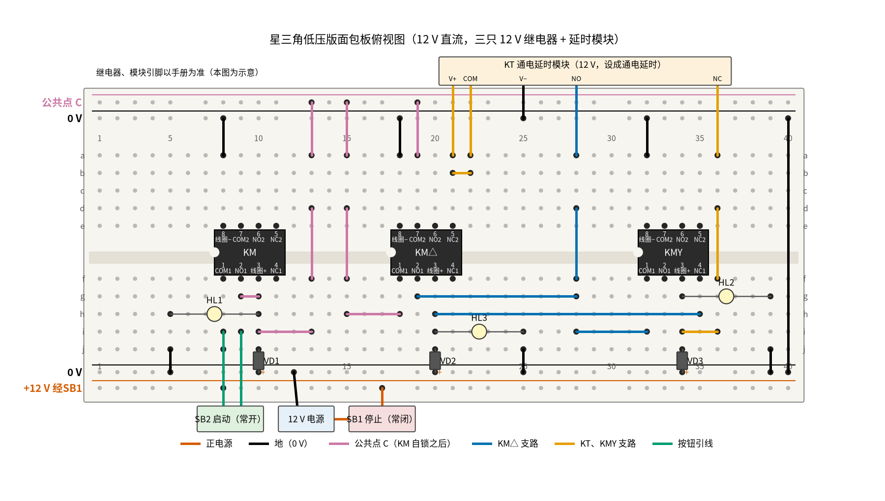
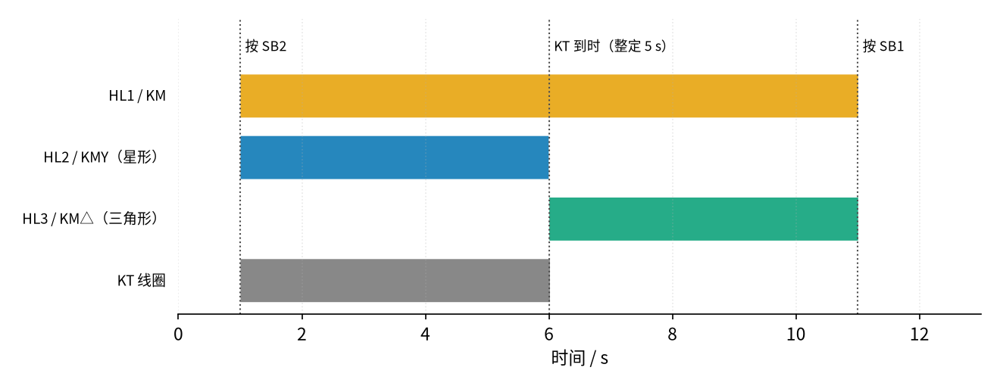

# 19 星三角降压启动 · 动手实验篇

[上一页：参数与调试篇](page3.md) · [直觉篇](page1.md) · [原理与实现篇](page2.md) · [参数与调试篇](page3.md) · 本页：动手实验篇 · [下一页：04 差分放大 · 直觉篇](../04-differential-amp/page1.md) · 前置节点：[P1 元件速成 · 直觉篇](../P1-components-basics/page1.md)、[18 互锁 · 直觉篇](../18-interlock/page1.md)

> [!WARNING]
> **市电危险：不要接 220 V/380 V，市电接线请电工。** 真实的星三角电路主电路是 380 V 三相，电动机有 6 根出线，KMY 和 KM△ 一旦同时吸合就是相间短路；控制回路和时间继电器的端子也常常带 220 V 或 380 V，连调延时都要断电。本页只做 12 V 直流低压版：三只 12 V 继电器代替 KM、KMY、KM△，一块 12 V 延时模块代替 KT，三只 12 V 小灯泡当指示，不接电动机，绝对不要接到插座上。

## 这次实验要验证什么

用灯泡亲眼看到 [19 星三角降压启动 · 原理与实现篇](page2.md) 第二节那组逻辑式的结果：按一下启动，「主灯 + 星形灯」一起亮；延时一到，星形灯灭、三角形灯接着亮；之后时间继电器自己断电复位。本页是 [19 星三角降压启动 · 原理与实现篇](page2.md) 第五节「低压动手实验」的展开版：器材、延时设置（先调到 5 s 左右）和 1 到 5 步的做法都按那一节来，本页补上面包板的具体插法、逐点读数和记录表。

和第五节有两处写法上的区别，结论不变：

- 第五节把 LED 接在每只继电器的一组常开触点上；本页为了省触点，把 12 V 小灯泡**并在线圈两端**，线圈有电就亮，和「触点已经动作」是一回事。你用 LED 串 1 kΩ 接在常开触点上也完全可以。
- KT 支路和 KMY 支路里都要串一只 KM△ 常闭。本页让这两条支路**共用 KM△ 的同一只常闭**（先经过它，再分成两路），逻辑和原理篇第二节的控制回路图完全等价，却只占 KM△ 一组触点；这样每只继电器有两组转换触点就够用，KT 模块也只需要一组转换触点。

## ⚠️ 安全须知

- **只用 12 V 及以下的直流电**，电源最好带过流保护。**不要接 220 V/380 V，市电接线请电工。**
- 本实验没有电解电容；三只 **1N4007 有方向**：白圈朝线圈正端，另一端接 0 V，接反了一通电就是短路。原理见 [22 三极管开关与继电器驱动 · 原理与实现篇](../22-bjt-relay-driver/page2.md)。成品延时模块通常已内置续流二极管，不用另加。
- **灯泡会烫**，不要用手摸。
- **调延时旋钮、改线之前先断电**。在 12 V 上这只是好习惯，在真实电柜里是保命的规矩。
- 第五节第 4 步「短接 KMY 常闭」的实验只在 12 V 板上做，**断电后插跳线，做完马上断电拆掉**。

## 器材清单

| 元件 | 型号或数值 | 数量 | 说明 |
|---|---|---|---|
| 继电器 KM、KMY、KM△ | 线圈 12 V 直流、双刀双掷（两组转换触点）、可插面包板 | 3 | KM 用一组常开自锁；KMY 用一组常闭作互锁；KM△ 用一组常开自锁、一组常闭 |
| 延时模块 KT | 12 V 通电延时继电器模块，延时可调到几秒，带一组转换触点（COM、NO、NC） | 1 | 按说明书设成「通电延时」模式；端子名以说明书为准 |
| 停止按钮 SB1 | 自复位常闭按钮 | 1 | 接在电源正极和面包板之间 |
| 启动按钮 SB2 | 自复位常开按钮 | 1 | |
| 二极管 VD1～VD3 | 1N4007 | 3 | 各反并一只线圈 |
| 小灯泡 HL1～HL3 | 12 V、1 W 以下，带灯座 | 3 | HL1 = KM，HL2 = KMY（星形），HL3 = KM△（三角形） |
| 电源 | 12 V 直流，能给出 0.5 A 以上，最好带过流保护 | 1 | |
| 万用表、手机秒表 | 直流 20 V、电流 2 A（或 10 A）挡、电阻挡、蜂鸣挡 | 各 1 | 秒表用来量延时 |
| 面包板、杜邦线、鳄鱼夹线 | 830 孔 | 1 套 | |

## 搭建步骤

先对照 [19 星三角降压启动 · 原理与实现篇](page2.md) 第二节的控制回路图，认清四条支路。每一步都在**断电**状态下完成。

1. **认脚**。用蜂鸣挡找出每只继电器和 KT 模块的 COM、NO、NC：不通电时 COM–NC 响。下面按「下排 COM1、NO1、线圈正、NC1，上排线圈负、COM2、NO2、NC2」的示意排列写。
2. **插继电器**。KM 左端第 8 列，KM△ 左端第 18 列，KMY 左端第 32 列，都跨在凹槽上。黑线 a8、a18、a32 → 上边 0 V 轨（三只线圈负端）；第 40 列黑线连上下两条 0 V 轨。
3. **电源和 SB1**。12 V 负极接下边 0 V 轨；正极经 SB1 接下边外侧轨，这条轨叫「+12 V 经 SB1」。**上边外侧轨不接电源**，它将来是「公共点 C」。
4. **KM 自锁**。朱红色线 j8 → 「+12 V 经 SB1」轨（COM1）；SB2 两端接 i8、i9；红紫色短线 g9–g10（NO1 接线圈正）；再用 i10 → i13、f13 → d13、a13 → 上边外侧轨，把公共点 C 引到上边轨。VD1 在 0 V 轨第 10 列和 j10 之间；HL1 插 h10–h5，黑线 j5 → 0 V 轨。
5. **KM△ 的公共端**。h18 → h15、f15 → d15、a15 → 公共点轨（COM1）；a19 → 公共点轨（COM2）。VD2 在 0 V 轨第 20 列和 j20 之间；HL3 插 i20–i25，黑线 j25 → 0 V 轨。
6. **KT 模块**。V+ 接 a21（KM△ 的 NC2，这一点叫 X）；COM 接 a22，再用橙色短线 b21–b22 把 COM 也接到 X；V− 接上边 0 V 轨。
7. **KMY 支路（橙色）**。KT 的 NC 接 a36，d36 → f36，i36 → i34（KMY 线圈正）。VD3 在 0 V 轨第 34 列和 j34 之间；HL2 插 g34–g39，黑线 j39 → 0 V 轨。
8. **KM△ 支路（蓝色）**。KT 的 NO 接 a28，d28 → f28；g19 → g28（KM△ 的 NO1 与 KT 常开并联，这一点叫 Y）；i28 → i32（Y 接到 KMY 的 COM1）；h20 → h35（KMY 的 NC1 接到 KM△ 线圈正）。
9. **通电前核对**：电阻挡量「+12 V 经 SB1」轨和 0 V 轨之间，不能是 0 Ω；三只二极管白圈都朝线圈正端。延时旋钮先调到 5 s 左右。

接法和 [18 互锁 · 动手实验篇](../18-interlock/page4.md) 的双继电器板类似，只是多了一只继电器和一块延时模块，见 图 19-p4-1。



*图 19-p4-1　星三角低压版的面包板接线（12 V 直流，三只继电器加一块延时模块）*

图中朱红色线是「+12 V 经 SB1」，黑色线是 0 V，红紫色线是 KM 自锁之后的公共点 C，蓝色线是 KM△ 支路，橙色线是 KT 和 KMY 支路，蓝绿色线是按钮引线。长线会从别的孔上方跨过，只有画了黑点的孔才真正插着线；继电器和模块的端子位置只是示意。

## 测量表

「应该读到」取自 [review/spice/19.md](../review/spice/19.md) 的「面包板万用表读数」表；灯泡电流和总电流由 code/figs/19_figs.py 按 400 Ω 线圈、1 W 灯泡算出。

| 步骤 | 测什么 | 红表笔 | 黑表笔 | 挡位 | 应该读到 | 读不到时先查 |
|---|---|---|---|---|---|---|
| ① 上电 | 电源 | 「+12 V 经 SB1」轨 | 0 V 轨 | 直流 20 V | 约 12 V | 0 V：断电，查 SB1 是否接成常开 |
| ② 按 SB2 后 | 公共点 C | 上边外侧轨 | 0 V 轨 | 直流 20 V | 约 12 V，一直保持 | 一松手就掉：断电，查 g9–g10 |
| ③ 星形阶段 | KMY 线圈 | j34 | 0 V 轨 | 直流 20 V | 约 12 V；KT 到时后变 0 V | 一直 0 V：断电，查 KT 的 NC 接线和 b21–b22 |
| ③ 星形阶段 | KM△ 线圈 | j20 | 0 V 轨 | 直流 20 V | 0 V；KT 到时后约 12 V | 一开始就有电：断电，KT 的 NO、NC 接反了 |
| ③ 星形阶段 | KM△ 支路里 KMY 常闭两端 | i32 | h35 | 直流 20 V | 0 V（KT 常开还没闭合，支路里没有电压） | 有读数：断电，查 Y 点是否误接到公共点 |
| ④ 切换后 | KMY 常闭两端 | i32 | h35 | 直流 20 V | 0 V（触点已闭合） | 约 12 V：KMY 没释放，断电查 KMY 支路 |
| ④ 三角形运行 | KT 模块电源 | a21 | 0 V 轨 | 直流 20 V | 0 V（被 KM△ 常闭切断，KT 复位） | 约 12 V：断电，V+ 没接在 KM△ 常闭后面 |
| ④ 三角形运行 | 总电流（电流表串在电源正极线里） | 电源正极 | SB1 进线 | 直流 2 A（或 10 A） | 约 0.23 A（两只线圈各约 30 mA，两只 1 W 灯各约 83 mA）；换成 LED 指示时约 60 mA 再加 LED 电流 | 远大于此：断电，查二极管和短路 |
| ⑤ 延时 | 按 SB2 到 HL2 灭、HL3 亮的时间 | 手机秒表 | — | — | 等于 KT 整定值（先调 5 s） | 与刻度差很多：以实测为准，记下模块的刻度误差 |
| ⑥ 断电检查 | 线圈电阻（先拔掉同一列的灯泡） | j34 | a32 | 电阻 2 kΩ | 标称值，12 V/30 mA 的约 400 Ω | 0 Ω：二极管接反 |
| ⑥ 断电检查 | KT 模块触点 | COM（a22） | NC（a36） | 蜂鸣挡 | 响（不通电时 COM–NC 闭合） | 不响：NO、NC 认反了 |

共 11 个测量点。量总电流时要把电流表**串进**电源线，**换挡、改接前先断电**，量完拨回电压挡。

## 没有示波器怎么办

先后顺序用眼睛就能看：三只灯的亮灭顺序应该和 图 19-p4-2 一样。



*图 19-p4-2　按 SB2 以后三只灯和 KT 线圈的先后（不计继电器动作时间）*

图 19-p4-2 由 code/figs/19_figs.py 按 图 19-p4-1 的接法每 0.01 s 推演一次：1 s 按 SB2，KT 整定 5 s，所以 6 s 时 HL2 灭、HL3 亮，KT 线圈也在这时断电；程序还检查了全程 HL2 和 HL3 没有同时亮。延时可以用手机秒表量：从按 SB2 开始，到看见 HL2 熄灭为止，量三次取平均。

**只能讲道理的部分**：HL2 灭到 HL3 亮之间的「切换空档」只有几到几十毫秒（原理篇仿真里是 20 ms），眼睛看到的是「同时」，万用表也测不出来，只有示波器两个通道分别接两只灯才看得见。所以第五节第 4 步「短接 KMY 常闭」的结果，在没有示波器时只能讲道理：空档是正是负取决于两只继电器的快慢，见 [19 星三角降压启动 · 参数与调试篇](page3.md) 第一节的切换空档扫描图和练习 2。真接电动机时「延时太短冲击大」也只能看 [19 星三角降压启动 · 参数与调试篇](page3.md) 第一节的星形时间扫描图，本实验不接电动机。

## 用 Python 核对你的读数

把你设的延时、秒表量到的三次时间和几处电压填进去，代码算平均值和偏差，偏差超过 10% 会提醒。

```python
import sys, pathlib
sys.path.insert(0, str(pathlib.Path("code/figs").resolve()))  # 在仓库根目录运行

# ===== 把下面换成你自己的实测值（这里是一组示例） =====
T_SET = 5.0                     # KT 旋钮整定值，s
T_MEAS = [5.3, 5.1, 5.2]        # 秒表三次：按 SB2 到 HL2 熄灭，s
V_SUPPLY = 12.1                 # 电源，V
V_KMY_STAR = 11.9               # 星形阶段 KMY 线圈，V
V_KMD_DELTA = 11.8              # 三角形阶段 KM△ 线圈，V
V_KT_DELTA = 0.0                # 三角形阶段 KT 模块 V+，V
SEEN = ["HL1+HL2", "HL1+HL3", "全灭"]   # 你看到的三个阶段：星形、三角形、按 SB1 后

def check(name, meas, calc):
    dev = (meas - calc) / calc * 100
    flag = "  <-- 偏差超过 10%，断电后按测量表排查" if abs(dev) > 10 else ""
    print(f"{name}: 实测 {meas:.2f}，计算 {calc:.2f}，偏差 {dev:+.1f}%{flag}")

t_avg = sum(T_MEAS) / len(T_MEAS)
check("星形时间 / s", t_avg, T_SET)
check("星形阶段 KMY 线圈 / V", V_KMY_STAR, V_SUPPLY)
check("三角形阶段 KM△ 线圈 / V", V_KMD_DELTA, V_SUPPLY)
print("三角形阶段 KT 已复位" if V_KT_DELTA < 0.5 else "  <-- KT 没有复位，查 KM△ 常闭")
expect = ["HL1+HL2", "HL1+HL3", "全灭"]
print("亮灯顺序正确" if SEEN == expect else f"  <-- 顺序不对：应为 {expect}")
```

示例数据里，秒表平均 5.20 s，比旋钮刻度长 4.0%，在 10% 以内；两只线圈电压偏差都不到 3%。手按秒表本身就有零点几秒的反应误差，这也是量三次取平均的原因。

## 实验记录表

| 项目 | 实测值 | 计算值 | 偏差 |
|---|---|---|---|
| 电源电压 |  | 12 V |  |
| 公共点 C |  | 等于电源 |  |
| 星形阶段 KMY 线圈 |  | 等于电源 |  |
| 三角形阶段 KM△ 线圈 |  | 等于电源 |  |
| 三角形阶段 KT 模块电源 |  | 0 V | — |
| 三角形阶段总电流 |  | 约 0.23 A（1 W 灯泡时） |  |
| 星形时间（三次平均） |  | KT 整定值 |  |

**思考题 1**：为什么要让 KT 在切换到三角形以后断电？如果 V+ 直接接公共点 C，会怎样？

<details><summary>答案</summary>

KT 断电以后触点复位，常开断开、常闭闭合。KM△ 靠自己的常开自锁，不受影响；而 KMY 支路此时被 KM△ 常闭切断，也不会再吸合。断电的好处是 KT 不再长时间发热耗电，下次启动时又从零开始计时。如果 V+ 直接接 C，KT 会一直通电，电路仍能工作，但就是 [19 星三角降压启动 · 参数与调试篇](page3.md) 故障排查表里「三角形运行后 KT 一直有电、发热」那一条。

</details>

**思考题 2**：如果把 KT 的 NO 和 NC 两根线接反了（NO 接 a36、NC 接 a28），按 SB2 后会看到什么？在真实电路里意味着什么？

<details><summary>答案</summary>

KT 刚通电时 COM–NC 是闭合的，现在 NC 接的是 KM△ 支路，于是 KM△ 立刻吸合并自锁，它的常闭一断开 KT 就断电；KMY 支路接在 NO 上，一直不通。你看到的是 HL1 和 HL3 一起亮，HL2 从头到尾不亮：星形被跳过了。真实电路里这等于直接三角形启动，启动电流是星形的 3 倍，星三角白装了。这也是第 1 步一定要先用蜂鸣挡认脚的原因。

</details>

**思考题 3**：按第五节第 5 步，把延时调到 1 s 和 10 s 各试一次，灯的顺序变了吗？真接电动机时这两个设置各有什么问题？

<details><summary>答案</summary>

灯的顺序不变，只是星形灯亮的时间变了；低压板上看不出好坏。真接电动机时，1 s 太短，电动机还没转起来就切到三角形，冲击几乎和直接启动一样（[19 星三角降压启动 · 参数与调试篇](page3.md) 第一节：示意电动机 1 s 时 5.7 倍）；10 s 则在星形下低转矩运行太久，负载重时电流长期偏大，热继电器可能跳。整定值要按电流「不再下降」的时刻来定。

</details>

## 自测清单

- 我能说清楚为什么本页只用 12 V，并且知道市电接线、调延时都要断电并请电工。
- 我能说出 KM、KMY、KM△、KT 四条支路各自串了哪些触点。
- 我能按 图 19-p4-2 预测三只灯的先后，并用秒表量出星形时间。
- 我能解释为什么切换空档只能用示波器看，而不能靠肉眼判断有没有重叠。
