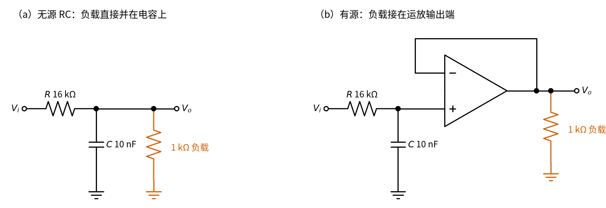

# 20 有源滤波 · 直觉篇

[上一页：19 射极跟随器 · 动手实验篇](../19-emitter-follower/page4.md) · 本页：直觉篇 · [原理与实现篇](page2.md) · [参数与调试篇](page3.md) · [下一页：原理与实现篇](page2.md) · 前置节点：[01 元件速成 · 直觉篇](../01-components-basics/page1.md)、[08 同相放大 · 直觉篇](../08-noninverting-amp/page1.md)、[12 电压跟随器 · 直觉篇](../12-voltage-follower/page1.md)

## 痛点：有用的信号上骑着一层"毛刺"

传感器送来的信号常常很慢，比如温度、心跳、50 Hz 的电网波形；可导线上总会混进高频干扰，比如开关电源、电机电刷、数字电路打出来的几千到几万赫兹的噪声。用示波器一看，原本光滑的曲线变成了一条"毛毛虫"。后面的单片机去采样，读数会跳来跳去。

我们想要一个"筛子"：慢的信号放过去，快的噪声挡下来。这个筛子就叫**滤波器**；放过低频、挡住高频的叫**低通滤波器**。

再看几个具体场景：

- **心电、脉搏测量**：心跳每秒一两下，有用的信号在几十赫兹以下；可电极线一碰到荧光灯、手机，就收进一大堆高频噪声。
- **单片机读电位器或温度**：模数转换器每隔一段时间"拍一张照片"。如果信号上叠着很快的噪声，每张照片都碰巧拍到噪声的不同位置，读数就乱跳。在模数转换器前面加一个低通，是最常见的做法。
- **音响里的"嘶嘶"声**：人耳听不到 20 kHz 以上的声音，但功放和数字电路的高频噪声会混进来，必须先滤掉。

打个比方：滤波器就像汽车的**减震器**。路面上的小石子让车轮一秒钟颠几十下（高频），减震器把它们"吃掉"，车厢几乎感觉不到；而上坡、下坡这种很慢的起伏（低频），车厢会老老实实跟着走。减震器不改变你要去哪儿，只去掉那些又快又碎的颠簸。

## 直觉：电容对快变化"开门"

在 [01 元件速成 · 直觉篇](../01-components-basics/page1.md) 里我们知道，电容两端电压不能突变，变化越快，电容吸进、吐出的电流越大。换一种说法：**频率越高，电容越像一根导线；频率越低，电容越像断开**。

把一个电阻串在信号路上，再把一个电容并到地上，就得到最简单的 RC 低通：

- 慢信号来了，电容像断开，信号几乎原样留在电容上；
- 快噪声来了，电容像导线，把噪声"倒"进地里，电容上几乎看不到它。

放过和挡住的分界叫**截止频率**，记作 $f_c$ （下标 c 是"截止"的意思），单位赫兹（Hz）。它只由电阻 $R$ 和电容 $C$ 决定，下一页会给出公式。

## 为什么要加运放："有源"两个字

只用 R 和 C 的滤波器叫**无源滤波器**。它有两个毛病：

1. **怕负载**。电容上的电压一接后级就会被拉低，截止频率也跟着变。这和 [12 电压跟随器 · 直觉篇](../12-voltage-follower/page1.md) 里分压器一接负载就掉电压是同一个问题。
2. **不能放大**。无源电路的输出最多等于输入。

在电容后面接一个运放就解决了：接成跟随器，后级再重也不影响 RC；接成 [08 同相放大 · 直觉篇](../08-noninverting-amp/page1.md)，还能顺手把信号放大。带运放的滤波器就叫**有源滤波器**（运放需要电源，"有源"由此得名）。

下面 图 20-p1-1 是一个仿真：一个 50 Hz、幅度 1 V 的正弦信号，叠加了一个 10 kHz、幅度 0.3 V 的噪声，送进截止频率约 1 kHz 的一阶有源低通。

*图 20-p1-1　带高频噪声的信号经过低通滤波*

图中蓝色是输入 $V_i$ ，因为噪声上下抖得太快，看起来像一条粗带子；橙色是输出 $V_o$ ，几乎是一条干净的正弦波。仿真打印出：输出上剩下的噪声只有约 0.03 V，是原来 0.3 V 的十分之一；而 50 Hz 的有用信号几乎没被削弱。

## 电路长什么样

图 20-p1-2 是本节最基本的电路：电阻 $R$ = 16 kΩ 串在路上，电容 $C$ = 10 nF 接地，电容上的电压送进一个接成跟随器的运放。

*图 20-p1-2　一阶有源低通（RC + 跟随器）*

图 20-p1-2 左半边就是无源 RC 低通，右半边的运放只负责"传话"：同相端几乎不取电流，所以 RC 不受后级影响；输出端能带负载。如果想放大，把跟随器换成同相放大即可，通带内的倍数就是 08 里的 $1 + R_f/R_1$ 。

## 在示波器上会看到什么

假设你搭好了 图 20-p1-2 的电路，用信号发生器从输入端送进幅度 1 V 的正弦波，示波器通道 1 看输入、通道 2 看输出，然后只拧信号发生器的频率旋钮：

1. **100 Hz**。两条正弦几乎完全重合，输出约 0.99 V。这时电容的"阻碍"比 16 kΩ 大得多，几乎不分走信号。
2. **约 1 kHz（截止频率附近）**。输出变成约 0.71 V，而且波峰比输入**晚到一点点**，好像输出"慢半拍"。这是电容需要时间充电造成的。
3. **10 kHz**。输出只剩约 0.1 V，而且明显落后于输入。频率高了十倍，输出小了十倍。
4. **100 kHz**。输出只剩约 0.01 V，在示波器上几乎是一条平线，要把通道 2 的灵敏度调大才看得见。
5. **再把一个 1 kΩ 的负载接到运放输出**。上面的读数都**不变**，因为运放（跟随器）隔开了负载。作为对照，如果把 1 kΩ 直接接到电容上，输出会掉一大截，截止频率也会变——这就是"无源滤波器怕负载"。

第 5 步里 1 kΩ 负载的两种接法见图 20-p1-3。

*图 20-p1-3　1 kΩ 负载接在哪里：（a）直接并在电容上，（b）接在跟随器输出端*

图 20-p1-3（a）里负载和电容并联，低频时它和 16 kΩ 组成分压器，输出只剩约 1/17，截止频率也被改变；（b）里负载挂在运放输出端，电容这边只连着几乎不取电流的同相端，RC 照常工作。

把这几步的读数画在纸上（横轴频率、纵轴输出幅度），就得到下一页要讲的**幅频曲线**：低频平平的，过了截止频率就一路往下掉。

## 一句话总结

**有源低通 = RC 决定在哪儿分界（ $f_c = 1/(2\pi RC)$ ，低于它的信号放过、高于它的噪声衰减），运放（跟随器或同相放大）让滤波器不怕负载、还能放大**。

下一页我们推出截止频率公式，看看"挡住"到底能挡多少，以及为什么有时要用两级 RC 的二阶电路。
