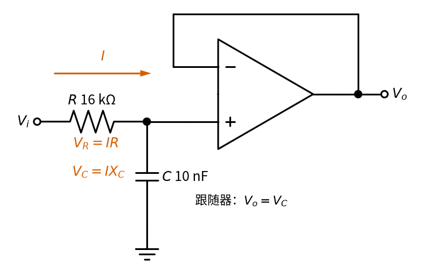
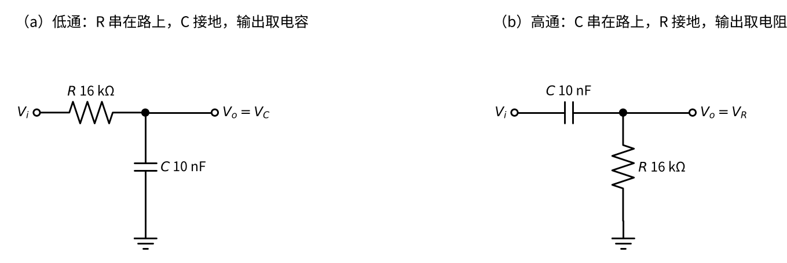
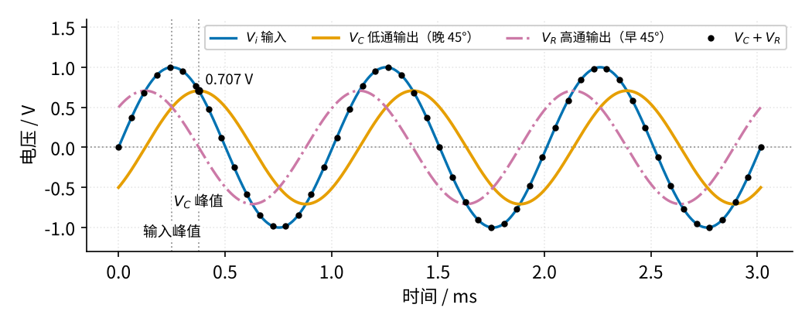
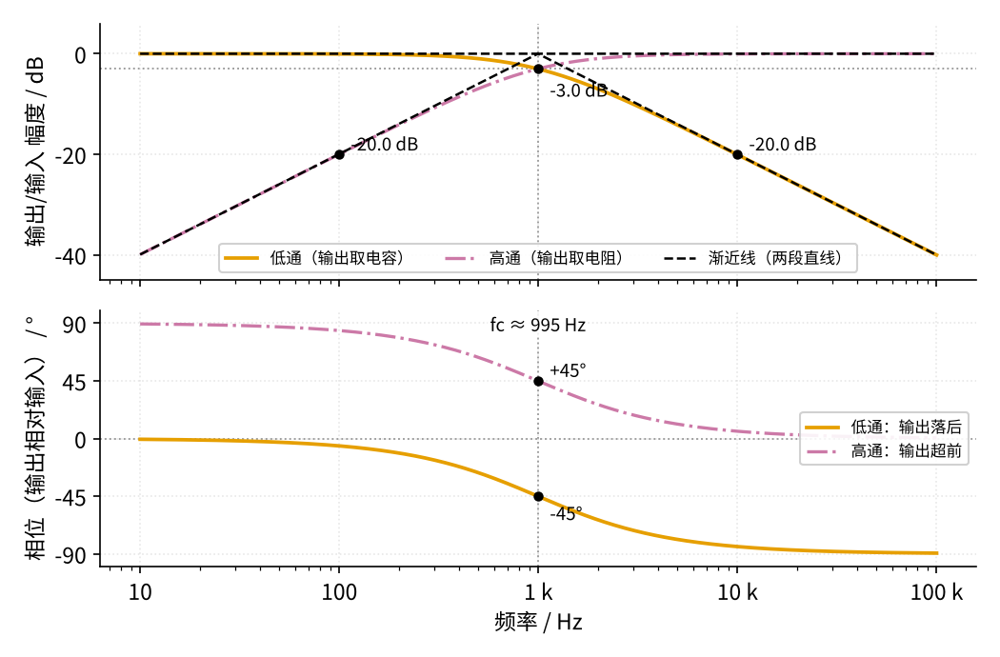
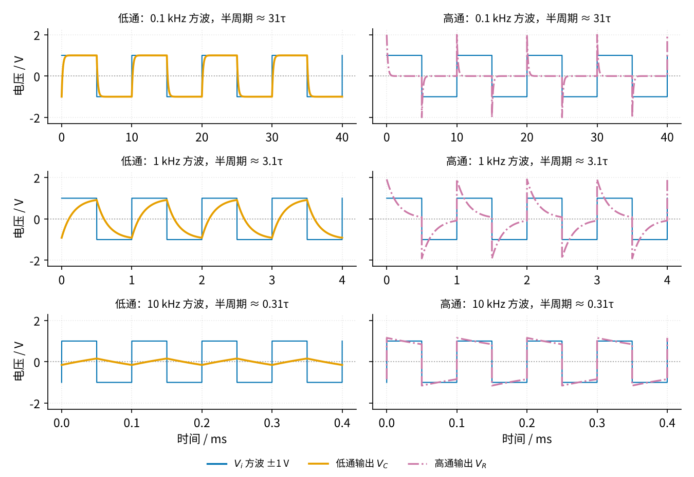
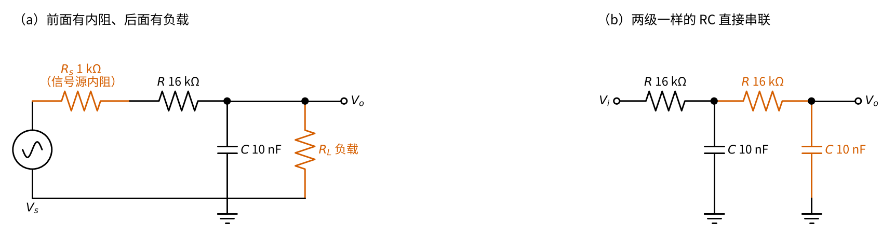
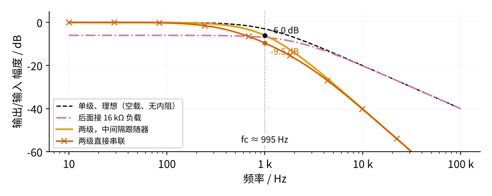
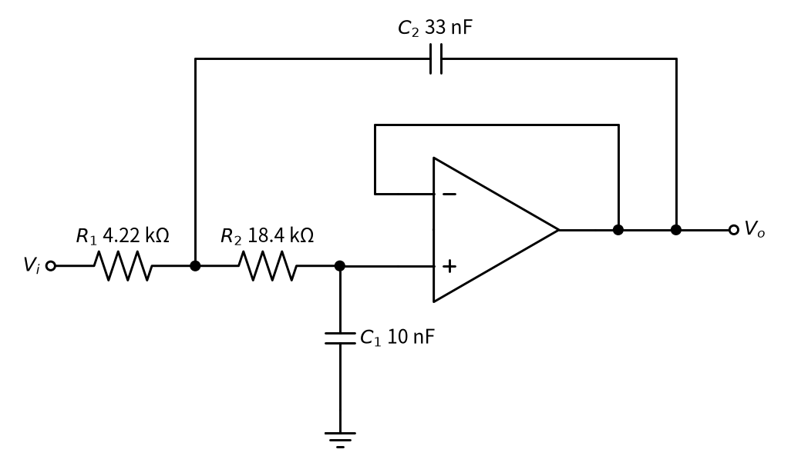
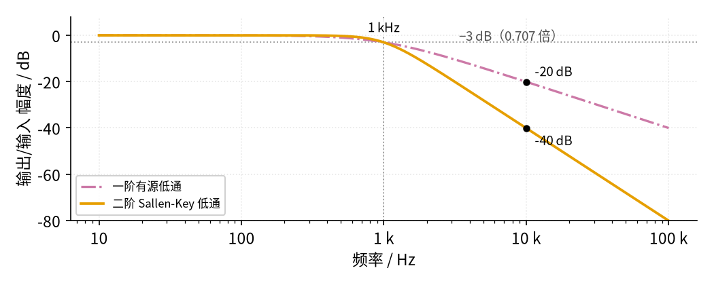
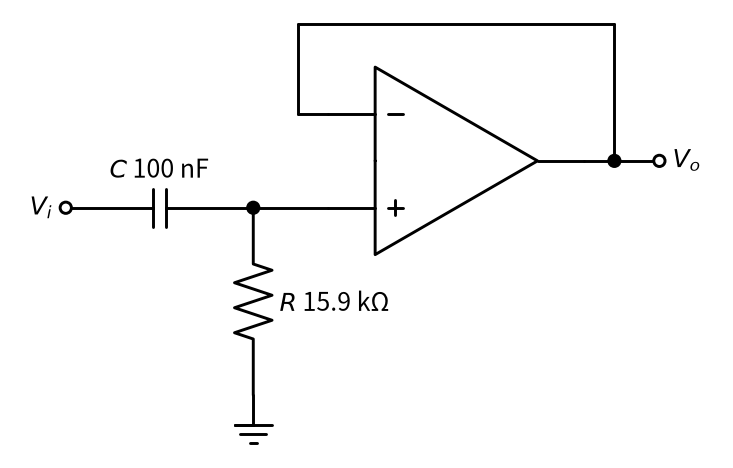

# 20 有源滤波 · 原理与实现篇

[上一页：直觉篇](page1.md) · [直觉篇](page1.md) · 本页：原理与实现篇 · [参数与调试篇](page3.md) · [下一页：参数与调试篇](page3.md) · 前置节点：[01 元件速成 · 直觉篇](../01-components-basics/page1.md)、[08 同相放大 · 直觉篇](../08-noninverting-amp/page1.md)、[12 电压跟随器 · 直觉篇](../12-voltage-follower/page1.md)

## 这一页要解决的问题

直觉篇说"电阻和电容决定分界"。这一页回答四个问题：分界频率怎么算？去掉运放以后，无源 RC 低通和高通的幅度、相位、方波波形各是什么样，又怕什么？一级 RC 挡得够不够？不够时怎么用 Sallen-Key 电路做成二阶？最后三道例题，从照着算到自己改成高通。

## 一、一阶低通：截止频率公式

**意思**：电容的"阻碍"随频率升高而变小。当电容的阻碍和电阻 $R$ 一样大时，输出降到输入的约 0.707 倍，这个频率就是截止频率 $f_c$ 。

电容的阻碍叫**容抗**，记作 $X_C$ ，单位欧姆：

$$X_C = \frac{1}{2\pi f C}$$

其中 $f$ 是信号频率， $C$ 是电容量， $2\pi$ 来自正弦波转一圈是 $2\pi$ 弧度。令 $X_C = R$ ，解出：

$$f_c = \frac{1}{2\pi R C}$$

**代数**： $R$ = 16 kΩ， $C$ = 10 nF，

$$f_c = \frac{1}{2\pi \times 16000 \times 10 \times 10^{-9}} \approx 995\ \text{Hz}$$

**一步一步推（不用复数）**。为什么"容抗等于电阻"时是 0.707 倍，而不是一半？

推导用的就是直觉篇那个一阶有源低通，图 20-p2-4 把电流和两段电压标了出来。



*图 20-p2-4　推导用的一阶低通：同一个电流 I 先流过 R，再流过 C 到地*

图 20-p2-4 中跟随器的同相端几乎不取电流，所以流过 $R$ 的电流 $I$ 全部流进 $C$ ，这就是下面第 1 步「流过同一个电流」的来历；输出取自电容上端，所以 $V_o = V_C$ 。

1. **电阻和电容串联，流过同一个电流**。电阻上的电压幅度是 $V_R = I R$ ，电容上的电压幅度是 $V_C = I X_C$ ，这里 $I$ 是电流的幅度。
2. **但两者"不同步"**。电阻电压和电流同时到达最大；电容电压要等电流把它充满之后才最大，恰好晚四分之一个周期。为什么是四分之一？电容的电流正比于电压曲线的斜率（[01 元件速成 · 原理与实现篇](../01-components-basics/page2.md) 讲过），所以电流在电容电压上升最快的时刻最大；正弦上升最快的地方是过零处，它比峰值正好早四分之一个周期。反过来说，电容电压的峰值比电流的峰值晚四分之一个周期。两个正弦"错开四分之一周期"相加时，合成的幅度不是简单相加，而是像直角三角形的两条直角边求斜边：

$$V_i^2 = V_R^2 + V_C^2$$

3. **输出取自电容**。跟随器把电容电压原样送出，所以 $V_o = V_C$ 。把第 1 步代入第 2 步：

$$\frac{V_o}{V_i} = \frac{I X_C}{\sqrt{(I R)^2 + (I X_C)^2}} = \frac{1}{\sqrt{1 + (R/X_C)^2}}$$

4. **把 $R/X_C$ 写成频率之比**。 $R/X_C = 2\pi f R C$ ，而 $f_c = 1/(2\pi R C)$ ，所以 $R/X_C = f/f_c$ 。

代数验证：当 $X_C = R$ 时，直角三角形两条直角边相等，斜边是直角边的 $\sqrt{2}$ 倍，输出就是 $1/\sqrt{2} \approx 0.707$ 倍，而不是一半。这正是"−3 dB 点"的来历。

**挡住多少**？把第 4 步代回第 3 步，一阶低通（跟随器倍数为 1）在任意频率 $f$ 下的输出幅度与输入幅度之比是

$$\frac{V_o}{V_i} = \frac{1}{\sqrt{1 + (f/f_c)^2}}$$

代数：在 $f = f_c$ 处是 $1/\sqrt{2} \approx 0.707$ ；在 10 kHz（约 10 倍 $f_c$ ）处是 $1/\sqrt{1+101} \approx 0.099$ ，大约只剩十分之一。

**分贝**。工程上常把倍数换成**分贝**（dB）： $20\lg(V_o/V_i)$ 。0.707 倍是 −3 dB，0.1 倍是 −20 dB，0.01 倍是 −40 dB。所以截止频率又叫"−3 dB 点"。一阶低通在 $f_c$ 以上频率每升高 10 倍（叫一个"十倍频程"），输出再降 10 倍，也就是**每十倍频程 −20 dB**。

## 二、无源 RC 低通与高通：完整分析

第一节借一阶有源低通推出了公式，但真正「决定分界」的只是前面那一对 $R$ 和 $C$ ，运放只是把电容电压原样传出去。把运放拿掉，剩下的就是**无源 RC 滤波器**。它是全书出现最多的电路片段：[01 元件速成 · 原理与实现篇](../01-components-basics/page2.md) 第四节的方波实验、[14 积分电路 · 直觉篇](../14-integrator/page1.md) 和 [18 微分电路 · 直觉篇](../18-differentiator/page1.md) 里的无源积分、无源微分、[23 光耦隔离 · 原理与实现篇](../23-optocoupler/page2.md) 的上升时间、[45 集成功放芯片与散热保护 · 原理与实现篇](../45-audio-amp-ics/page2.md) 的耦合电容，都是它。本节把它单独拿出来，从六个角度讲透：两种接法、幅度、相位、幅频曲线、时域波形、带负载，最后给一张用途速查表。

### 1. 两种接法：同一个分压器，输出取的位置不同

**意思**：把电容看成一个「阻值随频率变化的电阻」，它的阻值就是容抗 $X_C = 1/(2\pi f C)$ ：频率越低越大，直流时无穷大（相当于断开）；频率越高越小，很高时接近 0（相当于导线）。于是 $R$ 和 $C$ 串联就是一个分压器，只是其中一个「电阻」会随频率变。输出取电容上的电压，就是**低通**；输出取电阻上的电压，就是**高通**。

图 20-p2-5 把两种接法并排画出来，用的是同一对 16 kΩ 和 10 nF。



*图 20-p2-5　无源 RC 低通（a）与 CR 高通（b）：同一对元件，位置对调*

图 20-p2-5 (a) 里电阻串在信号路上，电容接地；(b) 里两者对调，电容串在路上，电阻接地。好记的说法是：**电容接地的是低通（它把高频「短路」到地），电容串在路上的是高通（它把低频「挡」在门外）**。用分压的眼光看四个特殊频率，结论一目了然：

| 频率 | 容抗 $X_C$ | 低通输出（取电容） | 高通输出（取电阻） |
|---|---|---|---|
| 直流（0 Hz） | 无穷大，电容相当于断开 | 没有电流，电阻上不掉压，输出 = 输入 | 没有电流，电阻上电压为 0 |
| 远低于 $f_c$ | 远大于 $R$ | 大部分电压落在电容上，约等于输入 | 很小 |
| 等于 $f_c$ | 等于 $R$ | 0.707 倍 | 0.707 倍 |
| 远高于 $f_c$ | 远小于 $R$ | 很小 | 大部分电压落在电阻上，约等于输入 |

两种接法的截止频率是同一个 $f_c = 1/(2\pi RC)$ ：只要容抗等于电阻，两条直角边就一样长，取哪一条都是斜边的 0.707 倍。

### 2. 高通的幅度公式：同一个直角三角形，换一条直角边

第一节已经推出：串联的 $R$ 、 $C$ 流过同一个电流 $I$ ，电阻电压 $V_R = IR$ 和电容电压 $V_C = I X_C$ 错开四分之一周期，所以 $V_i^2 = V_R^2 + V_C^2$ 。低通取的是 $V_C$ 这条直角边，高通取 $V_R$ 这条：

$$\frac{V_o}{V_i} = \frac{V_R}{V_i} = \frac{IR}{\sqrt{(IR)^2 + (I X_C)^2}} = \frac{R/X_C}{\sqrt{1 + (R/X_C)^2}} = \frac{f/f_c}{\sqrt{1 + (f/f_c)^2}}$$

最后一步同样用了 $R/X_C = f/f_c$ 。

**代数**：仍取 $f_c \approx 995$ Hz。在 100 Hz（约 0.1 倍 $f_c$ ）， $0.1/\sqrt{1.01} \approx 0.0995$ ，低频只剩约十分之一；在 10 kHz（约 10 倍 $f_c$ ）， $10/\sqrt{101} \approx 0.995$ ，几乎原样通过。和低通正好左右镜像。

**一个好用的关系**：同一对 $R$ 、 $C$ ，低通倍数的平方加高通倍数的平方永远等于 1。这就是勾股定理 $V_C^2 + V_R^2 = V_i^2$ 两边同除以 $V_i^2$ 。低通在某个频率剩 0.6 倍，高通在同一频率就是 $\sqrt{1 - 0.36} = 0.8$ 倍。

### 3. 相位：低通输出「晚到」，高通输出「早到」

直觉篇示波器第 2 步说过，截止频率附近输出波峰比输入「晚到一点点」。晚多少，也能从同一个直角三角形读出来。

**意思**：电阻电压和电流同步；电容电压比电流晚四分之一周期（90°）。输入是这两者「错开相加」的结果，所以输入的步调夹在两者中间：比电阻电压晚一点，比电容电压早一点。具体夹在哪里，由直角三角形里的角度决定。

**写成公式**：设输入与电容电压之间的角度是 $\varphi$ ，它的对边是 $V_R$ 、邻边是 $V_C$ ，所以

$$\tan\varphi = \frac{V_R}{V_C} = \frac{R}{X_C} = \frac{f}{f_c}$$

- **低通**：输出 $V_C$ 比输入晚 $\varphi = \arctan(f/f_c)$ 。 $\arctan$ 读作「反正切」，意思是「已知直角三角形两条直角边之比，求这个角」，计算器上是 $\tan^{-1}$ 键。
- **高通**：输出 $V_R$ 比 $V_C$ 早 90°，所以比输入早 $90^\circ - \varphi$ 。

**代数**：在 $f = f_c$ 处 $\tan\varphi = 1$ ， $\varphi$ = 45°：低通输出晚 45°，高通输出早 45°。一个周期是 360°，45° 就是八分之一个周期， $1/(8 \times 995) \approx 126$ μs。在 $10 f_c$ 处 $\arctan 10 \approx 84.3^\circ$ ，低通输出几乎晚了四分之一周期；在 $0.1 f_c$ 处 $\arctan 0.1 \approx 5.7^\circ$ 。

图 20-p2-7 把 $f = f_c$ 时的三个电压画在一起。



*图 20-p2-7　输入频率等于截止频率时：低通输出晚 45°，高通输出早 45°*

图 20-p2-7 里两条灰色点线分别标出输入峰值和橙色 $V_C$ 峰值，间隔约 0.126 ms，正是八分之一周期。红紫色的 $V_R$ 峰值则比输入早同样多。两路输出的幅度都是 0.707 V，加起来是 1.414 V，却不超过输入的 1 V，因为它们的峰值不在同一时刻；黑色圆点是每一时刻 $V_C + V_R$ 的值，它和蓝色输入完全重合：串联回路里两段电压之和在任何时刻都等于总电压，这就是高中学过的串联电压规律，只是现在要「逐个时刻」相加，不能拿幅度直接相加。

**相位什么时候要紧**？听音乐时耳朵对相位不敏感，只看幅度就够了。但在反馈电路里相位决定会不会自激（[24 振荡器 · 直觉篇](../24-oscillator/page1.md) 就是故意利用 RC 的相移起振）；两路信号需要对齐时（比如 [38 同步检波（电磁流量计） · 直觉篇](../38-synchronous-demod/page1.md)），滤波器带来的延时也必须算进去。注意相位比幅度「变得早」：在 $0.1 f_c$ 处幅度只差 0.5%，相位却已经偏了 5.7°。

### 4. 幅频、相频曲线与「两段直线」近似

下面的代码按第 2、3 小节的公式扫频，同时画出幅度和相位，并检查「平方和等于 1」「两者相位差 90°」这两条关系。代码与仓库里的 code/20_rc_sim.py 内容一致，存成文件后**在仓库根目录运行**。

```python
import sys, pathlib
sys.path.insert(0, str(pathlib.Path("code/figs").resolve()))  # 在仓库根目录运行
# 20 无源 RC 低通与高通：同一对 R = 16 kΩ、C = 10 nF，输出取电容是低通，取电阻是高通。
# 按幅度公式和相位公式扫频，打印关键频率处的数值，画出幅频、相频曲线和渐近线。
import numpy as np                                 # 数组运算
import matplotlib.pyplot as plt                    # 画图
import figstyle as fs                              # 全书统一的颜色、轴标签、保存函数

R, C = 16e3, 10e-9                                 # 电阻 16 kΩ，电容 10 nF
tau = R * C                                        # 时间常数 τ = RC = 0.16 ms
fc = 1 / (2 * np.pi * tau)                         # 截止频率 fc = 1/(2πRC) ≈ 995 Hz

f = np.logspace(1, 5, 800)                         # 频率从 10 Hz 扫到 100 kHz
x = f / fc                                         # 频率比 f/fc，也等于 R/X_C
lp = 1 / np.sqrt(1 + x ** 2)                       # 低通（输出取电容）：Vo/Vi = 1/√(1+x²)
hp = x / np.sqrt(1 + x ** 2)                       # 高通（输出取电阻）：Vo/Vi = x/√(1+x²)
ph_lp = -np.degrees(np.arctan(x))                  # 低通相位：输出比输入晚 arctan(x)，记成负角度
ph_hp = 90 - np.degrees(np.arctan(x))              # 高通相位：输出比输入早 90° − arctan(x)
dB = lambda h: 20 * np.log10(h)                    # 倍数换成分贝

assert np.allclose(lp ** 2 + hp ** 2, 1)           # 直角三角形：两条直角边的平方和等于斜边的平方
assert np.allclose(ph_hp - ph_lp, 90)              # 电阻电压永远比电容电压早四分之一周期（90°）

print(f"τ = {tau*1e3:.2f} ms，fc = {fc:.0f} Hz")
print(" f/fc | 低通 倍数  dB    相位  | 高通 倍数  dB    相位")
for k in (0.1, 0.5, 1, 2, 10):                     # 关键频率点：0.1、0.5、1、2、10 倍 fc
    a, b = 1 / np.sqrt(1 + k * k), k / np.sqrt(1 + k * k)
    pa, pb = -np.degrees(np.arctan(k)), 90 - np.degrees(np.arctan(k))
    print(f" {k:4g} | {a:.3f} {dB(a):5.1f} {pa:6.1f}° | {b:.3f} {dB(b):5.1f} {pb:+6.1f}°")

fig, (ax1, ax2) = plt.subplots(2, 1, figsize=fs.SIZE["tall"], sharex=True)  # 上：幅度；下：相位
ax1.semilogx(f, dB(lp), **fs.LS["vout"], label="低通（输出取电容）")       # 橙色
ax1.semilogx(f, dB(hp), **fs.LS["third"], label="高通（输出取电阻）")      # 红紫色点划线
ax1.semilogx(f, np.minimum(0, -20 * np.log10(x)), **fs.LS["good"], label="渐近线（两段直线）")  # 低通渐近线
ax1.semilogx(f, np.minimum(0, 20 * np.log10(x)), **fs.LS["good"])         # 高通渐近线
fs.ref_h(ax1, -3)                                  # 灰色点线：−3 dB
fs.ref_v(ax1, fc)                                  # 灰色点线：截止频率
fs.mark(ax1, fc, dB(1 / np.sqrt(2)), fmt="{:.1f}", unit=" dB", dx=6, dy=-14)
fs.mark(ax1, 10 * fc, dB(1 / np.sqrt(101)), fmt="{:.1f}", unit=" dB", dx=6, dy=2)  # 低通 10 fc 处 −20 dB
fs.mark(ax1, fc / 10, dB(0.1 / np.sqrt(1.01)), fmt="{:.1f}", unit=" dB", dx=6, dy=2)  # 高通 0.1 fc 处 −20 dB
fs.axlabels(ax1, None, None, "输出/输入 幅度", "dB")
ax1.set_ylim(-45, 6); ax1.legend(loc="lower center", fontsize=8, ncol=3)

ax2.semilogx(f, ph_lp, **fs.LS["vout"], label="低通：输出落后")           # 橙色
ax2.semilogx(f, ph_hp, **fs.LS["third"], label="高通：输出超前")          # 红紫色点划线
fs.ref_h(ax2, 0, None)                             # 0° 参考线
fs.ref_v(ax2, fc, f"fc ≈ {fc:.0f} Hz")              # 截止频率（标签写在下图顶端）
fs.mark(ax2, fc, -45.0, fmt="{:.0f}", unit="°", dx=6, dy=-12)
fs.mark(ax2, fc, 45.0, fmt="{:+.0f}", unit="°", dx=6, dy=2)
fs.axlabels(ax2, "频率", "Hz", "相位（输出相对输入）", "°")
ax2.set_yticks([-90, -45, 0, 45, 90]); ax2.set_ylim(-100, 100); ax2.legend(loc="center right", fontsize=8)
ax2.set_xticks([10, 100, 1e3, 1e4, 1e5]); ax2.set_xticklabels(["10", "100", "1 k", "10 k", "100 k"])
fs.save(fig, "20", "20_p2_6_rc_bode.png")          # 保存到 20-active-filter/img/
```

运行后打印的关键数值整理成下表（倍数 / 分贝 / 相位，相位负号表示输出比输入晚）：

| $f/f_c$ | 频率 | 低通 | 高通 |
|---|---|---|---|
| 0.1 | 99.5 Hz | 0.995 / −0.0 dB / −5.7° | 0.100 / −20.0 dB / +84.3° |
| 0.5 | 497 Hz | 0.894 / −1.0 dB / −26.6° | 0.447 / −7.0 dB / +63.4° |
| 1 | 995 Hz | 0.707 / −3.0 dB / −45° | 0.707 / −3.0 dB / +45° |
| 2 | 1.99 kHz | 0.447 / −7.0 dB / −63.4° | 0.894 / −1.0 dB / +26.6° |
| 10 | 9.95 kHz | 0.100 / −20.0 dB / −84.3° | 0.995 / −0.0 dB / +5.7° |

曲线见图 20-p2-6。



*图 20-p2-6　同一对 R、C 组成的低通和高通：幅频曲线（上）与相频曲线（下）*

图 20-p2-6 这种「横轴取对数频率、纵轴取分贝或角度」的画法叫**波特图**。读图要点有三条：

1. **两段直线近似（渐近线）**。黑色虚线就是把曲线「拉直」：低通在 $f_c$ 以下是一条 0 dB 的水平线，在 $f_c$ 以上是一条每十倍频程 −20 dB 的斜线；高通正好反过来，在 $f_c$ 以下每十倍频程**上升** 20 dB，在 $f_c$ 以上是 0 dB 水平线。两段直线在 $f_c$ 处相交，所以 $f_c$ 又叫**转折频率**或「拐点」。真实曲线和折线差得最多的地方就是拐点，差 3 dB；在 $0.5 f_c$ 和 $2 f_c$ 处只差约 1 dB；离开 10 倍以后几乎重合。所以估算时只记折线就够了。
2. **每十倍频程 20 dB = 每倍频程约 6 dB**。频率翻一倍，一阶低通在远离拐点处输出减半（ $20\lg 2 \approx 6$ dB）。
3. **相位在拐点前后各一个十倍频程内变化**。从 $0.1 f_c$ 到 $10 f_c$ ，相位从约 6° 走到约 84°，拐点处正好走一半（45°）。

### 5. 时域：时间常数 τ 和截止频率 fc 是同一件事的两种说法

[01 元件速成 · 原理与实现篇](../01-components-basics/page2.md) 用时间常数 $\tau = RC$ 描述电容充电有多快，本节用截止频率 $f_c$ 描述滤波器在哪里分界。两者其实是一回事：

$$f_c = \frac{1}{2\pi\tau}, \qquad \tau = RC$$

**代数**：16 kΩ × 10 nF， $\tau$ = 0.16 ms， $f_c = 1/(2\pi \times 0.16\ \text{ms}) \approx 995$ Hz。 $\tau$ 越大，充电越慢，能「跟上」的信号频率就越低，截止频率越低。

**阶跃响应**：输入从 0 突然跳到 1 V 时，

- **低通**输出就是电容电压，按 01 讲过的充电曲线 $1 - e^{-t/\tau}$ 慢慢爬上去；
- **高通**输出是电阻电压。电容电压不能突变，所以跳变的一瞬间整整 1 V 全落在电阻上，输出也跳到 1 V；之后电容充电， $V_R = V_i - V_C$ 按 $e^{-t/\tau}$ 衰减到 0。输出是一个先跳起、再按指数回落的「尖峰」。

**上升时间**：低通输出从 10% 升到 90% 要 $t_r = 2.2\tau$ （推导见 [23 光耦隔离 · 原理与实现篇](../23-optocoupler/page2.md) 第五步）。把 $\tau = 1/(2\pi f_c)$ 代进去：

$$t_r = 2.2\tau = \frac{2.2}{2\pi f_c} \approx \frac{0.35}{f_c}$$

**代数**： $f_c$ = 995 Hz 时 $t_r \approx 0.35/995 \approx 352$ μs，正好等于 2.2 × 0.16 ms。这条关系反过来说就是：**想让边沿陡，带宽就得宽**；示波器手册里「带宽 × 上升时间 ≈ 0.35」说的就是它。

图 20-p2-8 把 ±1 V 的方波送进同一对 $R$ 、 $C$ ，方波频率分别取 100 Hz、1 kHz、10 kHz，半个周期分别约是 31τ、3.1τ、0.31τ。为了只看稳定后的样子，仿真先空跑 10τ 以上再画最后 4 个周期。



*图 20-p2-8　方波经过无源 RC 低通（左列）和高通（右列）：方波频率从上到下 100 Hz、1 kHz、10 kHz*

图 20-p2-8 从上往下看，就是「τ 和半周期谁大谁小」决定一切：

- **半周期远大于 τ（第一行）**。电容每次都充满、放空。低通输出基本就是方波，只是边角磨圆了（上升时间 352 μs 相对 5 ms 的半周期很短）；高通输出只剩每个跳变处的尖峰，平台期间是 0。尖峰高 2 V，因为输入从 −1 V 跳到 +1 V，一下跳了 2 V，电容电压来不及变，2 V 全落在电阻上。这就是**无源微分**：只对「变化」有反应，可以用来检测边沿（[18 微分电路 · 直觉篇](../18-differentiator/page1.md)）。
- **半周期和 τ 差不多（第二行）**。低通输出来回充放电，成了「鲨鱼鳍」，最高只到 0.92 V；高通从 1.92 V 衰减，到半周期末还剩约 0.08 V 就又跳了。
- **半周期远小于 τ（第三行）**。电容来不及充放，低通输出只是在 0 附近 ±0.16 V 的小三角波，基本只剩方波的**平均值**，这就是用 RC 把 PWM 变成直流电压、以及**无源积分**（[14 积分电路 · 直觉篇](../14-integrator/page1.md)）的原理；高通则把方波几乎原样传过去，只有平台略微倾斜（从 1.15 V 降到 0.85 V），平均值被去掉了。这就是**交流耦合**：耦合电容让信号通过，只挡住直流分量。

**稳定后的峰值也能算**。设 $a = e^{-(\text{半周期})/\tau}$ ，即半个周期里指数过程「还剩下」的比例。高通输出在跳上去之后从峰值 $P$ 衰减到 $Pa$ ，再往下跳 2 V，按对称性应该落到 $-P$ ：

$$Pa - 2 = -P \quad\Rightarrow\quad P = \frac{2}{1 + a}$$

低通输出是 $V_i - V_R$ ，它的峰值是 $1 - Pa = (1 - a)/(1 + a)$ 。代数：第三行半周期 0.05 ms， $a = e^{-0.3125} \approx 0.732$ ，高通峰值 $2/1.732 \approx 1.15$ V、平台末尾 $1.15 \times 0.732 \approx 0.85$ V，低通峰值 $0.268/1.732 \approx 0.15$ V，和图上一致。平台的倾斜量约为「半周期 ÷ τ」：想让耦合电容不把方波的顶「拉斜」，就要让 $\tau$ 远大于信号里最长的平台时间。

### 6. 无源 RC 的三个「怕」：信号源内阻、负载、直接串两级

前面所有公式都假设两件事：输入端是理想电压源（没有内阻），输出端什么都不接（空载）。实际电路里这两条都不成立，而且无源 RC 对它们很敏感，这正是本节点要加运放的原因。图 20-p2-9 画出了三种常见情况。



*图 20-p2-9　无源 RC 的三个「怕」：（a）信号源内阻和负载，（b）两级直接串联*

**（1）信号源内阻**。图 20-p2-9 (a) 中朱红色的 $R_s$ 和 $R$ 串在一起，对电容来说充电电阻变成了 $R + R_s$ ，所以

$$f_c = \frac{1}{2\pi (R + R_s) C}$$

代数： $R_s$ = 1 kΩ 时 $f_c = 1/(2\pi \times 17\ \text{k}\Omega \times 10\ \text{nF}) \approx 936$ Hz，降了约 6%。经验：信号源内阻要远小于 $R$ ，否则把它算进去。

**（2）负载**。负载 $R_L$ 并在电容上，把电容「漏掉」一部分电流。用 [01 元件速成 · 原理与实现篇](../01-components-basics/page2.md) 第七节的戴维南等效：从电容往左看， $R$ 和 $R_L$ 组成一个分压器，相当于一个电压为 $V_i \cdot R_L/(R + R_L)$ 、内阻为 $R \parallel R_L$ 的电源。于是有两个后果：

$$\text{低频倍数} = \frac{R_L}{R + R_L}, \qquad f_c = \frac{1}{2\pi (R \parallel R_L) C}$$

代数： $R_L$ = 16 kΩ（和 $R$ 一样大）时，低频只剩 0.5 倍（−6 dB）， $R \parallel R_L$ = 8 kΩ，截止频率翻倍到约 1989 Hz；[20 有源滤波 · 直觉篇](page1.md) 负载位置对比图里的 $R_L$ = 1 kΩ 更糟，低频只剩 1/17 ≈ 0.059 倍，截止频率跑到约 16.9 kHz，滤波器基本失效。经验：**负载至少是 $R$ 的 10 倍**，这时低频倍数 10/11 ≈ 0.91，截止频率偏高约 10%。高通也一样怕负载： $R_L$ 并在 $R$ 上，等效电阻变成 $R \parallel R_L$ ，截止频率同样升高。

**（3）两级直接串联**。一级 RC 每十倍频程只降 20 dB，很自然想到串两级。可是图 20-p2-9 (b) 中第二级的 $R$ 、 $C$ 本身就是第一级的负载，会从第一级的电容上抽电流。结果不是「每级都在 $f_c$ 处 0.707 倍，两级相乘 0.5 倍」，而是更差。图 20-p2-10 用公式算出了几种情况的幅频曲线（两级直接串联的公式要用复数推，这里只用结果，code/figs/20_figs.py 里有它）。



*图 20-p2-10　负载和级联对无源 RC 低通的影响*

图 20-p2-10 中，橙色是两级中间隔一个跟随器的情况，两级互不影响，在 $f_c$ 处正好 0.5 倍（−6.0 dB），−3 dB 点在约 638 Hz；朱红色带 × 的是两级直接串联，在 $f_c$ 处只剩 1/3（−9.5 dB），−3 dB 点提前到约 373 Hz，有用信号被多削掉一块。补救办法有两个：中间加一个跟随器（这正是下一节 Sallen-Key 的出发点）；或者让第二级的阻抗比第一级大 10 倍（例如 $R_2$ = 160 kΩ、 $C_2$ = 1 nF， $\tau$ 不变），这时第二级几乎不抽电流，−3 dB 点约在 0.60 $f_c$ ，接近隔离时的 0.64 $f_c$ 。

### 7. 怎么用：低通和高通的用途速查

| 用途 | 类型 | 怎么定 τ 或 $f_c$ | 本书哪里讲过 |
|---|---|---|---|
| 滤掉高频噪声、模数转换前防混叠 | 低通 | $f_c$ 高于有用信号最高频率、低于噪声频率；一阶不够陡就换二阶 | 本节点 |
| 按钮消抖 | 低通 | τ 比抖动时间长（毫秒到几十毫秒） | [29 上拉/下拉电阻与电平转换 · 参数与调试篇](../29-pullup-level-shift/page3.md) |
| PWM 变直流电压、取平均值 | 低通 | $f_c$ 远低于 PWM 频率，每低 10 倍纹波约小 10 倍 | [01 元件速成 · 原理与实现篇](../01-components-basics/page2.md) 第四节、[14 积分电路 · 直觉篇](../14-integrator/page1.md) |
| 延时、过流判断前「看一小会儿」 | 低通 | τ 等于想要的延时量级 | [22 过载保护 · 直觉篇](../22-overload-protection/page1.md) |
| 隔直流、交流耦合（耦合电容） | 高通 | $f_c$ 取有用信号最低频率的 1/10 以下 | [45 集成功放芯片与散热保护 · 原理与实现篇](../45-audio-amp-ics/page2.md) |
| 去掉传感器的缓慢漂移 | 高通 | $f_c$ 高于漂移、低于有用信号 | 本页例 3 |
| 检测边沿、产生窄脉冲 | 高通 | τ 远小于脉冲宽度 | [18 微分电路 · 直觉篇](../18-differentiator/page1.md) |

**设计步骤**（以一阶为例）：

1. **先定类型**：要留下的在低频就用低通，在高频就用高通；两头都要挡就把高通、低通串起来（[33 带通与 50 Hz 陷波 · 参数与调试篇](../33-bandpass-notch/page3.md)）。
2. **再定截止频率**：截止频率处有用信号已经掉了 30%，所以要和有用信号拉开距离。拉开 10 倍时，有用信号只掉 0.5%，相位偏 5.7°。
3. **先选电容、再算电阻**：电容的标准值档位少，先在 1 nF～1 μF 里挑一个，再用 $R = 1/(2\pi f_c C)$ 算电阻，取最接近的标准值。电阻最好落在 1 kΩ～1 MΩ：太小会让信号源吃力（第 6 小节的内阻问题），太大则怕负载、容易拾取干扰。
4. **最后检查两头**：信号源内阻是否远小于 $R$ ，负载是否至少是 $R$ 的 10 倍（低通看 $R$ ，高通看接地的那只 $R$ ）。不满足就加跟随器，也就是下一节开始的有源滤波。

## 三、二阶 Sallen-Key 低通

一阶的下降太"温柔"：10 kHz 的噪声只压到十分之一。把两级 RC 串起来能降得更快，但简单串联时第二级会拖累第一级。**Sallen-Key** 电路用一个跟随器解决这个问题，并且把两电阻中间那个节点的电容（ $C_2$ ）接到输出端，而不是接地，借输出"推一把"，让拐角更陡。

看 图 20-p2-1：输入经 $R_1$ 、 $R_2$ 两个电阻到运放同相端， $C_1$ 从同相端接地， $C_2$ 从两电阻中间的节点接到输出。



*图 20-p2-1　单位增益 Sallen-Key 二阶低通*

图 20-p2-1 中的运放输出直接接反相端，就是 [12 电压跟随器 · 直觉篇](../12-voltage-follower/page1.md)：它让 $C_1$ 上的电压原样出现在输出端，再经 $C_2$ 送回中间节点。元件值取自 TI 应用笔记 SLOA049 表 10-1 的 1 kHz 巴特沃斯设计。

**意思**：二阶电路有两个参数。一个是**特征频率** $f_0$ ，相当于一阶的 $f_c$ ，由四个元件的乘积决定；另一个是**品质因数** $Q$ ，管拐角处"鼓不鼓"。 $Q$ = 0.707 时通带最平、又不过冲，这种设计叫**巴特沃斯**（Butterworth）。 $Q$ 的直觉含义： $Q$ 大，曲线在拐角处会先往上鼓起来再掉下去； $Q$ 小，拐角早早就软塌塌地往下弯。下面三个式子（ $f_0$ 、 $Q$ 和幅度公式）的推导要用复数，超出高中范围，这里直接用结论。可以用来放心的是：把 SLOA049 表 10-1 的元件值代进去，算出的 $Q$ 约 0.71，正好是表里标的 0.707；仿真画出的曲线也和"二阶每十倍频程 −40 dB"对得上。

$$f_0 = \frac{1}{2\pi\sqrt{R_1 R_2 C_1 C_2}}, \qquad Q = \frac{\sqrt{R_1 R_2 C_1 C_2}}{C_1 (R_1 + R_2)}$$

**代数**： $R_1 R_2 C_1 C_2 = 4220 \times 18400 \times 10 \times 10^{-9} \times 33 \times 10^{-9} \approx 2.56 \times 10^{-8}$ ，开方约 $1.60 \times 10^{-4}$ ，所以 $f_0 \approx 1/(2\pi \times 1.60 \times 10^{-4}) \approx 994$ Hz； $Q \approx 1.60 \times 10^{-4} / (10 \times 10^{-9} \times 22620) \approx 0.71$ 。

**为什么两个电容不一样大**？试试四个元件都取相等： $R_1 = R_2 = R$ 、 $C_1 = C_2 = C$ 。代入 $Q$ 的公式，分子是 $RC$ ，分母是 $C \times 2R$ ，得 $Q$ = 0.5，比 0.707 小，拐角会"发软"，在 $f_0$ 处已经降到一半（−6 dB）。要把 $Q$ 抬高，就要让接到输出的 $C_2$ 比接地的 $C_1$ 大：本例 $C_2$ 是 $C_1$ 的 3.3 倍，输出"推一把"的作用更强， $Q$ 才到 0.71。

**幅度公式**：

$$\frac{V_o}{V_i} = \frac{1}{\sqrt{\left(1 - (f/f_0)^2\right)^2 + \left(f/(Q f_0)\right)^2}}$$

代数：在 10 kHz， $f/f_0 \approx 10$ ，第一项约 $(1-100)^2 \approx 9800$ ，第二项约 $(10/0.71)^2 \approx 200$ ，开方约 100，输出只剩约 0.01 倍，即 −40 dB。**二阶每十倍频程 −40 dB**，比一阶陡一倍。

## 四、仿真：两种低通的幅频曲线

下面的代码按上面两个幅度公式，从 10 Hz 扫到 100 kHz，画出两种低通的输出/输入幅度（以 dB 表示），并检查 10 kHz 处二阶确实约 −40 dB。代码里的 a、b 两项就是 Sallen-Key 幅度公式分母里的两项，只是没有先除成 $f/f_0$ 的形式。代码与仓库里的 code/20_sim.py 内容一致，存成文件后**在仓库根目录运行**（开头两行会找到 code/figs 里的画图样式）。

```python
import sys, pathlib
sys.path.insert(0, str(pathlib.Path("code/figs").resolve()))  # 在仓库根目录运行
# 20 有源滤波最小仿真：截止频率都约 1 kHz 的一阶有源低通和二阶 Sallen-Key 低通，比较幅频特性（输出幅度 / 输入幅度）。
import numpy as np                                 # 数组运算
import matplotlib.pyplot as plt                    # 画图
import figstyle as fs                              # 全书统一的颜色、轴标签、保存函数

f = np.logspace(1, 5, 800)                         # 频率从 10 Hz 扫到 100 kHz
w = 2 * np.pi * f                                  # 角频率 ω = 2πf（公式里要用）

R, C = 16e3, 10e-9                                 # 一阶：R = 16 kΩ，C = 10 nF
fc1 = 1 / (2 * np.pi * R * C)                      # 截止频率 fc = 1/(2πRC) ≈ 995 Hz
H1 = 1 / np.sqrt(1 + (f / fc1) ** 2)               # 一阶低通的幅值（运放接成跟随器，倍数 1）

R1, R2 = 4.22e3, 18.4e3                            # 二阶 Sallen-Key（TI SLOA049 表 10-1 巴特沃斯，fc = 1 kHz）
C1, C2 = 10e-9, 33e-9                              # C1 接地，C2 接到输出（反馈电容）
a = 1 - w ** 2 * R1 * R2 * C1 * C2                 # 幅值公式分母里的第一项
b = w * C1 * (R1 + R2)                             # 幅值公式分母里的第二项
H2 = 1 / np.sqrt(a ** 2 + b ** 2)                  # 二阶 Sallen-Key 低通的幅值（倍数 1）

dB = lambda h: 20 * np.log10(h)                    # 幅值换成分贝：每 20 dB 等于 10 倍
for fx in (1e3, 10e3):                             # 打印 1 kHz 和 10 kHz 处的衰减
    h1 = 1 / np.sqrt(1 + (fx / fc1) ** 2)
    wx = 2 * np.pi * fx
    h2 = 1 / np.sqrt((1 - wx ** 2 * R1 * R2 * C1 * C2) ** 2 + (wx * C1 * (R1 + R2)) ** 2)
    print(f"{fx/1e3:g} kHz：一阶 {h1:.3f} 倍（{dB(h1):.0f} dB），二阶 {h2:.3f} 倍（{dB(h2):.0f} dB）")
print(f"一阶截止频率 {fc1:.0f} Hz")
assert abs(fc1 - 995) < 1                          # 1/(2π × 16 kΩ × 10 nF) ≈ 995 Hz
assert abs(dB(1 / np.sqrt((1 - (2e4*np.pi) ** 2 * R1*R2*C1*C2) ** 2 + (2e4*np.pi*C1*(R1+R2)) ** 2)) + 40) < 1  # 10 kHz 处二阶约 −40 dB

fig, ax = plt.subplots(figsize=fs.SIZE["single"])  # 一张图
ax.semilogx(f, dB(H1), **fs.LS["third"], label="一阶有源低通")             # 红紫色点划线
ax.semilogx(f, dB(H2), **fs.LS["vout"], label="二阶 Sallen-Key 低通")      # 橙色
fs.ref_h(ax, -3, "−3 dB（0.707 倍）", x=0.62, ha="left")                 # 灰色点线：截止频率处的幅值
fs.ref_v(ax, 1e3, "1 kHz")                         # 灰色点线：截止频率
for fx in (10e3,):                                 # 标出 10 kHz 处两条曲线的数值
    fs.mark(ax, fx, dB(1 / np.sqrt(1 + (fx / fc1) ** 2)), fmt="{:.0f}", unit=" dB", dx=6, dy=4)
    wx = 2 * np.pi * fx
    fs.mark(ax, fx, dB(1 / np.sqrt((1 - wx**2*R1*R2*C1*C2) ** 2 + (wx*C1*(R1+R2)) ** 2)), fmt="{:.0f}", unit=" dB", dx=6, dy=-12)
fs.axlabels(ax, "频率", "Hz", "输出/输入 幅度", "dB")                    # 轴标签
ax.set_xticks([10, 100, 1e3, 1e4, 1e5]); ax.set_xticklabels(["10", "100", "1 k", "10 k", "100 k"])
ax.set_ylim(-80, 8); ax.legend(loc="lower left", fontsize=8)              # 纵轴范围和图例
fs.save(fig, "20", "20_p2_2_freq_response.png")    # 保存到 20-active-filter/img/
```

运行后打印 1 kHz 处两种低通都约 0.705 倍（−3 dB）；10 kHz 处一阶 0.099 倍（−20 dB），二阶 0.010 倍（−40 dB）。曲线见 图 20-p2-2。



*图 20-p2-2　一阶与二阶低通的幅频曲线*

图 20-p2-2 横轴是频率（每一大格是 10 倍），纵轴是输出/输入幅度的分贝值。灰色点线一条是 −3 dB（0.707 倍），一条是 1 kHz，两条曲线都在两线交点附近穿过，说明截止频率都设计在 1 kHz。往右看，红紫色点划线（一阶）在 10 kHz 处是 −20 dB，橙色（二阶）是 −40 dB：同样 10 kHz 的噪声，二阶比一阶多压 10 倍。

## 五、例题

**例 1（完整示范）** 用 10 nF 电容做截止频率约 1 kHz 的一阶低通，电阻取多少？10 kHz 的噪声能压到多少？

第 1 步，意思：截止时 $X_C = R$ 。公式 $f_c = 1/(2\pi R C)$ 变形为 $R = 1/(2\pi f_c C)$ 。

第 2 步，代数： $R = 1/(2\pi \times 1000 \times 10 \times 10^{-9}) \approx 15.9$ kΩ，取标准值 16 kΩ，实际 $f_c \approx 995$ Hz。

第 3 步，检查效果：10 kHz 时 $f/f_c \approx 10$ ， $V_o/V_i = 1/\sqrt{1 + 100} \approx 0.1$ 。0.3 V 的噪声剩约 0.03 V，和直觉篇的仿真一致。

第 4 步，检查有用信号：50 Hz 时 $f/f_c \approx 0.05$ ， $V_o/V_i = 1/\sqrt{1.0025} \approx 0.999$ ，几乎不受影响。

**例 2（填空）** 用 10 nF 电容做截止频率 2 kHz 的一阶低通，并算出 20 kHz 噪声剩多少倍。

第 1 步： $R = 1/(2\pi \times$ ____ $\times 10 \times 10^{-9}) \approx$ ____ kΩ。

第 2 步：20 kHz 时 $f/f_c$ = ____， $V_o/V_i \approx$ ____ 。

<details><summary>答案</summary>

第 1 步：2000 Hz；约 7.96 kΩ（频率翻倍，电阻减半），可取标准值 8.2 kΩ 或 7.87 kΩ。

第 2 步： $f/f_c$ = 10， $V_o/V_i = 1/\sqrt{101} \approx 0.1$ ：只要频率比相同，衰减倍数就相同。

</details>

**例 3（变体迁移：高通）** 想挡住低频（比如传感器的缓慢漂移），只放过 100 Hz 以上的信号，怎么改？

把 R 和 C **对调位置**：电容串在路上，电阻接地，见 图 20-p2-3。



*图 20-p2-3　一阶有源高通（C + R + 跟随器）*

图 20-p2-3 中，低频时电容像断开，信号过不去；高频时电容像导线，信号几乎全部到达同相端。截止频率公式不变： $f_c = 1/(2\pi \times 15.9\ \text{k}\Omega \times 100\ \text{nF}) \approx 100$ Hz。幅度公式就是第二节第 2 小节的高通公式

$$\frac{V_o}{V_i} = \frac{f/f_c}{\sqrt{1 + (f/f_c)^2}}$$

代数：在 10 Hz 处 $0.1/\sqrt{1.01} \approx 0.1$ ，低频被压到十分之一。接地的电阻还有一个作用：给同相端提供直流通路，否则运放的输入偏置电流没有地方流，输出会慢慢漂走。

## 本页小结

**一阶低通的截止频率 $f_c = 1/(2\pi RC)$ ，来自"容抗等于电阻"，此时输出是输入的 0.707 倍（−3 dB），之后每十倍频程 −20 dB；同一对 R、C，输出取电容是低通、取电阻是高通，截止频率相同，低通输出落后、高通输出超前，在 $f_c$ 处各 45°；时间常数和截止频率是一回事（ $f_c = 1/(2\pi\tau)$ ，上升时间约 $0.35/f_c$ ）；无源 RC 怕信号源内阻、怕负载、不能直接串两级，负载至少要是 R 的 10 倍；二阶 Sallen-Key 的 $f_0 = 1/(2\pi\sqrt{R_1R_2C_1C_2})$ ， $Q$ = 0.707 为巴特沃斯，每十倍频程 −40 dB；运放在这里是跟随器（12），需要放大时换成同相放大（08）**。
