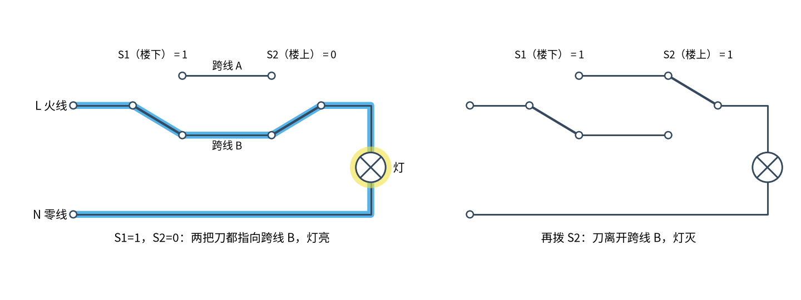
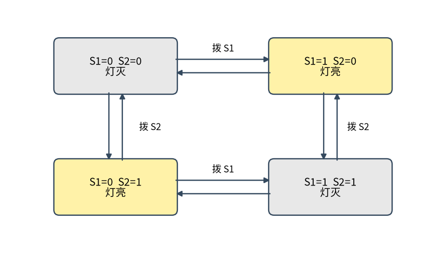
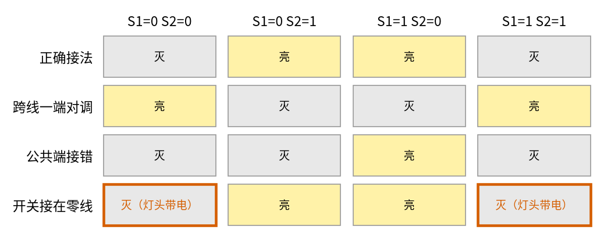

# 20 双控开关 · 原理与实现篇

[上一页：直觉篇](page1.md) · [直觉篇](page1.md) · 本页：原理与实现篇 · [参数与调试篇](page3.md) · [下一页：参数与调试篇](page3.md) · 前置节点：[P1 元件速成 · 直觉篇](../P1-components-basics/page1.md)

> [!WARNING]
> **市电危险**：本电路的实际版本接 220V/380V 市电，触电可能致命。本页的仿真和动手实验只在 12V 以下的低压电源上进行；任何接线、改线都必须在断电并验电后操作，由持证电工完成。
>
> 本节点特有的危险点：① 本页第三种接错（开关接在零线）**功能上完全正常**，用"开关灯试一试"是查不出来的，必须用验电器或万用表测；② 墙里的跨线在灯灭时也可能带电，不要以为"灯灭了线就没电"。

## 一、最小知识

本页只用到两件事：

1. 开关闭合就是一根导线，断开就是断路（见 [P1 元件速成 · 直觉篇](../P1-components-basics/page1.md)）。单刀双掷开关有三个端子：**公共端**（刀固定的那一头，英文常写 COM）和两个触点。刀在任何时候只接其中一个触点。
2. 灯要亮，灯的两端必须一端接通火线 L、另一端接通零线 N，形成回路。只要有一处断开，就没有电流。

本页不算电压、电流，只回答"通不通"。这种只看连通关系的分析，正好能用一个很短的程序做完。

## 二、推导：为什么是异或

请对照图 20-p2-1 看电流的走向。天蓝色粗线是电流路径：



*图 20-p2-1　同一个双控电路的两种状态，天蓝色是电流路径*

**第一步：给开关位置编号**。规定两只开关都从"出厂位置"开始，记作 0；被拨过一次记作 1。按图 20-p2-1 的画法，S1 在 0 时刀接跨线 A，在 1 时接跨线 B；S2 正好反过来，在 0 时接跨线 B，在 1 时接跨线 A。这样规定，起始状态（都是 0）灯是灭的，和装修完交房时一样。

**第二步：写出"灯亮"的条件**。先用中文说：两把刀搭在同一根跨线上，灯就亮。只有两种可能：S1 在 0、S2 在 1（都接 A），或者 S1 在 1、S2 在 0（都接 B）。也就是"两个数不一样"时灯亮，这正是**异或**，用 $\oplus$ 表示：

$$
\text{灯} = s_1 \oplus s_2
$$

图 20-p2-1 左图是 $s_1 = 1$ 、 $s_2 = 0$ ，代入得 1，灯亮；右图再拨 S2，变成 $s_1 = 1$ 、 $s_2 = 1$ ，得 0，灯灭。

**第三步：为什么拨哪只都管用**。异或有一个性质：把其中一个输入取反，输出一定取反。

$$
(1 - s_1) \oplus s_2 = 1 - (s_1 \oplus s_2)
$$

对 $s_2$ 也一样。所以不管另一只开关在哪，拨手边这只，灯一定翻转。推广一步：从起始状态算起，**两只开关一共被拨了奇数次，灯亮；偶数次，灯灭**。

**第四步：开关为什么要放在火线一侧**。只看"亮不亮"，开关放在火线一侧还是零线一侧，上面三步完全一样。区别在灯灭的时候：开关在火线一侧，灯和火线之间是断开的，灯头不带电；开关在零线一侧，灯的一端始终直接连着火线，灯虽然灭了，灯头仍是 220 V。所以 GB 50303-2015 规定"相线应经开关控制"。

## 三、仿真

下面的程序把每只开关、每根导线都看成"把两个点连起来"，再用并查集（一种把连通的点归成一组的方法）判断灯的两端是不是分别连着 L 和 N。A 部分列真值表；B 部分检查"拨一只开关灯就变"在所有情况下是否成立，并画状态图；C 部分模拟三种常见接错；D 部分是参数与调试篇要用的三地控制。程序要在**仓库根目录**运行：`python code/20_sim.py`（第二行靠这个找到 `code/figs` 里的共享画图样式），它会重新生成图 20-p2-2 和图 20-p2-3。想改参数做实验，先复制一份：`cp code/20_sim.py my_20.py`，再改 `my_20.py`。

读代码时有一处写法可能第一次见：`groups` 函数里面又定义了一个小函数 `find`，用来查"这个点属于哪一组"，`groups` 最后把 `find` 交出去，后面的代码拿它来问"灯的两端各和谁同组"。看不懂这种写法也没关系，只要记住"连通的点归为同一组"，就能读懂后面的结果。

```python
# 20 双控开关的最小仿真：把开关和导线看成"谁和谁连通"，算出每种开关位置下灯亮不亮。
# A：正确接法的真值表；B：四种状态的状态图；C：三种常见接错；D：三地控制（加一只中途开关）。
import sys, pathlib
sys.path.insert(0, str(pathlib.Path("code/figs").resolve()))  # 在仓库根目录运行
import itertools                                   # 列出所有开关组合
import matplotlib.pyplot as plt                    # 画图
import figstyle as fs                              # 全书统一的颜色、保存函数

def groups(wires):                                 # 输入"哪两个点连在一起"的列表，输出连通的点集合
    parent = {}                                    # 并查集：每个点记一个"代表"
    def find(x):                                   # 找 x 的代表
        parent.setdefault(x, x)                    # 第一次见到的点，代表就是它自己
        while parent[x] != x:                      # 一直往上找
            x = parent[x]
        return x
    for a, b in wires:                             # 每根导线或闭合的触点
        parent[find(a)] = find(b)                  # 把两边合并成一组
    return find                                    # 返回"找代表"的函数，代表相同就是连通

def spdt(name, pos):                               # 单刀双掷开关：公共端 COM 接到 1 号或 2 号触点
    return [(f"{name}.COM", f"{name}.{1 + pos}")]  # pos = 0 接 1 号，pos = 1 接 2 号

def lamp_state(wires):                             # 灯的两端一端通火线 L、一端通零线 N，灯就亮
    find = groups(wires)                           # 算连通关系
    top, bot = find("灯.上"), find("灯.下")          # 灯两端各属于哪一组
    on = {top, bot} == {find("L"), find("N")}      # 一端是 L 组、另一端是 N 组 → 有电流 → 亮
    live = find("L") in (top, bot)                 # 灯头有没有哪一端连着火线（灯灭时这就是触电隐患）
    return on, live                                # 返回（亮不亮，灯头带不带电）

def correct(s1, s2):                               # 正确接法：火线进 S1 公共端，S2 公共端出来去灯
    w = [("L", "S1.COM"), ("S2.COM", "灯.上"), ("灯.下", "N")]   # 火线、灯线、零线
    w += [("S1.1", "S2.2"), ("S1.2", "S2.1")]      # 两根跨线：A 连 S1.1 和 S2.2，B 连 S1.2 和 S2.1
    return w + spdt("S1", s1) + spdt("S2", s2)     # 加上两只开关此刻闭合的那一路

def swapped_travelers(s1, s2):                     # 接错 1：跨线在一端对调（A、B 互换）
    w = [("L", "S1.COM"), ("S2.COM", "灯.上"), ("灯.下", "N")]
    w += [("S1.1", "S2.1"), ("S1.2", "S2.2")]      # 跨线变成 1 对 1、2 对 2
    return w + spdt("S1", s1) + spdt("S2", s2)

def wrong_common(s1, s2):                          # 接错 2：S2 的公共端和一个触点接反了
    w = [("L", "S1.COM"), ("S2.1", "灯.上"), ("灯.下", "N")]     # 去灯的线错接在 S2.1 上
    w += [("S1.1", "S2.2"), ("S1.2", "S2.COM")]    # 跨线 B 错接在 S2 的公共端上
    return w + spdt("S1", s1) + spdt("S2", s2)

def switch_on_neutral(s1, s2):                     # 接错 3：火线直接进灯，开关串在零线一侧
    w = [("L", "灯.上"), ("灯.下", "S1.COM"), ("S2.COM", "N")]   # 开关断的是零线
    w += [("S1.1", "S2.2"), ("S1.2", "S2.1")]      # 跨线照常
    return w + spdt("S1", s1) + spdt("S2", s2)

STATES = list(itertools.product((0, 1), repeat=2)) # 四种组合 (0,0) (0,1) (1,0) (1,1)

print("[A] 正确接法真值表（0/1 = 开关在出厂位置/被拨过）")
for s1, s2 in STATES:                              # 逐个组合
    on, _ = lamp_state(correct(s1, s2))
    print(f"    S1={s1} S2={s2} → 灯{'亮' if on else '灭'}")
    assert on == bool(s1 ^ s2)                     # 检查：灯 = S1 异或 S2

def flips(wiring):                                 # 数一数：从每个状态拨一只开关，有几次灯会变
    n = 0
    for s1, s2 in STATES:
        now = lamp_state(wiring(s1, s2))[0]
        n += lamp_state(wiring(1 - s1, s2))[0] != now   # 拨 S1
        n += lamp_state(wiring(s1, 1 - s2))[0] != now   # 拨 S2
    return n                                       # 满分 8 次（4 个状态 × 2 只开关）

print(f"[B] 正确接法：拨一只开关灯就变的次数 = {flips(correct)} / 8")
assert flips(correct) == 8                         # 任何时候拨任何一只都管用

fig, ax = fs.diagram(6, 3.4)                       # 状态图：四个方框是四种状态，连线是"拨一只开关"
pos = {(0, 0): (1.4, 2.6), (1, 0): (4.6, 2.6), (0, 1): (1.4, 0.8), (1, 1): (4.6, 0.8)}
for (s1, s2), (x, y) in pos.items():               # 画四个方框，亮的状态填黄色
    on = lamp_state(correct(s1, s2))[0]
    fs.box(ax, x, y, f"S1={s1}  S2={s2}\n灯{'亮' if on else '灭'}", w=1.8, h=0.8,
           fc="#fff2a8" if on else "#e8e8e8")
fs.arrow(ax, (2.3, 2.7), (3.7, 2.7), "拨 S1"); fs.arrow(ax, (3.7, 2.5), (2.3, 2.5))
fs.arrow(ax, (2.3, 0.9), (3.7, 0.9), "拨 S1"); fs.arrow(ax, (3.7, 0.7), (2.3, 0.7))
fs.arrow(ax, (1.3, 2.2), (1.3, 1.2)); fs.arrow(ax, (1.5, 1.2), (1.5, 2.2))
fs.arrow(ax, (4.5, 2.2), (4.5, 1.2)); fs.arrow(ax, (4.7, 1.2), (4.7, 2.2))
ax.text(1.75, 1.7, "拨 S2", fontsize=9, va="center"); ax.text(4.85, 1.7, "拨 S2", fontsize=9, va="center")
fs.save(fig, "20", "20_p2_2_states.png")

print("[C] 三种接错")
rows = [("正确接法", correct), ("跨线一端对调", swapped_travelers),
        ("公共端接错", wrong_common), ("开关接在零线", switch_on_neutral)]
table = {}                                         # 记下每种接法、每个状态的结果，画图用
for name, wiring in rows:
    res = [lamp_state(wiring(s1, s2)) for s1, s2 in STATES]
    table[name] = res
    lit = sum(on for on, _ in res)                 # 四个状态里亮了几个
    danger = sum((not on) and live for on, live in res)  # 灯灭但灯头连着火线的状态数
    print(f"    {name}：亮 {lit}/4，拨开关有效 {flips(wiring)}/8，灯灭时灯头带电 {danger}/4")
assert flips(swapped_travelers) == 8               # 跨线对调：照样两地都能控制，只是亮灭位置反了
assert flips(wrong_common) < 8                     # 公共端接错：有时候拨开关不管用
assert flips(switch_on_neutral) == 8               # 开关接在零线：功能看起来完全正常……
assert sum((not on) and live for on, live in table["开关接在零线"]) == 2   # ……但灯灭时灯头仍带电

fig, ax = plt.subplots(figsize=(7, 2.8))           # 画成表格：行是接法，列是开关状态
ax.set_xlim(0, 4); ax.set_ylim(0, 4); ax.invert_yaxis(); ax.grid(False)
for j, (name, res) in enumerate(table.items()):
    for i, (on, live) in enumerate(res):
        bad = (not on) and live                    # 灯灭但带电，用朱红色框出来
        ax.add_patch(plt.Rectangle((i + 0.05, j + 0.08), 0.9, 0.84, fc="#fff2a8" if on else "#e8e8e8",
                                   ec=fs.C["bad"] if bad else "0.6", lw=2.2 if bad else 0.8))
        ax.text(i + 0.5, j + 0.5, ("亮" if on else "灭") + ("（灯头带电）" if bad else ""),
                ha="center", va="center", fontsize=9, color=fs.C["bad"] if bad else "k")
ax.set_xticks([0.5, 1.5, 2.5, 3.5], [f"S1={a} S2={b}" for a, b in STATES])
ax.set_yticks([0.5, 1.5, 2.5, 3.5], list(table))
ax.tick_params(length=0); [s.set_visible(False) for s in ax.spines.values()]
ax.xaxis.tick_top()
fs.save(fig, "20", "20_p2_3_mistakes.png")

def three_way(s1, s2, s3):                         # 三地控制：S1、S3 是双控开关，S2 是中途开关
    w = [("L", "S1.COM"), ("S3.COM", "灯.上"), ("灯.下", "N")]
    w += [("S1.1", "M.a1"), ("S1.2", "M.b1")]      # S1 的两个触点接中途开关的入口 a1、b1
    w += [("M.a2", "S3.2"), ("M.b2", "S3.1")]      # 中途开关的出口 a2、b2 接 S3
    w += [("M.a1", "M.a2"), ("M.b1", "M.b2")] if s2 == 0 else [("M.a1", "M.b2"), ("M.b1", "M.a2")]  # 直通或交叉
    return w + spdt("S1", s1) + spdt("S3", s3)

print("[D] 三地控制真值表")
for s in itertools.product((0, 1), repeat=3):     # 八种组合
    on, _ = lamp_state(three_way(*s))
    print(f"    S1={s[0]} 中途={s[1]} S3={s[2]} → 灯{'亮' if on else '灭'}")
    assert on == bool(s[0] ^ s[1] ^ s[2])          # 灯 = 三只开关的异或：拨任何一只都翻转
```

运行结果：

```text
[A] 正确接法真值表（0/1 = 开关在出厂位置/被拨过）
    S1=0 S2=0 → 灯灭
    S1=0 S2=1 → 灯亮
    S1=1 S2=0 → 灯亮
    S1=1 S2=1 → 灯灭
[B] 正确接法：拨一只开关灯就变的次数 = 8 / 8
[C] 三种接错
    正确接法：亮 2/4，拨开关有效 8/8，灯灭时灯头带电 0/4
    跨线一端对调：亮 2/4，拨开关有效 8/8，灯灭时灯头带电 0/4
    公共端接错：亮 1/4，拨开关有效 4/8，灯灭时灯头带电 0/4
    开关接在零线：亮 2/4，拨开关有效 8/8，灯灭时灯头带电 2/4
[D] 三地控制真值表
    S1=0 中途=0 S3=0 → 灯灭
    S1=0 中途=0 S3=1 → 灯亮
    S1=0 中途=1 S3=0 → 灯亮
    S1=0 中途=1 S3=1 → 灯灭
    S1=1 中途=0 S3=0 → 灯亮
    S1=1 中途=0 S3=1 → 灯灭
    S1=1 中途=1 S3=0 → 灯灭
    S1=1 中途=1 S3=1 → 灯亮
```

## 四、看结果

A 部分的真值表四行里，(0,1) 和 (1,0) 亮，(0,0) 和 (1,1) 灭，和第二步的异或一致。B 部分把它画成了图 20-p2-2：



*图 20-p2-2　双控开关的状态图*

图 20-p2-2 里，四个方框是四种状态，箭头是"拨一次开关"。可以看到**每一条箭头都是从黄框指向灰框，或者从灰框指向黄框**，没有一条箭头连着两个同色的方框。这就是"拨哪只都管用"的图形说法，程序里的 8/8 也是这个意思：4 个状态，每个状态 2 只开关可拨，一共 8 种拨法，每一种都让灯变了。

C 部分的结果画成了图 20-p2-3，每一行是一种接法，每一列是一种开关状态：



*图 20-p2-3　正确接法和三种接错在四种开关状态下的结果*

图 20-p2-3 的四行分别说明：

- **跨线一端对调**（在 S2 那头把两根跨线互换）：亮灭的位置整体反过来了，但仍然两亮两灭，拨开关有效 8/8。也就是说功能没坏，只是"出厂位置"变成了灯亮。
- **公共端接错**（S2 的公共端和一个触点接反）：四种状态只有一种亮，拨开关只有 4/8 有效。用户感觉是"有时候拨了没反应"。Samotech 的排障指南把"火线或灯线没接在公共端上"列为"只有一只开关管用"最常见的原因：开关背面三个端子长得差不多，没看清哪个是公共端就接了。
- **开关接在零线**：亮灭和正确接法完全一样，8/8 有效，看起来没毛病。可是两个"灭"的格子被朱红色框出来了：灯灭时灯头仍然连着火线。这种错误**只能用仪表查出来**。

## 五、渐隐例题

**例 1（完整）**：起始状态两只开关都在 0，灯灭。晚上回家，楼下拨了 S1；上楼后拨了 S2；半夜下楼喝水，在楼上拨了 S2；回来时在楼下又拨了 S1。每一步之后灯是什么状态？

- 拨 S1： $s_1 = 1$ 、 $s_2 = 0$ ， $1 \oplus 0 = 1$ ，亮。
- 拨 S2： $s_1 = 1$ 、 $s_2 = 1$ ， $1 \oplus 1 = 0$ ，灭。
- 拨 S2： $s_1 = 1$ 、 $s_2 = 0$ ，亮。
- 拨 S1： $s_1 = 0$ 、 $s_2 = 0$ ，灭。
- 核对：一共拨了 4 次，偶数，最后是灭的，和第三步的结论一致。

**例 2（填空）**：起始状态灯灭。一天里 S1 被拨了 5 次，S2 被拨了 2 次。总次数是 $\square$ 次，是 $\square$ 数，所以灯 $\square$ 。此时 $s_1 = \square$ ， $s_2 = \square$ 。

<details><summary>答案</summary>

总次数 7 次，奇数，所以灯亮。S1 拨了奇数次， $s_1 = 1$ ；S2 拨了偶数次， $s_2 = 0$ ；代入 $1 \oplus 0 = 1$ ，同样是亮。

</details>

**例 3（变体迁移）**：电工在 S2 那头把两根跨线接反了（图 20-p2-3 第二行）。起始状态两只开关都在 0。灯是亮还是灭？拨 S1 以后呢？这个错误需不需要返工？

<details><summary>答案</summary>

跨线对调后，两只开关在 0 时都接同一根跨线，所以起始状态灯亮；拨 S1 后两把刀分开，灯灭。灯变成 $1 - (s_1 \oplus s_2)$ ，也就是"同或"（"两者相同"时为 1，正好是异或反过来），拨任意一只仍然翻转。功能上不需要返工，只是开关面板"按下去那头"和灯的亮灭对应关系反过来了，很多人家里就是这样的。

</details>

## 六、低压动手实验

> [!WARNING]
> **市电危险**：本电路的实际版本接 220V/380V 市电，触电可能致命。本页的仿真和动手实验只在 12V 以下的低压电源上进行；任何接线、改线都必须在断电并验电后操作，由持证电工完成。
>
> 本节点特有的危险点：① 本实验只用 9 V 电池，**不要**拆墙上的开关来练手；② 墙上的开关即使"看起来一样"，里面接的是 220 V，本实验的任何结论都不能代替持证电工的验电。

材料：两只小的单刀双掷拨动开关（三个引脚的那种）、9 V 电池、红色 LED 一只、1 kΩ 电阻一只、面包板、导线、万用表。

第 4、5、6 步都要改线：每次改线前先取下 9 V 电池扣，改好、检查一遍再接回去，养成和真实市电"先断电再动线"一样的习惯。

1. 先找公共端：万用表打到通断档，把开关拨到一边，量三个引脚两两之间，记下哪一对相通；再拨到另一边量一次。两次都出现在相通那一对里的脚，就是公共端（通常是中间那个脚，但以实测为准）。
2. 接正确接法：9 V 正极 → S1 公共端；S1 两个触点分别用两根导线（跨线）接 S2 的两个触点；S2 公共端 → 1 kΩ → LED 长脚（正极），LED 短脚 → 9 V 负极。红色 LED 压降约 2 V（见 [P2 半导体入门 · 直觉篇](../P2-semiconductor-basics/page1.md)），电流约 $(9 - 2) / 1\ \text{k}\Omega = 7\ \text{mA}$ ，亮度足够。
3. 把四种开关组合都试一遍，应当两亮两灭，并且在任何状态下拨任意一只，LED 都会翻转。和图 20-p2-2 对照。
4. 复现接错 1：在 S2 那头把两根跨线对调。应当仍然两亮两灭，只是原来亮的组合变成灭。
5. 复现接错 2：把 S2 公共端上的线和 S2 某个触点上的线对调。应当只剩一种组合亮，和图 20-p2-3 第三行一致。
6. 复现接错 3（模拟"开关接在零线"）：改成 9 V 正极 → 1 kΩ → LED 长脚，LED 短脚 → S1 公共端，S2 公共端 → 9 V 负极。先拨到 LED 灭，再用万用表黑表笔接电池负极、红表笔接电阻和 LED 相接的那一点，读数应接近 9 V；换回第 2 步的正确接法，同样在 LED 灭时测这一点，读数应接近 0 V。这就是"灯灭了灯头还带电"的低压版本。

以上读数是模型估算，未经实测，具体数值会因万用表内阻和 LED 而略有不同。

## 参考资料

- Wikipedia，Multiway switching（两地控制原理、四种组合中两种亮灯、开关只能断不接地导线）：https://en.wikipedia.org/wiki/Multiway_switching
- Samotech，How to wire a 2-way light switch (UK)（COM、L1、L2 的接法；"只有一只开关管用"最常见原因是火线或灯线没接在 COM 上）：https://www.samotech.co.uk/guides/wiring/how-to-wire-2-way-light-switch-uk/
- GB 50303-2015《建筑电气工程施工质量验收规范》第 20.1.4 条（相线应经开关控制）：https://gf.cabr-fire.com/article-19525.htm
