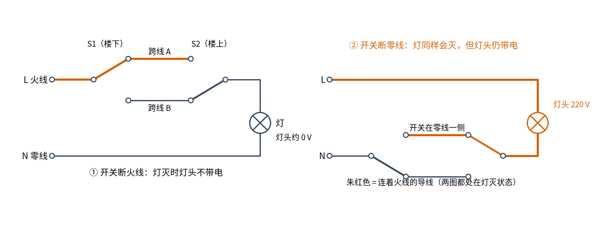
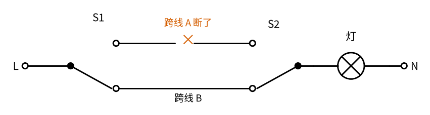
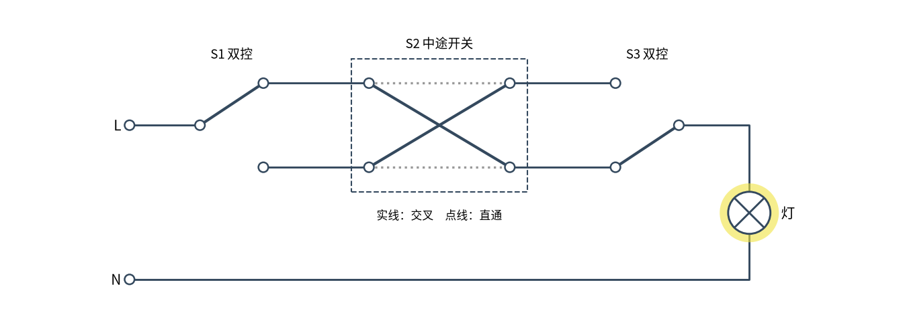
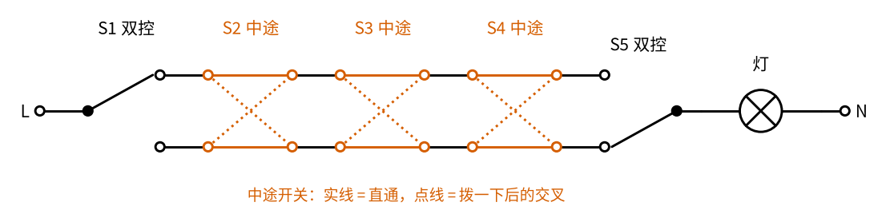

# 20 双控开关 · 参数与调试篇

[上一页：原理与实现篇](page2.md) · [直觉篇](page1.md) · [原理与实现篇](page2.md) · 本页：参数与调试篇 · [下一页：20 双控开关 · 动手实验篇](page4.md) · 前置节点：[P1 元件速成 · 直觉篇](../P1-components-basics/page1.md)

> [!WARNING]
> **市电危险**：本电路的实际版本接 220V/380V 市电，触电可能致命。本页的仿真和动手实验只在 12V 以下的低压电源上进行；任何接线、改线都必须在断电并验电后操作，由持证电工完成。
>
> 本节点特有的危险点：① 本页的故障排查表是帮你**看懂问题、和电工沟通**用的，不是让你自己拆墙上的开关；② 验电要用合格的验电器或万用表，Samotech 的接线指南特别指出，只用非接触式电笔不够；③ 墙上开关盒里的跨线在灯灭时也可能带电。

## 一、参数表

双控开关本身没有需要计算的电阻电容，要记的是"几只开关、几根线、断哪根线"。下表除注明"推导"的以外，都来自参考资料：

| 项目 | 数值或要求 | 说明 |
|---|---|---|
| 两地控制 | 2 只单刀双掷开关 | 美国叫 3-way，英国叫 2-way，国内叫双控开关 |
| 两只开关之间 | 2 根跨线 | 英国做法用三芯加地线的电缆 |
| 每多一个控制点 | 加 1 只中途开关 | 中途开关有 4 个端子，在直通和交叉之间切换 |
| n 地控制 | 2 只双控开关加 n − 2 只中途开关 | 推导，见本页第三节 |
| 开关断哪根线 | 相线（火线） | GB 50303-2015 第 20.1.4 条 |
| 螺口灯头 | 相线接中间的端子 | GB 50303-2015 第 18.2.2 条第 4 款 |
| 引向单个灯具的导线 | 铜芯截面积不小于 1 mm² | GB 50303-2015 第 18.2.1 条 |
| 开关额定值 | 按面板上标的电流、电压选 | 灯的电流不能超过开关的标称电流 |

为什么螺口灯头的相线要接中间：螺口灯头的金属螺纹外壳是换灯泡时手最容易碰到的地方。相线接中间的小触点、零线接外壳，配合"开关断相线"，灯灭时整个灯头都不带电；即使灯亮着，手碰到的外壳也是零线一侧。

## 二、故障排查

先看图 20-p3-1。两边都处在"灯灭"的状态，朱红色是连着火线的导线：

*图 20-p3-1　灯灭时，开关断火线与开关断零线的对比*

图 20-p3-1 说明了故障排查里最要紧的一条：**灯会灭，不代表接法对**。下表按"看到的现象"排列。所有检查都要在断开配电箱断路器、验电确认无电后由电工进行：

| 现象 | 可能原因 | 怎么查 |
|---|---|---|
| 只有一个开关管用，或者"有时候拨了没反应" | 某只开关的公共端接错（见原理与实现篇"公共端接错"） | 断电后用万用表通断档找出每只开关真正的公共端，核对火线和灯线是否都接在公共端上 |
| 两个开关都管用，但"开关朝下才亮"和别的房间不一样 | 跨线在一端对调（见原理与实现篇"跨线一端对调"） | 功能正常，不必返工；介意的话先断开断路器，再请电工把开关面板翻转安装，不要自己拆墙上的开关 |
| 拨哪个都不亮 | 灯坏、跨线断了一根后正好处在断的那根上、断路器跳闸 | 先断开断路器再换灯（开关如果接在零线上，灯灭时灯头仍带电）；送电后再把**两只**开关都拨到另一边，如果灯亮了，说明原来那根跨线断了，接着断电按下一行量通断（或请电工） |
| 只有两种组合中的一种亮，另一种"本该亮"的不亮 | 两根跨线中有一根断了或接触不良 | 断电后量两根跨线各自的通断 |
| 功能正常，但灯灭时用验电器测灯头仍有电 | 开关接在零线一侧（图 20-p3-1 右图） | 请电工把火线改到开关一侧；在改好之前，换灯泡前必须断开断路器 |
| 开关发热、有焦味 | 端子松动、导线太细或负载超过开关额定值 | 立即断电，请电工处理 |

上表"跨线断了一根"那一行，可以用第二节的思路推一下：跨线 A 断了，那么只有"两把刀都在 B 上"的那一种组合能亮，另一种本该亮的组合不亮，所以四种组合里只有一种亮。

图 20-p3-3 画的就是跨线 A 断了、两把刀都搭在跨线 B 上的那种组合。

*图 20-p3-3　跨线 A 断了：只有两把刀都在跨线 B 上才亮*

图 20-p3-3 里只要任意一把刀拨到跨线 A，路就断在叉号处，灯不亮。所以排查时断电后分别量两根跨线的通断，哪根不通就是哪根断了。

## 三、变体

### 变体 1：三地控制

一条长走廊有三个门，每个门口都要能开关同一盏灯。做法是在两只双控开关中间插一只**中途开关**，见图 20-p3-2：

*图 20-p3-2　三地控制：两只双控开关中间加一只中途开关*

图 20-p3-2 的中途开关 S2 没有公共端，只有四个端子。它的两个位置是：直通（上进上出、下进下出，点线）和交叉（上进下出、下进上出，实线）。不管它在哪个位置，两根跨线都没有断，只是"哪根接哪根"变了。所以拨它的效果和"把两根跨线对调"一样，灯一定翻转。

仿真 D 部分的八行真值表给出：

$$
\text{灯} = s_1 \oplus s_2 \oplus s_3
$$

图 20-p3-2 画的是 $s_1 = 0$ 、 $s_2 = 1$ 、 $s_3 = 0$ ，代入得 1，灯亮。依此类推，要四地控制就再串一只中途开关，n 地控制需要 2 只双控开关和 n − 2 只中途开关，结论仍然是"总共拨了奇数次就亮"。

### 变体 2：用继电器或智能开关做多地控制

控制点很多、或者布线很远时，跨线又长又多。另一种做法是让每个开关只发一个低压信号，由一个继电器或单片机来切换灯的电源（继电器驱动见 [22 三极管开关与继电器驱动 · 直觉篇](../22-bjt-relay-driver/page1.md)）。这样墙上的开关只接低压，接错也不会让灯头带电。现在常见的智能开关、无线随意贴开关就是这个思路。

## 四、练习

**练习 1（易）**：三地控制，起始状态三只开关都在 0，灯灭。依次拨 S2、S3、S2，灯最后是什么状态？用异或验证。

答案

一共拨了 3 次，奇数，灯亮。最后 $s_1 = 0$ 、 $s_2 = 0$ （拨了两次）、 $s_3 = 1$ ， $0 \oplus 0 \oplus 1 = 1$ ，亮。

**练习 2（中 · 概念辨析）**：邻居说："我家楼梯灯两个开关都能用，所以接线肯定没问题。"这句话对吗？要确认接法安全，还要查什么？

答案

不对。原理与实现篇的仿真（"开关接在零线"那一行）和图 20-p3-1 右图都表明，开关接在零线一侧时功能完全正常，但灯灭时灯头带 220 V。要确认安全，必须在灯灭时由电工用验电器或万用表测灯头，确认开关断的是火线；螺口灯头还要确认火线接在中间的端子上。

**练习 3（较难 · 变体迁移）**：一个大厅有 5 个门，每个门口都要能开关同一盏灯。需要几只双控开关、几只中途开关？如果起始状态灯灭、5 只开关都在 0，依次拨了其中 4 只各一次，灯是亮还是灭？

答案

2 只双控开关放在两头，中间 5 − 2 = 3 只中途开关。和三地控制一样，每只中途开关拨一次也让灯翻转一次，所以灯的状态是 5 个数的异或： $1 \oplus 1 \oplus 1 \oplus 1 \oplus 0 = 0$ ，一共翻转 4 次（偶数），灯灭。

五地控制的接法见图 20-p3-4。

*图 20-p3-4　五地控制：两只双控开关在两头，中间三只中途开关*

图 20-p3-4 中三只中途开关都画在直通位置，点线是拨一下以后的交叉连接。每只中途开关都只是让两根跨线"直通"或"交叉"，所以拨任意一只灯都翻转一次。

## 参考资料

- Wikipedia，Multiway switching（中途开关是在直通和交叉之间切换的双刀双掷开关，可以串任意多只；也可以用低压继电器实现多地控制）：https://en.wikipedia.org/wiki/Multiway_switching
- Samotech，How to wire a 2-way light switch (UK)（中途开关四个端子、每多一个控制点加一只；"只有一只开关管用"的常见原因；验电不能只用非接触式电笔）：https://www.samotech.co.uk/guides/wiring/how-to-wire-2-way-light-switch-uk/
- GB 50303-2015《建筑电气工程施工质量验收规范》第 20.1.4 条（相线应经开关控制）：https://gf.cabr-fire.com/article-19525.htm
- GB 50303-2015《建筑电气工程施工质量验收规范》第 18.2.1 条（引向单个灯具的铜芯导线不小于 1 mm²）、第 18.2.2 条第 4 款（螺口灯头相线接中间端子）：https://gf.cabr-fire.com/article-19520.htm
