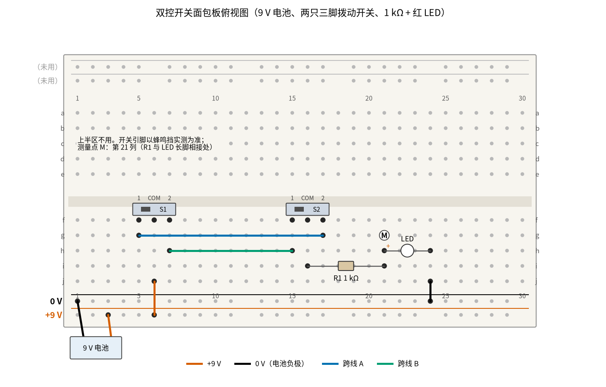
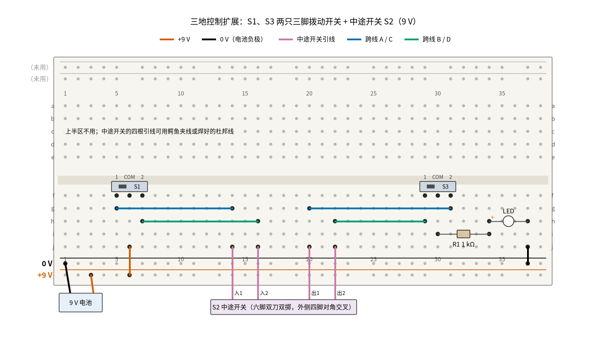

# 20 双控开关 · 动手实验篇

[上一页：参数与调试篇](page3.md) · [直觉篇](page1.md) · [原理与实现篇](page2.md) · [参数与调试篇](page3.md) · 本页：动手实验篇 · [下一页：24 隔离电源与数字隔离器 · 直觉篇](../24-isolated-power/page1.md) · 前置节点：[P1 元件速成 · 直觉篇](../P1-components-basics/page1.md)

> [!WARNING]
> **市电危险：不要接 220 V/380 V，市电接线请电工。** 墙上的双控开关接的是 220 V 照明回路，触电可能致命。本页只用一节 9 V 电池、两只小拨动开关和一只 LED，**不要**拆墙上的开关来练手；本实验得出的任何结论，都不能代替电工断电、验电以后的检查。

## 这次实验要验证什么

在面包板上亲手验证 [20 双控开关 · 原理与实现篇](page2.md) 第二节的结论：灯的亮灭是两只开关位置的**异或**，四种组合两亮两灭，任何时候拨任意一只，灯都会翻转；再看三种常见接错各是什么样子，尤其是「开关接在零线上，灯灭了灯头还带电」。

本页是 [20 双控开关 · 原理与实现篇](page2.md) 第六节「低压动手实验」的展开版：器材（9 V 电池、两只三脚拨动开关、1 kΩ、红 LED）和第 1 到 6 步都照那一节做，本页补上面包板的具体插法、每一步的读数表和记录表；最后加一个第六节没有的扩展：照 [20 双控开关 · 参数与调试篇](page3.md) 变体 1 搭一个三地控制。

## ⚠️ 安全须知

- **只用 9 V 电池**（12 V 以下的直流电）。**不要接 220 V/380 V，市电接线请电工。**
- 本实验没有电解电容；有极性的只有 **LED**：长脚（正极）朝电阻，短脚朝负极。接反了不会坏，只是不亮。
- 本实验没有发热元件，1 kΩ 上只有几十毫瓦。但 **9 V 电池两极被导线直接短路时会发烫**，改线时别让正负极的线头碰在一起。
- 第 4、5、6 步都要改线：**每次改线前先取下电池扣**，改好、检查一遍再接回去。这和真实电路「先断电再动线」是同一个习惯。

## 器材清单

| 元件 | 型号或数值 | 数量 | 说明 |
|---|---|---|---|
| 单刀双掷拨动开关 S1、S2 | 三个引脚、可插面包板的小拨动开关 | 2 | 公共端通常是中间脚，以蜂鸣挡实测为准 |
| 电阻 R1 | 1 kΩ，1/4 W | 1 | 限流 |
| LED | 红色，直径 3 mm 或 5 mm | 1 | |
| 电池 | 9 V 叠层电池和电池扣 | 1 | |
| 万用表 | 直流 20 V 挡、20 mA 挡、蜂鸣挡 | 1 | |
| 面包板、杜邦线 | 830 孔（或半块板） | 1 套 | |
| 扩展用：单刀双掷拨动开关 S3 | 同 S1 | 1 | 三地控制用 |
| 扩展用：双刀双掷开关 | 六个引脚的拨动开关或船形开关 | 1 | 改成中途开关，需要焊 2 根短线或用鳄鱼夹线 |

## 搭建步骤

先对照 [20 双控开关 · 原理与实现篇](page2.md) 第二节的电路，记住三件事：电源进 S1 的公共端，两根跨线连两只开关的触点，S2 的公共端出来去灯。下面只用面包板的下半区。

1. **找公共端**（第六节第 1 步）。蜂鸣挡量开关三个脚两两之间，拨到一边量一次、另一边再量一次；两次都响的那一对里共有的脚是 COM。在开关上用记号笔标出「1、COM、2」。
2. **插开关**。S1 插在 f5、f6、f7（COM 在第 6 列），S2 插在 f15、f16、f17（COM 在第 16 列）。
3. **跨线**。蓝色线 g5 → g17（S1 的 1 接 S2 的 2，叫跨线 A），蓝绿色线 h7 → h15（S1 的 2 接 S2 的 1，叫跨线 B）。这样交叉连，四种组合的亮灭就和原理篇的真值表一一对应；如果你把两根线连成「1 对 1、2 对 2」，那就是第 4 步要复现的「跨线一端对调」。
4. **电阻和 LED**。R1 插 i16–i21；LED 长脚插 h21、短脚插 h24；黑线 j24 → 下边 0 V 轨。第 21 列（R1 和 LED 长脚相接处）记作测量点 M。
5. **电源**。朱红色线 j6 → 下边 +9 V 轨（电源进 S1 公共端）；电池扣红线接 +9 V 轨，黑线接 0 V 轨。

接好后如 图 20-p4-1。



*图 20-p4-1　两地控制的面包板接线（9 V 电池、两只三脚拨动开关）*

图中朱红色线是 +9 V，黑色线是 0 V，蓝色和蓝绿色是两根跨线；跨线从中间几列上方经过，只有画了黑点的孔才插着线。上边两条电源轨不用，画成了灰色。code/figs/20_figs.py 还把这张图的每一处连接列成表，逐个组合推了一遍，核对了「两亮两灭、拨任一只都翻转」。

第 4、5 步照第六节改线即可（先取下电池扣）。第 6 步「开关接在零线」在这块板上这样改，接成「+9 V → R1 → LED → S1 公共端……S2 公共端 → 0 V」：

1. 拔掉 j6 到 +9 V 轨的朱红色线。
2. 把 j24 那根黑线的另一头从 0 V 轨拔出，改插到 j6（LED 短脚接 S1 公共端）。
3. 把 R1 的左脚从 i16 拔出，改插到下边 +9 V 轨（R1 另一脚仍在第 21 列，M 点不变）。
4. 新加一根黑线 j16 → 0 V 轨（S2 公共端接负极）。

## 测量表

「应该读到」取自 [review/spice/20.md](../review/spice/20.md) 的「面包板万用表读数」表和核对表（LED 用 SPICE 通用红光模型，压降 1.87 V，电流 7.13 mA），亮几种由 code/figs/20_figs.py 推演得到。

| 步骤 | 测什么 | 红表笔 | 黑表笔 | 挡位 | 应该读到 | 读不到时先查 |
|---|---|---|---|---|---|---|
| 第 1 步 | 每只开关的公共端 | 开关任一脚 | 另一脚 | 蜂鸣挡 | 拨到两边都响的那一对里共有的脚是 COM | 一直响：量的是同一侧两脚，换一对 |
| 第 2 步 | 电池 | +9 V 轨 | 0 V 轨 | 直流 20 V | 约 9 V，新电池约 9.3～9.6 V | 明显低于 8 V：换电池 |
| 第 2 步，LED 亮 | LED 两端 | h21（长脚） | h24（短脚） | 直流 20 V | 约 1.9 V（不同 LED 在 1.8～2.2 V） | 约 9 V 且不亮：LED 接反 |
| 第 2 步，LED 亮 | R1 两端 | i16 | i21 | 直流 20 V | 约 7.1 V，相当于 7.1 mA | 0 V：这个组合本来就该灭，拨一只再量 |
| 第 2 步，LED 亮 | LED 电流 | R1 右脚（先拔出第 21 列） | 第 21 列 | 直流 20 mA | 约 7.1 mA | 量完要把 R1 插回去、表笔拨回电压挡 |
| 第 3 步 | 四种组合 | 眼睛看 | — | — | 两亮两灭；S1、S2 都在同一侧（都标 1 或都标 2）时灭 | 只有一种亮：公共端认错了，回第 1 步 |
| 第 3 步，LED 灭 | M 点对负极（正确接法） | 第 21 列 | 0 V 轨 | 直流 20 V | 约 0 V | 有电压：电源接到了灯这一侧 |
| 第 4 步 | 跨线一端对调后的四种组合 | 眼睛看 | — | — | 仍两亮两灭，原来亮的组合变灭 | |
| 第 5 步 | 公共端接错后的四种组合 | 眼睛看 | — | — | 只剩一种亮；8 次拨动只有 4 次有效 | |
| 第 6 步，LED 灭 | M 点对负极（开关接负极一侧） | 第 21 列 | 0 V 轨 | 直流 20 V | 约 9.0 V（「灯灭了灯头还带电」） | 0 V：R1 左脚没插到 +9 V 轨 |
| 扩展 | 三地控制的八种组合 | 眼睛看 | — | — | 亮 4 种，任拨一只都翻转；三只都在 1 时灭 | 拨 S2 没反应：中途开关没交叉 |

共 11 个测量点。量电流时要把表**串进**回路，**改接前先取下电池扣**。

## 扩展：三地控制

按 [20 双控开关 · 参数与调试篇](page3.md) 变体 1，在 S1 和另一只三脚开关 S3 之间插一只中途开关 S2。中途开关用六脚双刀双掷开关改：两只中间脚是「入 1、入 2」；先断电，用两根短线把四个外侧脚**对角交叉**连起来（左上接右下、右上接左下），再从上排两个外侧脚引出「出 1、出 2」。这样拨到一边是直通，拨到另一边是交叉，正是变体 1 说的四端子中途开关。

接法见 图 20-p4-2：S1 在 f5～f7，S3 在 f29～f31，R1 在 i30–i34，LED 在 h34–h37。



*图 20-p4-2　三地控制扩展：两只三脚开关中间加一只中途开关*

图 20-p4-2 里红紫色是中途开关的四根引线，蓝色和蓝绿色是四根跨线。code/figs/20_figs.py 按这张图推演了八种组合：亮 4 种，三只都在「1」时灭，任拨一只灯都翻转，和参数与调试篇的三地真值表一致。

## 没有示波器怎么办

本节点不需要示波器：亮灭用眼睛看，读数都是直流电压和电流，万用表就够。真正「做不了」的是另一部分：**220 V 照明回路里的现象，比如灯头带电、验电笔发光，本页只能用 9 V 的 M 点读数来类比讲道理**，不要拿墙上的开关验证，见 [20 双控开关 · 参数与调试篇](page3.md) 第二节的对比图。

还有一处肉眼会骗人：LED 灭的时候，万用表 10 MΩ 内阻上只有极小的电流，所以第 6 步 M 点读到的 9.0 V 是「有电压、没电流」。真实灯头上这一点是 220 V，人一碰就会有电流从人体流过。

## 用 Python 核对你的读数

把四种组合的亮灭和几个读数填进去，代码按原理篇的结论算出应有值，偏差超过 10% 会提醒。

```python
import sys, pathlib
sys.path.insert(0, str(pathlib.Path("code/figs").resolve()))  # 在仓库根目录运行

# ===== 把下面换成你自己的实测值（这里是一组示例） =====
V_BAT = 9.4          # 电池，V
V_LED = 1.92         # LED 亮时两端，V
V_R = 7.45           # LED 亮时 R1 两端，V
I_MEAS = 7.4         # LED 亮时电流，mA
R1 = 1000.0          # 电阻标称值，Ω
SEEN = {(0, 0): 0, (0, 1): 1, (1, 0): 1, (1, 1): 0}   # 你看到的亮(1)灭(0)；0 = 拨到标「1」那边
VM_OK_OFF = 0.0      # 正确接法、LED 灭时 M 点对负极，V
VM_NEUTRAL_OFF = 9.3 # 第 6 步、LED 灭时 M 点对负极，V

def check(name, meas, calc):
    dev = (meas - calc) / calc * 100
    flag = "  <-- 偏差超过 10%，取下电池扣后按测量表排查" if abs(dev) > 10 else ""
    print(f"{name}: 实测 {meas:.2f}，计算 {calc:.2f}，偏差 {dev:+.1f}%{flag}")

check("R1 两端 / V", V_R, V_BAT - V_LED)
check("LED 电流 / mA", I_MEAS, V_R / R1 * 1000)
for (s1, s2), lit in SEEN.items():
    want = s1 ^ s2                                  # 异或：两只开关不在同一侧才亮
    if lit != want:
        print(f"  <-- S1={s1} S2={s2} 应该{'亮' if want else '灭'}，先查跨线和公共端")
print("四种组合", "两亮两灭，符合异或" if sum(SEEN.values()) == 2 else "不是两亮两灭")
print("正确接法灯灭时 M 点", "约 0 V，灯头不带电" if VM_OK_OFF < 0.5 else "有电压，电源接错了一侧")
check("第 6 步灯灭时 M 点 / V", VM_NEUTRAL_OFF, V_BAT)
```

示例数据里，R1 两端 7.45 V 和 $9.4 - 1.92 = 7.48$ V 只差 0.4%，电流 7.4 mA 和 7.45 V 除以 1 kΩ 的 7.45 mA 也对得上；第 6 步 M 点 9.3 V 差不多就是电池电压，说明灯灭时这一点仍然接着正极。

## 实验记录表

| 项目 | 实测值 | 计算值 | 偏差 |
|---|---|---|---|
| 电池电压 |  | — | — |
| LED 亮时两端 |  | 约 1.9 V |  |
| LED 亮时 R1 两端 |  | 电池电压减 LED 压降 |  |
| LED 电流 |  | R1 两端电压除以 1 kΩ |  |
| 四种组合亮几种 |  | 2 |  |
| 正确接法灯灭时 M 点 |  | 约 0 V | — |
| 第 6 步灯灭时 M 点 |  | 等于电池电压 |  |
| 三地控制八种组合亮几种 |  | 4 |  |

**思考题 1**：如果跨线 A 从中间断了（拔掉 g5–g17 那根线），四种组合会怎样？

<details><summary>答案</summary>

只剩跨线 B 一条路，只有「S1 拨到 2、S2 拨到 1」这一种组合能把电送到 LED，所以四种里只亮一种，另一种「本该亮」的组合不亮。这就是 [20 双控开关 · 参数与调试篇](page3.md) 故障排查表里「只有两种组合中的一种亮」那一行。你可以真拔掉试一下。

</details>

**思考题 2**：第 6 步 LED 是灭的，为什么 M 点还能读到约 9 V？换到墙上的灯，这意味着什么？

<details><summary>答案</summary>

LED 灭是因为开关在负极一侧断开了，回路里没有电流。没有电流，R1 上就没有压降，M 点经 R1 直接连着 +9 V，所以读数约等于电池电压。墙上的灯如果开关接在零线上，灯灭时灯头仍接着 220 V 的火线，换灯泡时一碰就可能触电。所以规范要求开关断相线，接线由电工完成。

</details>

**思考题 3**：做扩展时，如果忘了把双刀双掷开关的外侧脚对角交叉，只从「出 1、出 2」直接引线，会看到什么？

<details><summary>答案</summary>

没有交叉线时，入 2 在两个位置都接到没引出的下排外侧脚上，一直悬空；入 1 拨到一边接出 1、拨到另一边接出 2。于是不管 S2 在哪边，都只有一根跨线是通的，八种组合里只亮 2 种（S1 在「1」时，S3 还得正好拨到那根跨线所在的一边），很多次拨动灯都不变。所以四根外侧脚的对角交叉不能省，它让两根跨线在两个位置都通，只是换了位置。

</details>

## 自测清单

- 我能用蜂鸣挡找出三脚开关的公共端，并说清楚电源和灯线为什么都要接在公共端上。
- 我能在面包板上搭出两地控制，并用「异或」预测四种组合的亮灭。
- 我能复现三种接错，说出每种各亮几种组合。
- 我能用 M 点的读数解释「灯灭了灯头还带电」，并知道墙上的开关不要自己拆，市电接线请电工。
