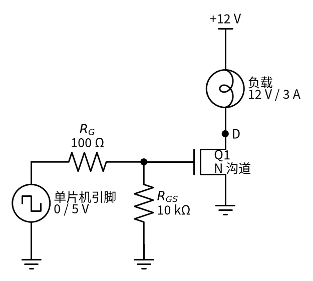
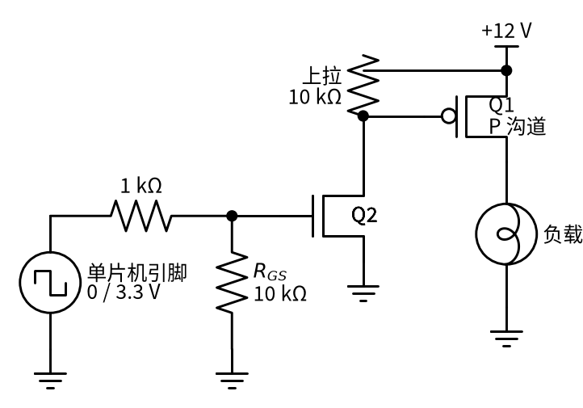

# 21 MOS 管开关 · 直觉篇

[上一页：01 反相放大](../01-inverting-amp/page3.md) · 本页：直觉篇 · [原理与实现篇](page2.md) · [参数与调试篇](page3.md) · [下一页：原理与实现篇](page2.md) · 前置节点：[P1 元件速成](../P1-components-basics/) · [P2 半导体入门](../P2-semiconductor-basics/)

## 痛点：小引脚想控制大电流

做一个小项目时，经常会遇到这样的需求：用单片机（比如 Arduino、ESP32）的一个引脚，去开关一条 12 V、3 A 的灯带，或者一个 12 V 的直流电机，最好还能用 PWM（快速开关、调节通电时间的比例）调亮度、调转速。

问题是，单片机引脚只是一个「弱信号」：它能输出 0 V 或 3.3 V / 5 V，但能提供的电流很小（具体数值看芯片手册，一般是毫安级），而且电压也不够 12 V。直接把灯带接到引脚上，灯不会亮，引脚还可能被烧坏。

我们需要一个「用小信号控制大电流」的开关。[P2 半导体入门](../P2-semiconductor-basics/page1.md) 已经介绍过 MOS 管：栅极电压像手按阀门，按下去漏极到源极就导通。这一节把它真正用起来，并回答几个实际问题：

- 栅极电阻、栅极下拉电阻各自干什么用？
- 为什么同样能「打开」，有的 MOS 管会烫手？
- PWM 频率调高以后，MOS 管为什么反而更热？
- 开关电机这种「带线圈」的负载，为什么一定要加二极管？

## 类比：带小水桶的阀门

P2 把 MOS 管比作按压式阀门。这里再补充一个细节：**MOS 管的栅极其实是一个小电容**，相当于阀门手柄上连着一个小水桶。

- 想打开阀门，要先往小水桶里灌水（给栅极电容充电）。水位（栅源电压 $V_{GS}$ ）越过门限，阀门开始打开；水位再高一些，阀门才开到底。
- 水桶灌满以后，就不需要再灌水了。所以 MOS 管导通后栅极几乎不取电流，单片机一点也不累。
- 想关上阀门，要把水桶里的水放掉（让栅极电容放电）。如果放水的路被堵住了（栅极悬空），阀门就会一直半开，谁也说不准。
- 灌水和放水需要时间。水管越细（栅极电阻越大），灌得越慢，阀门在「半开」状态停留越久。半开的阀门既有水压又有水流，最容易「发热」。

记住这个画面：**稳态时栅极不耗电，但每次开关都要来回搬一次电荷**。这就是后面「开关损耗」和「PWM 频率越高越热」的根源。

## 最常用的接法：低边开关

最简单、最常用的是把 N 沟道 MOS 管放在负载**下面**，源极接地，叫「低边开关」。请看图 21-p1-1：负载一端接 +12 V，另一端接 MOS 管的漏极 D。

*图 21-p1-1　N 沟道 MOS 管低边开关：单片机经栅极电阻驱动，栅源之间接下拉电阻*

图 21-p1-1 里每个元件的作用：

- **Q1（N 沟道 MOS 管）**：源极接地，所以单片机引脚相对地的电压就直接等于 $V_{GS}$ 。引脚输出 5 V， $V_{GS}$ = 5 V，管子导通，电流从 +12 V 经负载、漏极、源极流到地；引脚输出 0 V，管子关断，负载断电。
- **栅极电阻 $R_G$ （100 Ω）**：就是那根「水管」。它限制给栅极电容充电的瞬间电流，保护单片机引脚，也能抑制导线带来的振荡。电阻越大，开关越慢。
- **下拉电阻 $R_{GS}$ （10 kΩ）**：给小水桶留一个「放水口」。单片机复位、引脚还没设成输出时，栅极会悬空；有了它，栅极被可靠拉到 0 V，负载不会自己乱开。

为什么低边最常用？因为只有源极接地时，「单片机电压」才等于「栅源电压」，单片机能直接驱动。

## 负载必须接地时：高边开关

有些场合要求负载一端固定接地，开关只能放在负载**上面**，叫「高边开关」。这时如果还用 N 沟道管，它的源极会跟着负载升到接近 12 V，栅极必须比 12 V 再高几伏才能导通，单片机做不到，需要专门的驱动电路。

常见的简单办法是换用 P 沟道 MOS 管，并加一只小管子帮忙，见图 21-p1-2。

*图 21-p1-2　P 沟道 MOS 管高边开关：小 N 沟道管 Q2 把 Q1 的栅极拉低，上拉电阻负责关断*

图 21-p1-2 的工作过程：单片机输出高电平，Q2 导通，把 Q1 的栅极拉到接近 0 V，Q1 的 $V_{GS}$ 约为 −12 V，Q1 导通，负载得电；单片机输出低电平，Q2 关断，上拉电阻把 Q1 栅极拉回 12 V， $V_{GS}$ ≈ 0，Q1 关断。P2 的练习 4 已经分析过：如果把 Q1 栅极直接接 5 V 单片机，输出 5 V 时 $V_{GS}$ 仍有 −7 V，**根本关不断**，所以这只小管子不能省。

## MOS 管发热的三个来源

MOS 管「开了」并不代表它不发热。它的热量主要来自三处，后面两页会逐一算清楚：

1. **导通发热**：导通时漏源之间还有一个很小的电阻 $R_{DS(on)}$ 。电流大时，哪怕几十毫欧也会发热；栅极电压不够高，这个电阻还会成倍变大。
2. **开关发热**：每次开关都要经过「半开」状态，这时管子上同时有电压和电流。PWM 频率越高，每秒「半开」的次数越多，发热越多。
3. **感性负载的电压尖峰**：电机、继电器、电磁阀里有线圈。P1 讲过，线圈像飞轮，电流不能突然停。MOS 管一关断，线圈会产生很高的电压尖峰，可能把 MOS 管击穿。办法是在线圈两端反并一只续流二极管。

## 一句话总结

**MOS 管开关就是用栅极这个「小电容」去控制大电流：低边接法最好驱动，栅极要有下拉电阻；选管子要看驱动电压下的导通电阻，PWM 频率不能盲目调高，带线圈的负载必须加续流二极管。**

下一页我们把栅极充电的过程拆开，算出开关时间、导通发热和开关发热，并用仿真看清「半开」状态到底停留多久。
