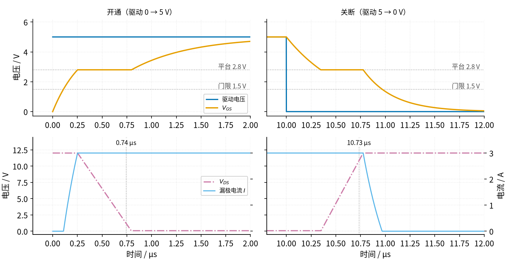
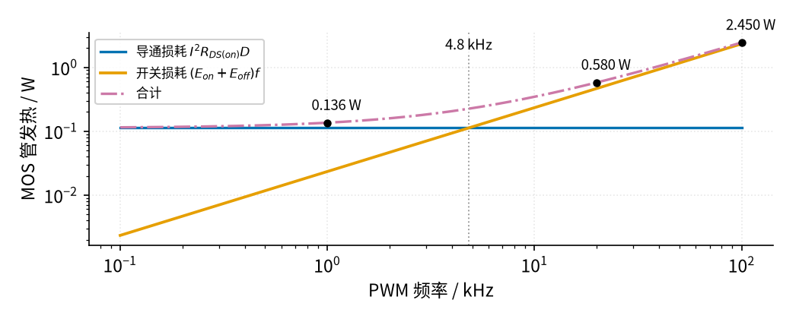
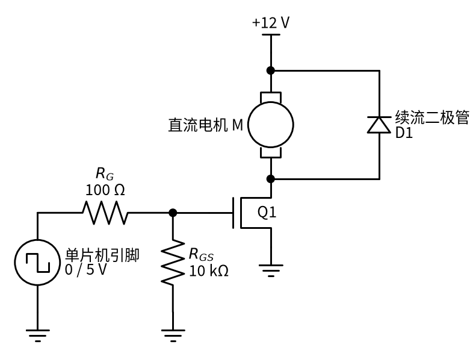

# 21 MOS 管开关 · 原理与实现篇

[上一页：直觉篇](page1.md) · [直觉篇](page1.md) · 本页：原理与实现篇 · [参数与调试篇](page3.md) · [下一页：参数与调试篇](page3.md) · 前置节点：[P1 元件速成](../P1-components-basics/) · [P2 半导体入门](../P2-semiconductor-basics/)

## 先补一点最小知识

这一页只用到三样以前学过的东西：

- **电容充电**：电阻 $R$ 给电容 $C$ 充电，电压按指数规律上升，快慢由时间常数 $\tau = RC$ 决定（[P1 元件速成 · 原理与实现篇](../P1-components-basics/page2.md) 第二、三节）。栅极就是一个电容，栅极电阻就是那个 $R$ 。
- **门限电压与导通电阻**： $V_{GS}$ 超过门限 $V_{GS(th)}$ 才开始导电，再高几伏才「开到底」，导通电阻降到手册值 $R_{DS(on)}$ （[P2 半导体入门 · 原理与实现篇](../P2-semiconductor-basics/page2.md) 第 4 节）。
- **电功率**：元件上的电压乘电流就是它的发热功率 $P = VI$ ；电阻上可以写成 $P = I^2 R$ 。

本页以一只常见的逻辑电平 N 沟道 MOS 管 IRLZ44N 为参照：耐压 55 V， $V_{GS}$ = 5 V 时 $R_{DS(on)}$ 最大 25 mΩ，门限 1.0–2.0 V，总栅极电荷 $Q_G$ 48 nC，结到环境热阻 62 °C/W（[Infineon IRLZ44N 数据手册](https://www.infineon.com/assets/row/public/documents/24/49/infineon-irlz44n-datasheet-en.pdf)）。负载是 12 V、3 A，单片机输出 0/5 V，栅极电阻 100 Ω，电路就是 [直觉篇](page1.md) 里的低边开关电路图。

## 1. 开通过程拆成三段

把单片机引脚从 0 V 跳到 5 V，栅极电压不会立刻变成 5 V，而要经过三段：

**第一段：充到门限，再充到平台**。栅极电流等于栅极电阻两端的电压除以电阻：

$$I_G = \frac{V_{drv} - V_{GS}}{R_G}$$

意思是：驱动电压 $V_{drv}$ 和当前栅压之差越大，充得越猛。刚跳变时 $V_{GS}$ = 0，所以栅极峰值电流

$$I_{G,pk} = \frac{V_{drv}}{R_G} = \frac{5\ \text{V}}{100\ \Omega} = 50\ \text{mA}$$

$V_{GS}$ 还没到门限时，漏极没有电流，这段只是「延时」；过了门限，漏极电流从 0 往 3 A 爬，但这时负载还没得到全部电流，漏极电压仍是 12 V。

**第二段：平台（又叫米勒平台）**。漏极电流到 3 A 以后，漏极电压开始从 12 V 往下掉。漏极和栅极之间也有一个电容 $C_{GD}$ ，漏极电压下降时，它要从栅极「抢走」电荷。结果是：驱动送来的电荷全被这个电容吃掉， $V_{GS}$ 停在一个固定电压 $V_{pl}$ 不动，直到漏极电压掉到接近 0。这段要搬走的电荷叫 $Q_{GD}$ ，栅极电流此时为 $(V_{drv} - V_{pl})/R_G$ ，所以平台持续时间

$$t_{pl,on} = \frac{Q_{GD} R_G}{V_{drv} - V_{pl}}$$

意思是：要搬的电荷越多、栅极电阻越大、驱动电压比平台高得越少，平台就越长。关断时栅极经 $R_G$ 放电到 0 V，放电电流是 $V_{pl}/R_G$ ：

$$t_{pl,off} = \frac{Q_{GD} R_G}{V_{pl}}$$

**第三段：继续充到驱动电压**。平台结束后 $V_{GS}$ 继续往 5 V 爬，导通电阻降到手册值，管子「开到底」。TI 的栅极驱动应用笔记把开通、关断各分成四个时间段，就是这里的细化版（[TI SLUA618](https://www.ti.com/lit/pdf/slua618) 第 2.5、2.6 节）。

## 2. 开关一次要发多少热

第一段后半和第二段里，管子上**同时**有电压和电流，这就是「半开」状态。把电压、电流的变化近似成直线，开关一次的发热能量近似是一个三角形面积：

$$E_{sw} \approx \frac{1}{2} V_{DD} I_L \left( t_{ri} + t_{pl} \right)$$

意思是：电源电压 $V_{DD}$ 乘负载电流 $I_L$ 再乘一半，就是这段时间的平均发热功率；再乘上「电流爬升时间 $t_{ri}$ 加平台时间 $t_{pl}$ 」就是能量。PWM 每个周期开一次、关一次，频率为 $f$ 时开关损耗为

$$P_{sw} = (E_{on} + E_{off})\thinspace f$$

这正是 TI 笔记里式 (13)、(14) 的写法（[TI SLUA618](https://www.ti.com/lit/pdf/slua618) 第 2.7 节）。另一部分是导通损耗，占空比为 $D$ （导通时间占周期的比例）时

$$P_{cond} = I_L^2 R_{DS(on)} D$$

管子的温升用热阻估算：

$$\Delta T = (P_{cond} + P_{sw})\thinspace R_{\theta JA}$$

意思是：每瓦发热让芯片比环境高 $R_{\theta JA}$ 摄氏度。还有一笔小账：栅极每周期充放一次 $Q_G$ ，驱动电路的平均耗电为 $P_{gate} = V_{drv} Q_G f$ （同一笔记式 (9)），这部分热量落在驱动电路和栅极电阻上，不在 MOS 管里。

### 代数：把数字代进去

先算平台。示意模型取平台电压 $V_{pl}$ = 2.8 V、 $Q_{GD}$ = 12 nC（手册给的 25 nC 是在漏极电压 44 V 下测的，我们只切换 12 V，要搬的电荷少一些，取 12 nC 作示意）：

$$t_{pl,on} = \frac{12\ \text{nC} \times 100\ \Omega}{5 - 2.8\ \text{V}} \approx 0.55\ \mu\text{s} ,\quad t_{pl,off} = \frac{12\ \text{nC} \times 100\ \Omega}{2.8\ \text{V}} \approx 0.43\ \mu\text{s}$$

电流爬升时间 $t_{ri}$ 约 0.14 μs（栅极从门限 1.5 V 充到 2.8 V 所需的时间）。代入开关能量：

$$E_{on} \approx \frac{1}{2} \times 12 \times 3 \times (0.14 + 0.55)\ \mu\text{s} \approx 12.4\ \mu\text{J}$$

关断时电流下降段约 0.19 μs， $E_{off} \approx 18 \times (0.19 + 0.43) \approx 11.2\ \mu\text{J}$ 。两者合计约 23.6 μJ。

## 3. 仿真：一小段一小段地算栅极电荷

公式是近似的，我们用和 P1 一样的办法逐步仿真：每 1 ns 算一次栅极电流，累加电荷，再由电荷查出 $V_{GS}$ 。模型很简单：电荷少于 $Q_{GS}$ 时 $V_{GS}$ 线性上升到平台；在平台上停留 $Q_{GD}$ 那么多电荷；之后再继续上升。漏极电流在门限和平台之间从 0 线性升到 3 A，漏极电压在平台期间从 12 V 线性降到接近 0。下面的代码可以直接复制运行：

```python
import numpy as np                          # 数值计算
import matplotlib                           # 画图库
matplotlib.use("Agg")                       # 不弹窗口，直接存文件
import matplotlib.pyplot as plt

V_TH, V_PL = 1.5, 2.8                       # 门限电压、平台电压（V），示意值
Q_GS, Q_GD, C_TAIL = 8.6e-9, 12e-9, 6e-9    # 充到平台的电荷、平台电荷（C）、平台后的等效电容（F）
R_ON, V_DD, I_L = 0.025, 12.0, 3.0          # 导通电阻（Ω）、电源（V）、负载电流（A）
R_G, V_DRV = 100.0, 5.0                     # 栅极电阻（Ω）、单片机高电平（V）

def vgs_of_q(q):                            # 由栅极电荷求栅源电压
    if q < Q_GS:                            # 还没到平台：线性上升
        return q / Q_GS * V_PL
    if q < Q_GS + Q_GD:                     # 平台上：电压不动
        return V_PL
    return V_PL + (q - Q_GS - Q_GD) / C_TAIL   # 平台之后：继续上升

dt, t_on, t_end = 1e-9, 10e-6, 20e-6        # 步长 1 ns；前 10 μs 驱动为高，之后为低
t = np.arange(0, t_end, dt)                 # 时间轴
q = np.zeros_like(t)                        # 栅极电荷
for k in range(1, len(t)):
    vd = V_DRV if t[k - 1] < t_on else 0.0  # 当前驱动电压
    ig = (vd - vgs_of_q(q[k - 1])) / R_G    # 栅极电流 = 电阻两端电压 / R_G
    q[k] = max(q[k - 1] + ig * dt, 0.0)     # 电荷 = 上一步电荷 + 电流 × 步长
vgs = np.array([vgs_of_q(x) for x in q])    # 每个时刻的 V_GS
i_d = I_L * np.clip((vgs - V_TH) / (V_PL - V_TH), 0, 1)   # 漏极电流：门限到平台之间爬升
frac = np.clip((q - Q_GS) / Q_GD, 0, 1)                    # 平台走完了几成
v_ds = np.maximum(V_DD * (1 - frac), i_d * R_ON)           # 漏源电压：平台上从 12 V 降到接近 0
p = v_ds * i_d                                             # MOS 管瞬时发热（W）
half_open = v_ds > 2 * I_L * R_ON                          # 「还没开到底」的时刻
e_on = p[half_open & (t < t_on)].sum() * dt                # 开通一次的能量（J）
e_off = p[half_open & (t >= t_on)].sum() * dt              # 关断一次的能量（J）
print(f"E_on = {e_on*1e6:.1f} μJ, E_off = {e_off*1e6:.1f} μJ")
for f in (1e3, 20e3, 100e3):                               # 三个 PWM 频率
    p_cond = I_L**2 * R_ON * 0.5                           # 导通损耗（占空比 50%）
    p_sw = (e_on + e_off) * f                              # 开关损耗
    print(f"{f/1e3:>5.0f} kHz: 导通 {p_cond:.3f} W + 开关 {p_sw:.3f} W = {p_cond+p_sw:.3f} W")
assert 20e-6 < e_on + e_off < 27e-6                        # 与手算的 23.6 μJ 接近

plt.plot(t * 1e6, vgs, label="V_GS")                       # 栅源电压
plt.plot(t * 1e6, v_ds / 4, label="V_DS / 4")              # 漏源电压缩小 4 倍画在一起
plt.xlim(-0.2, 2); plt.xlabel("时间 / μs"); plt.ylabel("电压 / V"); plt.legend()
plt.savefig("mos_gate_demo.png", dpi=100)                  # 存到当前目录
```

运行后会打印 E_on = 12.6 μJ、E_off = 10.8 μJ，和手算的 12.4 μJ、11.2 μJ 相差不到一成。完整版仿真在 [code/21_sim.py](../code/21_sim.py)，画出来就是图 21-p2-1。请先看上排橙色的 $V_{GS}$ 在灰色「平台 2.8 V」线上停留的那一段，再看下排红紫色的 $V_{DS}$ 在这段时间里怎么下降。



*图 21-p2-1　低边开关的开通（左）与关断（右）：上排为驱动电压与 V_GS，下排为 V_DS 与漏极电流（示意模型，R_G = 100 Ω）*

图 21-p2-1 左上：蓝色驱动电压一下子跳到 5 V，橙色 $V_{GS}$ 却像 RC 充电一样爬升，到 0.25 μs 撞上 2.8 V 的平台后「横着走」，直到约 0.8 μs 才继续上升，约 2 μs 时接近 5 V。左下：天蓝色电流在 $V_{GS}$ 越过 1.5 V 门限后开始上升，到平台时达到 3 A；红紫色点划线 $V_{DS}$ 正是在平台期间从 12 V 斜着降到 0，在 0.74 μs 处降到 10% 以下。电压和电流「交叠」的这一段就是发热的半开状态。右侧关断过程正好反过来：驱动在 10 μs 处掉到 0， $V_{GS}$ 先放电到平台，平台上 $V_{DS}$ 从 0 升回 12 V（10.73 μs 升到 90%），之后电流才降到 0。

## 4. PWM 频率越高，越热

导通损耗只和占空比有关，和频率无关；开关损耗却和频率成正比。把仿真得到的 23.4 μJ 代入，请看图 21-p2-2 中橙色线和蓝色线的交点。



*图 21-p2-2　12 V / 3 A、占空比 50% 时 MOS 管的导通损耗、开关损耗与合计（R_G = 100 Ω，双对数坐标）*

图 21-p2-2 中蓝色导通损耗是一条水平线，0.113 W；橙色开关损耗随频率直线上升，在 4.8 kHz 和蓝线相交。1 kHz 时红紫色点划线合计只有 0.136 W；20 kHz（接近人耳听觉上限、常用来消除啸叫的 PWM 频率）时变成 0.580 W，开关损耗已占八成；100 kHz 时达到 2.450 W，没有散热片的 TO-220 封装管子按 62 °C/W 计算会升温一百多摄氏度。结论：**用单片机引脚直接驱动时，PWM 频率宜低不宜高**；要高频，就得换更快的驱动（专门的栅极驱动芯片），或者选 $Q_{GD}$ 更小的管子。

## 5. 带线圈的负载：必须加续流二极管

电机、继电器、电磁阀里都有线圈，也就是电感。P1 讲过电感两端电压是 $V = L\thinspace \Delta I/\Delta t$ ：电流变化越快，电压越高。MOS 管关断只要不到 1 μs，假设线圈电感 1 mH（示意值），电流 3 A 在 0.73 μs 内降到 0：

$$V \approx 1\ \text{mH} \times \frac{3\ \text{A}}{0.73\ \mu\text{s}} \approx 4100\ \text{V}$$

远超 IRLZ44N 的 55 V 耐压。实际上管子会在 55 V 以上某处被击穿（雪崩），线圈储存的能量 $\frac{1}{2} L I^2 = \frac{1}{2} \times 1\ \text{mH} \times (3\ \text{A})^2 = 4.5\ \text{mJ}$ 每次都要灌进 MOS 管；PWM 1 kHz 时就是每秒 4.5 W，管子很快会过热损坏。

办法和 [P1 元件速成 · 原理与实现篇](../P1-components-basics/page2.md) 第五节「电感断电」那张图一样：在线圈两端反向并联一只二极管，见图 21-p2-3。



*图 21-p2-3　直流电机低边开关：续流二极管 D1 的阴极接 +12 V，阳极接漏极*

图 21-p2-3 中，MOS 管导通时 D1 承受反向电压、不导电；MOS 管关断瞬间，线圈电流改道从 D1 流回线圈上端，漏极电压只比 12 V 高一个二极管压降，约 12.7 V。注意 D1 关断瞬间要扛住全部负载电流，所以它的额定电流要不小于负载电流；PWM 频率较高时常用恢复快、压降小的肖特基二极管。

## 6. 例题：从照着做到自己做

**例 1（完整示范）**：直觉篇的低边开关电路，IRLZ44N，12 V / 3 A 灯带，5 V 驱动、 $R_G$ = 100 Ω，PWM 1 kHz、占空比 50%。估算 MOS 管的发热和温升（不加散热片）。

1. 导通损耗：按 5 V 时 $R_{DS(on)}$ 的最大值 25 mΩ 算（取最坏值）， $P_{cond}$ = 3² × 0.025 × 0.5 = 0.1125 W。
2. 开关损耗：仿真得 $E_{on} + E_{off}$ = 23.4 μJ， $P_{sw}$ = 23.4 μJ × 1000 = 0.0234 W。
3. 合计 0.136 W，与图 21-p2-2 的 1 kHz 标注一致。
4. 温升： $\Delta T$ = 0.136 × 62 ≈ 8.4 °C。室温 25 °C 时芯片约 33 °C，不需要散热片。
5. 顺便算栅极驱动耗电： $P_{gate}$ = 5 V × 48 nC × 1 kHz = 0.24 mW，单片机毫无压力。

**例 2（留空练习）**：同一电路，把 PWM 改到 20 kHz（消除灯带的「滋滋」声），其他不变。

1. 导通损耗：____ W（提示：和频率有没有关系？）
2. 开关损耗： $P_{sw}$ = 23.4 μJ × ____ = ____ W
3. 合计 ____ W，温升 $\Delta T$ = ____ × 62 ≈ ____ °C

<details><summary>答案</summary>

1. 导通损耗与频率无关，仍是 0.1125 W。
2. $P_{sw}$ = 23.4 μJ × 20000 = 0.468 W。
3. 合计约 0.580 W（与图 21-p2-2 一致），温升 0.580 × 62 ≈ 36 °C，室温下芯片约 61 °C，摸上去很烫但还在安全范围内。如果机箱里环境温度高，或者负载电流更大，就要加散热片或降低频率。

</details>

**例 3（变体迁移）**：改用 3.3 V 单片机，管子换成小封装（SOT-23）的 AO3400A，灯带一直常亮（占空比 100%）。这个管子在 3.3 V 驱动下的导通电阻手册没有直接给，怎么估？温升是多少？

<details><summary>答案</summary>

AO3400A 手册给出 $V_{GS}$ = 2.5 V 时 $R_{DS(on)}$ 最大 48 mΩ、4.5 V 时最大 32 mΩ（[AOS AO3400A 数据手册](https://www.aosmd.com/sites/default/files/res/datasheets/AO3400A.pdf)）。3.3 V 落在两者之间，保守起见按 2.5 V 的 48 mΩ 算：常亮时 $P_{cond}$ = 3² × 0.048 = 0.432 W，没有开关损耗。这个小封装的稳态结到环境热阻最大 125 °C/W（而且是焊在 1 平方英寸铜皮上测的），温升约 54 °C，室温下约 79 °C。能用，但余量不大；要么在 PCB 上多铺铜散热，要么让 3 A 分给两只管子并联。反过来，IRLZ44N 在 3.3 V 下手册不保证导通电阻（最低只给到 4 V），不能直接换过来。

</details>

下一页把栅极电阻、驱动电压这些参数逐个扫描，并整理常见故障的排查办法。
