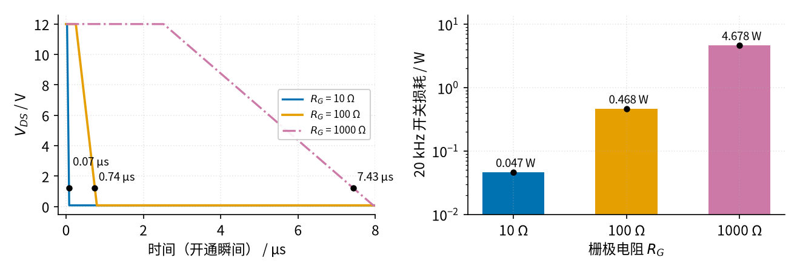
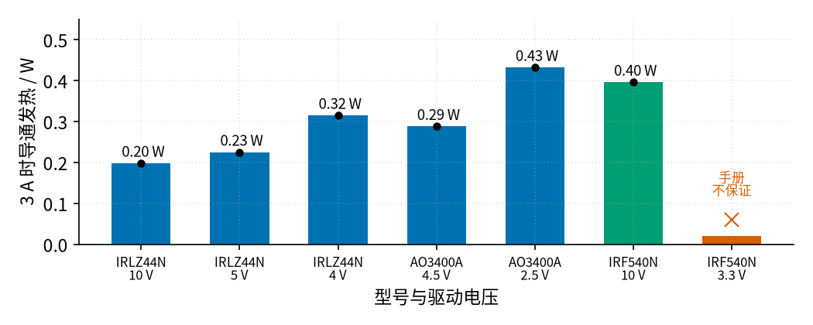

# 21 MOS 管开关 · 参数与调试篇

[上一页：原理与实现篇](page2.md) · [直觉篇](page1.md) · [原理与实现篇](page2.md) · 本页：参数与调试篇 · [下一页：22 三极管开关与继电器驱动 · 直觉篇](../22-bjt-relay-driver/page1.md) · 前置节点：[P1 元件速成 · 直觉篇](../P1-components-basics/page1.md) · [P2 半导体入门 · 直觉篇](../P2-semiconductor-basics/page1.md)

## 本页要解决的问题

上一页算清了 MOS 管开关的两种发热：导通损耗 $I_L^2 R_{DS(on)} D$ 和开关损耗 $(E_{on}+E_{off}) f$ 。这一页回答动手时最常问的问题：栅极电阻取多大？手头的管子能不能被 3.3 V / 5 V 单片机直接驱动？电路不正常时先查哪里？

## 1. 参数含义与常见取值

| 参数 | 含义 | 常见范围 / 本教程取值 | 怎么选 |
|---|---|---|---|
| $V_{DS}$ 额定（耐压） | 漏源之间能承受的最高电压 | 20 V–100 V 常见；IRLZ44N 为 55 V | 经验上取电源电压的 1.5–2 倍以上，感性负载还要考虑关断尖峰 |
| $V_{GS(th)}$ | 刚开始导电的栅压（手册在 250 μA 这种极小电流下测） | IRLZ44N 1.0–2.0 V | 只说明「从哪开始开」，**不能**用来判断能不能开到底 |
| $R_{DS(on)}$ 及其测试 $V_{GS}$ | 开到底后的导通电阻，手册会注明在哪个栅压下测 | 几毫欧到几百毫欧 | 你的驱动电压必须不低于手册标注的测试栅压，按最大值算发热 |
| $V_{GS}$ 极限 | 栅源之间允许的最高电压 | IRLZ44N ±16 V，AO3400A ±12 V | 高边 P 沟道管要特别检查 |
| $Q_G$ 、 $Q_{GD}$ | 开通一次要搬的总电荷、平台电荷 | IRLZ44N 48 nC / 25 nC | 越小开关越快；PWM 频率高时优先看 $Q_{GD}$ |
| $R_G$ 栅极电阻 | 限制充放电电流，阻尼振荡 | 几欧到几百欧；本教程 100 Ω | 大了开关慢、发热多；小了驱动电流大、可能振荡 |
| $R_{GS}$ 下拉电阻 | 保证栅极不悬空 | 10 kΩ–100 kΩ；本教程 10 kΩ | 太大防误触发能力弱，太小会和 $R_G$ 分压，降低实际 $V_{GS}$ |
| $R_{\theta JA}$ | 每瓦发热让芯片比环境高几摄氏度 | TO-220 无散热片 62 °C/W | 发热 × 热阻 + 环境温度，要远低于最高结温 |
| PWM 频率 $f$ | 每秒开关次数 | 几百赫兹到几十千赫兹 | 单片机直驱时宜低；要静音或高频时换驱动芯片 |

$R_{GS}$ 和 $R_G$ 会分压：5 V 经 100 Ω 和 10 kΩ 分压后，稳态 $V_{GS}$ = 5 × 10000/10100 ≈ 4.95 V，只损失 1%；如果把下拉电阻换成 1 kΩ，就会损失约 9%。

## 2. 扫描一：栅极电阻从 10 Ω 到 1 kΩ

用 page2 同一个示意模型，只改变 $R_G$ ，看开通时的漏源电压，并算出 20 kHz 下的开关损耗。请看图 21-p3-1 左图三条曲线降到 0 的先后，以及右图柱子的高度（右图是对数坐标，每格差 10 倍）。

*图 21-p3-1　栅极电阻对开通速度（左）和 20 kHz 开关损耗（右）的影响（示意模型，12 V / 3 A）*

图 21-p3-1 左图：蓝色 10 Ω 在 0.07 μs 就完成开通，橙色 100 Ω 用 0.74 μs，红紫色点划线 1 kΩ 要 7.43 μs，开关时间和 $R_G$ 基本成正比。右图：20 kHz 下开关损耗分别为 0.047 W、0.468 W、4.678 W。1 kΩ 时管子仅开关就要发热近 5 W，没有散热片很快就会烧毁；所以 **「栅极电阻越大越安全」是错的**。

那是不是越小越好？也不是。10 Ω 时栅极峰值电流是 5 V / 10 Ω = 500 mA，远超单片机引脚的能力；而且栅极回路里导线的寄生电感和栅极电容会构成谐振电路，电阻太小时栅极电压出现过冲和振荡。TI 的笔记指出，较小的栅极电阻会导致栅极电压过冲但开关更快，较大的电阻则拖长开关时间（[TI SLUA618](https://www.ti.com/lit/pdf/slua618) 第 2.8 节）。单片机直驱时取几十到几百欧是常见的折中，本教程用 100 Ω；要更快就上专门的栅极驱动芯片。

## 3. 扫描二：驱动电压够不够，查手册而不是查门限

P2 参数与调试篇的「扫描二」用示意模型说明了「开了不等于开到底」。这里换成真实数据手册：按 3 A 负载、 $R_{DS(on)}$ **最大值**计算导通发热，看图 21-p3-2 每根柱子对应的驱动电压。

*图 21-p3-2　3 A 时的导通发热（按手册 R_DS(on) 最大值，25 °C）；最右为手册在该电压下不保证*

图 21-p3-2 数据来源：IRLZ44N 在 10 V、5 V、4 V 时最大 22、25、35 mΩ（[Infineon IRLZ44N](https://www.infineon.com/assets/row/public/documents/24/49/infineon-irlz44n-datasheet-en.pdf)）；AO3400A 在 4.5 V、2.5 V 时最大 32、48 mΩ（[AOS AO3400A](https://www.aosmd.com/sites/default/files/res/datasheets/AO3400A.pdf)）；IRF540N 只给出 10 V 时的 44 mΩ，门限最大可达 4.0 V（[Infineon IRF540N](https://www.infineon.com/assets/row/public/documents/24/49/infineon-irf540n-datasheet-en.pdf)）。

图中蓝色的逻辑电平管从 0.20 W 到 0.43 W，驱动电压越低发热越大；蓝绿色的 IRF540N 即使用 10 V 驱动也有 0.40 W，而在 3.3 V 下（朱红色 ×）手册根本不保证它能导通——它的门限最大就有 4.0 V，有的样品可能完全不开，有的半开发烫。这就是论坛上常见的「同样的电路，换一批管子就不行了」。

还要注意两点：一是这些数字是 25 °C 下的值，IRLZ44N 手册的图 4 显示导通电阻随结温升高而变大，管子热了发热还会再增加；二是 TO-220 管子不加散热片时热阻是 62 °C/W，0.4 W 就意味着约 25 °C 的温升。

## 4. 故障排查表

| 现象 | 可能原因 | 怎么查 | 怎么改 |
|---|---|---|---|
| 负载不亮 / 电机不转 | 管子用错（P 沟道当 N 沟道）或引脚 G、D、S 接错 | 对照手册引脚图；断电后用万用表二极管档测体二极管（红表笔接 S、黑表笔接 D 应显示零点几伏） | 按手册重接；低边一定用 N 沟道 |
| 能开但管子烫手、负载偏暗 | 驱动电压低于手册 $R_{DS(on)}$ 测试栅压，管子半开 | 导通时测 $V_{DS}$ ，算 $V_{DS}/I_L$ 和手册值比较 | 换逻辑电平管，或用驱动芯片抬高栅压，见图 21-p3-2 |
| 上电或单片机复位时负载闪一下、乱动 | 栅极悬空，引脚尚未初始化 | 拔掉单片机，看负载是否随手靠近栅极而变化 | 栅源之间加 10 kΩ 下拉，且尽量靠近 MOS 管焊接 |
| 低频正常，PWM 调高后管子越来越烫 | 开关损耗随频率上升，或 $R_G$ 太大 | 示波器看 $V_{DS}$ 的上升/下降时间，按 $(E_{on}+E_{off})f$ 估算 | 降低 PWM 频率、减小 $R_G$ ，或改用栅极驱动芯片，见 page2 第 4 节 |
| 开关电机后 MOS 管击穿（D、S 短路） | 没有续流二极管，关断尖峰超过耐压 | 检查线圈两端是否有反并二极管、方向是否正确 | 加续流二极管（阴极接正电源），额定电流不小于负载电流，见 page2 第 5 节 |
| 栅极波形有尖刺、振荡，附近电路受干扰 | 栅极走线太长、 $R_G$ 太小 | 示波器看 $V_{GS}$ 边沿是否有过冲 | 缩短栅极回路，适当加大 $R_G$ |
| 高边 N 沟道管始终开不足、发烫 | 源极随负载升高， $V_{GS}$ 不够 | 测源极对地电压和栅极对地电压之差 | 改成 P 沟道高边（直觉篇的高边开关图）或用带自举电路的高边驱动芯片 |
| 高边 P 沟道管关不断 | 栅极只被拉到 5 V，没回到电源电压 | 关断状态下测 Q1 的 $V_{GS}$ | 加小管子和上拉电阻，见直觉篇的高边开关图 |
| 栅极击穿、管子莫名损坏 | $V_{GS}$ 超过 ±16 V 或 ±12 V 之类的极限 | 测栅源电压最大值，查手册极限 | 电阻分压限压或栅源并联稳压管 |

上表中「高边 N 沟道管需要把栅极驱动到电源电压以上」见 [TI SLUA618](https://www.ti.com/lit/pdf/slua618) 第 5.2 节；栅极悬空导致误动作、需要下拉电阻，Espruino 的 MOS 管教程也提醒了栅极悬空的问题并建议加 10 kΩ 下拉（[Espruino MOSFETs](https://www.espruino.com/mosfets)）。

## 5. 练习

**练习 1**：3.3 V 单片机经 47 Ω 栅极电阻驱动 MOS 管，栅极峰值电流是多少？如果芯片手册说引脚最大只能输出 20 mA，栅极电阻至少要多大？

答案

峰值电流 3.3 V / 47 Ω ≈ 70 mA，超过 20 mA。要限制在 20 mA 以下， $R_G \ge$ 3.3 / 0.02 = 165 Ω，可选标准值 180 Ω 或 220 Ω。代价是开关变慢，PWM 频率要相应降低。

**练习 2**：用 5 V 单片机控制 24 V、2 A 的加热片（纯电阻负载，只开关不调速）。手头有 IRLZ44N 和 IRF540N，选哪个？导通发热多少？

答案

选 IRLZ44N。IRF540N 的导通电阻只在 10 V 下保证，门限最大 4.0 V，5 V 驱动可能只半开。IRLZ44N 耐压 55 V 大于 24 V 的两倍，5 V 时 $R_{DS(on)}$ 最大 25 mΩ，常开时发热 2² × 0.025 = 0.1 W，温升约 0.1 × 62 ≈ 6 °C，不用散热片。

**练习 3**：例 2 的灯带电路（20 kHz、50%）里，有人为了「保护单片机」把栅极电阻换成 1 kΩ。根据图 21-p3-1，MOS 管的总发热和温升会变成多少？会发生什么？

答案

开关损耗变成 4.678 W，加上导通损耗 0.113 W，共约 4.79 W；温升 4.79 × 62 ≈ 297 °C，远超 175 °C 的最高结温，管子会很快烧坏。正确的做法是保持 100 Ω 左右，或者把 PWM 降到 1 kHz 左右（此时 1 kΩ 的开关损耗约 0.23 W，合计约 0.35 W）。

**练习 4（变体迁移）**：把直觉篇的高边开关电路从 12 V 改到 24 V，Q1 换成一只栅源极限为 ±20 V 的 P 沟道管，其他不变。Q2 导通时 Q1 的 $V_{GS}$ 是多少？有什么问题？怎么改？

答案

Q2 导通把 Q1 栅极拉到约 0 V，Q1 源极接 24 V，所以 $V_{GS}$ ≈ −24 V，超过了 ±20 V 的极限，栅极可能被击穿。改法一：在 Q2 漏极和 Q1 栅极之间串一个 10 kΩ 电阻，和 10 kΩ 上拉电阻分压，Q2 导通时栅极约 12 V， $V_{GS}$ ≈ −12 V，足以导通又不超限（代价是关断变慢一些）。改法二：在 Q1 栅源之间并联一只约 12 V 的稳压管，同时串电阻限流，把 $V_{GS}$ 钳在 −12 V 左右。这和 P2 page3 练习 4 的思路一致：高边 P 沟道管既要能「拉低到导通」，又不能拉过头。

## 小结与下一步

MOS 管开关的设计可以浓缩为四步：按手册在**你的驱动电压**下查 $R_{DS(on)}$ 最大值，算导通发热；按 $Q_{GD}$ 、 $R_G$ 估算开关时间，再乘 PWM 频率算开关发热；用热阻检查温升；带线圈的负载加续流二极管，栅极加下拉电阻。下一个节点 [22 三极管开关与继电器驱动 · 直觉篇](../22-bjt-relay-driver/page1.md) 用三极管驱动继电器线圈，续流二极管还会再次出场；后面的 [25 H 桥电机驱动 · 直觉篇](../25-h-bridge/page1.md) 会把四只开关组合起来，让电机正反转。
