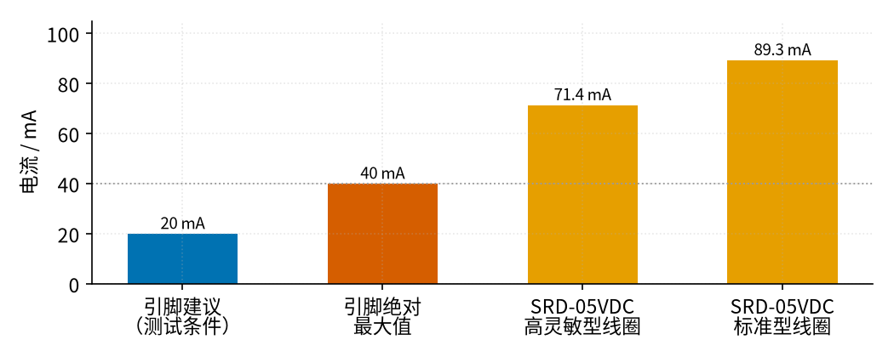
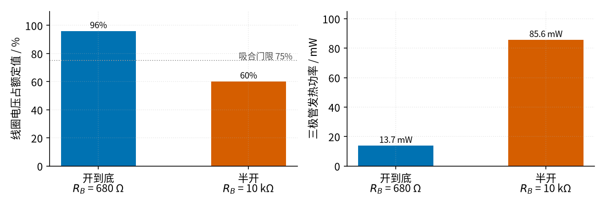
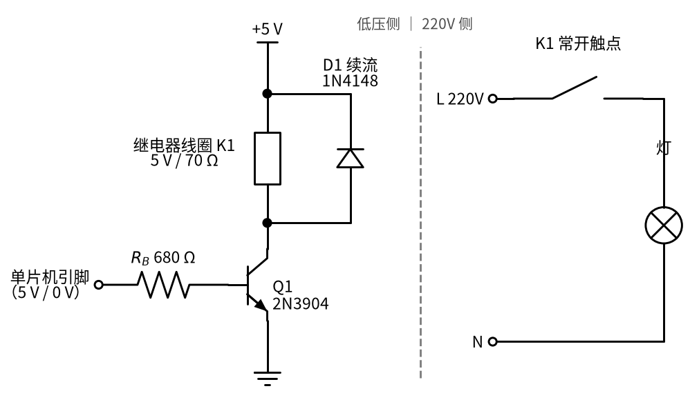

# 22 三极管开关与继电器驱动 · 直觉篇

[上一页：21 MOS 管开关 · 参数与调试篇](../21-mosfet-switch/page3.md) · 本页：直觉篇 · [原理与实现篇](page2.md) · [参数与调试篇](page3.md) · [下一页：原理与实现篇](page2.md) · 前置节点：[P1 元件速成](../P1-components-basics/page1.md)、[P2 半导体入门](../P2-semiconductor-basics/page1.md)

> [!WARNING]
> **市电危险**：本电路的实际版本接 220V/380V 市电，触电可能致命。本页的仿真和动手实验只在 12V 以下的低压电源上进行；任何接线、改线都必须在断电并验电后操作，由持证电工完成。
>
> 本节点特有的危险点：① 继电器的**触点侧**常常直接切换 220 V 的灯、插座、水泵，单片机这边只有 5 V，不代表整块板子都安全；② 市面上的继电器模块，触点接线端子（螺丝端子）和板子背面的焊盘都**带 220 V**，通电时不要用手摸板子背面，也不要把模块直接放在金属桌面上；③ 低压侧和 220 V 侧之间要留足距离（见参数与调试篇），不能为了省地方把两边的走线挤在一起。

## 一、痛点：单片机"拉不动"继电器，还会被它反咬一口

很多小制作都想让单片机（比如 Arduino 用的 ATmega328P）去控制一盏 220 V 的灯或者一台水泵。单片机的引脚只能输出 5 V 或 0 V 的"信号"，不能直接去碰 220 V，于是大家会请一个中间人：**继电器**。P1 里讲过，继电器是"用小电流的线圈去控制大电流的触点"：线圈通电，衔铁被吸下来，触点闭合，220 V 那边就通了。

问题是，这个"小电流"其实也不小。看 图 22-p1-1：

*图 22-p1-1　单片机引脚能给的电流和继电器线圈要的电流*

图 22-p1-1 左边两根柱子是单片机一个引脚的能力：数据手册里输出高电平的测试条件是 20 mA，绝对最大值是 40 mA，超过它就可能把引脚烧坏。右边两根是一只常见的 5 V 继电器（松乐 SRD-05VDC）线圈要的电流：高灵敏型 71.4 mA，标准型 89.3 mA，都比 40 mA 的上限高出一截。也就是说，**直接拿引脚去推线圈，是让一个小学生去推汽车**。

更麻烦的是第二个问题：线圈是一个电感。P1 讲过，电感"不让电流突变"。线圈正通着几十毫安的电流，你突然把它断开，电感会拼命想让电流继续流，于是在断开的那一端"挤"出一个很高的电压，可以有几百甚至上千伏。这个尖峰会顺着线打回驱动它的器件，轻则让单片机莫名其妙复位，重则直接击穿。

## 二、类比：用水龙头开关大水管，再给水管装一个"回流阀"

把三极管想象成一个**水龙头**：基极上的一点点小电流，就像用手指拧龙头的小把手；集电极到发射极之间，是大水管里哗哗流的水（P2 讲过的 $I_C = \beta I_B$ ）。单片机只要提供"拧把手"的那点力气——几毫安——就能让三极管放出七八十毫安去推线圈。

但这个龙头**只能拧到底或者关死**，不能"开一半"。开一半的时候，水流不够，继电器的衔铁吸不上去；而龙头自己还要承受很大的水压，会发热。这个"开到底"的状态，就是 P2 里说的**饱和区**；"开一半"就是**放大区**。看 图 22-p1-2：

*图 22-p1-2　三极管开到底和半开的对比（β = 100）*

图 22-p1-2 左半边看线圈两端的电压：开到底时线圈拿到 96% 的额定电压，高过灰色点线标的 75% 吸合门限，衔铁稳稳吸合；半开时只有 60%，低于门限，继电器可能根本吸不上，或者"咔哒咔哒"地抖。右半边看三极管自己的发热：半开时是开到底的六倍多。所以**三极管当开关用，一定要让它进饱和**，办法是给足基极电流，这取决于基极电阻 $R_B$ 选多大。

至于那个高压尖峰，可以想象水管里的**水锤**：水正在冲，你猛地把阀门关死，水的惯性会把管子撞得砰砰响。解决办法是在阀门旁边装一条"回流支路"，让冲过来的水绕一个小圈慢慢停下。电路里的回流支路就是一只反着并在线圈两端的二极管，叫**续流二极管**：平时它反向截止、不干活；三极管一关断，线圈电流就从它这里绕回线圈，慢慢衰减掉，电压被钳住，不再冲高。

## 三、图：一张完整的继电器驱动电路

把上面两个想法合起来，就得到 图 22-p1-3：

*图 22-p1-3　三极管驱动继电器：左边低压，右边 220V*

图 22-p1-3 的左半边全是低压：单片机引脚输出 5 V 时，电流经基极电阻 $R_B$ 流进三极管 Q1 的基极，Q1 饱和导通，+5 V 经继电器线圈、Q1 流到地，线圈吸合。二极管 D1 的**负极（有横杠的一端）接 +5 V**，正极接集电极，平时不导通；Q1 关断的瞬间，线圈电流就经 D1 绕回来。中间的灰色虚线是隔离带：右边的继电器常开触点和灯接的是 220 V，它和左边只靠继电器内部的绝缘隔开，电路上没有任何一根线相连。

有两个细节值得记住。第一，Q1 接在线圈的**下面**（线圈接电源、三极管接地），这种接法叫"低边开关"，NPN 三极管的发射极直接接地，最好驱动。第二，D1 的方向千万不能反，反了的话三极管一导通，电流就从 D1 直接短路过去，后果会在参数与调试篇里讲。

## 四、一句话总结

**单片机只出"拧把手"的几毫安，让三极管开到底（饱和）去推几十毫安的线圈；线圈两端反并一只续流二极管，把断电时的高压尖峰"放回"线圈里；继电器触点那一侧是 220 V，和低压侧之间必须隔开。**

## 参考资料

- Microchip，ATmega48A/88A/168A/328/328P 数据手册（I/O 引脚绝对最大 40 mA、 $V_{OH}$ 测试条件 20 mA）：https://ww1.microchip.com/downloads/en/DeviceDoc/ATmega48A-PA-88A-PA-168A-PA-328-P-DS-DS40002061B.pdf
- 松乐 SRD 系列继电器数据手册（线圈 71.4 mA / 89.3 mA、吸合电压 75%）：https://www.alldatasheet.com/html-pdf/1132639/SONGLERELAY/SRD-05VDC-SL-C/1713/2/SRD-05VDC-SL-C.html
- TE Connectivity，线圈抑制与继电器寿命（不加抑制时感应电压可达数百甚至上千伏）：https://www.te.com/en/products/relays-and-contactors/electromechanical-relays/intersection/coil-suppression-relay-life.html
