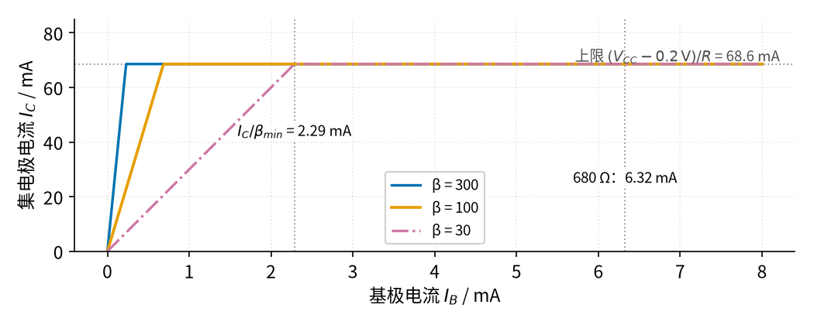
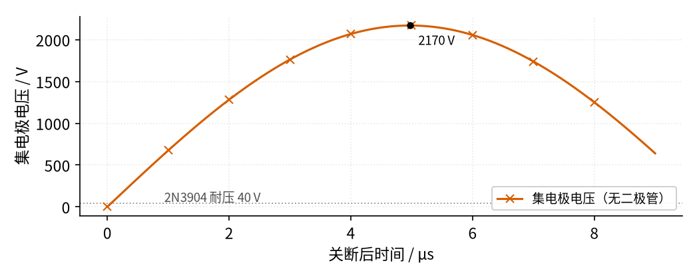
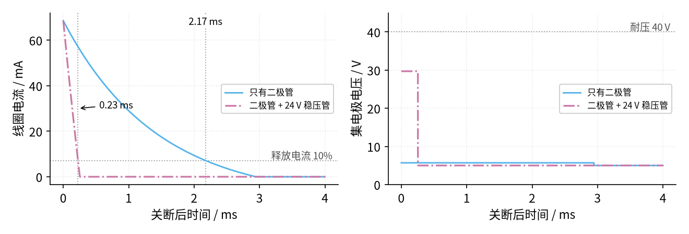

# 22 三极管开关与继电器驱动 · 原理与实现篇

[上一页：直觉篇](page1.md) · [直觉篇](page1.md) · 本页：原理与实现篇 · [参数与调试篇](page3.md) · [下一页：参数与调试篇](page3.md) · 前置节点：[P1 元件速成 · 直觉篇](../P1-components-basics/page1.md)、[P2 半导体入门 · 直觉篇](../P2-semiconductor-basics/page1.md)

> [!WARNING]
> **市电危险**：本电路的实际版本接 220V/380V 市电，触电可能致命。本页的仿真和动手实验只在 12V 以下的低压电源上进行；任何接线、改线都必须在断电并验电后操作，由持证电工完成。
>
> 本页特有的危险点：继电器触点那一侧接 220 V 时，触点端子、模块背面焊盘都带电；本页的计算只针对线圈这一侧（5 V），触点侧的接线不在本页的动手范围内。

## 一、最小知识

只需要三样东西，都在前置节点里出现过：

1. **三极管的三个区**（P2）。我们沿用 P2 的简化模型：导通时 $V_{BE} = 0.7\ \text{V}$ ；放大区里 $I_C = \beta I_B$ ；饱和区里 $V_{CE}$ 降到约 $0.2\ \text{V}$ ，不再随 $I_B$ 变化。当开关用，我们只要两个状态：截止（ $I_B = 0$ ，相当于开关断开）和饱和（相当于开关闭合，只剩 0.2 V 压降）。
2. **继电器线圈 = 电阻 + 电感**（P1）。稳态时它就是一个电阻：松乐 SRD-05VDC 高灵敏型线圈是 70 Ω，要求加到额定电压的 75% 以上才保证吸合，降到 10% 以下一定释放。
3. **电感的脾气**（P1）： $v_L = L \dfrac{di}{dt}$ 。电流变得越快，电感两端的电压越高。电流不能突变，所以"突然断开"会逼出一个很大的电压。

另外要知道一个"坑"：同一型号的三极管， $\beta$ 能差好几倍。onsemi 的 2N3904 手册里，10 mA 时 $h_{FE}$ （就是 $\beta$ ）在 100 到 300 之间，而到 100 mA 时最小只保证 30。设计时**只能按最小值算**。

## 二、推导一：基极电阻怎么选

**先用中文说**：要让三极管饱和，"基极电流乘以 β"必须比"线圈最多能流过的电流"还大——β 想放大出来的电流，电路给不了，三极管只好"开到底"。为了防止 β 偏小、电压偏低、温度变化，再乘一个 2 到 5 倍的裕量。

**再写成公式**：

$$I_{C(max)} = \frac{V_{CC} - V_{CE(sat)}}{R_{coil}}, \qquad I_B \ge k \cdot \frac{I_{C(max)}}{\beta_{min}}\ (k = 2 \sim 5), \qquad R_B = \frac{V_{pin} - V_{BE}}{I_B}$$

**最后代数**： $V_{CC} = 5\ \text{V}$ 、 $R_{coil} = 70\ \Omega$ ，得 $I_{C(max)} = 4.8/70 = 68.6\ \text{mA}$ 。这个电流已经接近 100 mA，按 $\beta_{min} = 30$ 算，最少要 2.29 mA 基极电流；乘 2 倍是 4.57 mA，乘 5 倍是 11.43 mA。单片机引脚输出 5 V，电阻上的电压是 $5 - 0.7 = 4.3\ \text{V}$ ，所以 $R_B$ 应在 376 Ω（5 倍）到 941 Ω（2 倍）之间。取一个常见值 680 Ω，基极电流 6.32 mA，是最低需求的 2.8 倍。就算把 $V_{BE}$ 按手册上限 0.95 V 算，也有 5.96 mA（2.6 倍），仍然够。单片机引脚只出 6 mA 多一点，远低于 20 mA 的测试条件。

这个关系画出来就是 图 22-p2-1：



*图 22-p2-1　集电极电流随基极电流变化：碰到上限就"顶住"*

图 22-p2-1 里三条线代表三只 β 不同的三极管：蓝色 β = 300，橙色 β = 100，红紫色点划线 β = 30。每条线先按斜率 β 上升（放大区），碰到灰色点线标的 68.6 mA 上限就变平——这时三极管进了饱和区，再加基极电流，集电极电流也不会再涨，因为线圈电阻已经把它卡住了。β = 30 的那只最"懒"，要到 2.29 mA 才变平；我们选的 680 Ω 给出 6.32 mA，落在右边很远的地方，三只管子无论哪只都早就饱和了。这就是"按最小 β 算、再留裕量"的意义。

## 三、推导二：断电的尖峰有多高，二极管怎么把它摁住

**先用中文说**：线圈通着电时存着一份能量。三极管一关，这份能量必须找个地方放。如果没有二极管，它只能去给集电极上那点极小的杂散电容充电——电容很小，要装下同样的能量，电压就得非常高。并上二极管以后，能量沿着"线圈 → 二极管 → 线圈"的小圈慢慢在线圈电阻上烧掉，电压只比电源高一个二极管压降。

**再写成公式**：线圈储能 $W = \tfrac12 L I_0^2$ 。无二极管时，全部倒进杂散电容 $C$ ： $\tfrac12 L I_0^2 = \tfrac12 C V^2$ ，所以尖峰约为

$$V_{peak} \approx V_{CC} + I_0\sqrt{\frac{L}{C}}$$

有二极管时，集电极被钳在 $V_{CC} + V_F$ ，线圈两端是 $-V_F$ ，电流按时间常数 $\tau = L/R$ 衰减。如果在二极管上再串一只稳压值 $V_Z$ 的稳压管，钳位电压变成 $V_{CC} + V_F + V_Z$ ，线圈两端的反向电压大得多， $di/dt$ 也就大得多，电流衰减更快。

**最后代数**：松乐 SRD 的数据手册没有给线圈电感。同样是 5 V 小继电器，欧姆龙 [G5V-1 数据手册](https://xonstorage.z8.web.core.windows.net/pdf/Omron/4226465XON.pdf) 的线圈参数表给的参考值是 0.15 H（衔铁未吸合）到 0.29 H（衔铁吸合），所以我们取同一量级的 $L = 0.1\ \text{H}$ 作示意值；杂散电容 $C = 100\ \text{pF}$ 也是示意值。不同继电器、不同电路板差别很大，但尖峰随 $\sqrt{L/C}$ 变，量级不会差太多。 $I_0 = 68.6\ \text{mA}$ ，储能 0.235 mJ，估算尖峰 2173 V。2N3904 的 $V_{CEO}$ 只有 40 V——实际上三极管远在 2000 V 之前就被击穿了，尖峰的能量全打在它身上。

## 四、仿真

下面的程序把两件事都算一遍。A 部分用 P2 的分段模型检查不同 $R_B$ 、不同 β 时三极管有没有饱和；B 部分把时间切成小段，一步步推线圈电流和集电极电压。运行：`python code/22_sim.py`。

```python
# 22 三极管驱动继电器的最小仿真：A 部分扫基极电阻看三极管是否饱和；B 部分看线圈断电瞬间的电压尖峰。
# 电路：+5V → 继电器线圈（70 Ω）→ 三极管集电极；发射极接地；单片机引脚 → 基极电阻 R_B → 基极；线圈两端反并续流二极管。
import sys, os                                     # 下一行让 Python 找到 code/figs 里的共享画图样式
sys.path.insert(0, os.path.join(os.path.dirname(os.path.abspath(__file__)), "figs"))  # 把 code/figs 加进搜索路径
import numpy as np                                 # 数组运算
import matplotlib.pyplot as plt                    # 画图
import figstyle as fs                              # 全书统一的颜色、轴标签、保存函数

VCC = 5.0                                          # 线圈电源 5 V
R_COIL = 70.0                                      # 松乐 SRD-05VDC 高灵敏型线圈电阻 70 Ω（数据手册）
V_BE, V_SAT = 0.7, 0.2                             # 和 P2 一致的简化模型：导通时 V_BE = 0.7 V，饱和时 V_CE = 0.2 V
PULL_IN = 0.75                                     # 吸合电压最大 75% 额定值（数据手册）：低于它不保证吸得上
I_MAX = (VCC - V_SAT) / R_COIL                     # 三极管完全导通（饱和）时线圈电流的上限
print(f"[A] 饱和时线圈电流 I_C(max) = {I_MAX*1e3:.1f} mA")  # 打印上限电流

def drive(v_pin, rb, beta):                        # 给定引脚电压、基极电阻、电流放大倍数，算三极管工作点
    ib = max(v_pin - V_BE, 0.0) / rb               # 基极电流：电阻两端电压 ÷ 电阻
    ic = min(beta * ib, I_MAX)                     # 放大区 I_C = β·I_B，但不可能超过线圈允许的最大值
    vce = VCC - ic * R_COIL                        # 集电极电压 = 电源 − 线圈上的压降
    sat = beta * ib >= I_MAX                       # β·I_B 够大（"想要的"电流超过上限）就进了饱和区
    if sat:                                        # 饱和时 V_CE 由饱和压降决定
        vce = V_SAT  # 饱和压降 0.2 V
    return ib, ic, vce, sat                        # 返回基极电流、集电极电流、V_CE、是否饱和

BETA_MIN = 30                                      # 2N3904 在 100 mA 时 h_FE 最小 30（数据手册），按最坏情况算
ib_need = I_MAX / BETA_MIN                         # 刚好饱和所需的最小基极电流
print(f"[A] 最小基极电流 I_C/β = {ib_need*1e3:.2f} mA，留 2 倍裕量 = {2*ib_need*1e3:.2f} mA，5 倍 = {5*ib_need*1e3:.2f} mA")  # 打印所需基极电流
print(f"[A] 5 V 引脚：R_B 在 {(5-V_BE)/(5*ib_need):.0f} Ω（5 倍）到 {(5-V_BE)/(2*ib_need):.0f} Ω（2 倍）之间")  # 由裕量反推基极电阻的范围
print(f"[A] 若 V_BE 按手册上限 0.95 V 算：680 Ω 给 {(5-0.95)/680*1e3:.2f} mA（{(5-0.95)/680/ib_need:.1f} 倍）")  # 换成更悲观的 V_BE 再检查一次
for v_pin, rb in [(5.0, 680), (3.3, 470)]:         # 两种单片机：5 V 引脚配 680 Ω，3.3 V 引脚配 470 Ω
    ib, ic, vce, sat = drive(v_pin, rb, BETA_MIN)  # 用最坏的 β 检查
    k = ib / ib_need                               # 实际基极电流是"刚好够"的几倍
    print(f"[A] 引脚 {v_pin} V、R_B = {rb} Ω：I_B = {ib*1e3:.2f} mA（裕量 {k:.1f} 倍），V_CE = {vce:.1f} V，饱和 = {sat}")  # 打印检查结果
    assert sat and 2 <= k <= 5                     # 关键结论：这两组取值在最坏 β 下也饱和，裕量落在 2 到 5 倍之间

print("[A] R_B = 10 kΩ（取大了）时：")  # 下面看基极电阻取大了的情况
for beta in (30, 100, 300):                        # 同一型号的三极管，β 可以差好几倍
    ib, ic, vce, sat = drive(5.0, 10e3, beta)      # 基极电阻取 10 kΩ
    v_coil = VCC - vce                             # 线圈两端实际拿到的电压
    p_q = vce * ic                                 # 三极管自己消耗的功率 = V_CE × I_C
    print(f"    β = {beta:3d}：I_C = {ic*1e3:5.1f} mA，V_CE = {vce:.2f} V，线圈 {v_coil/VCC*100:3.0f}% 额定，三极管 {p_q*1e3:4.1f} mW，饱和 = {sat}")  # 打印每种 β 的结果
    if beta == 100:                                # 关键结论：β = 100 时没饱和，线圈电压低于 75% 吸合门限
        assert (not sat) and v_coil / VCC < PULL_IN  # 不饱和，而且吸不上
ib, ic, vce, sat = drive(5.0, 680, BETA_MIN)       # 对照：正确取值时三极管的功耗
print(f"[A] 对照 R_B = 680 Ω：三极管 {vce*ic*1e3:.1f} mW，线圈 {(VCC-vce)/VCC*100:.0f}% 额定")  # 打印对照结果
print(f"[A] 半开（β = 100）的功耗是开到底的 {85.6/13.7:.1f} 倍")  # 两种状态的发热之比（数值取自上面两行）
print(f"[A] 放大区最坏功耗（V_CE = V_CC/2 时）= {VCC**2/(4*R_COIL)*1e3:.0f} mW")  # 放大区里三极管功耗最大的情况

# ---------------- B 部分：t = 0 时三极管关断，看集电极电压 ----------------
L = 0.1                                            # 线圈电感 0.1 H（示意值，SRD 数据手册没有给）
C_STRAY = 100e-12                                  # 集电极对地的杂散电容 100 pF（示意值）
I0 = I_MAX                                         # 关断前线圈电流 = 饱和电流
print(f"[B] 关断前线圈电流 {I0*1e3:.1f} mA，线圈储能 ½LI² = {0.5*L*I0**2*1e3:.3f} mJ，时间常数 L/R = {L/R_COIL*1e3:.2f} ms")  # 打印关断前的状态

dt = 1e-9                                          # 没有二极管时尖峰只有几微秒，步长要取 1 ns
t_a = np.arange(0, 9e-6, dt)                       # 仿真 9 μs（只看冲上去的那半个周期）
i, vc = I0, V_SAT                                  # 初值：线圈电流 I0，集电极电压 0.2 V
vc_a = np.empty_like(t_a)                          # 存集电极电压
for k in range(len(t_a)):                          # 线圈电流只能流进杂散电容，电容电压一路冲高
    vc_a[k] = vc                                   # 记下这一刻的集电极电压
    i += (VCC - vc - R_COIL * i) / L * dt          # 电感：L·di/dt = 线圈两端电压
    vc += i / C_STRAY * dt                         # 电容：C·dv/dt = 流进来的电流
peak = vc_a.max()                                  # 尖峰最高值
t_peak = t_a[vc_a.argmax()]                        # 尖峰出现的时刻
print(f"[B] 无二极管：集电极尖峰 {peak:.0f} V（t = {t_peak*1e6:.1f} μs），估算式 V_CC + I0·√(L/C) = {VCC + I0*np.sqrt(L/C_STRAY):.0f} V")  # 打印尖峰和估算值
assert peak > 1000                                 # 关键结论：尖峰上千伏，远超 2N3904 的 40 V 耐压

dt2 = 1e-6                                         # 有二极管时电流按毫秒衰减，步长 1 μs 足够
t_b = np.arange(0, 4e-3, dt2)                      # 仿真 4 ms
V_F, V_Z = 0.7, 24.0                               # 二极管正向压降 0.7 V；稳压管 24 V
def clamp_run(v_clamp):                            # 有钳位时：集电极电压被钳在 V_CC + 钳位电压，线圈电流自己衰减
    i = I0                                         # 初值
    out = np.empty_like(t_b)                       # 存线圈电流
    for k in range(len(t_b)):                      # 逐步推
        out[k] = i                                 # 记下电流
        i += (-v_clamp - R_COIL * i) / L * dt2     # 线圈两端被反向钳位：L·di/dt = −钳位电压 − R·i
        i = max(i, 0.0)                            # 二极管不让电流反向，到 0 就停
    return out                                     # 返回电流曲线
i_d = clamp_run(V_F)                               # 只有续流二极管
i_z = clamp_run(V_F + V_Z)                         # 二极管串 24 V 稳压管
I_REL = 0.1 * VCC / R_COIL                         # 释放电压最小 10%：电流低于额定值的 10% 时一定释放
t_d = t_b[np.argmax(i_d < I_REL)]                  # 只有二极管：电流掉到释放值的时刻
t_z = t_b[np.argmax(i_z < I_REL)]                  # 加稳压管：电流掉到释放值的时刻
print(f"[B] 只有二极管：集电极钳在 {VCC+V_F:.1f} V，电流降到 {I_REL*1e3:.2f} mA 用 {t_d*1e3:.2f} ms")  # 打印二极管方案
print(f"[B] 二极管 + 24 V 稳压管：集电极钳在 {VCC+V_F+V_Z:.1f} V，用 {t_z*1e3:.2f} ms（快 {t_d/t_z:.1f} 倍）")  # 打印稳压管方案
assert VCC + V_F + V_Z < 40 and t_d / t_z > 5      # 关键结论：稳压管方案仍低于 40 V 耐压，而且释放快 5 倍以上

fig, ax = plt.subplots(figsize=fs.SIZE["single"])  # 图 22-p2-2：无二极管时的尖峰
ax.plot(t_a * 1e6, vc_a, **{**fs.LS["bad"], "markevery": 1000}, label="集电极电压（无二极管）")  # 朱红色×：无二极管的集电极电压
fs.ref_h(ax, 40, "2N3904 耐压 40 V", x=0.30)       # 耐压参考线（几乎贴着 0，可见尖峰比它高多少）
fs.mark(ax, t_peak * 1e6, peak, "{:.0f}", " V", dx=6, dy=-14)   # 标出尖峰值（同时打印）
fs.axlabels(ax, "关断后时间", "μs", "集电极电压", "V")  # 坐标轴标签
ax.legend(loc="lower right")  # 图例
fs.save(fig, "22", "22_p2_2_nodiode.png")  # 保存图片

fig, (a1, a2) = plt.subplots(1, 2, figsize=fs.SIZE["pair"])  # 图 22-p2-3：二极管 vs 二极管 + 稳压管
a1.plot(t_b * 1e3, i_d * 1e3, **fs.LS["cur"], label="只有二极管")  # 天蓝色：只有二极管时的线圈电流
a1.plot(t_b * 1e3, i_z * 1e3, **fs.LS["third"], label="二极管 + 24 V 稳压管")  # 红紫色点划线：加稳压管时的线圈电流
fs.ref_h(a1, I_REL * 1e3, "释放电流 10%", x=0.98)  # 灰色点线：释放电流
fs.ref_v(a1, t_d * 1e3, f"{t_d*1e3:.2f} ms")  # 二极管方案的释放时刻
fs.ref_v(a1, t_z * 1e3)                            # 稳压管方案的释放时刻
a1.annotate(f"{t_z*1e3:.2f} ms", (t_z * 1e3, 30), (0.55, 30), fontsize=9, arrowprops=dict(arrowstyle="->", lw=0.8))  # 给稳压管方案的时刻加一个箭头标注
fs.axlabels(a1, "关断后时间", "ms", "线圈电流", "mA")  # 坐标轴标签
a1.legend(loc="center right", fontsize=8)  # 图例
vd = np.where(i_d > 0, VCC + V_F, VCC)             # 电流衰减完以后集电极回到 V_CC
vz = np.where(i_z > 0, VCC + V_F + V_Z, VCC)  # 稳压管方案的集电极电压
a2.plot(t_b * 1e3, vd, **fs.LS["cur"], label="只有二极管")  # 天蓝色：只有二极管
a2.plot(t_b * 1e3, vz, **fs.LS["third"], label="二极管 + 24 V 稳压管")  # 红紫色点划线：加稳压管
fs.ref_h(a2, 40, "耐压 40 V", x=0.98)  # 耐压参考线
fs.axlabels(a2, "关断后时间", "ms", "集电极电压", "V")  # 坐标轴标签
a2.set_ylim(0, 45)  # 纵轴范围
a2.legend(loc="center right", fontsize=8)  # 图例
fs.save(fig, "22", "22_p2_3_clamp.png")  # 保存图片

# ---------------- 例题与练习用到的数字（正文里引用的都从这里打印） ----------------
r_std = 55.0                                       # 例 3：SRD-05VDC 标准型线圈 55 Ω
ic3 = (VCC - V_SAT) / r_std                        # 饱和时线圈电流
ib3 = (5.0 - V_BE) / 560                           # 选 560 Ω 时的基极电流
print(f"[例 3] 55 Ω 线圈：I_C = {ic3*1e3:.1f} mA，I_C/30 = {ic3/30*1e3:.2f} mA，560 Ω 给 {ib3*1e3:.2f} mA（{ib3/(ic3/30):.1f} 倍）")  # 打印例 3
assert 2 <= ib3 / (ic3 / 30) <= 5                  # 裕量在 2 到 5 倍之间
print(f"[例 2] 3.3 V 引脚若仍用 680 Ω：I_B = {(3.3-V_BE)/680*1e3:.2f} mA")  # 例 2 答案里的对照
print(f"[例 3] 55 Ω 线圈仍用 680 Ω：裕量只有 {(5.0-V_BE)/680/(ic3/30):.1f} 倍")  # 例 3：旧电阻够不够

ic_e1 = (12.0 - V_SAT) / 400                       # 练习 1：SRD-12VDC 高灵敏型 400 Ω，3.3 V 单片机，β 最小按 60
ib_e1 = (3.3 - V_BE) / 1500                        # 选 1.5 kΩ
print(f"[练习 1] 12 V / 400 Ω：I_C = {ic_e1*1e3:.1f} mA，I_C/60 = {ic_e1/60*1e3:.2f} mA，1.5 kΩ 给 {ib_e1*1e3:.2f} mA（{ib_e1/(ic_e1/60):.1f} 倍）")  # 打印练习 1
assert 2 <= ib_e1 / (ic_e1 / 60) <= 5              # 裕量在 2 到 5 倍之间

vce_m = 1.99                                       # 练习 2：实测 V_CE = 1.99 V，R_B = 10 kΩ
ic_m = (VCC - vce_m) / R_COIL                      # 由线圈压降反推集电极电流
ib_m = (5.0 - V_BE) / 10e3                         # 基极电流
print(f"[练习 2] I_C = {ic_m*1e3:.1f} mA，I_B = {ib_m*1e3:.2f} mA，β ≈ {ic_m/ib_m:.0f}，线圈 {(VCC-vce_m)/VCC*100:.0f}%")  # 打印练习 2
print(f"[练习 2] 线圈压降 {VCC-vce_m:.2f} V")  # 线圈两端的电压

for vs, vsat in [(5.0, 0.9), (5.0, 1.1), (12.0, 1.1)]:  # 练习 4：ULN2003 的 V_CE(sat) 典型 0.9 V、最大 1.1 V（100 mA 时）
    print(f"[练习 4] {vs:.0f} V 继电器、V_CE(sat) = {vsat} V：线圈拿到 {vs-vsat:.1f} V = {(vs-vsat)/vs*100:.0f}% 额定")  # 打印练习 4
print(f"[练习 4] ULN2003 比单只三极管多压降 {0.9-V_SAT:.1f} V（典型）到 {1.1-V_SAT:.1f} V（最大）")  # 和 0.2 V 的饱和压降比

```

运行输出：

```text
[A] 饱和时线圈电流 I_C(max) = 68.6 mA
[A] 最小基极电流 I_C/β = 2.29 mA，留 2 倍裕量 = 4.57 mA，5 倍 = 11.43 mA
[A] 5 V 引脚：R_B 在 376 Ω（5 倍）到 941 Ω（2 倍）之间
[A] 若 V_BE 按手册上限 0.95 V 算：680 Ω 给 5.96 mA（2.6 倍）
[A] 引脚 5.0 V、R_B = 680 Ω：I_B = 6.32 mA（裕量 2.8 倍），V_CE = 0.2 V，饱和 = True
[A] 引脚 3.3 V、R_B = 470 Ω：I_B = 5.53 mA（裕量 2.4 倍），V_CE = 0.2 V，饱和 = True
[A] R_B = 10 kΩ（取大了）时：
    β =  30：I_C =  12.9 mA，V_CE = 4.10 V，线圈  18% 额定，三极管 52.9 mW，饱和 = False
    β = 100：I_C =  43.0 mA，V_CE = 1.99 V，线圈  60% 额定，三极管 85.6 mW，饱和 = False
    β = 300：I_C =  68.6 mA，V_CE = 0.20 V，线圈  96% 额定，三极管 13.7 mW，饱和 = True
[A] 对照 R_B = 680 Ω：三极管 13.7 mW，线圈 96% 额定
[A] 半开（β = 100）的功耗是开到底的 6.2 倍
[A] 放大区最坏功耗（V_CE = V_CC/2 时）= 89 mW
[B] 关断前线圈电流 68.6 mA，线圈储能 ½LI² = 0.235 mJ，时间常数 L/R = 1.43 ms
[B] 无二极管：集电极尖峰 2170 V（t = 5.0 μs），估算式 V_CC + I0·√(L/C) = 2173 V
[B] 只有二极管：集电极钳在 5.7 V，电流降到 7.14 mA 用 2.17 ms
[B] 二极管 + 24 V 稳压管：集电极钳在 29.7 V，用 0.23 ms（快 9.7 倍）
[数值] (4.971, 2170 V)
[图] 22-bjt-relay-driver/img/22_p2_2_nodiode.png  46 KB
[图] 22-bjt-relay-driver/img/22_p2_3_clamp.png  75 KB
[例 3] 55 Ω 线圈：I_C = 87.3 mA，I_C/30 = 2.91 mA，560 Ω 给 7.68 mA（2.6 倍）
[例 2] 3.3 V 引脚若仍用 680 Ω：I_B = 3.82 mA
[例 3] 55 Ω 线圈仍用 680 Ω：裕量只有 2.2 倍
[练习 1] 12 V / 400 Ω：I_C = 29.5 mA，I_C/60 = 0.49 mA，1.5 kΩ 给 1.73 mA（3.5 倍）
[练习 2] I_C = 43.0 mA，I_B = 0.43 mA，β ≈ 100，线圈 60%
[练习 2] 线圈压降 3.01 V
[练习 4] 5 V 继电器、V_CE(sat) = 0.9 V：线圈拿到 4.1 V = 82% 额定
[练习 4] 5 V 继电器、V_CE(sat) = 1.1 V：线圈拿到 3.9 V = 78% 额定
[练习 4] 12 V 继电器、V_CE(sat) = 1.1 V：线圈拿到 10.9 V = 91% 额定
[练习 4] ULN2003 比单只三极管多压降 0.7 V（典型）到 0.9 V（最大）
```

## 五、看结果

**A 部分**的输出说明了三件事。第一，5 V 引脚配 680 Ω、3.3 V 引脚配 470 Ω，在最坏的 β = 30 下都饱和，裕量分别是 2.8 倍和 2.4 倍，落在 2 到 5 倍之间。第二，把 $R_B$ 错取成 10 kΩ 以后，结果全看运气：β = 300 的管子照样饱和；β = 100 的管子 $V_{CE}$ 停在 1.99 V，线圈只拿到 60% 的额定电压，吸不上；β = 30 的更惨，只有 18%。第三，"半开"时三极管功耗 85.6 mW，是饱和时 13.7 mW 的六倍多。对 2N3904（625 mW）来说 85.6 mW 还烧不坏，但换成电流更大的线圈，发热就成了真问题：放大区里最坏情况的功耗是 $V_{CC}^2 / (4R)$ ，这里是 89 mW，线圈电流大十倍，它也大十倍。

**B 部分**先看没有二极管的情况，见 图 22-p2-2：



*图 22-p2-2　没有续流二极管：关断后几微秒内集电极电压冲到两千多伏*

图 22-p2-2 的横轴是**微秒**。朱红色带×的曲线在 5.0 μs 时冲到 2170 V，和估算式算的 2173 V 几乎一样；贴着横轴的那条灰色点线是 2N3904 的 40 V 耐压，和尖峰比起来几乎看不见。真实电路里不会真的出现 2000 V：三极管会先被击穿，线圈能量从击穿的地方泄放掉——每关一次就"伤"一次，迟早损坏。尖峰还会通过电源线、地线干扰单片机，这就是"继电器一动单片机就复位"的常见原因。

再看并上二极管以后，见 图 22-p2-3：



*图 22-p2-3　只有二极管（天蓝色）与二极管串 24 V 稳压管（红紫色点划线）的对比*

图 22-p2-3 的横轴换成了**毫秒**。右图是集电极电压：只并二极管时（天蓝色）被钳在 5.7 V，加了 24 V 稳压管（红紫色点划线）钳在 29.7 V，两种都低于灰色点线的 40 V 耐压。左图是线圈电流：天蓝色那条按 $\tau = 1.43\ \text{ms}$ 慢慢衰减，2.17 ms 才降到释放电流（额定的 10%，7.14 mA）以下；红紫色那条几乎是直线往下掉，0.23 ms 就降下去了，快 9.7 倍。

这说明续流二极管是**有代价的**：它保护了三极管，却让线圈电流"拖泥带水"，衔铁释放变慢。TE 公司的技术文章指出，只并二极管时电流衰减慢，衔铁释放变慢，触点更容易粘连甚至熔焊；继电器手册上的释放时间（SRD 是最大 5 ms）是在不加抑制元件时测的。对开关频繁、负载电流大的场合，可以用"二极管 + 稳压管"折中：稳压值选得让钳位电压低于三极管耐压就行。

## 六、动手：12 V 以下的低压实验

> [!WARNING]
> **市电危险**：本电路的实际版本接 220V/380V 市电，触电可能致命。本页的仿真和动手实验只在 12V 以下的低压电源上进行；任何接线、改线都必须在断电并验电后操作，由持证电工完成。
>
> 实验里继电器触点**只接 5 V 电源 + LED + 1 kΩ 电阻**当负载，不接任何 220 V 设备；如果用的是现成的继电器模块，螺丝端子上也只接这组低压负载。

1. 用面包板按原理图搭好：5 V 电源、SRD-05VDC 继电器、2N3904、680 Ω 基极电阻、续流二极管（负极朝 +5 V）。单片机引脚可以先用一根接 5 V / 接地的跳线代替。
2. 万用表测 $V_{CE}$ ：基极接 5 V 时应在 0.2 V 左右，继电器"咔"一声吸合，LED 亮。
3. 把 680 Ω 换成 10 kΩ，再测 $V_{CE}$ 。如果读数在 1 V 以上、继电器不吸或抖动，说明你手里这只管子的 β 不够大，正是 A 部分的情形；如果仍是 0.2 V，说明它的 β 很大——但别指望下一只也一样。
4. **不要做"拆掉二极管看尖峰"的实验**：尖峰会损坏三极管，也可能打坏示波器输入端。尖峰的大小交给上面的仿真去看。

## 七、渐隐例题

**例 1（完整示范）**：5 V 单片机驱动 SRD-05VDC 高灵敏型（70 Ω），用 2N3904，选 $R_B$ 。

- 线圈电流上限 $I_{C(max)} = (5 - 0.2)/70 = 68.6\ \text{mA}$ 。
- 接近 100 mA，β 按手册最小 30 算： $I_C/\beta_{min} = 2.29\ \text{mA}$ 。
- 留 2 到 5 倍裕量，基极电流取 4.57 到 11.43 mA，对应 $R_B$ 在 376 到 941 Ω 之间，选 680 Ω： $I_B = 4.3/680 = 6.32\ \text{mA}$ ，裕量 2.8 倍。
- 检查单片机：6.32 mA 小于 20 mA 的测试条件，没问题。线圈两端反并二极管，负极接 +5 V。

**例 2（留空）**：同一只继电器，单片机换成 3.3 V 的， $R_B$ 选 470 Ω。基极电流 $I_B = (3.3 - 0.7)/470 =$ ____ mA，是最低需求 2.29 mA 的 ____ 倍，在不在 2 到 5 倍之间？

<details><summary>答案</summary>

$I_B = 2.6/470 = 5.53\ \text{mA}$ ，裕量 2.4 倍，在 2 到 5 倍之间，三极管能饱和。注意 3.3 V 引脚上电阻两端只剩 2.6 V，同样的 680 Ω 只能给 3.82 mA 左右——所以电压低了，电阻要跟着变小。

</details>

**例 3（变体迁移）**：换成 SRD-05VDC **标准型**，线圈 55 Ω。还用 680 Ω 行不行？如果不行，选多大？

<details><summary>答案</summary>

线圈电流上限变成 $4.8/55 = 87.3\ \text{mA}$ ，最低基极电流 $87.3/30 = 2.91\ \text{mA}$ 。680 Ω 给的 6.32 mA 只有 2.2 倍，刚刚够 2 倍的底线，偏紧。换成 560 Ω： $I_B = 4.3/560 = 7.68\ \text{mA}$ ，裕量 2.6 倍，单片机引脚 7.68 mA 也还在 20 mA 以内。线圈电流变大，关断时的储能也变大，续流二极管照样不能省。

</details>

## 参考资料

- onsemi，2N3904 数据手册（ $h_{FE}$ 、 $V_{CE(sat)}$ 、 $V_{BE(sat)}$ 、40 V 耐压）：https://www.onsemi.com/download/data-sheet/pdf/2n3904-d.pdf
- 松乐 SRD 系列继电器数据手册（线圈电阻、吸合 / 释放电压、释放时间）：https://www.alldatasheet.com/html-pdf/1132639/SONGLERELAY/SRD-05VDC-SL-C/1713/2/SRD-05VDC-SL-C.html
- 欧姆龙 G5V-1 数据手册（同类 5 V 小继电器的线圈电感参考值 0.15～0.29 H）：https://xonstorage.z8.web.core.windows.net/pdf/Omron/4226465XON.pdf
- TE Connectivity，线圈抑制与继电器寿命（无抑制时数百上千伏、二极管让释放变慢、二极管串稳压管）：https://www.te.com/en/products/relays-and-contactors/electromechanical-relays/intersection/coil-suppression-relay-life.html
