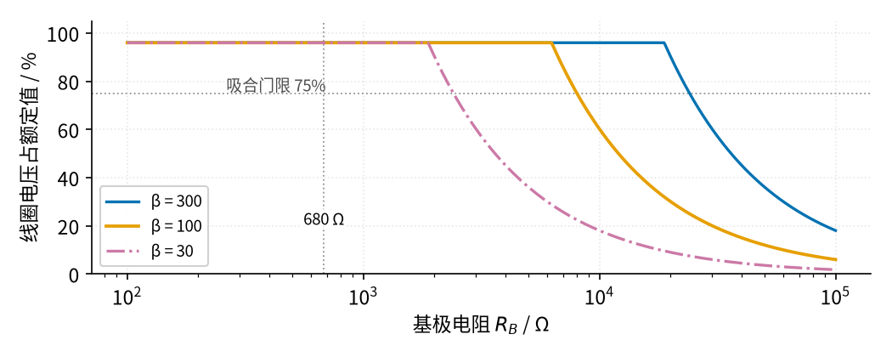
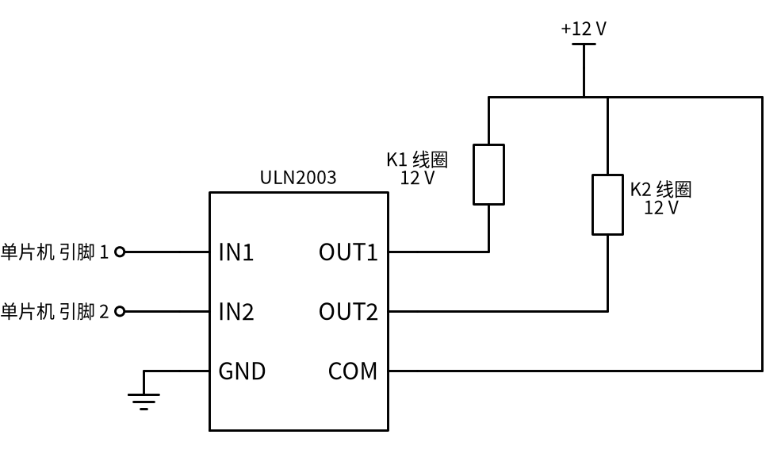

# 22 三极管开关与继电器驱动 · 参数与调试篇

[上一页：原理与实现篇](page2.md) · [直觉篇](page1.md) · [原理与实现篇](page2.md) · 本页：参数与调试篇 · [下一页：02 同相放大 · 直觉篇](../02-noninverting-amp/page1.md) · 前置节点：[P1 元件速成 · 直觉篇](../P1-components-basics/page1.md)、[P2 半导体入门 · 直觉篇](../P2-semiconductor-basics/page1.md)

> [!WARNING]
> **市电危险**：本电路的实际版本接 220V/380V 市电，触电可能致命。本页的仿真和动手实验只在 12V 以下的低压电源上进行；任何接线、改线都必须在断电并验电后操作，由持证电工完成。
>
> 本页特有的危险点：排查故障时**先断开触点侧的 220 V**，再去量线圈侧的电压；不要在 220 V 带电的情况下用手指去拨继电器、按衔铁，也不要拿万用表表笔在模块背面的焊盘上"随便点一点"。

## 一、参数表

下面这些数都来自数据手册（来源列在页尾），选型、排错时直接对照。

| 器件 | 参数 | 数值 | 对设计的意义 |
|---|---|---|---|
| 2N3904 | $V_{CEO}$ （集电极-发射极耐压） | 40 V | 关断尖峰必须钳在它以下 |
| 2N3904 | $I_C$ 连续 | 200 mA | 手册说当开关用的有效范围到 100 mA |
| 2N3904 | $h_{FE}$ 最小值 | 10 mA 时 100，50 mA 时 60，100 mA 时 30 | 电流越大 β 越小，按最小值算 |
| 2N3904 | $V_{CE(sat)}$ | ≤ 0.2 V（10 mA / 1 mA），≤ 0.3 V（50 mA / 5 mA） | 手册用强制 β = 10 测饱和压降 |
| SRD-05VDC 高灵敏型 | 线圈 | 70 Ω ±10%，71.4 mA，0.36 W | 决定 $I_{C(max)}$ |
| SRD-05VDC 标准型 | 线圈 | 55 Ω，89.3 mA，0.45 W | 电流更大，基极电阻要更小 |
| SRD 系列 | 吸合 / 释放电压 | 最大 75% / 最小 10% 额定 | 线圈电压低于 75% 不保证吸合 |
| SRD 系列 | 触点 | 10 A 250 VAC / 10 A 28 VDC | 负载电流不能超过它，感性负载还要降额 |
| SRD 系列 | 线圈-触点绝缘耐压 | 1500 VAC | 继电器本体能隔开低压和 220 V |
| ATmega328P | 每个 I/O 引脚 | 绝对最大 40 mA； $V_{OH}$ 测试条件 20 mA（5 V） | 引脚不能直接推线圈 |
| ULN2003A | 每路电流 / 输出耐压 | 500 mA / 50 V | 多路继电器的现成驱动 |
| ULN2003A | $V_{CE(sat)}$ （100 mA） | 典型 0.9 V，最大 1.1 V | 比单只三极管大得多，5 V 继电器会吃亏 |

基极电阻怎么影响结果，最直观的是扫一遍，看 图 22-p3-1：

*图 22-p3-1　扫基极电阻：线圈两端电压占额定值的百分比（5 V 引脚、70 Ω 线圈）*

图 22-p3-1 的横轴是对数刻度的 $R_B$ ，从 100 Ω 到 100 kΩ。三条线在左边都是平的（96%，三极管饱和），往右到某个点突然往下掉——那就是三极管退出饱和、进入放大区的地方。线圈电压跌破灰色点线（75% 吸合门限）的位置：蓝色 β = 300 在 24.08 kΩ，橙色 β = 100 在 8.03 kΩ，红紫色点划线 β = 30 在 2.41 kΩ。我们选的 680 Ω 在竖直点线处，离最"懒"的那条线的拐点还有好几倍的距离，这就是裕量。反过来，如果你在网上看到别人用 10 kΩ 也能用，那只是他的管子 β 恰好大——同一张图告诉你，换一只 β = 30 的管子就不行了。

## 二、220 V 侧的布线距离

继电器触点切换 220 V 时，220 V 的走线和 5 V 的走线之间要有足够的**电气间隙**（空气中的直线距离）和**爬电距离**（沿板子表面的距离）。继电器本体做到了这一点：比如 Finder 62 系列功率继电器的手册写明，线圈和触点之间按 EN 60335-1 做加强绝缘，有 6 mm 电气间隙和 8 mm 爬电距离。可如果你在自己画的 PCB 上，把 220 V 的触点走线和单片机的走线挤在一起，继电器本体的绝缘就白做了。自制板子具体要留多少毫米，要按 IEC 60664-1 等安全标准，根据工作电压、污染等级来定 [待核实：本页不给具体数值]；常见做法是在两侧之间开槽、在丝印上画出隔离带、220 V 走线加宽并远离板边。

## 三、故障排查表

| 现象 | 原因 | 怎么查 | 怎么改 |
|---|---|---|---|
| 继电器不吸合，或"咔哒咔哒"抖 | $R_B$ 太大，三极管停在放大区，线圈电压低于 75% | 吸合时量 $V_{CE}$ ：明显高于 0.3 V 就是没饱和 | 按 $\beta_{min}$ 和 2 到 5 倍裕量重算 $R_B$ |
| 三极管发烫 | 同上，放大区里 $V_{CE} \times I_C$ 很大 | 量 $V_{CE}$ 和线圈电压 | 减小 $R_B$ ；线圈电流大时换更大的管子 |
| 三极管一通电就烧，继电器不吸 | 续流二极管接反：三极管一导通，电流从 +5 V 经二极管直接灌进集电极，几乎短路 | 看二极管负极（横杠）是不是接 +5 V | 二极管负极朝电源、正极朝集电极 |
| 用了一阵三极管击穿，或继电器一动单片机就复位 | 没有续流二极管，关断尖峰打穿三极管、干扰电源 | 查线圈两端有没有二极管 | 加续流二极管；电源加去耦电容 |
| 继电器释放慢，触点粘连 | 只并二极管，线圈电流衰减慢 | 对照释放时间要求 | 二极管串稳压管，钳位电压低于三极管耐压 |
| 单片机上电、复位瞬间继电器乱动一下 | 复位时引脚是高阻（悬空），基极电位不确定 | 断开单片机，看基极悬空时继电器是否动作 | 基极到地加一只 10 kΩ 下拉电阻 |
| 5 V 继电器配 ULN2003 吸合不稳 | ULN2003 饱和压降约 1 V，线圈只拿到约 80% | 量线圈两端电压 | 改用 12 V 继电器，或用单只三极管驱动 |
| 板子上打火、烧焦 | 220 V 走线离低压走线太近，或触点负载超额 | **断电后**目视检查板子 | 按标准留间隙、开槽；负载电流按触点额定值降额选 |

## 四、练习

**练习 1**：用 3.3 V 单片机驱动 SRD-12VDC 高灵敏型继电器（12 V、400 Ω），三极管 2N3904。线圈电流约 30 mA，β 按 50 mA 时的最小值 60 算（偏保守）。 $R_B$ 选 1.5 kΩ 够不够？

答案

$I_{C(max)} = (12 - 0.2)/400 = 29.5\ \text{mA}$ ，最低基极电流 $29.5/60 = 0.49\ \text{mA}$ 。1.5 kΩ 给 $I_B = 2.6/1500 = 1.73\ \text{mA}$ ，裕量 3.5 倍，够了。注意线圈接的是 12 V，而单片机是 3.3 V：两者**共地**，但三极管集电极上是 12 V 系统的电压，千万不能把集电极接回单片机引脚。

**练习 2**：某同学用 10 kΩ 的 $R_B$ ，测得继电器吸合时 $V_{CE} = 1.99\ \text{V}$ 。他这只管子的 β 大约是多少？继电器能可靠吸合吗？

答案

线圈压降 $5 - 1.99 = 3.01\ \text{V}$ ，集电极电流 $3.01/70 = 43.0\ \text{mA}$ ；基极电流 $4.3/10000 = 0.43\ \text{mA}$ ，所以 β ≈ 100。线圈只拿到 60% 的额定电压，低于 75% 的吸合门限，不能保证吸合。这正是上面扫描图里 β = 100 那条线在 10 kΩ 处的情形。

**练习 3**：判断对错并说明理由——"续流二极管反正平时不导通，接反了也没关系。"

答案

错。接反以后，三极管一导通，+5 V 就经二极管（此时正向导通）直接接到集电极，再经三极管到地，几乎是短路：二极管和三极管都可能烧掉，而线圈两端只剩一个二极管压降，继电器也吸不上。

**练习 4（变体迁移）**：要用一片 ULN2003 驱动两只继电器。① 选 5 V 继电器还是 12 V 继电器？② COM 引脚接哪里？③ 输入端还要不要串基极电阻？

答案

① 选 12 V。ULN2003 是达林顿结构，100 mA 时饱和压降典型 0.9 V、最大 1.1 V。5 V 继电器只拿到 4.1 V（82%）到 3.9 V（78%），离 75% 的吸合门限很近；12 V 继电器拿到 10.9 V（91%），余量充足。TI 手册里的应用示例也是 12 到 48 V 的线圈。

② COM 接线圈电源 +12 V。芯片里每一路都有一只钳位二极管，阳极接输出、阴极都接到 COM，COM 接上线圈电源，这些二极管就成了续流二极管，不用再外接。COM 忘了接，就等于没有续流二极管。

③ 不用。每路输入内部已经串了 2.7 kΩ，手册说可直接接 5 V 的 TTL / CMOS 输出，3.3 V 也可以。接法如 图 22-p3-2：

*图 22-p3-2　ULN2003 驱动两路 12 V 继电器*

图 22-p3-2 里两只线圈的上端和 COM 引脚接在同一根 +12 V 上，线圈下端分别接 OUT1、OUT2，GND 和单片机共地。和单只三极管相比，ULN2003 省掉了基极电阻和续流二极管，代价是饱和压降比单只三极管的 0.2 V 大了约 0.7 V（典型）到 0.9 V（最大），芯片自己也会多发一点热。

## 参考资料

- onsemi，2N3904 数据手册：https://www.onsemi.com/download/data-sheet/pdf/2n3904-d.pdf
- 松乐 SRD 系列继电器数据手册（alldatasheet 镜像）：https://www.alldatasheet.com/html-pdf/1132639/SONGLERELAY/SRD-05VDC-SL-C/1713/2/SRD-05VDC-SL-C.html
- TI，ULN2003A 数据手册：https://www.ti.com/lit/ds/symlink/uln2003a.pdf
- TE Connectivity，线圈抑制与继电器寿命：https://www.te.com/en/products/relays-and-contactors/electromechanical-relays/intersection/coil-suppression-relay-life.html
- Microchip，ATmega48A/88A/168A/328/328P 数据手册：https://ww1.microchip.com/downloads/en/DeviceDoc/ATmega48A-PA-88A-PA-168A-PA-328-P-DS-DS40002061B.pdf
- Finder，62 系列功率继电器样本：https://cdn.findernet.com/app/uploads/S62EN.pdf
