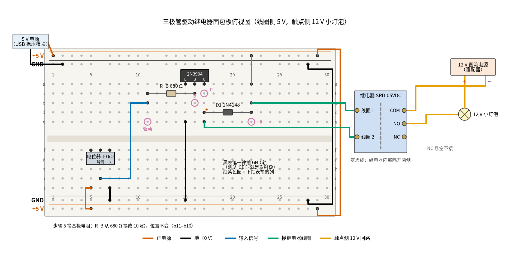

# 22 三极管开关与继电器驱动 · 动手实验篇

[上一页：参数与调试篇](page3.md) · [直觉篇](page1.md) · [原理与实现篇](page2.md) · [参数与调试篇](page3.md) · 本页：动手实验篇 · [下一页：02 同相放大 · 直觉篇](../02-noninverting-amp/page1.md) · 前置节点：[P1 元件速成 · 直觉篇](../P1-components-basics/page1.md)、[P2 半导体入门 · 直觉篇](../P2-semiconductor-basics/page1.md)

## 这次实验要验证什么

用一只 2N3904 在面包板上推动一只 5 V 继电器，亲手确认三件事：基极电阻取 680 Ω 时三极管饱和， $V_{CE}$ 只剩 0.2～0.3 V，线圈拿到约 94% 的额定电压；把基极电阻错换成 10 kΩ，管子掉进放大区，继电器吸不牢；继电器的吸合电压比释放电压高得多。这几条分别对应 [22 三极管开关与继电器驱动 · 原理与实现篇](page2.md) 第二节「基极电阻怎么选」的结论和第五节 A 部分的扫描结果，以及 [22 三极管开关与继电器驱动 · 参数与调试篇](page3.md) 参数表里「吸合 / 释放电压 75% / 10%」那一行。

页面里继电器的触点接的是 220 V 灯。本页**触点那一侧只接一只 12 V 小灯泡和一个 12 V 直流电源**，不接任何 220 V 设备。继电器的工作方式完全一样：线圈吸合，触点闭合，灯泡亮。

## ⚠️ 安全须知

- **不要接 220 V**。页面里触点侧的 220 V 灯、插座、电机，本页一律不碰；市电部分请电工做。即使你手里是现成的继电器模块，螺丝端子上也只接本页的 12 V 小灯泡回路。
- **只用 12 V 及以下的直流电**。线圈侧用 5 V（USB 电源模块），触点侧用 12 V 直流适配器；手边没有 12 V，也可以用 9 V 电池配 9 V 或 12 V 小灯泡（12 V 灯泡在 9 V 下会暗一些）。
- **二极管分正负极**。续流二极管 1N4148 的负极（有黑色色环的一端）必须朝 +5 V。接反了，三极管一导通，电流就经二极管从 +5 V 直接灌进集电极，几乎是短路，三极管会很快烧掉（[22 三极管开关与继电器驱动 · 参数与调试篇](page3.md) 故障排查表第三行）。本实验没有电解电容。
- **元件可能发烫，不要用手摸**。小灯泡点亮后玻璃壳很烫；第 7 步拧电位器时三极管处在放大区，会比饱和时热一些（最坏约 89 mW，仍远小于 625 mW 的额定值），不要停在中间位置太久。
- **接线、改线之前先断电**。两侧的电源都要断：先拔 12 V 适配器，再关 5 V。**不要做「拆掉续流二极管看尖峰」的实验**，尖峰会打坏三极管，也可能打坏示波器的输入端。

## 器材清单

| 元件 | 型号或数值 | 数量 | 说明 |
|---|---|---|---|
| NPN 三极管 | 2N3904（TO-92 封装） | 1 | 平面（印字面）朝你，三只脚从左到右是 E、B、C |
| 继电器 | 松乐 SRD-05VDC 高灵敏型（线圈 70 Ω） | 1 | 和页面一致；标准型是 55 Ω，也能用，但电流更大 |
| 二极管 | 1N4148（或 1N4007） | 1 | 续流二极管，有色环的一端是负极 |
| 电阻 | 680 Ω | 1 | 基极电阻 $R_B$ |
| 电阻 | 10 kΩ | 1 | 第 5 步临时替换 680 Ω，演示「没饱和」 |
| 电位器 | 10 kΩ 线性，三脚 | 1 | 当作「单片机引脚」：拧到一头是 0 V，另一头是 5 V |
| 小灯泡 | 12 V，1～3 W 的指示灯泡或汽车小灯泡，带灯座 | 1 | 触点侧负载 |
| 12 V 电源 | 12 V 直流适配器（0.5 A 以上） | 1 | 触点侧专用，不和面包板共地 |
| 5 V 电源 | 面包板电源模块或 USB 5 V | 1 | 线圈侧，电流能力 0.5 A 以上 |
| 面包板 | 830 孔（30 列以上） | 1 | 上下各两条电源轨 |
| 跳线 | 杜邦线、鳄鱼夹线 | 若干 | 继电器的五只脚各焊一根杜邦线；触点侧用鳄鱼夹线 |
| 万用表 | 带 2 V、20 V 直流挡、200 Ω 电阻挡和二极管挡 | 1 | 自动量程表也可以 |

SRD 继电器的引脚间距和面包板的 2.54 mm 孔距对不上，硬插会把弹片撑坏。最省事的办法是在它的五只脚上各焊一根杜邦线（或者买一块「继电器转接板」），继电器本体放在面包板外面。两只线圈脚挨在一起，另一端是 COM（公共端），COM 两边是 NO（常开）和 NC（常闭）；具体哪只脚是哪个，看继电器底面印的图，或者按第 2 步用万用表量。

## 搭建步骤

电路就是 [22 三极管开关与继电器驱动 · 直觉篇](page1.md) 第三节那张完整的驱动电路图：左边低压驱动，右边触点回路，只是把单片机换成电位器、把 220 V 灯换成 12 V 小灯泡。面包板上同一列的 a–e 五个孔连通，f–j 五个孔连通，中间凹槽把上下两半隔开；上下边缘的长条是电源轨，整条横向连通。

请看图 22-p4-1：红色线是 +5 V，黑色线是 GND，蓝色线是驱动信号，蓝绿色线通往继电器线圈，橙色线是和面包板完全分开的 12 V 触点回路。



*图 22-p4-1　三极管驱动继电器的面包板接线（线圈侧 5 V，触点侧只接 12 V 小灯泡）*

1. **铺电源轨**。5 V 电源的正极接上方最外侧一条轨（+5 V），负极接它下面一条（GND）。再用一根红线、一根黑线绕到右边，把上方两条轨分别和下方对应的轨连起来。先不要开电源。
2. **先量继电器**。断电状态下，万用表打到 200 Ω 挡，量两只线圈脚之间的电阻，应在 63–77 Ω 之间（70 Ω ±10%）。再打到通断挡：COM 和 NC 之间应该是通的，COM 和 NO 之间应该是断的（OL）。最后量任意一只线圈脚和 COM 之间，应该是 OL，这就是继电器内部的隔离。
3. **先量二极管**。插板之前，万用表打二极管挡：红表笔接 1N4148 没有色环的一端（阳极），黑表笔接有色环的一端（阴极），应读到 0.5～0.7 V；对调表笔应显示 OL。装进电路以后它和 70 Ω 线圈并联，两个方向都读得很低，就分不出好坏了。
4. **插三极管和发射极地线**。2N3904 平面朝你，三只脚插在 a15、a16、a17，分别是 E、B、C。黑线从 e15 接到下方 GND 轨。
5. **接基极电阻**。 $R_B$ （680 Ω）插 b11 和 b16。第 11 列上半区就是「驱动点」。
6. **接续流二极管和线圈**。1N4148 阳极插 d17（集电极那一列），阴极插 d22；红线从 a22 接到上方 +5 V 轨。蓝绿色线一根从 c22 接继电器「线圈 1」，另一根从 e17 接「线圈 2」。线圈不分正负，两只脚对调也行。这样电流路径是：+5 V → 线圈 → 集电极 → 发射极 → GND；二极管反着并在线圈两端。
7. **接电位器**。三只脚插 f5、f6、f7，中间那只是滑臂。红线从 j5 接 +5 V 轨，黑线从 j7 接 GND 轨，蓝线从 i6 接到 c11。
8. **接触点回路**。用鳄鱼夹线：12 V 电源正极 → 小灯泡一端，小灯泡另一端 → 继电器 NO；继电器 COM → 12 V 电源负极。NC 悬空不接。这一圈导线不经过面包板，也不和 5 V 的 GND 相连。
9. **检查一遍再上电**。电位器拧到接 GND 的那一头。对照图 22-p4-1 数一遍：二极管色环在第 22 列；三极管平面朝你。先开 5 V，继电器不应动作；再插 12 V 适配器，灯泡不亮。

图 22-p4-1 里红紫色圆圈标的是要下红表笔的位置：驱动点在第 11 列，B 是基极所在的第 16 列，C 是集电极所在的第 17 列，「+5」是线圈上端的第 22 列。黑表笔一般插 GND 轨；发射极接在 GND 上，所以「对 GND 的电压」就是 $V_{BE}$ 和 $V_{CE}$ 。

## 测量表

线圈侧「应该读到」一栏的数取自 [review/spice/22.md](../review/spice/22.md) 的面包板万用表读数表：ngspice 用 onsemi 的 2N3904 官方模型、70 Ω 线圈、5 V 电源算出，和本页电路相同。吸合、释放电压一行取自松乐 SRD 手册（吸合不高于额定的 75%，释放不低于 10%），手册只给保证线，你手里这只的具体数要自己量。触点侧的读数是电路关系直接推出来的，不依赖仿真。

| 步骤 | 测什么 | 红表笔 | 黑表笔 | 挡位 | 应该读到 | 读不到时先查 |
|---|---|---|---|---|---|---|
| 1 | 线圈电阻（断电） | 线圈 1 | 线圈 2 | 200 Ω | 63–77 Ω | 读到 OL：量到的不是线圈脚 |
| 2 | 5 V 电源电压 | +5 V 轨 | GND 轨 | 直流 20 V | 约 5 V（4.75–5.25 V） | 电源模块开关、USB 线 |
| 3 | 吸合时 $V_{CE}$ （电位器拧到 5 V 头） | 第 17 列（C） | GND 轨 | 直流 20 V | 约 0.27 V（0.2～0.3 V），继电器「咔」一声 | 高于 1 V：查 $R_B$ 是不是 680 Ω（蓝灰棕） |
| 4 | 吸合时线圈两端 | 第 22 列（+5） | 第 17 列（C） | 直流 20 V | 约 4.73 V（额定的 94%） | 明显偏低：电源电压低，或管子没饱和 |
| 5 | 吸合时 $R_B$ 两端 | 第 11 列（驱动） | 第 16 列（B） | 直流 20 V | 约 4.13 V（基极电流约 6.1 mA） | 0 V：蓝线没接到 c11 |
| 6 | 吸合时 $V_{BE}$ | 第 16 列（B） | GND 轨 | 直流 2 V | 约 0.87 V | 读到 0 V：三极管脚序插错 |
| 7 | 吸合时灯泡两端 | 灯泡接 12 V 正极那端 | 灯泡接 NO 那端 | 直流 20 V | 接近 12 V 电源电压，灯泡亮 | 0 V 且不亮：触点接在 NC 上了 |
| 8 | 吸合时 COM 与 NO 之间 | NO | COM | 直流 20 V | 接近 0 V（不到 0.1 V） | 有几伏：触点没闭合，回到步骤 3 |
| 9 | 释放时 COM 与 NO 之间（电位器拧回 GND 头） | NO | COM | 直流 20 V | 约等于 12 V 电源电压，灯泡灭 | 0 V 且灯亮：触点接到了 NC，或继电器粘连 |
| 10 | 慢慢拧电位器，「咔」吸合那一刻的线圈电压 | 第 22 列（+5） | 第 17 列（C） | 直流 20 V | 不高于 3.75 V（额定的 75%） | 一直不吸：步骤 3 先确认能吸合 |
| 11 | 再慢慢往回拧，「嗒」释放那一刻的线圈电压 | 第 22 列（+5） | 第 17 列（C） | 直流 20 V | 不低于 0.50 V（额定的 10%），比步骤 10 低得多 | 读数跳得厉害：拧慢一点，多做几次取中间值 |
| 12 | $R_B$ 换成 10 kΩ 后 $V_{CE}$ （电位器拧到 5 V 头） | 第 17 列（C） | GND 轨 | 直流 20 V | 典型管约 2.7 V，继电器不吸或抖；β 很大的管子才读到约 0.2 V | 这一步读数因管子而异，见下文 |
| 13 | 断电后，线圈脚与 COM 之间 | 线圈 1 | COM | 20 MΩ 或最高电阻挡 | OL（开路） | 有读数：继电器内部绝缘坏了，换一只 |

读表时注意几件事。第一，步骤 4 和步骤 5 可以算出两个电流：线圈电流约 4.73 V ÷ 70 Ω = 67.6 mA，基极电流约 4.13 V ÷ 680 Ω = 6.07 mA，两者之比只有 11.1。这个「强制 β」远小于 2N3904 在放大区的 β（手册 10 mA 时 100 到 300，100 mA 时最小 30），说明电路给的基极电流远超需要，三极管被「逼」到了饱和。页面要求的 2～5 倍裕量就体现在这里。第二，步骤 6 的 0.87 V 比页面简化模型里的 0.7 V 高，因为 6 mA 的基极电流对这只小管子来说不算小；它仍在手册上限 0.95 V 以内，所以 page2 例题里按 0.95 V 验算过的结论不变。第三，步骤 9 里，触点断开时万用表读到的是 12 V 电源电压，这是因为灯丝把电源正极接到了 NO 上，而万用表内阻有 10 MΩ，灯丝上几乎没有压降。

步骤 12 的读数取决于你手上这只管子的 β。页面 A 部分算过：10 kΩ 时 β = 100 的管子 $V_{CE}$ 停在 1.99 V，线圈只拿到 60%；β = 30 的更低。SPICE 模型给的约 2.7 V 落在这一带。如果你读到 0.2 V，说明这只管子 β 很大，不代表 10 kΩ 是对的，下一只管子很可能就不行。

## 没有示波器怎么办

继电器本身就是一个很好的「指示器」：吸合有「咔」声，释放有「嗒」声，灯泡亮灭也看得见。本页的大部分结论用万用表加耳朵就能验证，真正需要示波器的只有微秒级的关断尖峰。

第一，用电位器代替示波器看「开关」和「放大」的区别。步骤 10、11 就是这个实验：电位器慢慢拧，基极电流慢慢变，三极管从截止经过放大区走到饱和，线圈电压跟着连续上升。继电器却不会跟着连续动作，而是在某个电压「咔」地吸合；往回拧，要降到低得多的电压才「嗒」地释放。这个吸合高、释放低的现象叫**回差**（滞回）：衔铁吸上以后离铁芯近了，磁路变短，保持它需要的电流比拉动它小得多。手册的保证线是吸合不高于 3.75 V、释放不低于 0.50 V，你量到的两个数应该在这两条线之间，并且明显拉开。

第二，用耳朵听「抖动」。基极电阻换成 10 kΩ 以后，如果继电器发出连续的「咔哒咔哒」声，或者灯泡忽明忽暗，说明线圈电压停在吸合线附近。这就是 [22 三极管开关与继电器驱动 · 参数与调试篇](page3.md) 故障排查表第一行的现象，用万用表量 $V_{CE}$ 就能确认它明显高于 0.3 V。

第三，用手机慢动作录像看吸合与灯泡的先后。手机的慢动作一般能拍每秒 120 帧或 240 帧，把电位器从 GND 头快速拧到 5 V 头，录下继电器和灯泡，可以看到灯泡是在「咔」声之后才亮的；这段延迟来自衔铁的机械运动，电子开关没有这一步。这一项只看先后，本页不给具体帧数和时间。

**只有示波器才能看到的**：Q1 关断瞬间集电极上的电压尖峰。没有续流二极管时，它在 5.0 µs 内冲到约 2170 V（实际上三极管会先被击穿）；并上二极管后被钳在约 5.7 V，二极管串 24 V 稳压管时钳在约 29.7 V。这些波形见 [22 三极管开关与继电器驱动 · 原理与实现篇](page2.md) 第五节「看结果」B 部分的两张仿真波形图：没有二极管的那张冲到两千多伏，有二极管的那张对比了两种钳位平台。不要为了「亲眼看看」去拆二极管，用仿真看就够了。

## 用 Python 核对你的读数

把你量到的电源电压、线圈电阻、 $R_B$ 实际值和各点读数填进去。代码用你自己的 $V_{BE}$ 和 $V_{CE}$ 算出期望的线圈电压、基极电流和强制 β，逐项比较，偏差超过 10% 就提示；再检查饱和压降和吸合 / 释放电压是否在手册保证线以内。

```python
import sys, pathlib
sys.path.insert(0, str(pathlib.Path("code/figs").resolve()))  # 在仓库根目录运行
# 22 三极管驱动继电器 · 动手实验核对：填入实测值，算出期望读数并比较

# ---- 1. 你量到的电源和元件（示例值，换成你自己的）----
VCC = 5.06                  # 步骤 2：+5 V 轨对 GND / V
R_COIL = 71.5               # 步骤 1：线圈电阻 / Ω
RB = 676.0                  # 680 Ω 的实际值 / Ω
V_RATED = 5.0               # 继电器额定电压 / V

# ---- 2. 你量到的读数（对应测量表步骤 3–6、10、11）----
m = dict(vce=0.26,          # 步骤 3：吸合时 V_CE / V
         vcoil=4.80,        # 步骤 4：线圈两端 / V
         vrb=4.17,          # 步骤 5：R_B 两端 / V
         vbe=0.88,          # 步骤 6：V_BE / V
         v_pull=3.1,        # 步骤 10：吸合那一刻的线圈电压 / V
         v_drop=1.4)        # 步骤 11：释放那一刻的线圈电压 / V

calc = dict(vcoil=VCC - m["vce"],          # 电源 = 线圈 + V_CE
            vrb=VCC - m["vbe"])            # 电位器拧到头 = 5 V：R_B 上 = 电源 − V_BE
ic = m["vcoil"] / R_COIL
ib = m["vrb"] / RB
print(f"线圈电流 I_C = {ic*1e3:.1f} mA，基极电流 I_B = {ib*1e3:.2f} mA，强制 β = {ic/ib:.1f}")

warn = 0
print(f"{'项目':<8}{'实测':>8}{'计算':>8}{'偏差':>9}")
for k, c in calc.items():
    dev = (m[k] - c) / c * 100
    flag = abs(dev) > 10
    warn += flag
    print(f"{k:<8}{m[k]:>8.2f}{c:>8.2f}{dev:>+8.1f}%" + ("   ← 偏差太大，先查测量表最后一列" if flag else ""))

# 饱和判据：V_CE 不超过手册 0.3 V（50 mA / 5 mA），强制 β 远小于 β_min = 30
checks = [("饱和压降 V_CE ≤ 0.3 V", m["vce"] <= 0.3),
          ("强制 β 小于 β_min 30", ic / ib < 30),
          ("线圈电压 ≥ 额定的 75%", m["vcoil"] >= 0.75 * V_RATED),
          ("吸合电压 ≤ 额定的 75%", m["v_pull"] <= 0.75 * V_RATED),
          ("释放电压 ≥ 额定的 10%", m["v_drop"] >= 0.10 * V_RATED),
          ("吸合电压 > 释放电压（回差）", m["v_pull"] > m["v_drop"])]
for name, ok in checks:
    warn += not ok
    print(("  ✓ " if ok else "  ✗ ") + name + ("" if ok else "   ← 不满足，先查测量表最后一列"))
print(f"吸合 {m['v_pull']/V_RATED*100:.0f}% 额定，释放 {m['v_drop']/V_RATED*100:.0f}% 额定")
print("全部在范围内" if warn == 0 else f"有 {warn} 项需要检查")
```

示例数据里电源是 5.06 V，线圈电阻 71.5 Ω，所以线圈电压是 4.80 V 而不是 4.73 V。代码用你量到的电源和 $V_{CE}$ 算，偏差就只剩零点几个百分点。吸合 3.1 V、释放 1.4 V 只是示例，用来演示判断方法，不是哪只继电器的实测值；你的数只要落在 0.50～3.75 V 之间、并且吸合比释放高，就符合手册。

## 实验记录表

| 项目 | 实测值 | 计算值 | 偏差 |
|---|---|---|---|
| 5 V 电源电压 |  |  |  |
| 线圈电阻 / 680 Ω 实际阻值 |  |  |  |
| 吸合时 $V_{CE}$ |  |  |  |
| 吸合时线圈两端电压 |  |  |  |
| 吸合时 $R_B$ 两端电压和算出的 $I_B$ |  |  |  |
| 吸合时 $V_{BE}$ |  |  |  |
| 强制 β（ $I_C / I_B$ ） |  |  |  |
| 灯泡两端（吸合）/ COM–NO（释放） |  |  |  |
| 吸合电压 / 释放电压 |  |  |  |
| 10 kΩ 时的 $V_{CE}$ |  |  |  |
| 线圈脚与 COM 之间电阻 |  |  |  |

### 思考题

**1. 你量到的强制 β 大约是 11，而 2N3904 的 β 在 10 mA 时有 100 到 300。是不是说明这只管子「β 太小」了**？

<details><summary>答案</summary>

不是。β 只在放大区才有意义，指的是「基极电流能放大出多少集电极电流」。饱和时集电极电流被线圈电阻卡在约 68 mA，基极电流却给了 6 mA，两者之比自然很小。强制 β 越小，说明基极电流给得越足、裕量越大。页面按 β 最小 30 再乘 2.8 倍裕量选出 680 Ω，算出来的比值正好在十左右。

</details>

**2. 如果把 12 V 小灯泡换成一只 12 V 小电机，触点那一侧要不要也加续流二极管？加在哪里**？

<details><summary>答案</summary>

最好加。电机也是线圈，触点断开时同样会产生尖峰，在触点之间打火，加快触点磨损。直流负载可以在电机两端反并一只二极管：负极接 12 V 电源正极那一端，正极接电机另一端。注意这只二极管和线圈侧的 1N4148 是两回事，它保护的是触点；电机电流大时要选额定电流足够的二极管，比如 1N4007。

</details>

**3. 步骤 13 里线圈脚和 COM 之间是开路。这对「用继电器控制 220 V」有什么意义？面包板上的电路能直接拿去接 220 V 吗**？

<details><summary>答案</summary>

开路说明线圈和触点之间只靠继电器内部的绝缘隔开，SRD 手册给的耐压是 1500 VAC，所以低压一侧不会带上市电。但面包板电路不能直接接 220 V：面包板相邻两列只隔 2.54 mm，裸露的金属弹片、鳄鱼夹都会让人碰到带电部分，也达不到 [22 三极管开关与继电器驱动 · 参数与调试篇](page3.md) 第二节说的布线距离要求。市电部分必须用有认证的成品模块，并且请电工接线。

</details>

## 自测清单

- 我能认出 2N3904 的 E、B、C 三只脚，按低边开关的接法把它和继电器线圈接好，并说出续流二极管的方向。
- 我能用万用表量出吸合时的 $V_{CE}$ 、线圈电压和 $R_B$ 两端电压，算出线圈电流、基极电流和强制 β，判断三极管有没有饱和。
- 我能用电位器慢慢调节，量出继电器的吸合电压和释放电压，并解释为什么吸合电压比释放电压高。
- 我能说清楚把 $R_B$ 换成 10 kΩ 以后继电器为什么可能抖动，以及为什么「这只管子能用」不代表设计是对的。
- 我能说明为什么本实验的触点侧只接 12 V 小灯泡，市电部分为什么必须交给电工。
