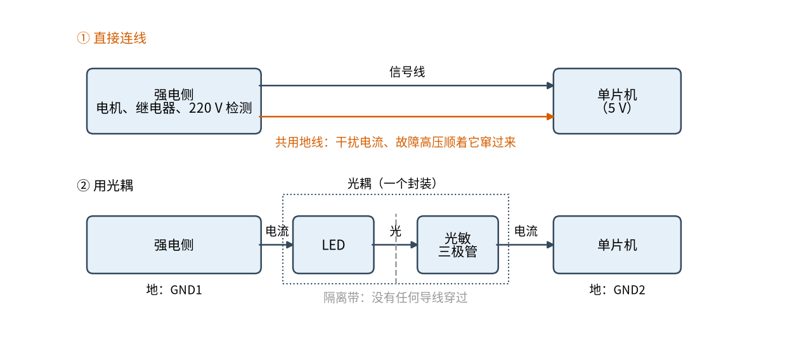
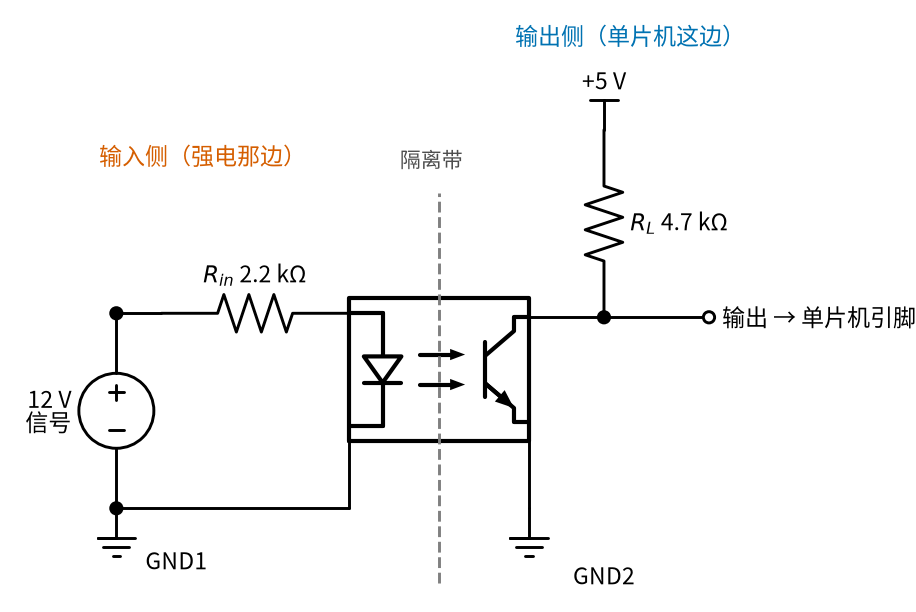
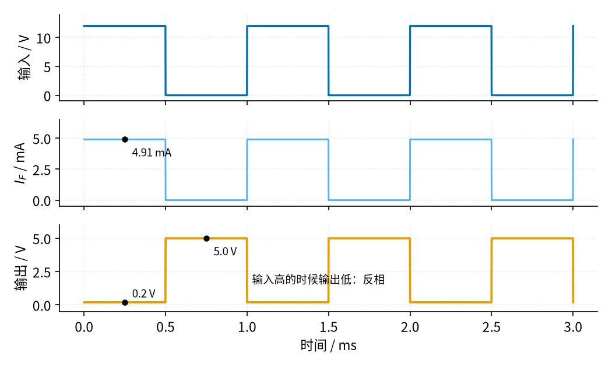
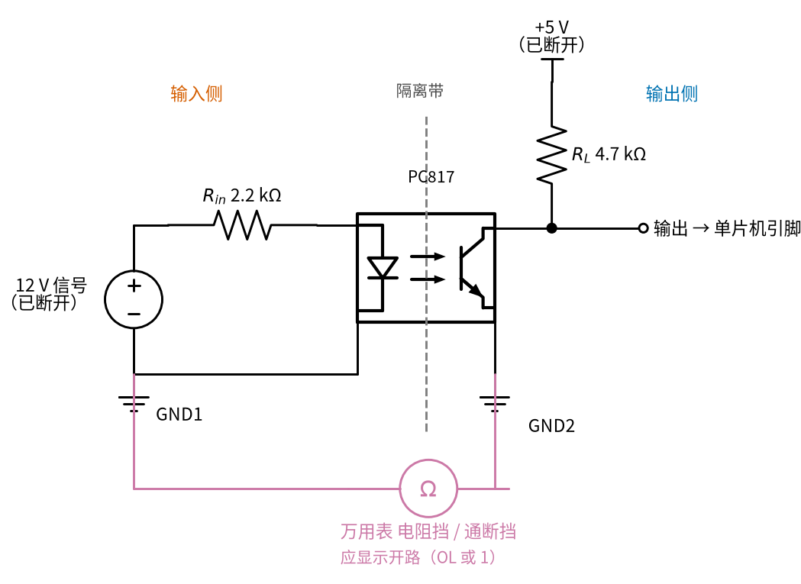

# 23 光耦隔离 · 直觉篇

[上一页：22 过载保护 · 动手实验篇](../22-overload-protection/page4.md) · 本页：直觉篇 · [原理与实现篇](page2.md) · [参数与调试篇](page3.md) · [下一页：原理与实现篇](page2.md) · 前置节点：[03 半导体入门 · 直觉篇](../03-semiconductor-basics/page1.md)、[07 三极管开关与继电器驱动 · 直觉篇](../07-bjt-relay-driver/page1.md)

> [!WARNING]
> **市电危险**：本电路的实际版本接 220V/380V 市电，触电可能致命。本页的仿真和动手实验只在 12V 以下的低压电源上进行；任何接线、改线都必须在断电并验电后操作，由持证电工完成。
>
> 本节点特有的危险点：① 光耦的**输入侧**如果用来检测市电（过零检测、有无电压检测），那一侧的电阻、焊盘、引脚全部带 220 V，单片机这边是 5 V 不代表整块板子安全；② 光耦只有在两侧的地**真的分开**时才起隔离作用，一根跳线、一个示波器探头的地夹就可能把 220 V 引到单片机和你手上；③ 光耦本体的引脚间距是有限的，板子上两侧走线之间也要留足距离，不能为了省地方挤在一起。

## 一、痛点：强电那边一出事，单片机跟着遭殃

在 [07 三极管开关与继电器驱动 · 直觉篇](../07-bjt-relay-driver/page1.md) 里，单片机通过三极管去**控制**继电器。现在反过来：单片机要**读**强电那边的状态——一台 24 V 的工业传感器有没有信号、电机控制柜里某个 12 V 继电器有没有吸合，甚至 220 V 插座上有没有电。

最直接的办法是拉一根信号线过来，再把两边的地连在一起，好让电压有个共同的"零点"。问题就出在这根地线上。电机启动、继电器断开时，强电侧的地线里有很大的电流在跳动，这根共用的地线会把干扰一起送进单片机，轻则读数乱跳、程序跑飞，重则一旦强电侧绝缘损坏，高压会顺着地线直接打到单片机，甚至打到摸着 USB 线的你。

图 23-p1-1 上半部分就是这种"直接连线"的情形，下半部分是本节的办法：

*图 23-p1-1　直接连线（上）与光耦隔离（下）*

图 23-p1-1 下半部分的关键是中间那条灰色虚线：**隔离带上没有任何导线穿过**。强电侧的电流点亮一只 LED，LED 的光照到另一侧的光敏三极管上，三极管导通，单片机读到信号。信号是靠"光"过去的，两侧的地分别叫 GND1 和 GND2，彼此不连。这个"LED + 光敏三极管"装在一个小黑盒子里，就叫**光电耦合器**，简称光耦。常见的 PC817 内部两侧之间能承受 5 kV（有效值）的隔离电压。

## 二、类比：隔着玻璃窗打手电

想象两栋楼之间隔着一条马路，你想告诉对面的人"现在有信号"。拉一根绳子过去最直接，可是绳子也会把对面的晃动、甚至危险传过来。换个办法：你打开手电，对面的人看到光就知道了。两栋楼之间什么都不连，对面楼里再怎么折腾，也传不到你这边。

光耦就是这样：

- 输入侧的 LED 是"手电"，电流越大越亮。03 讲过，LED 也是二极管，必须串限流电阻；光耦里用的是红外 LED，导通压降比常见的红光 LED 低，PC817 典型约 1.2 V；
- 输出侧的光敏三极管是"看光的人"。它和 [03 半导体入门 · 直觉篇](../03-semiconductor-basics/page1.md) 里的普通三极管一样有集电极和发射极，只是基极电流不是靠导线送进来，而是靠光"照"出来的；
- "手电多亮、对面能看清多少"用一个比值描述，叫**电流传输比** CTR：输出侧三极管能导通的电流 $I_C$ 与 LED 电流 $I_F$ 之比。CTR 为 100% 时，LED 走 5 mA，三极管最多能流 5 mA。

## 三、看一张完整的电路

图 23-p1-2 是一个读取 12 V 信号的典型接法。左边是输入侧，右边是输出侧，灰色虚线就是隔离带：

*图 23-p1-2　用光耦读取 12 V 信号的电路*

图 23-p1-2 里要记住两颗电阻：

- **输入电阻** $R_{in}$ （这里 2.2 kΩ）决定 LED 电流 $I_F$ 。12 V 减去 LED 的 1.2 V，再除以 2.2 kΩ，约 4.9 mA。它的作用和 07 节的基极电阻一样：电流给少了，后面推不动。
- **上拉电阻** $R_L$ （这里 4.7 kΩ）接在 5 V 和三极管集电极之间。三极管不导通时，输出被它拉到 5 V；三极管导通时，输出被拉到接近 0 V。这里的三极管只当开关用，和 07 节一样，要么截止、要么饱和。

注意输出是**反相**的。图 23-p1-3 把三个量放在一起看：

*图 23-p1-3　输入电压、LED 电流和输出电压*

图 23-p1-3 中，蓝色的输入为 12 V 时，天蓝色的 LED 电流约 4.91 mA，橙色的输出被拉低到 0.2 V；输入变成 0 V，LED 熄灭，输出回到 5 V。单片机程序里要记住："读到低电平 = 外面有信号"。

**装好以后怎么确认两侧真的隔开了**：先把两侧的电源都断开（如果输入侧接的是市电，必须请电工断电并验电），把万用表拨到电阻挡或通断挡，一支表笔碰 GND1，另一支碰 GND2。读数应该是开路，多数表显示 OL 或 1；如果蜂鸣器响，或者读数只有几欧到几千欧，说明某根跳线、某颗电阻或某个共用的电源把两侧的地连上了，光耦就白装了。这一步在参数与调试篇的排查表里排在第一位，因为"两侧的地分开"是光耦起作用的前提。表笔的接法见图 23-p1-4。

*图 23-p1-4　断电后用万用表测 GND1 与 GND2 之间，应为开路*

## 四、一句话总结

**光耦用光把信号送过隔离带，两侧的地完全分开**；输入电阻决定 LED 电流，上拉电阻决定输出能不能被拉低、拉低以后又能多快回到高电平。下一页会算清楚这两颗电阻怎么选，以及为什么"今天能用"不等于"五年后还能用"。

## 参考资料

- Sharp，PC817XxNSZ1B 系列数据手册（隔离电压 5 kV、LED 压降典型 1.2 V、CTR 50% 到 400%）：https://global.sharp/products/device/lineup/data/pdf/datasheet/PC817XxNSZ1B_e.pdf
- Shutdown Circuit，Optocoupler Isolated Digital Signal（光耦原理、两侧地不能相连、输出反相）：https://shutdowncircuit.com/blocks/optocoupler/
- ArduinoGetStarted，Arduino – PC817 Optocoupler（不要把 12 V/24 V 电路的地接到 Arduino 的 GND）：https://arduinogetstarted.com/tutorials/arduino-pc817-optocoupler-monitor-12v-24v-dc-input-signal
