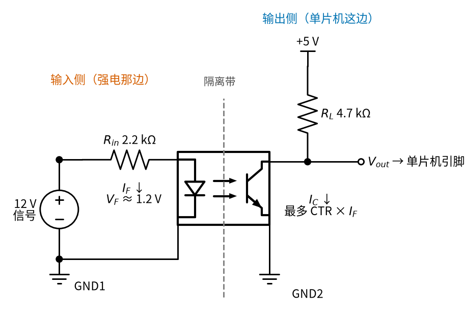
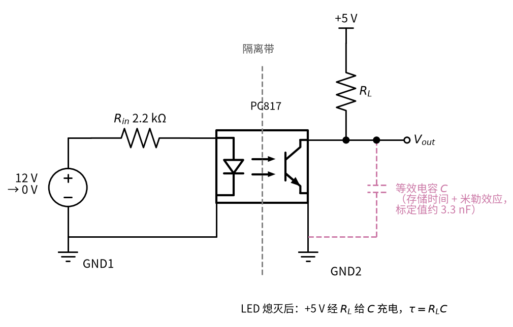
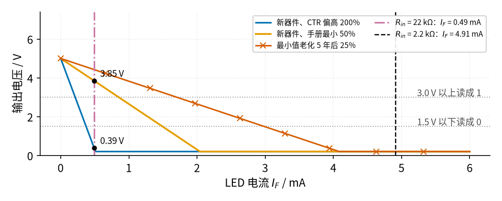
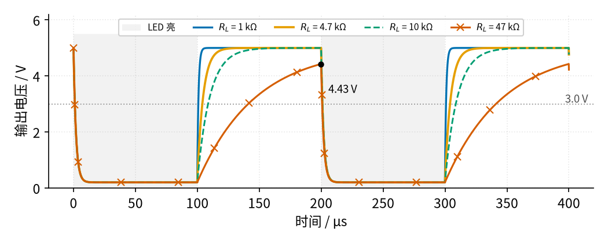
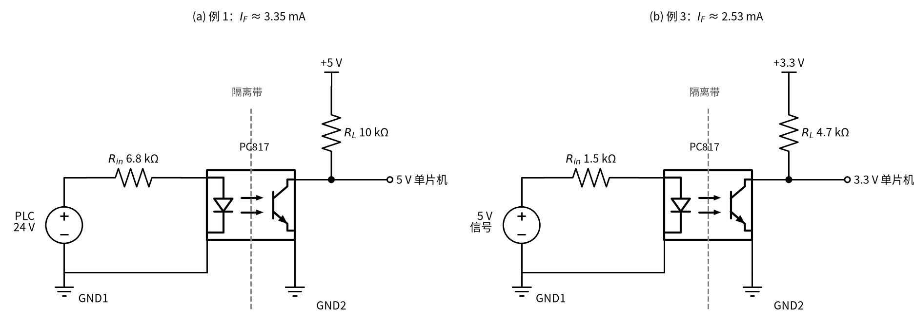
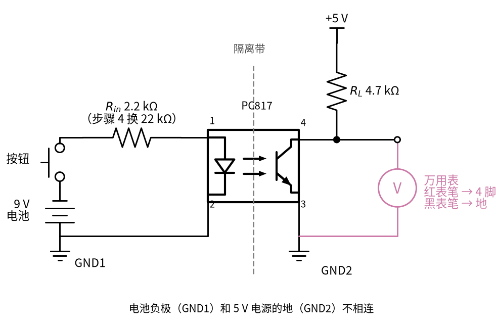
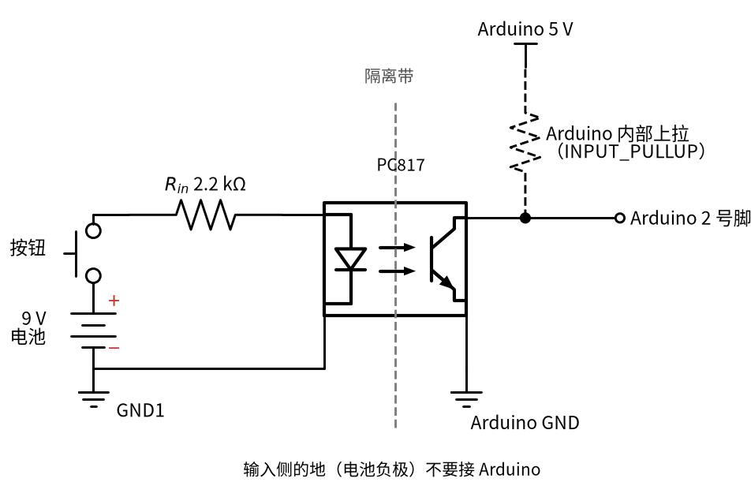

# 23 光耦隔离 · 原理与实现篇

[上一页：直觉篇](page1.md) · [直觉篇](page1.md) · 本页：原理与实现篇 · [参数与调试篇](page3.md) · [下一页：参数与调试篇](page3.md) · 前置节点：[03 半导体入门 · 直觉篇](../03-semiconductor-basics/page1.md)、[07 三极管开关与继电器驱动 · 直觉篇](../07-bjt-relay-driver/page1.md)

> [!WARNING]
> **市电危险**：本电路的实际版本接 220V/380V 市电，触电可能致命。本页的仿真和动手实验只在 12V 以下的低压电源上进行；任何接线、改线都必须在断电并验电后操作，由持证电工完成。
>
> 本节点特有的危险点：① 光耦输入侧一旦接到市电，输入电阻、LED 引脚和附近焊盘全部带电，不要因为"输出侧只有 5 V"就去碰板子；② 两侧的地必须分开，调试时示波器探头的地夹只能夹在一侧，不能同时夹两侧。

## 一、最小知识

本页只用到前置节点里的三件事：

1. LED 是二极管，导通时两端电压基本固定，电流要靠串联电阻来定（见 [03 半导体入门 · 直觉篇](../03-semiconductor-basics/page1.md)、[03 半导体入门 · 原理与实现篇](../03-semiconductor-basics/page2.md)）。光耦里的红外 LED 压降记作 $V_F$ ，PC817 手册给出典型 1.2 V、最大 1.4 V。
2. 三极管当开关用时，"想要"的电流比外电路能给的大，它就饱和， $V_{CE}$ 降到约 0.2 V，记作 $V_{CE(sat)}$ （见 [03 半导体入门 · 原理与实现篇](../03-semiconductor-basics/page2.md)）。
3. 器件参数有分散性，设计时**按最坏情况算，再留余量**（见 [07 三极管开关与继电器驱动 · 原理与实现篇](../07-bjt-relay-driver/page2.md)）。07 节用的是 β 的最小值，本节用的是 CTR 的最小值。

光敏三极管和普通三极管唯一的区别是：它的"基极电流"由照进来的光产生。所以我们不用 β，而是直接用光耦手册给的**电流传输比**，通常写成百分数：

$$
\text{CTR} = \frac{I_C}{I_F}
$$

## 二、推导：两颗电阻怎么选

请对照图 23-p2-1 看电流的走向：



*图 23-p2-1　光耦电路中的电流和电压*

**第一步：输入侧**。先用中文说：信号电压减去 LED 的压降，剩下的全落在输入电阻上。

$$
I_F = \frac{V_{in} - V_F}{R_{in}}
$$

图 23-p2-1 里 $V_{in} = 12\ \text{V}$ ， $R_{in} = 2.2\ \text{k}\Omega$ ，得 $I_F = 10.8 / 2.2 \approx 4.91\ \text{mA}$ 。

**第二步：输出侧"最多能给多少"**。光敏三极管的集电极电流最多是 LED 电流的 CTR 倍：

$$
I_{C,\max} = \text{CTR} \cdot I_F
$$

**第三步：输出侧"需要多少"**。先用中文说：要把输出拉到 0.2 V，上拉电阻 $R_L$ 两端就要有 $V_{CC} - V_{CE(sat)}$ 的电压，这需要一个确定的电流。三极管能给的必须比需要的多，它才会饱和：

$$
\text{CTR} \cdot I_F \ge \frac{V_{CC} - V_{CE(sat)}}{R_L}
$$

这和 07 节的饱和条件是同一个式子，只是把 β 换成了 CTR，把 $I_B$ 换成了 $I_F$ 。Vishay 的应用笔记 AN45 用的就是这个不等式。以图 23-p2-1 为例， $V_{CC} = 5\ \text{V}$ ， $R_L = 4.7\ \text{k}\Omega$ ，需要 $I_C \ge 4.8 / 4.7 \approx 1.02\ \text{mA}$ 。

**第四步：CTR 按多少算**？PC817 手册写的是 $I_F = 5\ \text{mA}$ 时 CTR 在 50% 到 400% 之间，同一个型号能差 8 倍。更麻烦的是 LED 会老化：手册里的曲线表明，LED 光输出在 5 年左右会降到约一半。所以本页按"最小 50%、再老化一半"取 **25%** 来设计。代入：

$$
I_F \ge \frac{1.02\ \text{mA}}{0.25} \approx 4.09\ \text{mA}
$$

2.2 kΩ 给的 4.91 mA 比这个大，够用。

**第五步：速度**。光敏三极管关断后，输出要靠 $R_L$ 给集电极上的电容充电才能回到高电平，和 RC 充电一样（见 [01 元件速成 · 直觉篇](../01-components-basics/page1.md)），快慢由时间常数决定：

$$
\tau = R_L C, \qquad t_r \approx 2.2 \tau
$$

$t_r$ 是从 10% 升到 90% 的上升时间。2.2 是这样来的：RC 充电时电压按 $1 - e^{-t/\tau}$ 上升，升到 10% 要 $\tau \ln(10/9)$ ，升到 90% 要 $\tau \ln 10$ ，两者相减就是 $\tau \ln 9 \approx 2.2\tau$ 。Vishay 的光耦开关速度笔记指出，影响速度的第一因素就是负载电阻。于是出现一个取舍： $R_L$ 越大，第三步需要的电流越小，但第五步的上升沿越慢。

难点在于"这个 C 有多大"。光耦比一个普通的 RC 电路慢得多，原因有两个：

- **存储时间**：三极管饱和时，基区里存了很多电荷。LED 灭了以后，这些电荷要慢慢放掉，集电极电流不会马上变成 0，输出会在低电平多停一会儿才开始往上爬。
- **米勒效应**：光敏三极管的基极没有外接电阻，面积又大。集电极和基极之间有一个小电容，输出电压一变化，三极管的放大作用会把它"放大"很多倍，所以输出端看到的等效电容远比管子本身的几 pF 大。

用 PC817 的 SPICE 模型（厂家给的仿真模型，CTR 取 50%）算，10 kΩ 上拉的上升时间约 83 μs。如果随便取一个 1 nF 的电容套上面的公式，只有 22 μs，快了将近 4 倍。所以下面的仿真不再用随便取的电容，而是用两个按 SPICE 结果"标定"（调到和 SPICE 对得上）的参数：描述存储时间的基区电荷时间常数 8 μs，和描述米勒效应的等效电容 3.3 nF。图 23-p2-4 把第五步对应的电路单独画出来：LED 熄灭后，+5 V 经 $R_L$ 给输出端的等效电容 $C$ 充电。



*图 23-p2-4　第五步的等效电路：上拉电阻给等效电容充电*

## 三、仿真

下面的程序用上面的分段模型（截止时输出 5 V、导通时输出 $V_{CC} - \text{CTR} \cdot I_F \cdot R_L$ 、最低 0.2 V）把第三、四、五步算一遍。A 部分比较两种输入电阻在三种 CTR 下的输出；B 部分用逐点计算把第五步的两个效应算进去：集电极电流按 8 μs 的时间常数慢慢跟上 $\text{CTR} \cdot I_F$ （LED 灭了就慢慢减到 0），输出电压再按 3.3 nF 等效电容充放电，看 4 种上拉电阻的波形。这两个参数是对着 PC817 SPICE 模型（CTR 50%）调出来的，程序最后用 assert 核对 4.7 kΩ、10 kΩ 和 47 kΩ 三种情况和 SPICE 相差不到 15%；换别的型号、别的 CTR 或布线，数值会不同。程序要在**仓库根目录**运行（第二行靠这个找到 `code/figs` 里的共享画图样式）。想改参数做实验，先复制一份：`cp code/23_sim.py my_23.py`，再改 `my_23.py`。

```python
# 23 光耦隔离最小仿真：A 部分看 CTR 和 LED 电流 I_F 能不能把输出拉低；B 部分看上拉电阻 R_L 对上升沿的影响。
# 电路：输入侧 12 V 信号 → 限流电阻 R_in → 光耦 LED → GND1；输出侧 +5 V → 上拉 R_L → 光敏三极管集电极（= 输出）→ 发射极 → GND2。
import sys, pathlib
sys.path.insert(0, str(pathlib.Path("code/figs").resolve()))  # 在仓库根目录运行
import numpy as np                                 # 数组运算
import matplotlib.pyplot as plt                    # 画图
import figstyle as fs                              # 全书统一的颜色、轴标签、保存函数

V_IN, V_F = 12.0, 1.2                              # 输入侧信号 12 V；PC817 的 LED 压降典型 1.2 V
VCC, VCE_SAT = 5.0, 0.2                            # 输出侧 5 V；光敏三极管饱和压降按手册最大 0.2 V
V_IL, V_IH = 0.3 * VCC, 0.6 * VCC                  # 5 V 单片机（ATmega328P）：低于 1.5 V 读 0，高于 3.0 V 读 1

def v_out(i_f, ctr, r_l):                          # 输出电压：光敏三极管最多给 CTR·I_F，饱和后停在 V_CE(sat)
    i_c = ctr * i_f                                # 光敏三极管"想要"导通的电流
    return np.maximum(VCE_SAT, VCC - i_c * r_l)    # 上拉电阻上的压降不可能超过 VCC − V_CE(sat)

# ---------------- A 部分：CTR 与 I_F 决定输出能不能被拉低（R_L = 4.7 kΩ） ----------------
R_L = 4700.0
I_need = (VCC - VCE_SAT) / R_L                     # 拉到饱和需要的集电极电流
print(f"[A] R_L = 4.7 kΩ：拉到饱和需要 I_C ≥ {I_need*1e3:.2f} mA；读成低电平（< {V_IL:.1f} V）需要 I_C ≥ {(VCC-V_IL)/R_L*1e3:.2f} mA")
CTRS = {"新器件、CTR 偏高 200%": 2.0, "新器件、手册最小 50%": 0.5, "最小值老化 5 年后 25%": 0.25}
i_f = np.linspace(0, 6e-3, 601)                    # LED 电流从 0 扫到 6 mA
curves = {k: v_out(i_f, c, R_L) for k, c in CTRS.items()}
for k, c in CTRS.items():
    print(f"[A] {k}：要读成低电平至少需要 I_F = {(VCC-V_IL)/R_L/c*1e3:.2f} mA，要饱和需要 {I_need/c*1e3:.2f} mA")

designs = {"R_in = 22 kΩ": 22e3, "R_in = 2.2 kΩ": 2.2e3}   # 两种设计：电流省着用 vs 按老化后的 CTR 留余量
res = {}
for name, r in designs.items():
    i = (V_IN - V_F) / r                           # LED 电流 I_F = (V_in − V_F)/R_in
    res[name] = (i, [float(v_out(i, c, R_L)) for c in CTRS.values()])
    vs = "、".join(f"{v:.2f} V" for v in res[name][1])
    print(f"[A] {name}：I_F = {i*1e3:.2f} mA；三种 CTR 下输出低电平 = {vs}")
bad, good = res["R_in = 22 kΩ"][1], res["R_in = 2.2 kΩ"][1]
assert bad[0] < V_IL and bad[1] > V_IH             # 结论 1：省电流的设计，按恒定 CTR 算，CTR 高的那只能用，换一只最小 CTR 的就读成高电平
assert max(good) < 0.25                            # 结论 2：按老化后 25% 留余量的设计，三种 CTR 都稳稳饱和
i_min_aged = I_need / 0.25
assert 3.5e-3 < i_min_aged < res["R_in = 2.2 kΩ"][0]   # 结论 3：2.2 kΩ 给的 I_F 超过"老化后仍饱和"所需的电流

fig, ax = plt.subplots(figsize=fs.SIZE["single"])
for (k, v), st in zip(curves.items(), ["vin", "vout", "bad"]):
    ax.plot(i_f * 1e3, v, **fs.LS[st], label=k)
fs.ref_h(ax, V_IL, "1.5 V 以下读成 0", x=0.98, ha="right")
fs.ref_h(ax, V_IH, "3.0 V 以上读成 1", x=0.98, ha="right")
for name, st in (("R_in = 22 kΩ", "third"), ("R_in = 2.2 kΩ", "good")):
    ax.axvline(res[name][0] * 1e3, **fs.LS[st], label=f"{name.replace('R_in', '$R_{in}$')}：$I_F$ = {res[name][0]*1e3:.2f} mA")
fs.mark(ax, res["R_in = 22 kΩ"][0] * 1e3, bad[1], "{:.2f}", " V", dx=6, dy=4)
fs.mark(ax, res["R_in = 22 kΩ"][0] * 1e3, bad[0], "{:.2f}", " V", dx=6, dy=4)
fs.axlabels(ax, "LED 电流 $I_F$", "mA", "输出电压", "V"); ax.set_ylim(0, 7.4)
ax.legend(loc="upper right", fontsize=7.5, ncol=2)
fs.save(fig, "23", "23_p2_2_ctr.png")

# ---------------- B 部分：上拉电阻越大，上升沿越慢（模型按 PC817 的 SPICE 结果标定） ----------------
# 光耦里的光敏三极管本身就慢，原因有两个：
#   ① LED 灭了以后，三极管基区里存着的电荷要慢慢放掉，集电极电流 i_C 不会立刻变 0，而是按时间常数 TAU_B 慢慢减小（LED 亮时也是慢慢增大）；
#   ② 集电极和基极之间的结电容只有十几 pF，但三极管会把它"放大"（米勒效应），在输出端看起来像一个几 nF 的电容 C_EQ。
TAU_B = 8e-6                                       # 标定值：基区电荷的时间常数 8 μs
C_EQ = 3.3e-9                                      # 标定值：输出端等效电容 3.3 nF（旧版示意值 1 nF 太小，上升时间少算 3～5 倍）
CTR_B, I_F_ON = 0.5, (V_IN - V_F) / 2.2e3          # B 部分用手册最小 CTR 50%、R_in = 2.2 kΩ（与 SPICE 核对时的条件相同）
SPICE_T3, SPICE_V47 = {4.7e3: 27.0, 10e3: 48.6}, 2.01   # PC817 SPICE 结果（review/spice/23.md）：升到 3.0 V 的时间 / μs；47 kΩ 熄灭 100 μs 后的电压 / V
f_sig, n_per = 5e3, 2                              # 5 kHz 方波，看两个周期
t = np.linspace(0, n_per / f_sig, 4001)            # 时间步长 0.1 μs
led_on = (t % (1 / f_sig)) < (0.5 / f_sig)         # 每个周期前一半 LED 亮
dt = t[1] - t[0]

def edge_wave(r_l):                                # 逐点计算：先算三极管电流，再算输出端电容的充放电
    v = np.empty_like(t); v[0] = VCC               # 开始时 LED 没亮过，输出在 5 V
    i_c, a = 0.0, np.exp(-dt / TAU_B)              # i_c：三极管此刻能导通的电流
    for k in range(1, len(t)):
        i_goal = CTR_B * I_F_ON if led_on[k] else 0.0   # LED 亮时"目标"是 CTR·I_F，灭时是 0
        i_c = i_goal + (i_c - i_goal) * a          # 但 i_c 只能按 TAU_B 慢慢追过去
        i_cap = (VCC - v[k - 1]) / r_l - i_c       # 上拉电阻送来的电流减去三极管拿走的，剩下的给电容充电
        v[k] = min(VCC, max(VCE_SAT, v[k - 1] + i_cap / C_EQ * dt))   # 输出夹在 0.2 V 和 5 V 之间
    return v

RLS = [1e3, 4.7e3, 10e3, 47e3]
waves = {r: edge_wave(r) for r in RLS}
off = (t >= 1 / f_sig / 2) & (t < 1 / f_sig)       # 第一次熄灭的那半个周期（100 μs 到 200 μs）
t_off, res_b = t[off] - t[off][0], {}
for r in RLS:
    v = waves[r][off]
    t3 = t_off[np.argmax(v >= V_IH)] if v.max() >= V_IH else float("nan")   # 熄灭后升到 3.0 V 的时间
    res_b[r] = (v[0], t3, v[-1])
    t3s = f"{t3*1e6:.1f} μs" if t3 == t3 else "半个周期内没升到"
    print(f"[B] R_L = {r/1e3:>4.1f} kΩ：LED 亮时输出 {v[0]:.2f} V；熄灭后升到 3.0 V 要 {t3s}；熄灭 100 μs 后 {v[-1]:.2f} V")
on2 = (t >= 1 / f_sig) & (t < 1.5 / f_sig)         # 第二次点亮：看下降沿
for r in (4.7e3, 10e3):
    print(f"[B] R_L = {r/1e3:>4.1f} kΩ：LED 点亮后降到 1.5 V 要 {t[on2][np.argmax(waves[r][on2] <= V_IL)]*1e6 - 200:.1f} μs")
assert 2.0 < res_b[1e3][0] < 3.0                   # 结论 4：1 kΩ 配 4.91 mA、CTR 50%，三极管给的电流不够，低电平只到 2.5 V 左右
for r, s3 in SPICE_T3.items():                     # 结论 5：标定模型和 SPICE 的差别在 15% 以内
    assert abs(res_b[r][1] * 1e6 / s3 - 1) < 0.15
assert abs(res_b[47e3][2] / SPICE_V47 - 1) < 0.15
assert res_b[47e3][2] < V_IH                       # 结论 6：47 kΩ 在半个周期内连 3.0 V 都升不到

fig, ax = plt.subplots(figsize=fs.SIZE["single"])
ax.fill_between(t * 1e6, 0, 5.5, where=led_on, color=fs.C["ref"], alpha=0.12, lw=0, label="LED 亮")
for r, st in zip(RLS, ["vin", "vout", "fb", "bad"]):
    ax.plot(t * 1e6, waves[r], **fs.LS[st], label=f"$R_L$ = {r/1e3:g} kΩ")
fs.ref_h(ax, V_IH, "3.0 V", x=0.99, ha="right")
fs.mark(ax, 199.9, res_b[47e3][2], "{:.2f}", " V", dx=-44, dy=6)
fs.axlabels(ax, "时间", "μs", "输出电压", "V"); ax.set_ylim(0, 6.2)
ax.legend(loc="upper center", fontsize=7.5, ncol=5)
fs.save(fig, "23", "23_p2_3_rise.png")
```

运行结果：

```text
[A] R_L = 4.7 kΩ：拉到饱和需要 I_C ≥ 1.02 mA；读成低电平（< 1.5 V）需要 I_C ≥ 0.74 mA
[A] 新器件、CTR 偏高 200%：要读成低电平至少需要 I_F = 0.37 mA，要饱和需要 0.51 mA
[A] 新器件、手册最小 50%：要读成低电平至少需要 I_F = 1.49 mA，要饱和需要 2.04 mA
[A] 最小值老化 5 年后 25%：要读成低电平至少需要 I_F = 2.98 mA，要饱和需要 4.09 mA
[A] R_in = 22 kΩ：I_F = 0.49 mA；三种 CTR 下输出低电平 = 0.39 V、3.85 V、4.42 V
[A] R_in = 2.2 kΩ：I_F = 4.91 mA；三种 CTR 下输出低电平 = 0.20 V、0.20 V、0.20 V
[数值] (0.490909, 3.85 V)
[数值] (0.490909, 0.39 V)
[B] R_L =  1.0 kΩ：LED 亮时输出 2.55 V；熄灭后升到 3.0 V 要 4.0 μs；熄灭 100 μs 后 5.00 V
[B] R_L =  4.7 kΩ：LED 亮时输出 0.20 V；熄灭后升到 3.0 V 要 29.5 μs；熄灭 100 μs 后 4.98 V
[B] R_L = 10.0 kΩ：LED 亮时输出 0.20 V；熄灭后升到 3.0 V 要 50.7 μs；熄灭 100 μs 后 4.55 V
[B] R_L = 47.0 kΩ：LED 亮时输出 0.20 V；熄灭后升到 3.0 V 要 半个周期内没升到；熄灭 100 μs 后 1.87 V
[B] R_L =  4.7 kΩ：LED 点亮后降到 1.5 V 要 12.4 μs
[B] R_L = 10.0 kΩ：LED 点亮后降到 1.5 V 要 10.6 μs
[数值] (199.9, 1.87 V)
```

## 四、看结果

图 23-p2-2 是 A 部分的结果，横轴是 LED 电流，纵轴是输出电压，三条曲线分别代表三只 CTR 不同的光耦：



*图 23-p2-2　三种 CTR 下输出电压随 LED 电流的变化*

图 23-p2-2 中，蓝色（CTR 200%）在 0.51 mA 就降到底，橙色（50%）要 2.04 mA，朱红色（25%）要 4.09 mA。红紫色点划线是"省电"设计 $R_{in} = 22\ \text{k}\Omega$ ， $I_F$ 只有 0.49 mA：桌上那只 CTR 高的光耦输出 0.39 V，能用；换一只手册最小值的，输出变成 3.85 V，单片机读成高电平，**等于没信号**。黑色虚线是 2.2 kΩ 的设计，4.91 mA 落在三条曲线全部到底的地方，三种情况都是 0.20 V。

注意这张图是按恒定 CTR 画的，偏乐观：CTR 在 LED 电流小的时候会变小（见本节末尾的「💡 实际芯片会怎样」）。用 PC817 SPICE 模型算，0.49 mA 时 CTR 200% 那只的输出约 2.0 V，不是 0.39 V，落进了 1.5～3.0 V 的说不清区（单片机读成高还是低说不准）；CTR 50% 那只约 4.4 V。所以"看起来能用"的那只其实也靠不住，真实的三条曲线都还要往右移。

这就是光耦最常见的坑："样机能用、批量出问题、用几年出问题"，根源都是按 CTR 的典型值甚至实测值设计。

图 23-p2-3 是 B 部分的结果。灰色阴影是 LED 亮的时间，每次 LED 熄灭，输出从 0.2 V 往 5 V 爬：



*图 23-p2-3　上拉电阻对上升沿的影响*

图 23-p2-3 里，蓝色 1 kΩ 回到高电平最快，但 LED 亮的时候只降到约 2.55 V：1 kΩ 要 4.80 mA 才能饱和，CTR 50% 只给约 2.5 mA，三极管拉不到底（SPICE 是 2.56 V），这个电压落在说不清区，单片机读不出低电平。橙色 4.7 kΩ 熄灭后升到 3.0 V 要 29.5 μs；蓝绿色 10 kΩ 要 50.7 μs，熄灭 100 μs 后才到 4.55 V；朱红色带 × 的 47 kΩ（相当于直接用单片机内部的上拉电阻，× 表示不推荐）在半个周期里根本升不到 3.0 V，熄灭 100 μs 后只有 1.87 V，单片机一直读成低电平，**信号丢了**。和 PC817 SPICE 模型对照：

| 上拉 $R_L$ | 升到 3.0 V：程序 | 升到 3.0 V：SPICE | 熄灭 100 μs 后：程序 | 熄灭 100 μs 后：SPICE |
|---|---|---|---|---|
| 4.7 kΩ | 29.5 μs | 27.0 μs | 4.98 V | 4.98 V |
| 10 kΩ | 50.7 μs | 48.6 μs | 4.55 V | 4.64 V |
| 47 kΩ | 升不到 | 升不到 | 1.87 V | 2.01 V |

下降沿也不是一下子完成的：LED 点亮后，集电极电流要先把基区电荷"充"起来，4.7 kΩ 要约 12 μs 才降到 1.5 V 以下（SPICE 12.8 μs），10 kΩ 约 11 μs（SPICE 10.1 μs）。所以：

- 信号只有几十赫兹（按钮、限位开关、继电器触点），用 10 kΩ 甚至内部上拉都没问题；
- 信号到几 kHz 以上，要把 $R_L$ 减小到 2.2 kΩ 左右（SPICE 里升到 3.0 V 约 15 μs，5 kHz 够用），同时按第三步把 $I_F$ 加大，保证 CTR 最小、老化以后也能饱和；
- 再快（串口是一位一位依次发数据的通信口，**波特率**就是每秒传多少位；9600 波特每位约 104 μs，10 kΩ 上拉的上升时间就占了八成；115200 波特每位只有约 8.7 μs），普通光耦不够用，要换 6N137 这类高速光耦，见参数与调试篇。

> **💡 实际芯片会怎样**
>
> 本页 A 部分把 CTR 当成常数。真实的 PC817 不是这样：手册的 CTR– $I_F$ 曲线显示，LED 电流降到 1 mA 以下时 CTR 明显变小。用 Sharp PC817 的 SPICE 模型（按 5 mA 时的 CTR 调好）重算图 23-p2-2，所需的 LED 电流都比图上大：
>
> | 光耦 CTR（5 mA 时） | 读成低电平：图上 | 读成低电平：SPICE | 降到底：图上 | 降到底：SPICE |
> |---|---|---|---|---|
> | 200% | 0.37 mA | 0.57 mA | 0.51 mA | 0.75 mA |
> | 50% | 1.49 mA | 1.91 mA | 2.04 mA | 2.53 mA |
> | 25% | 2.98 mA | 3.38 mA | 4.09 mA | 4.46 mA |
>
> 电流越小，差得越多。所以本页"省电流的设计不可靠"这个结论只会更站得住；2.2 kΩ、4.91 mA 的设计在 SPICE 里三种 CTR 都拉到 0.11～0.21 V，照样可靠。

## 五、渐隐例题

**例 1（完整）**：PLC（可编程逻辑控制器，工厂控制柜里常见的那种"工业电脑"）输出 24 V 信号，单片机 5 V，上拉 $R_L = 10\ \text{k}\Omega$ ，CTR 按 25% 设计。求 $R_{in}$ 和它的功耗。

- 输出需要： $I_C \ge (5 - 0.2) / 10\ \text{k}\Omega = 0.48\ \text{mA}$ 。
- LED 至少要： $I_F \ge 0.48 / 0.25 = 1.92\ \text{mA}$ 。目标取 3 mA，多留一点。
- 电阻： $R_{in} = (24 - 1.2) / 3\ \text{mA} = 7.60\ \text{k}\Omega$ ，取标准值 6.8 kΩ（取小一档，电流只会更大）。
- 核对： $I_F = 22.8 / 6.8 \approx 3.35\ \text{mA}$ ，在 PC817 最大 50 mA 以内；功耗 $P = I_F^2 R_{in} \approx 76\ \text{mW}$ ，普通 1/4 W 电阻足够。

例 1 和例 3 的电路见图 23-p2-5，结构都和图 23-p2-1 一样，只是电压和电阻值不同。



*图 23-p2-5　(a) 例 1 的电路；(b) 例 3 的电路（输入电阻取答案中的 1.5 kΩ）*

**例 2（填空）**：12 V 信号，单片机 5 V， $R_L = 4.7\ \text{k}\Omega$ ，CTR 按 25%。 $I_C \ge (5 - \square) / 4.7\ \text{k}\Omega$ ， $I_F \ge I_C / \square$ ， $R_{in} \le (12 - \square) / I_F$ 。

<details><summary>答案</summary>

$I_C \ge (5 - 0.2) / 4.7\ \text{k}\Omega \approx 1.02\ \text{mA}$ ； $I_F \ge 1.02 / 0.25 \approx 4.09\ \text{mA}$ ； $R_{in} \le (12 - 1.2) / 4.09\ \text{mA} \approx 2.64\ \text{k}\Omega$ 。取 2.2 kΩ，得 4.91 mA，正是图 23-p2-1 的取值。

</details>

**例 3（变体迁移）**：单片机换成 3.3 V 的，输入信号是 5 V（电路见图 23-p2-5(b)）， $R_L = 4.7\ \text{k}\Omega$ 。你买的光耦 CTR 最小 80%，按老化打对折算 40%。 $R_{in}$ 最大能取多少？3.3 V 单片机按 0.3 倍电源电压算，低电平门限是多少？

<details><summary>答案</summary>

低电平门限 $0.3 \times 3.3 = 0.99\ \text{V}$ ，饱和时 0.2 V 远低于它。输出需要 $I_C \ge (3.3 - 0.2) / 4.7\ \text{k}\Omega \approx 0.66\ \text{mA}$ ，所以 $I_F \ge 0.66 / 0.4 \approx 1.65\ \text{mA}$ ， $R_{in} \le (5 - 1.2) / 1.65\ \text{mA} \approx 2.30\ \text{k}\Omega$ 。标准值 2.2 kΩ 虽然也不超过 2.30 kΩ，但它给的 $(5 - 1.2) / 2.2\ \text{k}\Omega \approx 1.73\ \text{mA}$ 只比下限 1.65 mA 多约 5%，余量太小，所以再降一档取 1.5 kΩ，得 2.53 mA。注意手册的 CTR 是在 $I_F = 5\ \text{mA}$ 测的，电流小到 1 mA 以下 CTR 会更分散，所以电流不要取得太省。

</details>

## 六、低压动手实验

> [!WARNING]
> **市电危险**：本电路的实际版本接 220V/380V 市电，触电可能致命。本页的仿真和动手实验只在 12V 以下的低压电源上进行；任何接线、改线都必须在断电并验电后操作，由持证电工完成。
>
> 本节点特有的危险点：① 本实验输入侧只用 9 V 电池，**不要**把输入侧换成插座或任何市电信号；② 两侧的地（电池负极和 5 V 电源的地）不要连在一起，否则实验失去意义。

材料：PC817（或 4N25）一只、9 V 电池、5 V 电源（USB 充电头或单片机板的 5 V 引脚）、2.2 kΩ、22 kΩ、4.7 kΩ 电阻各一、按钮一个、万用表。

按图 23-p2-6 接线：

1. 输入侧：9 V 电池正极 → 按钮 → 2.2 kΩ → 光耦 1 脚（LED 正极），光耦 2 脚 → 电池负极。
2. 输出侧：5 V → 4.7 kΩ → 光耦 4 脚（集电极），光耦 3 脚（发射极）→ 5 V 电源的地。万用表黑表笔接 5 V 电源的地，红表笔接 4 脚。
3. 不按按钮，读数应接近 5 V。按下按钮， $I_F \approx (9 - 1.2) / 2.2\ \text{k}\Omega \approx 3.55\ \text{mA}$ ，即使 CTR 只有 50% 也能给 1.77 mA，大于需要的 1.02 mA，读数应降到约 0.2 V。
4. 先断开 9 V 电池，把 2.2 kΩ 换成 22 kΩ，再接回电池， $I_F$ 只有 0.35 mA。模型估算：CTR 50% 的光耦读数约 4.17 V（拉不下来），CTR 200% 的按恒定 CTR 算约 1.67 V，但小电流下 CTR 会变小，PC817 SPICE 模型给的是约 3.0 V，所以实际读数大约在 1.7～3 V 之间。你手里的光耦读多少，就能反推它的 CTR 大约在哪个档；因为 0.35 mA 时的 CTR 比手册 5 mA 时的小，反推出来的数会偏低，只能当作下限。
5. 用万用表电阻档测电池负极和 5 V 电源地之间：应该是开路。这就是"隔离"。



*图 23-p2-6　低压动手实验接线（步骤 4 把 2.2 kΩ 换成 22 kΩ）*

以上数值都是模型估算，未经实测，真实读数会随器件 CTR 不同而变化。

如果用 Arduino 读这个信号，可以去掉 4.7 kΩ，改用内部上拉（ArduinoGetStarted 的做法），接法见图 23-p2-7。



*图 23-p2-7　用 Arduino 读光耦：去掉 4.7 kΩ，改用 2 号脚的内部上拉*

下面的程序**未经运行验证**：

```cpp
// 未经运行验证：光耦 4 脚接 Arduino 2 号脚，3 脚接 Arduino GND；输入侧的地不要接 Arduino
void setup() {
  Serial.begin(9600);
  pinMode(2, INPUT_PULLUP);      // 内部上拉 20–50 kΩ，只适合慢信号
}
void loop() {
  if (digitalRead(2) == LOW) Serial.println("有信号");   // 反相：读到低 = LED 亮
  else Serial.println("无信号");
  delay(200);
}
```

内部上拉在 20 kΩ 到 50 kΩ 之间，属于图 23-p2-3 里最慢的那一类，读按钮没问题，读快速脉冲就不行了。

## 参考资料

- Sharp，PC817XxNSZ1B 系列数据手册（CTR 50% 到 400%、 $V_F$ 典型 1.2 V、 $V_{CE(sat)}$ 最大 0.2 V、 $I_F$ 最大 50 mA、LED 老化曲线）：https://global.sharp/products/device/lineup/data/pdf/datasheet/PC817XxNSZ1B_e.pdf
- Vishay，AN45 Application of Optocouplers（饱和条件 $R_L \ge (V_{CC} - V_{CE(sat)}) / (I_F \cdot \text{CTR})$ 和 CTR 降额）：https://www.vishay.com/doc/?83706=
- Vishay，Optocoupler Switching Speed（负载电阻是影响速度的第一因素）：https://www.vishay.com/docs/83590/fastswit.pdf
- Microchip，ATmega328P 数据手册（低电平 ≤ 0.3 VCC、高电平 ≥ 0.6 VCC、内部上拉 20 kΩ 到 50 kΩ）：https://ww1.microchip.com/downloads/en/DeviceDoc/Atmel-7810-Automotive-Microcontrollers-ATmega328P_Datasheet.pdf
- ArduinoGetStarted，Arduino – PC817 Optocoupler（INPUT_PULLUP 接法、读到 LOW 表示有信号）：https://arduinogetstarted.com/tutorials/arduino-pc817-optocoupler-monitor-12v-24v-dc-input-signal
- Shutdown Circuit，Optocoupler Isolated Digital Signal（CTR 至少留 2 倍余量）：https://shutdowncircuit.com/blocks/optocoupler/
