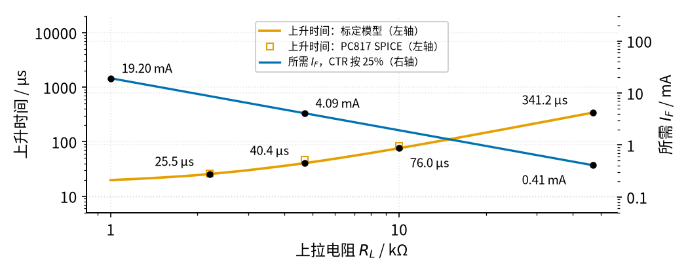
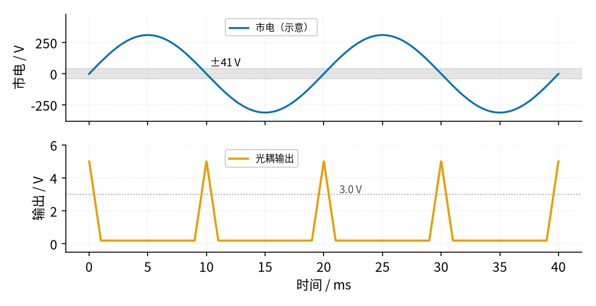

# 23 光耦隔离 · 参数与调试篇

[上一页：原理与实现篇](page2.md) · [直觉篇](page1.md) · [原理与实现篇](page2.md) · 本页：参数与调试篇 · [下一页：动手实验篇](page4.md) · 前置节点：[P2 半导体入门 · 直觉篇](../P2-semiconductor-basics/page1.md)、[22 三极管开关与继电器驱动 · 直觉篇](../22-bjt-relay-driver/page1.md)

> [!WARNING]
> **市电危险**：本电路的实际版本接 220V/380V 市电，触电可能致命。本页的仿真和动手实验只在 12V 以下的低压电源上进行；任何接线、改线都必须在断电并验电后操作，由持证电工完成。
>
> 本节点特有的危险点：① 本页第三节的市电过零检测只讲原理，**不要动手做**；② 光耦标的隔离电压是器件本身的能力，整块板子能不能承受，还取决于两侧走线之间的距离和绝缘，这些不是本教程能教会的。

## 一、参数表

三种常见光耦的关键参数（数值摘自各自的数据手册，"—"表示本表不讨论）：

| 参数 | PC817（Sharp） | 4N25（Vishay） | 6N137（Vishay） | 设计时怎么用 |
|---|---|---|---|---|
| 输出类型 | 光敏三极管 | 光敏三极管（引出基极） | 逻辑门输出，需外接上拉 | 三极管型按本节公式算；6N137 输出侧要单独供电 |
| 电流传输比 CTR | 50% 到 400%（ $I_F = 5\ \text{mA}$ ） | 至少 20%（ $I_F = 10\ \text{mA}$ ） | — | 按最小值再打对折设计 |
| LED 压降 $V_F$ | 典型 1.2 V，最大 1.4 V | — | — | 算 $R_{in}$ 用典型值即可 |
| LED 最大电流 | 50 mA | — | — | 正常设计取 3 mA 到 10 mA |
| 饱和压降 $V_{CE(sat)}$ | 典型 0.1 V，最大 0.2 V | — | — | 远低于单片机低电平门限 |
| 集电极–发射极耐压 | 80 V | — | — | 输出侧电压不要超过它 |
| 隔离电压 | 5 kV（有效值） | 5000 V（有效值） | — | 器件能力，不等于整板能力 |
| 速度 | 上升 4 μs、下降 3 μs（负载 100 Ω 时） | 上升、下降各约 2 μs | 10 MBd（每秒 1000 万个码元，可以理解为每秒传 1000 万位），传输延迟典型 48 ns | 负载电阻越大越慢 |
| 输出侧电源 | 随意（不超过耐压） | 随意（不超过耐压） | 4.5 V 到 5.5 V | 6N137 忘了供电就没有输出 |

注意 PC817 手册里的速度是在负载只有 100 Ω 的条件下测的。实际电路里上拉通常是几 kΩ，速度要慢得多，这正是图 23-p3-1 要说明的：

*图 23-p3-1　上拉电阻的取舍：速度和 LED 电流*

图 23-p3-1 画出两条线。橙色是上升时间，左轴，用的是原理与实现篇按 PC817 SPICE 模型标定的程序（CTR 50%、 $I_F$ = 4.91 mA），空心方块是 SPICE 本身的结果：2.2 kΩ 时 25.5 μs（SPICE 25.8 μs），4.7 kΩ 时 40.4 μs（SPICE 46.9 μs），10 kΩ 时 76.0 μs（SPICE 83.5 μs），47 kΩ 时 341.2 μs。程序比 SPICE 略快，真实器件只会更慢；1 kΩ 附近这组电流已经拉不到底，那一段曲线只作参考。和手册的"上升 4 μs"比，几 kΩ 上拉时慢了十倍以上，原因就是原理与实现篇第五步讲的存储时间和米勒效应。蓝色是保证饱和所需的 LED 电流（CTR 按 25%），右轴：1 kΩ 要 19.20 mA，4.7 kΩ 要 4.09 mA，47 kΩ 只要 0.41 mA。两条线方向相反，没有"两全"的点。一般的经验是：

- 慢信号（按钮、限位开关、继电器触点，几十赫兹以下）：上拉 4.7 kΩ 到 10 kΩ， $I_F$ 3 mA 到 5 mA；
- 几 kHz 的脉冲：上拉 2.2 kΩ 左右（SPICE 里升到 3.0 V 约 15 μs）， $I_F$ 加大到 9 mA 到 10 mA（按 CTR 25% 算，需要 $(5 - 0.2) / 2.2\ \text{k}\Omega \div 0.25 \approx 8.7\ \text{mA}$ ）；如果要用 1 kΩ， $I_F$ 就得约 19.2 mA，接近 PC817 上限 50 mA 的四成，要核对 $R_{in}$ 的功耗。千万不要只把上拉减到 1 kΩ 而 $I_F$ 还停在 10 mA：按 25% 算 $I_C$ 最多 2.5 mA，输出只能拉到 $5 - 2.5 \times 1 = 2.5\ \text{V}$ ，正好落在单片机高、低电平之间的"说不准"区域；
- 更快的信号：换高速光耦，见第三节。

还有两个与图 23-p3-1 方向相反的细节，来自 Vishay 的两份应用笔记：CTR 越高，开通越快但**关断越慢**，因为三极管饱和得更深；4N25 这类引出基极的光耦，可以在基极和发射极之间接一个电阻加快关断，代价是 CTR 变小。所以"挑一只 CTR 最高的"并不总是好事。

## 二、故障排查

| 现象 | 原因 | 怎么查 | 怎么改 |
|---|---|---|---|
| 有信号时单片机仍读到高电平，或时好时坏 | $I_F$ 太小，按 CTR 典型值或实测值设计；用久了 LED 老化 | 输入侧接市电时先请电工断电，不要自己去量；低压输入侧可直接测 $R_{in}$ 两端电压，除以电阻得 $I_F$ ；测有信号时输出电压是否低于 1.5 V | 断电后再换件：按 CTR 25% 重算，减小 $R_{in}$ 或增大 $R_L$ |
| 没有信号时输出也是低电平 | 前级（如 PLC、传感器）关断时仍有漏电流，LED 微亮 | 先断电（市电输入请电工），再断开输入线，重新给输出侧上电，看输出是否回到 5 V | 断电后在 LED 两端并一只 4.7 kΩ 到 10 kΩ 的泄放电阻 |
| 程序逻辑全反了 | 光耦输出是反相的 | 对照原理与实现篇的分析：LED 亮 = 输出低 | 程序里取反，不要改电路 |
| 慢信号正常，快信号（串口）乱码 | 上拉电阻太大，上升沿太慢；普通光耦只适合几 kHz | 示波器看输出上升沿占一位时间的比例；探头的地夹只能夹在输出侧 GND2 上，输入侧接市电时请电工 | 断电后再改：减小 $R_L$ 、加大 $I_F$ ，或换 6N137 |
| 加了光耦，干扰还在 | 两侧的地被某根线、某颗电阻或电容连在了一起 | 断电后用万用表测 GND1 与 GND2 之间，应为开路 | 断电后去掉连接；输出侧电源也不能取自输入侧 |
| LED 烧坏、光耦发烫 | 没串 $R_{in}$ 或电阻太小，电流超过 50 mA | 先断电（市电输入请电工），再按 $(V_{in} - V_F)/R_{in}$ 重算 | 断电后加电阻，一般 3 mA 到 10 mA 足够 |
| 6N137 完全没有输出 | 输出侧没有接 4.5 V 到 5.5 V 电源，或漏接上拉 | 测 6N137 电源脚电压 | 断电后按手册接电源和上拉电阻 |

排查顺序建议：先断电测 GND1 和 GND2 是否真的分开（这是隔离的前提），再测 $I_F$ ，再测输出的高、低电平，最后才用示波器看速度。

## 三、变体

**高速光耦 6N137**：内部是光电二极管加放大器和逻辑门，传输速率 10 MBd，延迟只有几十纳秒，适合串口、SPI（单片机和芯片之间常用的一种高速串行接口）等通信。代价是输出侧必须有 5 V 电源，而且它不再有"CTR"这个概念，按手册给的 LED 电流驱动即可。

**交流输入光耦**：内部是两只反向并联的 LED（Vishay 的这类器件就是如此），正、负半周都能点亮，可以直接检测交流信号而不用先整流。

**市电过零检测（原理示意，不要动手做）**：

> [!WARNING]
> **市电危险**：本电路的实际版本接 220V/380V 市电，触电可能致命。本页的仿真和动手实验只在 12V 以下的低压电源上进行；任何接线、改线都必须在断电并验电后操作，由持证电工完成。
>
> 本节点特有的危险点：① 下面的图只是计算示意，输入侧整个都带 220 V，电阻耐压、功率、板子绝缘距离都要由专业人员按标准设计；② 这里的输入电阻会持续发热，示意值约 0.48 W，选错功率会烧毁甚至起火。

调光器、固态继电器要知道市电"什么时候过零"。把交流输入光耦经一只大电阻接到市电上，只有在电压接近 0 V 时 LED 才几乎不亮，输出被上拉到高电平，于是每次过零输出一个脉冲。图 23-p3-2 是按 220 V（峰值 311 V）、输入电阻 100 kΩ、上拉 10 kΩ、CTR 50% 算出的示意：

*图 23-p3-2　交流输入光耦做市电过零检测（示意）*

图 23-p3-2 下方的输出每秒出现 100 个脉冲（50 Hz，一个周期过零两次）。当市电绝对值小于约 41 V 时输出高于 3.0 V，单片机读成高电平，脉冲宽约 0.85 ms。100 kΩ 是为了算图而取的**示意值**，不是可以照抄的电路。不过可以用手册上的数字检查一下它"合不合理"，这个推理过程值得学：

1. **LED 电流够不够、会不会过大**：峰值电流 311 V ÷ 100 kΩ ≈ 3.11 mA。[Vishay H11AA1 手册](https://www.vishay.com/docs/83608/h11aa1.pdf)（一种交流输入光耦）允许的 LED 连续电流是 ±40 mA，功耗上限 120 mW。这里 LED 功耗按有效值估算只有约 2.6 mW，离上限很远。
2. **电阻自己扛不扛得住**：电阻上几乎是全部 220 V，功耗 $220^2 \div 100\ \text{k}\Omega \approx 0.48$ W。[Yageo CFR 碳膜电阻手册](https://cdn.sparkfun.com/assets/a/9/3/0/e/yageo-cfr_datasheet.pdf) 规定，电阻能长期承受的电压是 $\sqrt{P \times R}$ 和"最高工作电压"二者中较小的那个。1/4 W 的 100 kΩ 只能承受 158 V，比 220 V 低，功率也只有一半，两头都不够。1/2 W 的能承受 224 V，刚好压线，没有余量。1 W 的能承受 316 V，功率也有一倍余量。另一种常见做法是拆成两只 50 kΩ 串联，每只只分到 110 V、0.24 W。
3. **隔离够不够**：H11AA1 的重复峰值隔离电压 VIORM 是 850 V，1 分钟隔离耐压 VISO 是 5000 V（有效值），都远高于市电峰值 311 V。

这三步只说明示意值"量级上说得通"。真实产品还要看电阻的脉冲耐受能力、板上的爬电距离（两侧导体之间沿着板子表面走的最短路程，比空中直线距离更容易被灰尘、潮气"爬"通）和相关安全标准，必须由专业人员设计。即使元件都选对了，自制的市电检测板仍然要满足爬电距离和外壳绝缘的要求，业余条件做不到；真要检测市电，请买现成的、有安全认证的隔离检测模块，由电工接线。

## 四、练习

**练习 1（易）**：PC817 的 LED 电流 5 mA，CTR 按 25%，输出侧 5 V。上拉电阻最小取多少才能保证饱和？取标准值多少？

答案

三极管最多给 $I_C = 0.25 \times 5 = 1.25\ \text{mA}$ 。饱和要求 $R_L \ge (5 - 0.2) / 1.25\ \text{mA} \approx 3.84\ \text{k}\Omega$ 。取 4.7 kΩ（取大一档，需要的电流更小）。

**练习 2（中）**：用 PC817 隔离串口（波特率 = 每秒传多少位），上拉 10 kΩ，用 PC817 SPICE 模型算得上升时间约 83 μs。波特率 9600 时每一位多长？上升时间占一位的多少？换成 115200 呢？

答案

9600 波特每位 $1 / 9600 \approx 104.2\ \text{μs}$ ，上升时间约 83 μs，占一位的八成左右（约 80%），已经很勉强：波形刚升上来下一位就到了，稍有偏差就会读错。所以 9600 波特也建议把上拉减到 2.2 kΩ 并加大 $I_F$ （SPICE 里上升时间约 26 μs，只占一位的四分之一）。115200 波特每位只有约 8.7 μs，上升时间是一位的近 10 倍，信号还没升上去下一位就来了，普通光耦肯定不行，要换 6N137 这类高速光耦。

**练习 3（中）**：有人怕电流不够，在 12 V 输入侧用了 470 Ω。LED 电流是多少？电阻功耗是多少？这样设计好不好？

答案

$I_F = (12 - 1.2) / 470 \approx 23.0\ \text{mA}$ ，没超过 PC817 的 50 mA，但比需要的 4 mA 到 5 mA 大好几倍。电阻功耗 $I_F^2 R \approx 248\ \text{mW}$ ，几乎等于常用 1/4 W 电阻的额定值，没有余量，会明显发热。电流也不是越大越好，取 2.2 kΩ 左右就够了。

**练习 4（中 · 概念辨析）**：小明为了"让信号更稳定"，用一根导线把输入侧的地和单片机的地连了起来。这样做有什么后果？

答案

光耦的作用是让两侧之间没有导线。连上这根地线，强电侧的干扰电流和故障时的高电压都可以顺着它进入单片机，隔离就失效了，光耦只剩下"反相"的作用。正确做法是两侧的地保持开路，断电后用万用表测 GND1 和 GND2 之间应为开路。

**练习 5（较难 · 变体迁移）**：把 PC817 换成 4N25（参数表：CTR 至少 20%，在 $I_F = 10\ \text{mA}$ 时测得），输入信号 12 V，单片机 5 V，上拉 4.7 kΩ，LED 压降按 1.2 V 估。仍按"最小值再打对折"的规矩， $R_{in}$ 最大取多少？选什么标准值、多大功率的电阻？

答案

CTR 按 20% ÷ 2 = 10% 设计。输出要饱和： $I_C \ge (5 - 0.2) / 4.7\ \text{k}\Omega \approx 1.02\ \text{mA}$ ，所以 $I_F \ge 1.02 / 0.1 = 10.2\ \text{mA}$ ， $R_{in} \le (12 - 1.2) / 10.2\ \text{mA} \approx 1.06\ \text{k}\Omega$ 。取标准值 1 kΩ，得 $I_F = 10.8\ \text{mA}$ ，远低于 4N25 手册规定的 LED 最大电流 60 mA。电阻功耗 $10.8^2 \times 1\ \text{k}\Omega \approx 117\ \text{mW}$ ，1/4 W 电阻够用。和 PC817 的例 2 比：同样的电路，CTR 低的光耦要大约 2.5 倍的 LED 电流，这就是"按手册最小值设计"的代价。

## 参考资料

- Sharp，PC817XxNSZ1B 系列数据手册（CTR、 $V_F$ 、 $V_{CE(sat)}$ 、80 V 耐压、5 kV 隔离、速度测试条件）：https://global.sharp/products/device/lineup/data/pdf/datasheet/PC817XxNSZ1B_e.pdf
- Vishay，4N25 数据手册（CTR 至少 20%、LED 最大电流 60 mA、隔离 5000 V、上升下降约 2 μs）：https://www.vishay.com/docs/83725/4n25.pdf
- Vishay，6N137 数据手册（10 MBd、输出侧电源 4.5 V 到 5.5 V、传输延迟）：https://www.vishay.com/docs/84732/6n137.pdf
- Vishay，Optocoupler Switching Speed（负载电阻、基极–发射极电阻对速度的影响）：https://www.vishay.com/docs/83590/fastswit.pdf
- Vishay，AN04 CTR 对开关速度的影响（CTR 高则开通快、关断慢）：https://www.vishay.com/docs/80579/an04_impactcurrenttransferratiooptocouplers.pdf
- Vishay，H11AA1 交流输入光耦数据手册（LED 电流 ±40 mA、功耗 120 mW、VIORM 850 V、VISO 5000 V）：https://www.vishay.com/docs/83608/h11aa1.pdf
- Yageo，CFR 碳膜电阻数据手册（最高工作电压、RCWV = √(P·R) 与最高工作电压取小）：https://cdn.sparkfun.com/assets/a/9/3/0/e/yageo-cfr_datasheet.pdf
- Vishay，交流输入光耦数据手册（反向并联的两只 LED）：https://www.vishay.com/docs/83741/83741.pdf
- ArduinoGetStarted，Arduino – PC817 Optocoupler（漏电流的输出加泄放电阻）：https://arduinogetstarted.com/tutorials/arduino-pc817-optocoupler-monitor-12v-24v-dc-input-signal
- Shutdown Circuit，Optocoupler Isolated Digital Signal（两侧地不能用导线、电阻或电容连接；普通光耦只到几 kHz，6N137 需要输出侧电源）：https://shutdowncircuit.com/blocks/optocoupler/
