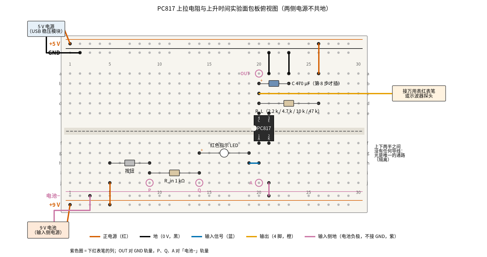
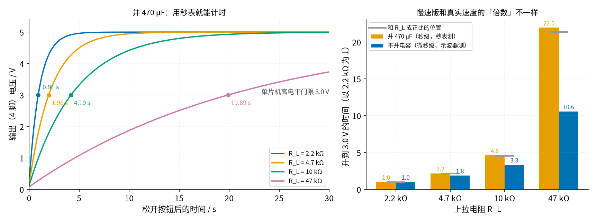

# 23 光耦隔离 · 动手实验篇

[上一页：参数与调试篇](page3.md) · [直觉篇](page1.md) · [原理与实现篇](page2.md) · [参数与调试篇](page3.md) · 本页：动手实验篇 · [下一页：16 振荡器 · 直觉篇](../16-oscillator/page1.md) · 前置节点：[P2 半导体入门 · 直觉篇](../P2-semiconductor-basics/page1.md)、[22 三极管开关与继电器驱动 · 直觉篇](../22-bjt-relay-driver/page1.md)

## 这次实验要验证什么

用一只 PC817 在面包板上搭一个最简单的光耦隔离电路：输入侧用 9 V 电池和按钮，输出侧用 5 V 电源和一只上拉电阻，两边的地不连在一起。亲手确认三件事：

1. **光能把信号传过去，电却不过去**。按下按钮，输出从约 5 V 掉到 0.2 V 以下；断电后量两侧的地之间，电阻是开路。
2. **上拉电阻越大，输出回到高电平越慢**。这是 [23 光耦隔离 · 原理与实现篇](page2.md) 第四节 B 部分的结论：LED 熄灭以后，输出要靠上拉电阻把电压「拉」回 5 V，电阻越大，拉得越慢。
3. **真实的上升时间是微秒级的，而且不和电阻成正比**。这一条只有示波器能直接看到；没有示波器时，本页用一只 470 μF 电容把过程放慢到秒级，用秒表和万用表计时，再说明这个「放慢版」和真实情况哪里一样、哪里不一样。

[23 光耦隔离 · 参数与调试篇](page3.md) 第三节讲的「市电过零检测」**本页不做**：那个电路的输入侧整个接在 220 V 上，电阻、板子、接线都要按安全标准设计，业余条件做不到。本页把「测上升时间」当作替代实验，输入侧只用 9 V 电池。

## ⚠️ 安全须知

- **不要接 220 V**。光耦的用途就是隔离市电，但本页的输入侧只接 9 V 电池（或单片机、信号发生器的 5 V 输出），不接插座、不接任何市电信号。市电部分请电工做，买有安全认证的成品模块。
- **只用 12 V 及以下的直流电**。输入侧 9 V 电池，输出侧 5 V 稳压电源，都不超过 12 V。
- **注意极性**。PC817 的 1 脚（LED 正极）要接电阻那一头，2 脚接电池负极；接反了 LED 不亮，输出没有反应。红色指示 LED 长脚是正极。470 μF 电解电容的长脚（正极）接 4 脚所在的第 20 列，短脚（外壳上有白色条纹的一侧）接 GND；接反了电容会发热、鼓包，严重时会爆开。
- **元件可能发烫**。本实验电流都只有几毫安，正常情况下没有元件会烫手；如果摸到哪个元件发热，马上断电，多半是接错了。
- **接线、改线之前先断电**。两侧都要断：先拿掉 9 V 电池扣，再关 5 V 电源。换上拉电阻、插拔电容都要断电操作；拔出电容前，先用一只 1 kΩ 电阻跨在电容两脚上几秒，把电放掉。
- **两侧的地不要连在一起**。这不是为了安全（两边都是低压），而是一连上，隔离实验就失去了意义；连接示波器时尤其要注意，见「没有示波器怎么办」一节的最后一段。

## 器材清单

| 元件 | 型号或数值 | 数量 | 说明 |
|---|---|---|---|
| 光耦 | PC817（DIP-4 封装） | 1 | 圆点或缺口标的是 1 脚；1、2 脚是 LED，3、4 脚是光敏三极管的 E、C |
| 电阻 | 1 kΩ | 1 | 输入电阻 $R_{in}$ ，配 9 V 电池 |
| 电阻 | 330 Ω | 1 | 选做：输入侧改用 5 V 方波（单片机或信号发生器）时代替 1 kΩ |
| 电阻 | 2.2 kΩ、4.7 kΩ、10 kΩ、47 kΩ | 各 1 | 上拉电阻 $R_L$ ，依次换着用 |
| 发光二极管 | 红色，直径 3 mm 或 5 mm | 1 | 串在输入回路里当「输入指示灯」 |
| 电解电容 | 470 μF，耐压 10 V 以上 | 1 | 把上升过程放慢到秒级，第 8 步才插 |
| 按钮 | 两脚轻触按钮（或四脚按钮只用对角两脚） | 1 | 手按就是「慢速方波」 |
| 9 V 电池 | 9 V 叠层电池加电池扣 | 1 | 输入侧专用电源 |
| 5 V 电源 | 面包板电源模块或 USB 5 V 充电头 | 1 | 输出侧专用电源 |
| 面包板 | 830 孔（30 列以上） | 1 | 上下各两条电源轨 |
| 跳线 | 杜邦线 | 若干 | |
| 万用表 | 带 20 V 直流挡、20 MΩ 电阻挡 | 1 | 自动量程表也可以 |
| 秒表 | 手机秒表或录像 | 1 | 慢速版计时用 |
| 示波器 | 任意双踪示波器 | 选做 | 有的话可以直接看微秒级的上升沿 |

PC817 的 LED 发的是红外光，封在黑色外壳里，人眼看不见它亮没亮。所以本页在输入回路里多串一只红色 LED：它和 PC817 的 LED 串在一起，电流相同，红灯亮就说明 PC817 的 LED 也在发光。

## 搭建步骤

电路就是 [23 光耦隔离 · 原理与实现篇](page2.md) 第六节「低压动手实验」的电路，只改了两处：输入电阻从 2.2 kΩ 换成 1 kΩ，并多串了一只红色指示 LED。为什么要换成 1 kΩ，下面的测量表后面会算。

面包板上同一列的 a–e 五个孔连通，f–j 五个孔连通，中间凹槽把上下两半隔开；上下边缘的长条是电源轨，整条横向连通。本页**故意不把上下两组电源轨连起来**：上面两条轨属于 5 V 输出侧，下面两条轨属于 9 V 输入侧。

请看图 23-p4-1：红色线是两侧的正电源，黑色线是输出侧的地（GND），紫色线是输入侧的地（电池负极），蓝色线是输入信号，橙色线是输出。



*图 23-p4-1　PC817 上拉电阻与上升时间实验的面包板接线（上半区 5 V 输出侧，下半区 9 V 输入侧，两侧不共地）*

把图 23-p4-1 的连线按节点改画成原理图，就是图 23-p4-3。左边是 9 V 输入侧，右边是 5 V 输出侧，中间的虚线是隔离带；PC817 的四个引脚都写上了引脚号和孔位，紫色圆圈和面包板图里的测量点同名。


*图 23-p4-3　与图 23-p4-1 对应的原理图（左：9 V 输入侧，地是「电池−」轨；右：5 V 输出侧，地是 GND 轨；中间虚线是隔离带）*

**对照看**：面包板的连通规则见 [P1 元件速成 · 动手实验篇](../P1-components-basics/page4.md)：同一列的 a–e 五个孔连通，f–j 五个孔连通，所以第 20 列下半区的 h20 蓝线和 f20 的 1 脚是同一个节点 A，第 20 列上半区的 c20 橙线、d20 的上拉电阻、e20 的 4 脚和后插的电容 b20 是同一个节点 OUT。原理图里隔离带左右各有一条地线：左边紫色的「电池−」轨只连 2 脚和电池负极，右边黑色的 GND 轨只连 3 脚、电容和 5 V 电源负极，没有任何一根线跨过隔离带，这就是测量表步骤 1 量到开路的原因。输入回路是一个串联圈：电池、按钮、 $R_{in}$ 、红色 LED 和 PC817 的 LED 依次串起来，所以两只 LED 电流相同；输出侧 $R_L$ 和光敏三极管上下串在 +5 V 和 GND 之间，OUT 就取在两者中间。把它和 [23 光耦隔离 · 原理与实现篇](page2.md) 「六、低压动手实验」的电路对照，只多了红色 LED 和后插的 470 μF 电容；元件怎么选的思路见同一页「二、推导：两颗电阻怎么选」。

1. **插光耦**。PC817 圆点（1 脚）朝左下，跨在中间凹槽上：1 脚 f20、2 脚 f21、3 脚 e21、4 脚 e20。先认准圆点再插，插反了后面全错。
2. **铺输出侧电源**。5 V 电源正极接上方最外侧一条轨（+5 V），负极接它下面一条（GND）。先不要开电源。
3. **接上拉电阻和发射极**。 $R_L$ 先用 4.7 kΩ，插 d20 和 d26；红线从 a26 接 +5 V 轨。黑线从 a21（3 脚 E 那一列）接 GND 轨。橙色线从 c20（4 脚 C 那一列）引出，这就是「输出」，红表笔或示波器探头都夹在这里。
4. **铺输入侧电源**。9 V 电池的正极接下方最外侧一条轨（+9 V），负极接它上面一条（电池−）。电池扣先不要扣上。
5. **接按钮、输入电阻和指示 LED**。按钮插 h5 和 h9；红线从 j5 接 +9 V 轨。 $R_{in}$ （1 kΩ）插 i9 和 i14。红色 LED 长脚插 g14，短脚插 g19；再用一根短蓝线把 h19 和 h20 连起来，接到 PC817 的 1 脚。
6. **接 2 脚**。紫色线从 j21（2 脚 K 那一列）接到「电池−」轨。
7. **检查一遍再上电**。对照图 23-p4-1 数一遍：上下两半之间除了 PC817 本身，**没有任何一根导线**跨过中间凹槽；上下两组电源轨之间也没有连线。确认后扣上 9 V 电池扣，打开 5 V 电源。此时红灯不亮，按住按钮红灯亮。
8. **（慢速版才做）插电容**。断电后，把 470 μF 电容长脚插 b20、短脚插 b23，黑线从 a23 接 GND 轨。电容并在输出和 GND 之间，专门把上升过程放慢。

图 23-p4-1 里紫色圆圈标的是要下红表笔的位置。OUT 是 4 脚所在的第 20 列上半区，黑表笔插 GND 轨（上方黑色那条）。P、Q、A 三点在输入侧：P 是按钮和 $R_{in}$ 之间的第 9 列，Q 是 $R_{in}$ 和红色 LED 之间的第 14 列，A 是 PC817 的 1 脚所在的第 20 列下半区；量它们时黑表笔要插「电池−」轨，不能插 GND。

## 测量表

「应该读到」一栏的数取自 ngspice 仿真：PC817 用仓库里的 Sharp 官方模型，按 [23 光耦隔离 · 原理与实现篇](page2.md) 第三节的方法把模型标定成 CTR 50% 和 CTR 200% 两只「样品」（标定值记录在 [spice/23/results.json](../spice/23/results.json)），红色 LED 用 LTspice 的红色 LED 模型，电路和本页完全相同。表里只写 CTR 50% 的结果，CTR 200% 的低电平更低一点。PC817 的 LED 压降一行同时给了手册的典型值和最大值。

| 步骤 | 测什么 | 红表笔 | 黑表笔 | 挡位 | 应该读到 | 读不到时先查 |
|---|---|---|---|---|---|---|
| 1 | 两侧的地之间的电阻（两侧电源都断开） | 「电池−」轨 | GND 轨 | 20 MΩ 或最高电阻挡 | OL（开路） | 有读数：哪根线跨过了凹槽，或两侧电源轨被连上了 |
| 2 | 9 V 电池电压 | +9 V 轨 | 「电池−」轨 | 直流 20 V | 约 9 V | 明显低于 8 V：换新电池 |
| 3 | 5 V 电源电压 | +5 V 轨 | GND 轨 | 直流 20 V | 约 5 V（4.75–5.25 V） | 电源模块开关、USB 线 |
| 4 | 不按按钮时的输出 | OUT（第 20 列上半区） | GND 轨 | 直流 20 V | 约 5.0 V | 0 V： $R_L$ 没接到 +5 V 轨 |
| 5 | 按住按钮时 $R_{in}$ 两端 | P（第 9 列） | Q（第 14 列） | 直流 20 V | 约 6.0 V，即 $I_F$ 约 6.0 mA；红灯亮 | 0 V 且红灯不亮：按钮没导通，或红灯插反 |
| 6 | 按住按钮时红色 LED 两端 | Q（第 14 列） | A（第 20 列下半区） | 直流 20 V | 约 1.9 V（模型值；不同型号的红色 LED 会差零点几伏） | 读到 9 V 左右：LED 插反，回路断开 |
| 7 | 按住按钮时 PC817 的 LED 两端 | A（第 20 列下半区） | 「电池−」轨 | 直流 2 V | 模型 1.07 V；手册典型 1.2 V，最大 1.4 V | 读到几伏、红灯不亮：PC817 插反了 |
| 8 | 按住按钮时的输出（ $R_L$ = 4.7 kΩ） | OUT | GND 轨 | 直流 20 V | 约 0.15 V | 高于 0.4 V：查 $R_{in}$ 是不是 1 kΩ（棕黑红） |
| 9 | 依次换成 2.2 kΩ、10 kΩ、47 kΩ，按住按钮时的输出 | OUT | GND 轨 | 直流 20 V | 约 0.20 V、0.12 V、0.08 V，都不超过 0.2 V | 2.2 kΩ 时偏高：输入电流不够，见下文 |
| 10 | 并上 470 μF， $R_L$ = 4.7 kΩ：按住按钮 3 秒后的输出 | OUT | GND 轨 | 直流 20 V | 约 0.15 V（按下后不到 1 秒就降到 1.5 V 以下） | 一直不降：电容接到了别的列 |
| 11 | 松开按钮，输出升到 3.0 V 所用时间（4.7 kΩ） | OUT | GND 轨 | 直流 20 V 加秒表 | 约 1.96 s | 远大于 2 s：查电容是不是 470 μF |
| 12 | 同上，换成 2.2 kΩ、10 kΩ、47 kΩ | OUT | GND 轨 | 直流 20 V 加秒表 | 约 0.91 s、4.19 s、19.9 s | 47 kΩ 明显偏长：电容漏电，见下文 |
| 13 | （选做，示波器，拔掉电容）LED 熄灭到输出升到 3.0 V | 探头夹 OUT | 探头地夹 GND 轨 | 示波器 1 V/格、20 μs/格 | 2.2 kΩ 约 14.6 μs，4.7 kΩ 约 27.0 μs，10 kΩ 约 48.6 μs，47 kΩ 约 154 μs；真实器件会更慢 | 看不到方波：输入侧要换成方波源，见下文 |

读表时注意三件事。

第一，步骤 5 和步骤 9 解释了为什么输入电阻要换成 1 kΩ。按 9 V 减去两只 LED 的压降算， $I_F$ 约 6.0 mA；CTR 按 50% 算，光敏三极管最多能吸 3.00 mA 的电流。上拉 2.2 kΩ 时，要把输出拉到底需要 $(5 - 0.2) / 2.2\ \text{k}\Omega \approx 2.18\ \text{mA}$ ，3.00 mA 够用；4.7 kΩ 只要 1.02 mA，10 kΩ 只要 0.48 mA，47 kΩ 只要 0.10 mA，都绰绰有余。原理与实现篇第六节用 2.2 kΩ 输入电阻、 $I_F$ 只有 3.55 mA，配 4.7 kΩ 上拉够用，但本页要换到 2.2 kΩ 上拉，CTR 低的光耦就不一定能拉到底了。

第二，步骤 8、9 的低电平随 $R_L$ 变大而变低：电阻越大，需要吸的电流越小，三极管饱和得越深。单看直流读数，47 kΩ 反而是「最好」的，这正是它容易被选错的原因。它的毛病在速度上，只有步骤 11 到 13 才看得出来。

第三，步骤 10 里按下按钮后输出下降得很快，松开后却上升得很慢。下降时是光敏三极管在放电，电流约 3 mA；上升时只能靠 $R_L$ 给电容充电，4.7 kΩ 在 5 V 下一开始也只有约 1 mA，并且越充越慢。这个「下降快、上升慢」的不对称，和不并电容时微秒级的情况方向相同。

## 没有示波器怎么办

光耦的上升沿只有几十微秒，万用表每秒只刷新几次，根本跟不上；手按按钮也只能产生「慢速方波」，一次亮几百毫秒。所以本页把实验分成两半：慢速版用秒表测，真实速度只能交给示波器或仿真。

**慢速版的原理**。在输出和 GND 之间并一只 470 μF 电容，它比光耦自身的电容大好几个数量级，上升过程就完全由「 $R_L$ 给 470 μF 充电」决定，时间常数 $\tau = R_L \cdot C$ 。从低电平 $V_L$ 升到 3.0 V 的时间是：

$$
t_{3.0} = R_L C \ln\frac{5 - V_L}{5 - 3.0}
$$

图 23-p4-2 左边是按这个公式画的四条曲线，右边是「慢速版」和「真实速度」两组上升时间的比较：



*图 23-p4-2　并上 470 μF 后的慢速上升，以及和真实（微秒级）上升时间的倍数比较*

左图里蓝色是 2.2 kΩ，0.91 s 越过 3.0 V；橙色 4.7 kΩ 是 1.96 s；绿色 10 kΩ 是 4.19 s；紫色 47 kΩ 要 19.89 s。用同样的电路做 ngspice 仿真，四个时间与公式算的完全一致，说明并了大电容以后，光耦本身的「慢」已经可以忽略。右图把每组时间都除以 2.2 kΩ 那一组：橙色柱是慢速版，倍数是 1.00、2.16、4.62、21.95，几乎正好落在灰色短横线（电阻之比 1.00、2.14、4.55、21.36）上；蓝色柱是不并电容时的真实上升时间，倍数只有 1.00、1.85、3.33、10.58。

**怎么计时**。按住按钮 3 秒，等万用表稳定在 0.2 V 以下，然后松开按钮，同时按下秒表；看着万用表读数越过 3.0 V 时再按一次秒表。红色指示 LED 熄灭的那一刻就是「输入变低」的时刻，所以也可以用手机把红灯和万用表屏幕一起录下来，回放时从红灯熄灭数到读数过 3.0 V。人按秒表的反应时间有零点几秒，2.2 kΩ 那组只有 0.91 s，误差会很大；每组至少测三次取平均，或者只看 4.7 kΩ 以上几组。

**如果手边有单片机**。可以用它的输出脚代替电池和按钮，产生更整齐的慢速方波，比如亮 3 秒、灭 30 秒。单片机输出只有 5 V，要把 $R_{in}$ 换成 330 Ω：仿真得到 $I_F$ 约 6.09 mA，和 9 V、1 kΩ 的 6.0 mA 差不多。单片机的 GND 接「电池−」轨，不要接上方的 GND 轨。还要注意一个坑：如果单片机和输出侧的 5 V 电源都插在同一台电脑的 USB 口上，两边的地会在电脑里连通，步骤 1 的开路就不成立了。

**慢速版能说明什么、不能说明什么**。它说明了「上拉电阻越大，回到高电平越慢」这个方向，也让你亲手体会到「下降快、上升慢」的不对称。但它把上升时间变成了严格和 $R_L$ 成正比，而真实的光耦不是这样：从图 23-p4-2 右边看，47 kΩ 真实只慢了约 10.58 倍，不是 21 倍。原因是不并电容时，决定速度的是光敏三极管基区里存的电荷和集电结电容的米勒效应，它们和 $R_L$ 不是简单的乘积关系。这一部分是 [23 光耦隔离 · 原理与实现篇](page2.md) 第四节和 [23 光耦隔离 · 参数与调试篇](page3.md) 第一节讨论的内容。另外，电解电容的容量误差一般是 ±20%，所以单次计时和表里的数差两成都正常；比较几组之间的**倍数**更可靠，下面的 Python 代码就是这样做的。

**只有示波器才能看到的**：不并电容时真实的微秒级上升沿和下降沿。如果你有示波器，按测量表步骤 13 做：拔掉电容，输入侧换成单片机或信号发生器输出的 0/5 V、500 Hz 方波（亮 1 ms、灭 1 ms），配 330 Ω 输入电阻。仿真给出的「LED 熄灭到输出升到 3.0 V」是 2.2 kΩ 约 14.6 μs、4.7 kΩ 约 27.0 μs、10 kΩ 约 48.6 μs、47 kΩ 约 154.4 μs；10%→90% 的上升时间分别约 25.9 μs、46.7 μs、82.8 μs、257.5 μs。这个模型在手册测试条件下比手册典型值还快，所以真实器件只会更慢。示波器的两个通道一般共用一个地，如果想用第二通道同时看输入，就会把「电池−」和 GND 连在一起；只是看波形问题不大，但做完要拆掉，再去做步骤 1。没有示波器的话，这些波形请看 [23 光耦隔离 · 原理与实现篇](page2.md) 第四节 B 部分那张四种上拉电阻的输出波形图。

## 用 Python 核对你的读数

把你量到的电源电压、电阻实际值和各步读数填进去。代码先核对直流读数（ $I_F$ 、低电平），再用 4.7 kΩ 那一组的计时反推电容的实际容量，拿它去预测其余几组的时间，偏差超过 10% 就提示。这样电容本身 ±20% 的误差就不会影响判断。

```python
import sys, pathlib
sys.path.insert(0, str(pathlib.Path("code/figs").resolve()))  # 在仓库根目录运行
# 23 光耦上拉电阻与上升时间 · 动手实验核对：填入实测值，算出期望读数并比较
import math

# ---- 1. 你量到的电源和元件（示例值，换成你自己的）----
VCC = 5.02                     # 步骤 3：+5 V 轨对 GND / V
R_IN = 990.0                   # 1 kΩ 的实际值 / Ω
CTR_MIN = 0.5                  # 按手册 CTR 最小值 50% 估算
V_TH = 3.0                     # 单片机高电平门限 / V

# ---- 2. 你量到的读数（对应测量表步骤 5、9、11、12）----
v_rin = 5.95                   # 步骤 5：R_in 两端 / V
# 上拉电阻实际值 / Ω : (按住时的低电平 / V, 松开后升到 3.0 V 的时间 / s)
runs = {2180.0: (0.19, 1.05),
        4680.0: (0.15, 2.10),
        9950.0: (0.12, 4.40),
        46800.0: (0.08, 21.5)}

warn = 0
i_f = v_rin / R_IN
print(f"I_F = {i_f*1e3:.2f} mA，按 CTR {CTR_MIN*100:.0f}% 光敏三极管最多吸 {CTR_MIN*i_f*1e3:.2f} mA")
for rl, (vl, _) in runs.items():
    need = (VCC - 0.2) / rl
    ok = CTR_MIN * i_f >= need and vl <= 0.3
    warn += not ok
    print(f"  R_L {rl/1e3:5.2f} kΩ：饱和需 {need*1e3:.2f} mA，低电平 {vl:.2f} V " + ("✓" if ok else "✗ ← 拉不到底，先查测量表最后一列"))

# 用 4.7 kΩ 那组反推电容：t = R_L·C·ln((VCC − V_L)/(VCC − 3.0))
r0 = min(runs, key=lambda r: abs(r - 4700))
vl0, t0 = runs[r0]
c_eff = t0 / (r0 * math.log((VCC - vl0) / (VCC - V_TH)))
print(f"由 {r0/1e3:.2f} kΩ 那组反推电容 C ≈ {c_eff*1e6:.0f} μF（标称 470 μF，±20% 都正常）")
print(f"{'R_L':>8}{'实测/s':>9}{'预测/s':>9}{'偏差':>9}")
for rl, (vl, t) in runs.items():
    pred = rl * c_eff * math.log((VCC - vl) / (VCC - V_TH))
    dev = (t - pred) / pred * 100
    flag = abs(dev) > 10
    warn += flag
    print(f"{rl/1e3:>6.2f} k{t:>9.2f}{pred:>9.2f}{dev:>+8.1f}%" + ("   ← 偏差太大：多测几次；47 kΩ 偏长多半是电容漏电" if flag else ""))
print("全部在范围内" if warn == 0 else f"有 {warn} 项需要检查")
```

示例数据里，4.7 kΩ 那组 2.10 s 反推出电容约 510 μF，比标称值大约 9%，在 ±20% 以内。用这个容量去预测，2.2 kΩ 那组应是约 0.97 s，示例填的 1.05 s 偏长 8.4%，这是秒表反应慢造成的，仍在 10% 以内；47 kΩ 那组只差 0.7%。如果你测出 47 kΩ 那组明显偏长，常见原因是电解电容漏电：漏电流要从 $R_L$ 上分走一部分充电电流，电阻越大，影响越明显。这些示例值只用来演示判断方法，不是哪一次的实测值。

## 实验记录表

| 项目 | 实测值 | 计算值 | 偏差 |
|---|---|---|---|
| 两侧地之间的电阻 |  | 开路 |  |
| 9 V 电池电压 / 5 V 电源电压 |  |  |  |
| $R_{in}$ 两端电压和算出的 $I_F$ |  |  |  |
| 红色 LED 压降 / PC817 LED 压降 |  |  |  |
| 不按按钮时的输出 |  |  |  |
| 按住时的输出：2.2 kΩ / 4.7 kΩ / 10 kΩ / 47 kΩ |  |  |  |
| 慢速版升到 3.0 V 的时间：2.2 kΩ |  |  |  |
| 慢速版升到 3.0 V 的时间：4.7 kΩ |  |  |  |
| 慢速版升到 3.0 V 的时间：10 kΩ |  |  |  |
| 慢速版升到 3.0 V 的时间：47 kΩ |  |  |  |
| 由 4.7 kΩ 那组反推的电容 |  |  |  |
| （选做）示波器测的上升时间 |  |  |  |

### 思考题

**1. 步骤 9 里 47 kΩ 的低电平最低、最「干净」。为什么实际设计里很少用 47 kΩ 做光耦的上拉**？

<details><summary>答案</summary>

因为它太慢。低电平低，只说明三极管饱和得深，这是电流小带来的好处；但 LED 熄灭以后，输出要靠 47 kΩ 把电压拉回去，仿真里不并电容也要约 154 μs 才升过 3.0 V。原理与实现篇第四节 B 部分里，5 kHz 方波每半个周期只有 100 μs，47 kΩ 根本来不及升到高电平。按钮、限位开关这类几十赫兹的慢信号用 47 kΩ 没问题，信号一快就不行。

</details>

**2. 慢速版里电阻翻 10 倍，时间也差不多翻 10 倍；不并电容时，10 kΩ 比 2.2 kΩ 只慢了约 3.3 倍。哪一个更能代表「真实的光耦」？为什么**？

<details><summary>答案</summary>

不并电容的那组更真实。并了 470 μF 以后，上升时间由 $R_L$ 和外加电容决定，光耦本身的特性被盖住了，所以严格成正比。不并电容时，速度由光敏三极管基区的存储电荷和集电结电容的米勒效应决定，它们和 $R_L$ 的关系不是简单的乘法，所以倍数更小。慢速版只能证明「方向」：电阻越大越慢。具体是多少微秒，要看示波器或仿真。

</details>

**3. 有同学把输出侧的 GND 和电池负极用一根线连起来，电路照样能用，按钮按下输出照样变低。那这根线有什么坏处**？

<details><summary>答案</summary>

在本实验里，两边都是低压，连上不会有危险，信号也照样能传。坏处是隔离没了：光耦存在的意义，就是让输入侧出事时（比如输入侧接的是市电，或者有很高的干扰电压）电流没有路可以流到输出侧。地连起来以后，输入侧的任何高压都能顺着这根线进到单片机。步骤 1 量出来就不再是开路。真正接市电的场合，这根线绝对不能有，而且两侧走线之间还要留出足够的爬电距离，这要由专业人员按标准设计。

</details>

## 自测清单

- 我能认出 PC817 的 1 脚，把它跨在凹槽上插好，并说清楚 1、2、3、4 脚各接哪里。
- 我能用万用表量出 $R_{in}$ 两端电压，算出 LED 电流，并判断它够不够让某个上拉电阻下的输出拉到底。
- 我能用 470 μF 电容和秒表测出不同上拉电阻下输出升到 3.0 V 的时间，并用 $t = R_L C \ln\frac{5 - V_L}{5 - 3.0}$ 核对。
- 我能说明慢速版的上升时间为什么和 $R_L$ 成正比，而真实的微秒级上升时间却不成正比。
- 我能用电阻挡确认两侧的地之间是开路，并说明为什么本页不做市电过零检测。
