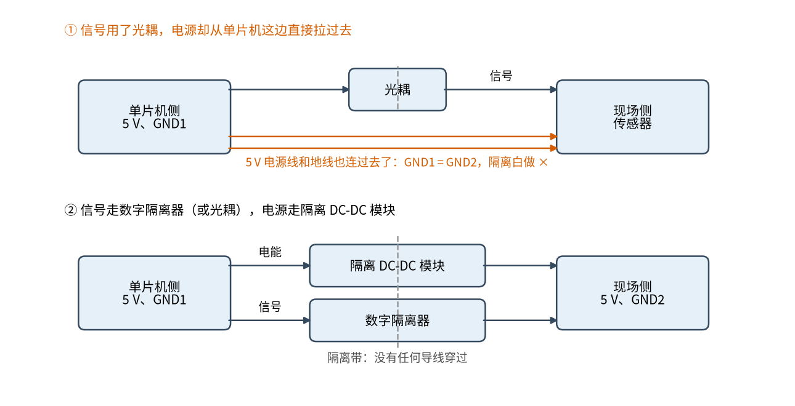
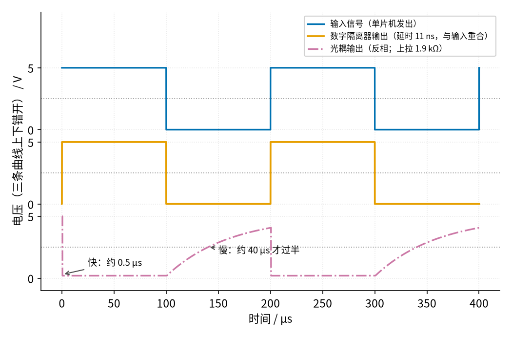

# 24 隔离电源与数字隔离器 · 直觉篇

[上一页：20 双控开关 · 参数与调试篇](../20-two-way-switch/page3.md) · 本页：直觉篇 · [原理与实现篇](page2.md) · [参数与调试篇](page3.md) · [下一页：原理与实现篇](page2.md) · 前置节点：[06 桥式整流 · 直觉篇](../06-bridge-rectifier/page1.md)、[09 开关电源 · 直觉篇](../09-switching-power-supply/page1.md)、[23 光耦隔离 · 直觉篇](../23-optocoupler/page1.md)

> [!WARNING]
> **市电危险**：本电路的实际版本接 220V/380V 市电，触电可能致命。本页的仿真和动手实验只在 12V 以下的低压电源上进行；任何接线、改线都必须在断电并验电后操作，由持证电工完成。
>
> 本节特有的危险：
> - 工频变压器的**初级**直接接 220 V。变压器只让副边和市电隔开，初级的接线端子、保险丝座、电源线本身始终带市电，不要去碰。
> - 本节用的 1 W 隔离 DC-DC 模块（以 NME0505SC 为例）手册写明它只算**功能隔离**，两侧都应保持在安全特低电压范围内（峰值 42.4 V 或直流 60 V 以下），**不能用它去隔离市电**。
> - "隔离"不等于"不带电"。被隔离的那一侧内部仍然可能有危险电压，隔离只是切断了它和另一侧之间的导电通路。
> - 示波器的地夹、电脑的 USB 线都可能把两侧的地连起来，让隔离失效（见本节参数与调试篇）。

## 一、痛点：光耦只隔离了信号

23 节用光耦把强电侧和单片机隔开：中间只有光，没有导线（见 23 page1）。可是隔离带另一边的电路也要用电。比如现场侧有一只传感器，要 5 V 供电，最省事的办法是从单片机板上拉一根 5 V 线和一根地线过去。

这样一接，问题就来了，见图 24-p1-1 的上半部分：

*图 24-p1-1　只隔离信号与电源、信号都隔离的对比*

图 24-p1-1 上半部分的两根朱红色线就是问题所在：信号虽然走了光耦，**电源线和地线却直接穿过了隔离带**。两侧的地又成了同一个地，23 节辛辛苦苦隔开的东西，被一根地线重新接上了。

下半部分是正确做法：电能和信号都要"隔着墙"传过去。传电能用**隔离电源**，传信号用光耦或者更快的**数字隔离器**。两只器件中间那条灰色虚线上，没有任何导线穿过。

## 二、类比：隔着一堵墙送水送信

把隔离带想成一堵墙，墙两边的人不能有任何"管道"相通。

- **送信**：23 节的光耦是隔着玻璃窗打手电，靠光。数字隔离器也是隔着墙传话，只不过不用光，而是用一层极薄的绝缘层构成的小电容，或者两只靠得很近的小线圈。
- **送水（电能）**：墙这边转动一只水车，带动一根穿墙的转轴，墙那边的水车跟着转。转轴不漏水，两边的水不会混在一起。变压器就是这根"转轴"：初级线圈的电流变化产生变化的磁场，副边线圈感应出电压，**两个线圈之间没有导线**。

变压器只能传**变化**的电流，这是高中物理讲过的。所以：

- 墙这边本来就是交流（市电），直接用工频变压器，副边再接 06 节的桥式整流和滤波，就得到隔离的直流。
- 墙这边是直流（比如单片机的 5 V），就先用开关把直流"切碎"成高频的脉冲（09 节的思路），过变压器，再整流滤波。把这些装进一个小盒子，就是**隔离 DC-DC 模块**。NME0505SC 这类模块手册写明，里面用的是环形隔离变压器，5 V 输入的型号开关频率约 110 kHz。

## 三、三件工具

| 工具 | 隔着墙传什么 | 靠什么穿过隔离带 | 本节的例子 |
|---|---|---|---|
| 工频变压器 + 整流滤波 | 市电的电能 | 50 Hz 的磁场 | 220 V → 12 V 变压器，整流后约 15.57 V |
| 隔离 DC-DC 模块 | 直流电能 | 约 100 kHz 的磁场 | NME0505SC：5 V 进、5 V 200 mA 出 |
| 数字隔离器 | 0 和 1 的信号 | 电容（电场）或线圈（磁场） | ISO7721：两路，典型延时 11 ns |

前两件传能量，第三件传信号。一个完整的隔离方案通常是"隔离电源 + 光耦或数字隔离器"成对出现，就像图 24-p1-1 的下半部分那样。

## 四、光耦不够快吗？

23 节的光耦用来传开关量（按钮按没按、继电器动没动）完全够用。可是要传串口、SPI 这样的数据，速度就成了问题。

TI 的白皮书 SLLA526D 把通用光耦和数字隔离器放在一起比：通用光耦接 1.9 kΩ 上拉时，输出拉低只要 0.5 µs，回升却要 40 µs；数字隔离器 ISO7721 的典型延时只有 11 ns。按这两个数字画出 5 kHz 方波经过两种器件的样子，见图 24-p1-2：

*图 24-p1-2　同一个方波经过光耦和数字隔离器（示意）*

图 24-p1-2 里，蓝色是输入，橙色是数字隔离器的输出：11 ns 的延时在这个时间尺度上根本看不出来，两条线形状一模一样。最下面红紫色点划线是光耦的输出，它和 23 节一样是反相的（输入高、输出低）。拉低很快，但回升像给电容慢慢充电，过灰色点线（2.5 V）要约 40 µs，下一个脉冲来之前只爬到约 4.07 V。

用白皮书的估算方法（最高数据率约等于 1 除以 4 倍的最大延时），这只光耦大约只能传 6.25 kbps，ISO7721 约 22.7 Mbps。常见的 115200 波特率串口，每一位只有 8.68 µs，比光耦慢的那一边（40 µs）还短，光耦根本跟不上。高速光耦能快很多，但白皮书指出，光耦的 LED 会老化，CTR 逐年下降（见 23 page2）；光耦输入要几毫安以上的电流，数字隔离器的输入只吃 ±10 µA 级别的电流。

## 五、两个地：GND1 和 GND2

隔离之后，电路里有了**两个互不相连的地**。画图和接线时有三条规矩：

1. 两侧的地分别标 GND1（单片机侧）和 GND2（现场侧），不要都写成 GND，更不要画成同一个接地符号。
2. 隔离电源和数字隔离器的引脚也分两组：VIN、GND1 在一侧，VOUT、GND2 在另一侧。每一侧的信号只能以本侧的地为参考。
3. 断电后用万用表的电阻挡测 GND1 和 GND2 之间，**应该是开路**。只要测出导通，说明有某根线、某个仪器把两侧连上了，隔离已经失效。

第三条也是本节所有动手实验的第一步。

## 六、一句话总结

光耦隔离了信号，**电源也必须隔离**：交流用工频变压器，直流用隔离 DC-DC 模块；信号要快就用数字隔离器；两侧的地分开标、分开接，断电测必须开路。

下一页把三件工具逐个拆开：变压器的匝数比怎么定，隔离模块为什么空载时电压会翻倍，以及一张完整的隔离电路图。

## 参考资料

- TI，SLLA526D《Replacing Optocouplers with Digital Isolators》白皮书（光耦与数字隔离器的延时对比表、最高数据率估算式、CTR 老化、输入电流、电容或磁耦合）：https://www.ti.com/lit/wp/slla526d/slla526d.pdf
- TI，ISO772x 数据手册 SLLSEP3G（典型延时 11 ns、每通道约 1.7 mA）：https://www.ti.com/lit/ds/symlink/iso7721.pdf
- Murata，NME 系列（NME0505SC）数据手册（功能隔离、安全特低电压范围、环形隔离变压器、开关频率）：https://pdf.digi-electronics.com/pdf/1732/NME0505SC-datasheet.pdf
- Wikipedia，Isolation transformer（变压器隔离、被隔离设备内部仍可能有危险电压）：https://en.wikipedia.org/wiki/Isolation_transformer
