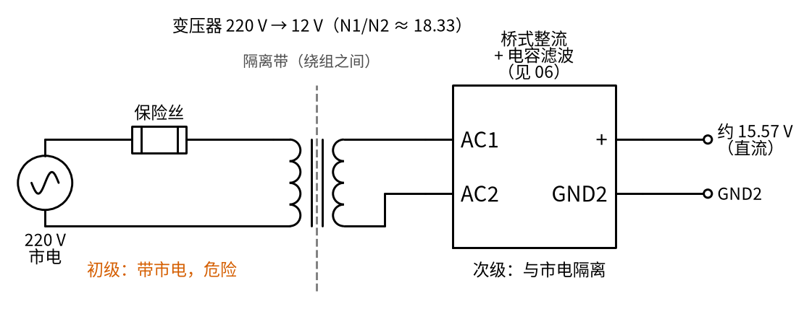
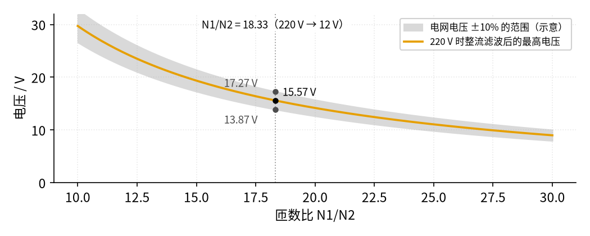
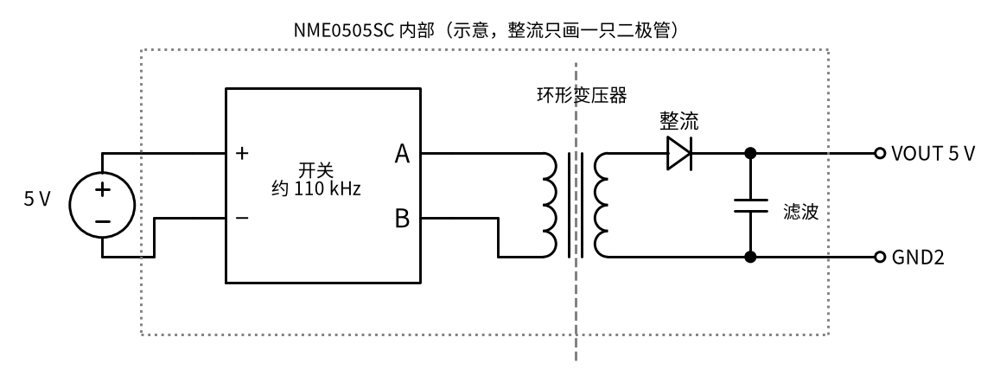
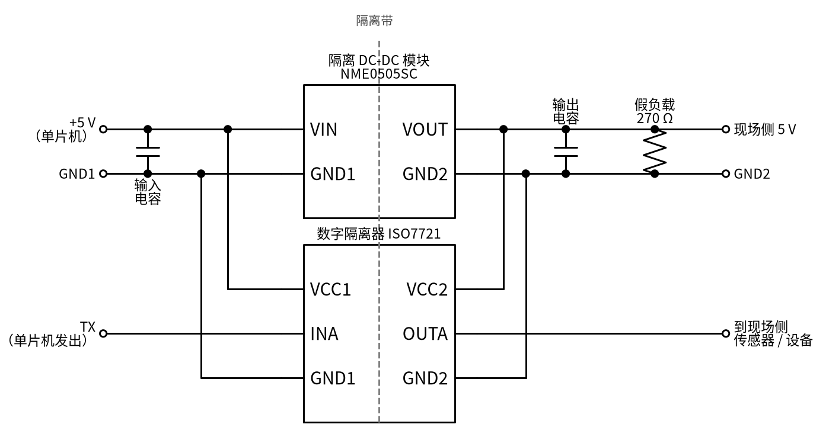
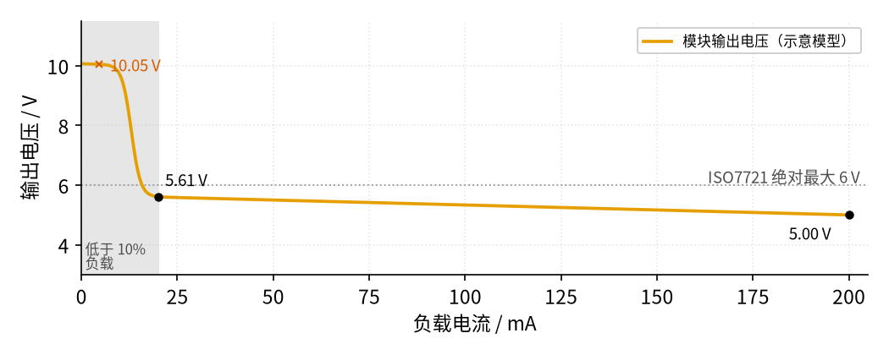
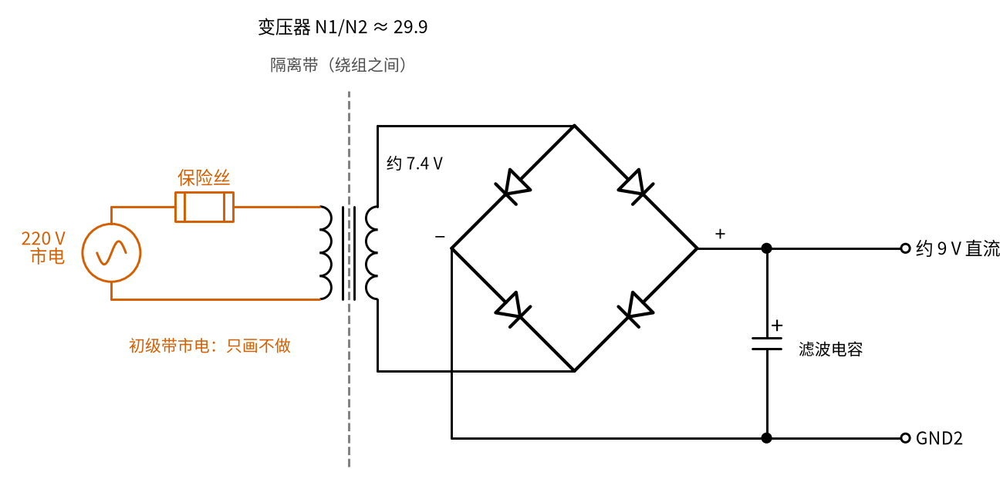
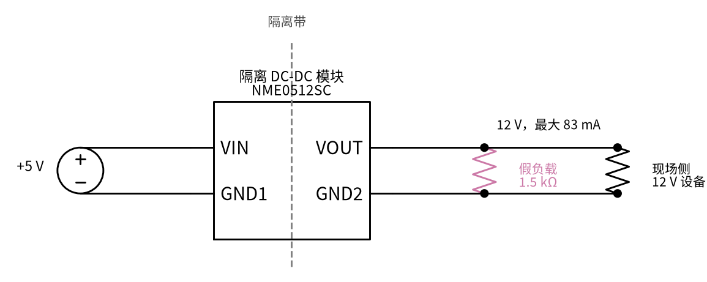
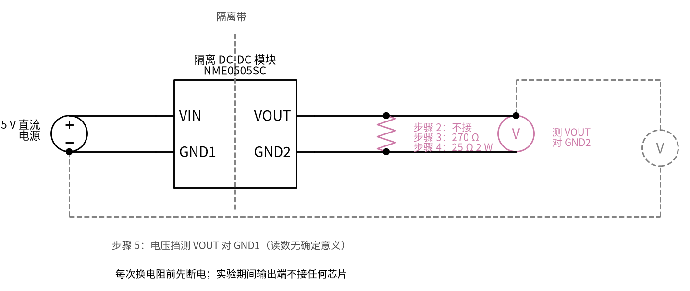

# 24 隔离电源与数字隔离器 · 原理与实现篇

[上一页：直觉篇](page1.md) · [直觉篇](page1.md) · 本页：原理与实现篇 · [参数与调试篇](page3.md) · [下一页：参数与调试篇](page3.md) · 前置节点：[06 桥式整流 · 直觉篇](../06-bridge-rectifier/page1.md)、[09 开关电源 · 直觉篇](../09-switching-power-supply/page1.md)、[09 开关电源 · 原理与实现篇](../09-switching-power-supply/page2.md)、[23 光耦隔离 · 直觉篇](../23-optocoupler/page1.md)

> [!WARNING]
> **市电危险**：本电路的实际版本接 220V/380V 市电，触电可能致命。本页的仿真和动手实验只在 12V 以下的低压电源上进行；任何接线、改线都必须在断电并验电后操作，由持证电工完成。
>
> 本节特有的危险：
> - 第二部分的工频变压器方案，**初级接 220 V**。本页只做计算，不做变压器的动手实验。真需要从市电得到隔离的低压直流，请买带外壳、有安全认证的成品适配器，不要自己去接裸变压器的初级。
> - 第三部分的 NME0505SC 类模块只是**功能隔离**，两侧都要在安全特低电压范围内（峰值 42.4 V 或直流 60 V 以下），不能拿它隔离市电。
> - 隔离模块在空载时输出会升到约两倍额定电压，接上去可能烧坏后级芯片。

直觉篇说了"电源也要隔离"。这一页回答三个问题：工频变压器的匝数比怎么定；隔离 DC-DC 模块为什么一定要带够负载；数字隔离器凭什么比光耦快。最后把它们画成一张完整的电路图。

## 一、用到的旧知识

1. **变压器**（高中物理）：理想变压器两边电压之比等于匝数之比，初级（原线圈） $N_1$ 匝、次级（副线圈） $N_2$ 匝时 $V_2 / V_1 = N_2 / N_1$ 。变压器只能传交流。
2. **整流滤波**（见 [06 桥式整流 · 原理与实现篇](../06-bridge-rectifier/page2.md)）：12 V 有效值的正弦，峰值 $V_p = \sqrt{2} \times 12 \approx 16.97$ V；桥式整流要过两只二极管，电容滤波后的最高电压 $V_{o,\max} = V_p - 2V_D \approx 15.57$ V（ $V_D$ 取 0.7 V）。
3. **开关电源**（见 [09 开关电源 · 原理与实现篇](../09-switching-power-supply/page2.md)）：开关把直流切成高频脉冲，电感或变压器存能、放能，再整流滤波。[09 开关电源 · 原理与实现篇](../09-switching-power-supply/page2.md) 第八部分的反激电源，就是"带变压器的开关电源"。
4. **光耦**（见 [23 光耦隔离 · 原理与实现篇](../23-optocoupler/page2.md)）：输入侧 LED 电流 $I_F$ ，输出侧电流 $I_C$ ，CTR $= I_C / I_F$ ；输出接上拉电阻 $R_L$ ，输出与输入反相。两侧的地分别是 GND1 和 GND2。

## 二、方案一：工频变压器 + 整流滤波

最直接的隔离电源就是一只 50 Hz 的变压器，后面接 06 节的桥式整流和电容滤波，见图 24-p2-1：



*图 24-p2-1　工频变压器隔离电源（220 V 到 12 V，再整流滤波）*

图 24-p2-1 里隔离发生在变压器的**两组绕组之间**：初级和次级是两根互不相连的漆包线，能量靠铁芯里变化的磁场过去。所以次级的地是一个新的地，记作 GND2，它和市电的零线、地线都没有导线相连。Wikipedia 的 Isolation transformer 词条也提醒两点：变压器隔断了直流通路，但两组绕组之间存在电容，交流干扰仍会少量"耦合"过去（耦合：不靠导线相连，而是经电容的电场或线圈的磁场把变化传到另一边）；另外，被隔离的一侧接上示波器之类有接地的仪器，就会重新和大地连起来（参数与调试篇会细讲）。

**匝数比怎么定**：从后往前算。想要整流后的最高电压是 $V_{o,\max}$ ，次级峰值就要 $V_{o,\max} + 2V_D$ ，次级有效值再除以 $\sqrt{2}$ 。于是

$$
\frac{N_1}{N_2} = \frac{\sqrt{2} V_1}{V_{o,\max} + 2V_D}
$$

代入 220 V 到 12 V 的变压器， $N_1 / N_2 = 220 / 12 \approx 18.33$ ，得到和 06 节一样的 15.57 V。

匝数比一旦绕好就固定了，但电网电压并不固定。下面按电网有 ±10% 的波动来示意（这个百分比是本页为了演示假设的，不是从标准里查来的），见图 24-p2-2：



*图 24-p2-2　匝数比与整流滤波后的电压*

图 24-p2-2 的橙色曲线说明：匝数比越大，输出越低，而且是反比关系。灰色点线竖线处（18.33）电网正常时是 15.57 V，电网高 10% 时升到 17.27 V，低 10% 时降到 13.87 V。**变压器 + 整流滤波本身不稳压**，电网一变，输出跟着按比例变。要稳定的 5 V 或 3.3 V，后面还得接 08 节的线性稳压（见 [08 线性稳压 · 原理与实现篇](../08-linear-regulator/page2.md)），并且按最低的 13.87 V 检查压差够不够。

## 三、方案二：隔离 DC-DC 模块

单片机板上通常只有 5 V 直流，没有市电。这时用隔离 DC-DC 模块，它把 09 节的开关电源和变压器装在了一起：

- 输入侧的开关以约 110 kHz（NME0505SC 手册给的 5 V 输入型号的开关频率）把 5 V 直流切成高频方波，加在一只环形变压器的初级上。
- 次级感应出高频方波，经整流、电容滤波（同 06 节的道理），得到隔离的 5 V。
- NME0505SC 额定 1 W（5 V 进，5 V、200 mA 出），手册写明效率约 69%，剩下的变成模块自身的热。

这三条对应的内部结构见图 24-p2-5：5 V 接到开关，开关的输出接环形变压器初级，次级经整流接到滤波电容，电容两端就是 VOUT 和 GND2。



*图 24-p2-5　隔离 DC-DC 模块内部示意（整流只画一只二极管）*

**关键的坑：它是不稳压的**。 NME 这类小模块内部没有 09 节那样的反馈回路，输出电压随负载变化。手册给的数据：

- 负载调整率典型 12%、最大 14%（负载从 10% 变到 100% 时，输出变化占额定电压的百分比）；
- 线性调整率最大 1.2 %/%（输入每变 1%，输出约变 1.2%）；
- 最小负载 10%；低于 5% 负载时，输出可能升到额定电压的约两倍。

Murata 的应用笔记 DCAN-68 解释了原因：不稳压的小功率隔离模块可能**没有任何主动限制输出电压的电路**，负载低于最小负载（一般是满载的 10%）时，输出就会超过手册规格；如果这对后级电路是个问题，就要在输出端加假负载，或者用稳压管钳位。

### 一张完整的隔离电路

把隔离模块和数字隔离器 ISO7721 组合起来，单片机侧的 5 V 同时把电能和信号送到现场侧，见图 24-p2-3：



*图 24-p2-3　隔离模块加数字隔离器的完整电路*

图 24-p2-3 有三处要看清：

1. **隔离带只穿过器件，不穿过导线**。 灰色虚线左边的每根线都接 GND1 体系，右边的都接 GND2 体系。ISO7721 两侧各有一个电源脚：VCC1 接单片机的 5 V，VCC2 接模块输出的现场侧 5 V。
2. **输入电容和输出电容**紧贴模块的引脚放，给开关电源的高频电流一个就近的回路（见 [09 开关电源 · 参数与调试篇](../09-switching-power-supply/page3.md)）。
3. **270 Ω 假负载**。现场侧只有 ISO7721（典型约 1.7 mA）和一只传感器（本页假设 3 mA），合计 4.7 mA，只占额定 200 mA 的 2.35%，远低于 10% 的最小负载。假负载就是为了把负载凑够。

下面用一个示意模型（按手册的 12% 负载调整率和"低于 5% 负载升到约两倍"拼出来的，不是实测曲线）画出输出电压随负载的变化，见图 24-p2-4：



*图 24-p2-4　不稳压隔离模块的输出电压随负载变化（示意模型）*

图 24-p2-4 里，橙色曲线在浅灰色背景（低于 10% 负载）里急剧上翘。如果不加假负载，4.7 mA 时输出约 10.05 V（朱红色叉），**远远超过 ISO7721 电源脚的绝对最大值 6 V**，芯片可能直接损坏。10% 负载（20 mA）时是 5.61 V，满载 200 mA 时是 5.00 V，两者相差 12%，正好是手册的负载调整率。

假负载怎么选：让它在 10% 负载时的电压下吃够 20 mA，即 $R = 5.6\ \text{V} / 20\ \text{mA} = 280\ \Omega$ ，取标准值 270 Ω。按模型算，加上后输出约 5.58 V，假负载功耗约 115 mW，留给现场侧的电流还有约 179 mA。

要说明一点：5.58 V 低于 ISO7721 的绝对最大值 6 V，但**高于它的推荐工作范围上限 5.5 V**（手册推荐 2.25 V 到 5.5 V）。对要求严格的设计，应改用稳压型隔离模块，或在模块后面再加一级 LDO（见 [08 线性稳压 · 原理与实现篇](../08-linear-regulator/page2.md)）。参数与调试篇会比较假负载和稳压管钳位两种补救。

## 四、数字隔离器：不用光，用电容或线圈

光耦是"电 → 光 → 电"。数字隔离器省掉了光这一步，TI 的白皮书 SLLA526D 介绍了两种做法：

- **电容耦合**：芯片里用二氧化硅（SiO₂）做绝缘层（ISO7721 手册也写明它用的是 SiO₂ 隔离层），两边各有一块金属极板，构成一只很小的电容。信号以高频变化的电场穿过绝缘层。白皮书给出二氧化硅的耐压约为每微米 500 V 有效值。
- **磁耦合**：芯片里做两只叠在一起的小线圈，像一只微型变压器。

两种做法都只让**变化的**信号穿过，所以芯片内部要先把 0/1 调制成高频信号（调制：把 0/1 变成"有没有高频信号"或高频信号的相位变化），过隔离层再还原。和光耦比，好处有三：

1. **快**。ISO7721 在 5 V 时传输延时典型 11 ns，最高 100 Mbps；通用光耦接 1.9 kΩ 上拉时回升要 40 µs（见直觉篇的对比图）。
2. **输入不用电流驱动**。光耦要几毫安的 LED 电流（见 [23 光耦隔离 · 原理与实现篇](../23-optocoupler/page2.md)），数字隔离器的输入是 CMOS 门（一种输入端几乎不取电流的数字电路输入），只吃 ±10 µA 级别的电流，单片机引脚可以直接接。
3. **不老化**。光耦的 LED 会老化，CTR 逐年下降；数字隔离器没有 LED。

代价是：**两侧都要供电**。ISO7721 的 VCC1 和 VCC2 各要 2.25 V 到 5.5 V，这正是本节要做隔离电源的原因。

## 五、用程序验证三个结论

下面的程序只用 Python 标准库，把本页的三组数字重算一遍：匝数比与输出电压、隔离模块的轻载问题、两种器件的最高数据率。模块的电压模型和上面的图用的是同一个示意模型。B 部分要"解方程"，是因为补救电路（例如假负载）吃的电流取决于输出电压，而输出电压又取决于模块的总电流，两者互相咬住；程序用二分法找出同时满足两边的那个电压。

```python
# 在仓库根目录运行（只用标准库，不需要 figstyle）
import math

# A 工频变压器：匝数比 → 整流滤波后的最高电压（后半段同 06 page2）
V1, VD = 220.0, 0.7
def vdc_max(n, v1=V1):
    return math.sqrt(2) * v1 / n - 2 * VD

n = 220 / 12
print(f"A  N1/N2 = {n:.2f}，次级峰值 {math.sqrt(2)*V1/n:.2f} V，整流后 {vdc_max(n):.2f} V")
print(f"A  电网 ±10%（示意）：{vdc_max(n, 198):.2f} ~ {vdc_max(n, 242):.2f} V")
assert abs(vdc_max(n) - 15.57) < 0.01

# B 不稳压隔离模块（NME0505SC 的示意模型）：负载越轻，电压越高
I_FULL = 0.200
def v_module(i, vin=5.0):
    x = max(i, 0.0) / I_FULL
    v = 5.0 * (1 + 0.12 * (1 - x) / 0.9)              # 10%~100% 负载：5.6 V → 5.0 V
    v += 4.4 / (1 + math.exp((x - 0.065) / 0.006))    # 低于约 5% 负载：升到约两倍
    return v * (1 + 1.2 * (vin - 5.0) / 5.0)          # 线性调整率 1.2 %/%

def solve(i_user, extra=lambda v: 0.0):
    lo, hi = 0.0, 15.0                                 # 二分法找 V = v_module(总电流)
    for _ in range(80):
        m = (lo + hi) / 2
        lo, hi = (m, hi) if v_module(i_user + extra(m)) > m else (lo, m)
    return (lo + hi) / 2

i_user = 1.7e-3 + 3.0e-3                               # ISO7721 + 传感器（示意）
v_bare = solve(i_user)
v_dum = solve(i_user, lambda v: v / 270)
print(f"B  满载 {v_module(0.2):.2f} V，10% 负载 {v_module(0.02):.2f} V")
print(f"B  只用 {i_user*1e3:.1f} mA：不处理 {v_bare:.2f} V，并 270 Ω 后 {v_dum:.2f} V（{v_dum**2/270*1e3:.0f} mW）")
assert v_bare > 6.0 > v_dum > 5.5                     # 不处理超过 ISO7721 绝对最大 6 V；补救后低于 6 V，但高于推荐上限 5.5 V

# C 最高数据率估算：1 / (4 × 最大传输延时)（SLLA526D）；ISO7721 最大延时 17 ns（5 V）
r_opto, r_iso = 1 / (4 * 40e-6), 1 / (4 * 17e-9)
print(f"C  光耦（上拉 1.9 kΩ）约 {r_opto/1e3:.2f} kbps，ISO7721 约 {r_iso/1e6:.1f} Mbps")
assert 1 / 115200 < 40e-6                              # 串口一位 8.68 µs 比 40 µs 短
```

运行结果：

```text
A  N1/N2 = 18.33，次级峰值 16.97 V，整流后 15.57 V
A  电网 ±10%（示意）：13.87 ~ 17.27 V
B  满载 5.00 V，10% 负载 5.61 V
B  只用 4.7 mA：不处理 10.05 V，并 270 Ω 后 5.58 V（115 mW）
C  光耦（上拉 1.9 kΩ）约 6.25 kbps，ISO7721 约 14.7 Mbps
```

三组输出和上面三张图、直觉篇的延时对比一一对应。断言检查了本页最重要的结论：不加假负载时 10.05 V 超过 6 V 的绝对最大值；加 270 Ω 后回到 6 V 以下，但仍高于 5.5 V 的推荐上限。

## 六、渐隐例题

**例 1（完整）**：现场侧要一个整流滤波后约 9 V 的电源，用工频变压器，匝数比 $N_1 / N_2$ 取多少？

解：次级峰值要 $9 + 2 \times 0.7 = 10.4$ V，代入第二部分的公式， $N_1 / N_2 = \sqrt{2} \times 220 / 10.4 \approx 29.9$ ，也就是次级约 7.4 V 有效值的变压器。电网高 10% 时输出约 $\sqrt{2} \times 242 / 29.9 - 1.4 \approx 10.0$ V，所以后面要接稳压的话，稳压器要能承受约 10 V 的输入（见 [08 线性稳压 · 原理与实现篇](../08-linear-regulator/page2.md)）。

例 1 的电路见图 24-p2-6，和直觉篇第二部分的变压器整流电路结构一样，只是次级换成约 7.4 V。



*图 24-p2-6　例 1：约 7.4 V 次级的变压器，整流滤波后约 9 V*

**例 2（填空）**：现场侧换成 12 V 的设备，用 NME0512SC（5 V 进、12 V 83 mA 出，手册负载调整率典型 6.5%）。按"10% 负载时的电压下吃够 10% 的电流"选假负载：

接法见图 24-p2-7：假负载并在 VOUT 和 GND2 之间，和现场侧设备并联。



*图 24-p2-7　例 2：NME0512SC 输出端并 1.5 kΩ 假负载*

- 10% 负载的电流是 ____ mA；
- 10% 负载时的电压约 $12 \times (1 + 0.065) \approx$ ____ V；
- 假负载电阻约 ____ Ω，取标准值 1.5 kΩ，功耗约 ____ W。

<details>
<summary>答案</summary>

- 10% 负载电流： $83 \times 0.1 = 8.3$ mA。
- 10% 负载时的电压约 12.78 V。
- $R = 12.78 / 0.0083 \approx 1540\ \Omega$ ，取 1.5 kΩ，实际电流约 8.52 mA，略多于 10%；功耗 $12.78^2 / 1500 \approx 0.109$ W，选 1/4 W 电阻即可。

</details>

**例 3（变体迁移）**：单片机要通过隔离带用 1 Mbps 的 SPI 发数据（每位 1 µs）。直觉篇对比图里的通用光耦（上拉 1.9 kΩ）和 ISO7721 哪个能用？若改用 ISO7721，现场侧需要几路电源？

<details>
<summary>答案</summary>

按 $1 / (4 \times \text{最大延时})$ 估算，通用光耦约 6.25 kbps，远低于 1 Mbps，不能用；ISO7721 按最大延时 17 ns 约 14.7 Mbps，够用。ISO7721 的 VCC2 要在现场侧供电（2.25 V 到 5.5 V），所以现场侧至少要一路隔离电源，例如本页的 NME0505SC，并注意最小负载。另外，ISO7721 的两路方向相反（一去一回），手册里同系列的 ISO7720 两路同方向；SPI 的时钟和数据都从单片机发出，要按线的方向选型号。

</details>

## 七、低压动手实验：看隔离模块的轻载电压

> [!WARNING]
> **市电危险**：本电路的实际版本接 220V/380V 市电，触电可能致命。本页的仿真和动手实验只在 12V 以下的低压电源上进行；任何接线、改线都必须在断电并验电后操作，由持证电工完成。
>
> 本实验只用 5 V 直流电源（实验室电源或充电宝），不接变压器、不接市电。模块空载时输出可能接近 10 V，**实验期间不要把任何芯片接到模块输出上**。

器材：NME0505SC（或同类 5 V 转 5 V、1 W 不稳压隔离模块）、5 V 直流电源、万用表两只（或一只轮流测）、270 Ω 1/4 W 电阻、25 Ω 2 W 电阻、面包板。

按图 24-p2-8 接线（步骤 1 的电阻挡测法见直觉篇第五部分）：

1. **断电测隔离**。模块不通电，万用表打电阻挡，测输入 GND1 和输出 GND2 之间，应为开路（万用表显示超量程）。再测 VIN 与 VOUT 之间，也应为开路。
2. **空载**。断电接好输入，确认输出端什么都没接，再通电，测 VOUT 对 GND2 的电压。按本页的示意模型，这时可能在 10 V 左右（实际值因模块而异，以你的实测为准）。
3. **10% 负载**。断电，在输出端并上 270 Ω，再通电测。模型预测约 5.6 V。
4. **满载**。断电，换成 25 Ω 2 W 电阻（ $5 / 25 = 0.2$ A，约 1 W，电阻会发烫，不要用手摸），再通电测。模型预测约 5.0 V。
5. **测"浮地"**。保持通电，用万用表电压挡测 VOUT 对 GND1。这个读数没有确定的意义（可能飘动），因为两侧之间没有导通的路径，现场侧的 5 V 只相对 GND2 才成立，这正是隔离的意思。



*图 24-p2-8　轻载电压实验的接线*

把三次读数和图 24-p2-4 的橙色曲线比一比：轻载电压高、满载电压低的趋势应该一致。每一步改接电阻都要先断电。

## 小结

- 工频变压器： $N_1 / N_2 = \sqrt{2} V_1 / (V_{o,\max} + 2V_D)$ ，220 V 到 12 V 时整流后约 15.57 V；本身不稳压，电网 ±10% 时在 13.87 V 到 17.27 V 之间变（图 24-p2-1、图 24-p2-2）。
- 隔离 DC-DC 模块是带变压器的开关电源；NME0505SC 这类不稳压模块要求至少 10% 负载，轻载时电压可升到约两倍（图 24-p2-3、图 24-p2-4）。
- 数字隔离器用电容或线圈穿过隔离层，快、输入电流小、不老化，但两侧都要供电。
- 两侧的地分别是 GND1 和 GND2，断电测必须开路。

## 参考资料

- Wikipedia，Isolation transformer（隔断直流、绕组间电容耦合交流、测试仪器可能使被隔离电路接地）：https://en.wikipedia.org/wiki/Isolation_transformer
- Murata，NME 系列（NME0505SC、NME0512SC）数据手册（1 W 不稳压、负载调整率、线性调整率、最小负载 10%、低于 5% 负载可升到约两倍、开关频率、效率）：https://pdf.digi-electronics.com/pdf/1732/NME0505SC-datasheet.pdf
- Murata，DCAN-68 隔离 DC-DC 模块应用笔记（不稳压模块的最小负载、假负载、稳压管钳位）：https://www.murata.com/-/media/webrenewal/products/power/appnote/dcan-68.pdf
- TI，ISO772x 数据手册 SLLSEP3G（传输延时、100 Mbps、电源电压推荐 2.25 V 到 5.5 V、绝对最大 6 V、每通道电流）：https://www.ti.com/lit/ds/symlink/iso7721.pdf
- TI，SLLA526D《Replacing Optocouplers with Digital Isolators》白皮书（电容与磁耦合、SiO₂ 耐压、光耦延时、最高数据率估算、输入电流）：https://www.ti.com/lit/wp/slla526d/slla526d.pdf
