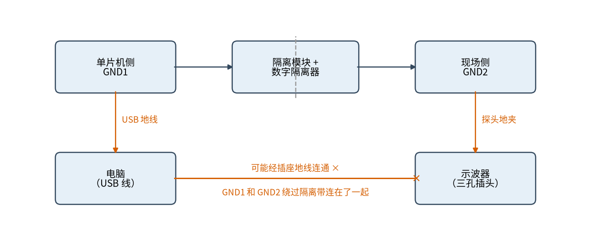
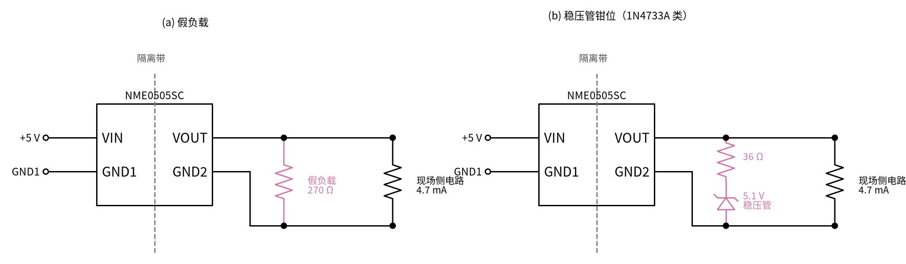
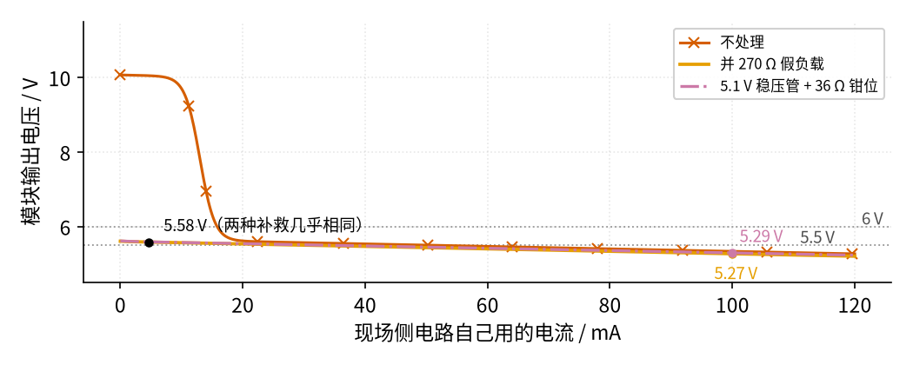
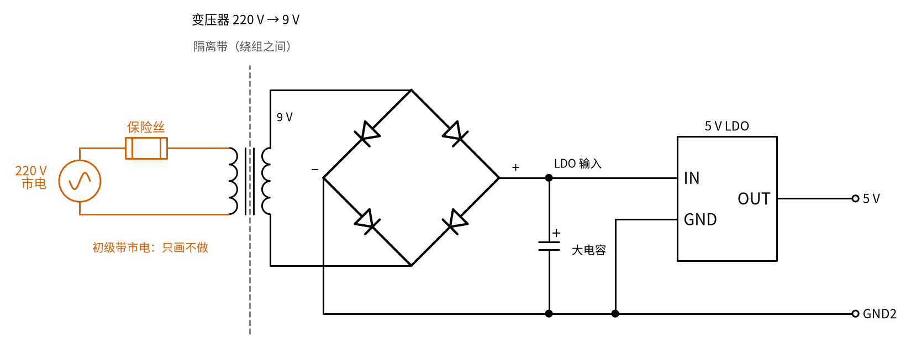

# 24 隔离电源与数字隔离器 · 参数与调试篇

[上一页：原理与实现篇](page2.md) · [直觉篇](page1.md) · [原理与实现篇](page2.md) · 本页：参数与调试篇 · [下一页：动手实验篇](page4.md) · 前置节点：[06 桥式整流 · 直觉篇](../06-bridge-rectifier/page1.md)、[09 开关电源 · 直觉篇](../09-switching-power-supply/page1.md)、[09 开关电源 · 原理与实现篇](../09-switching-power-supply/page2.md)、[23 光耦隔离 · 直觉篇](../23-optocoupler/page1.md)

> [!WARNING]
> **市电危险**：本电路的实际版本接 220V/380V 市电，触电可能致命。本页的仿真和动手实验只在 12V 以下的低压电源上进行；任何接线、改线都必须在断电并验电后操作，由持证电工完成。
>
> 本节特有的危险：
> - 工频变压器的初级接 220 V；排查变压器方案时，只在次级的低压侧测量，初级一律交给持证电工。
> - 器件上印的"隔离电压"是出厂短时测试的电压，**不是可以长期承受的电压**，更不代表能用来隔离市电（见第二部分）。
> - 示波器、电脑等接了地的仪器会把隔离的两侧连起来（见第三部分）。

## 一、参数表

| 参数 | 本节取值 | 含义 | 怎么用 |
|---|---|---|---|
| 匝数比 $N_1 / N_2$ | 18.33（220 V 到 12 V） | 初级与次级的匝数之比，等于电压之比 | 按 $\sqrt{2} V_1 / (V_{o,\max} + 2V_D)$ 定；整流后约 15.57 V（见 [24 隔离电源与数字隔离器 · 原理与实现篇](page2.md)） |
| 负载调整率 | NME0505SC 典型 12%、最大 14% | 负载从 10% 变到 100%，输出的变化量 | 不稳压模块轻载偏高、满载偏低，后级要能承受这个范围 |
| 最小负载 | 满载的 10%（20 mA） | 低于它输出超出规格；低于 5% 可升到约两倍 | 用户电流不够时加假负载或稳压管钳位（见第四部分） |
| 线性调整率 | 最大 1.2 %/% | 输入每变 1%，输出约变 1.2% | 输入 5.5 V 时空载输出按模型约 11.25 V |
| 模块隔离测试电压 | 1 kVDC，1 秒 | 出厂时每只都加这个电压测一下 | 只说明短时能扛，不是工作电压；NME 只算功能隔离 |
| 数字隔离器耐压 $V_{ISO}$ | ISO7721：DW 封装 5000 VRMS，D 封装 3000 VRMS | 60 秒鉴定测试；量产时每只加 1.2 倍、测 1 秒 | 长期工作电压看另一项（DW 封装 1500 VRMS，D 封装 450 VRMS） |
| 传输延时 | ISO7721：最小 6、典型 11、最大 17 ns（5 V） | 输入变化到输出变化的时间 | 最高数据率约 $1 / (4 \times \text{最大延时})$ ，按最大 17 ns 约 14.7 Mbps（见 [24 隔离电源与数字隔离器 · 直觉篇](page1.md)） |
| CMTI | ISO7721：最小 85、典型 100 kV/µs | 两侧地之间电压急剧跳变时，仍能正确传信号的能力 | 现场侧有大功率开关时要关心；白皮书给的高速光耦最小约 20 kV/µs |
| 电源电压 | ISO7721：每侧 2.25 V 到 5.5 V，绝对最大 6 V | 两侧各自的工作电压范围 | 隔离模块的输出要落在这个范围里 |
| 每通道电流 | ISO7721：约 1.7 mA（1 Mbps） | 每一侧的工作电流 | 算隔离电源的负载，往往远小于最小负载 |

表里有两类数字最容易误用：**耐压**和**负载**。下面逐个讲。

## 二、隔离耐压：测试电压不等于工作电压

NME0505SC 手册专门回答了一个常见问题："正常工作时，两侧之间能长期承受多高的电压？"它的答案是：1 kVDC 只是出厂时每只测 1 秒的测试电压，反映的是**对短时冲击电压的承受能力**；这个系列只被认证为**功能隔离**，两侧都应保持在安全特低电压范围内（峰值 42.4 V 或直流 60 V 以下），**绝不能当作安全隔离系统的一部分**。手册还提醒，反复做高压测试本身会让绝缘变差，确需复测时要把电压降低 20%。

ISO7721 的手册把这件事分得更细：

- $V_{ISO}$ 5000 VRMS（DW 封装）是 60 秒的鉴定测试，量产时每只加 1.2 倍、测 1 秒；
- 可以长期工作的电压是另一项"最大工作隔离电压"，DW 封装是 1500 VRMS，D 封装只有 450 VRMS；
- 同一型号有加强绝缘和基本绝缘两种等级（例如 ISO7721B 只做基本绝缘），封装越大，引脚之间的爬电距离越长（DW 封装 8 mm，D 封装 4 mm）。

这几行里的生词逐个解释：

- **VRMS**：按有效值计的伏特数，和"220 V 市电"里的 220 V 是同一种算法。
- **鉴定测试**：给一个型号做认证时，抽样把电压加到极限、看会不会击穿的测试，不是日常使用的条件。
- **加强绝缘**：单独这一层绝缘就足以保护人，相当于两道保护；**基本绝缘**只算一道保护，还需要第二道（例如接地的金属外壳）才能防触电；**功能隔离**更弱，只保证电路正常工作，完全不承担保护人的责任。
- **爬电距离**：沿着芯片封装表面，从一侧引脚走到另一侧引脚的最短距离。表面脏了、受潮了，电会沿表面"爬"过去，所以这段距离越长越安全。
- **推荐工作范围**：手册保证芯片按规格正常工作的条件；**绝对最大值**是超过就可能损坏的界限，两者之间的区域"不一定坏，但不保证正常"。

打个比方：测试电压像桥梁验收时的**极限载重测试**，开一辆超重卡车压一次，没塌就算合格；工作电压像桥头的**限载牌**，平时只能按牌子上的数通行。没人会因为桥扛住过一次超重测试，就天天按那个重量过车。

结论：**看隔离等级要看"工作电压"和"认证等级"，不要只看印在最前面的那个大数字**。 涉及市电的隔离设计，选型和验收要由有资质的工程师按相关安全标准做，本教程不展开。

## 三、示波器和 USB 线：最常见的"隔离失效"

隔离做好之后，最容易把它破坏的往往是调试工具本身。Wikipedia 的 Isolation transformer 词条提到，给被隔离的电路接上示波器、台式万用表之类的测试仪器，可能会让它重新接地。见图 24-p3-1：

*图 24-p3-1　USB 线和示波器地夹可能让两侧的地连起来*

图 24-p3-1 的路径是这样的：单片机侧通过 USB 线连到电脑，GND1 就跟电脑的地相连；现场侧用示波器测量，探头的地夹夹在 GND2 上；如果电脑和示波器都通过三孔插头接了插座的地线，那么底部那条朱红色线就成立了，**GND1 和 GND2 绕过隔离带连在了一起**。这时：

- 隔离的保护作用消失，现场侧的故障电流可以经地线窜到单片机侧；
- 如果两侧的地之间原本有电压差，地夹一夹上去就会有电流流过，可能打火、烧坏探头地线或电路板。

是否真的连通，取决于具体的电脑、电源适配器和示波器怎么接地，所以图上写的是"可能"。稳妥的做法是：

1. 一次只在**一侧**测量，测另一侧之前先拔掉这一侧的仪器连接；
2. 接好所有仪器后，**断电**用万用表测 GND1 和 GND2 之间，仍然应该是开路（同 [23 光耦隔离 · 参数与调试篇](../23-optocoupler/page3.md) 的检查方法）。

## 四、轻载电压偏高：假负载与稳压管钳位

[24 隔离电源与数字隔离器 · 原理与实现篇](page2.md) 算过：现场侧只用 4.7 mA 时，NME0505SC 的输出约 10.05 V，超过 ISO7721 的绝对最大值 6 V。Murata 的 DCAN-68 给了两种补救：

- **假负载**：在输出端并一只电阻，永远吃掉约 10% 的电流。简单，但这部分功率一直被浪费，留给用户的只剩约 90%。
- **稳压管钳位**：用"稳压管 + 串联电阻"跨在输出上。电压高时它导通吃电流，把电压往下拉；用户负载变重、电压自然降下来之后，它就几乎不导通，不再浪费功率。DCAN-68 的例子里，15 V 输出用 220 Ω 串联电阻，在负载超过约 60% 后稳压管就不再导通。

两种接法见图 24-p3-3：假负载直接并在 VOUT 和 GND2 之间；稳压管的负极朝 VOUT，和串联电阻一起跨在输出上；两种接法里现场侧电路都照常接在输出端。元件值在下一段算出。

*图 24-p3-3　两种补救的接法：(a) 假负载；(b) 稳压管钳位*

本节按 5 V 输出算：假负载取 270 Ω；稳压管用 1N4733A 类 5.1 V 稳压管，模型同 [10 稳压管稳压 · 原理与实现篇](../10-zener-regulator/page2.md)：电压 $V = V_{Z0} + r_Z I_Z$ ，击穿起点 $V_{Z0} = 5.1 - 7 \times 0.049 \approx 4.76\ \text{V}$ ，动态电阻 $r_Z = 7\ \Omega$ 。想让输出在 5.6 V 时支路吃 20 mA，总电阻要 $(5.6 - 4.76)\ \text{V} / 20\ \text{mA} \approx 42\ \Omega$ ，扣掉 $r_Z$ 的 7 Ω，串联电阻约 35 Ω，取 36 Ω。两种方案的输出电压随用户电流的变化见图 24-p3-2：

*图 24-p3-2　两种补救下模块输出电压随用户电流的变化（示意模型）*

从图 24-p3-2 能读出三件事：

1. 朱红色带叉的"不处理"曲线在用户电流很小时远高于上面那条 6 V 灰色点线，会损坏 ISO7721。
2. 用户只用 4.7 mA 时，橙色（假负载）和红紫色点划线（稳压管）都把电压拉到约 5.58 V（稳压管方案 5.59 V），两种补救效果几乎相同。这时假负载吃 20.7 mA、功耗约 115 mW；稳压管支路吃 19.3 mA。
3. 用户电流增大到 100 mA 时，两者开始不同：假负载仍然吃 19.5 mA（输出 5.27 V），稳压管支路只吃 12.4 mA（输出 5.29 V）。按这个模型，模块满载时也有约 5.0 V，始终高于击穿起点 4.76 V，所以稳压管支路**一直不会完全关断**：用户用到 180 mA 时，支路仍吃约 6.7 mA（输出 5.04 V）。所以**用户负载变化大时，稳压管钳位更省电，但没有"理想稳压管"想象的那么省**。

还要注意这是线性化模型。真实稳压管在小电流时拐点很软：1N4733A 手册在 1 mA 时的动态电阻最大 550 Ω，远大于 49 mA 时的 7 Ω，所以几 mA 以下电压会比模型低、电流也不会突然变成 0。实际选型要查所选型号的伏安曲线，拐点的讨论见 [10 稳压管稳压 · 原理与实现篇](../10-zener-regulator/page2.md)。

> **💡 实际芯片会怎样**
>
> 上面第 2、3 条的支路电流是按线性化模型（4.76 V 起击穿、再串 7 Ω）算的。换成 1N4733A 的厂家 SPICE 模型复核：输出电压几乎一样（5.61 V、5.31 V、5.06 V），但支路电流更小，用户 4.7 mA 时约 16 mA（模型 19.3 mA），100 mA 时约 8.5 mA（模型 12.4 mA），180 mA 时只剩约 3 mA（模型 6.7 mA）。原因就是上一段说的「拐点软」：真实稳压管在 5.0～5.3 V 这一段还没完全击穿，吃的电流比直线模型少。所以稳压管方案实际上比这里算的还要省电一些，结论不变。

还要再提醒一次：5.58 V 低于 6 V 的绝对最大值，但仍略高于下面那条 5.5 V 灰色点线（ISO7721 推荐工作范围的上限）。要求严格时，改用带稳压的隔离电源，或在模块后面加一级 LDO（见 [08 线性稳压 · 原理与实现篇](../08-linear-regulator/page2.md)），把现场侧稳定在 5.0 V 或 3.3 V。

## 五、变体：反激式隔离电源

功率再大一些（几瓦到几十瓦），或者需要从市电直接得到隔离的低压直流，常用**反激电源**。它的次级输出级在 [09 开关电源 · 原理与实现篇](../09-switching-power-supply/page2.md) 第八部分已经画过：初级的 MOSFET 导通时能量存进变压器，断开时经次级二极管放给电容和负载。

和本节的不稳压小模块不同，反激电源一般**带反馈**，所以输出是稳的。Wikipedia 的 Flyback converter 词条列了三种反馈方式：

- 次级用光耦把输出电压的信息送回初级（见 [23 光耦隔离 · 原理与实现篇](../23-optocoupler/page2.md)，光耦又一次用来过隔离带）；
- 在变压器上多绕一组辅助绕组，从初级这边间接感知输出；
- 初级侧检测，不需要光耦，但通常要求**最小负载**，和本节的不稳压模块是同一类问题。

手机充电器就是常见的反激电源。它的初级接市电，**只能由持证电工或专业人员处理，不要自己拆开测量**。

## 六、故障排查

下表每一步凡是要改线、拆线，都先**断电**再动手；涉及市电的成品（变压器初级、充电器内部）一律送修或交给持证电工，不要自己拆。

| 现象 | 可能原因 | 怎么查 | 怎么改 |
|---|---|---|---|
| 一上电，现场侧的芯片就发烫或损坏 | 不稳压模块负载太轻，输出升到约两倍 | 断电后断开后级，只接假负载或什么都不接，再上电测 VOUT 对 GND2 | 断电后加假负载或稳压管钳位；严格时加 LDO（见 08）或换稳压型模块 |
| 接上示波器后现场侧出现干扰、打火，或单片机复位 | 探头地夹把 GND2 接到了大地；USB 线又把 GND1 接到了大地 | 断电后接好全部仪器，测 GND1 与 GND2 之间是否开路 | 一次只在一侧测量；测另一侧前先断开这一侧的仪器 |
| 断电测 GND1 与 GND2 之间有导通 | 某根导线、屏蔽外壳（包住电路、挡外界干扰的金属壳，本身是导体）、安装螺丝跨过了隔离带 | 保持断电，逐一断开跨隔离带的连接，看何时变成开路 | 去掉桥接；隔离带两侧的线和铜皮都不相连 |
| 串口低速正常，提到 115200 波特率（每秒传多少位，见 [23 光耦隔离 · 原理与实现篇](../23-optocoupler/page2.md) 第四节）就乱码 | 用了通用光耦，回升太慢（上拉 1.9 kΩ 时约 40 µs） | 断电接好探头（只在一侧测），上电后用示波器看光耦输出的上升沿多长 | 断电后换数字隔离器；或按白皮书减小上拉电阻（100 Ω 时约 3 µs），但电流会增大 |
| 数字隔离器输出一直停在一个电平 | 输入侧掉电或信号丢失时输出进入默认状态（ISO772x 默认高）；或现场侧 VCC2 没电 | 测 VCC1 对 GND1、VCC2 对 GND2，都应在 2.25 V 到 5.5 V | 断电后检查隔离电源和接线；注意两侧电源各自以本侧的地为参考 |
| 变压器方案的输出随时间忽高忽低 | 变压器加整流滤波本身不稳压，电网电压一变就跟着变 | 在次级低压侧测整流后的直流电压，记录变化范围 | 断电后在次级后面加稳压（见 08），按最低输入电压检查压差；初级侧的任何改动交给持证电工 |
| 现场侧 5 V 实测约 5.6 V，略高于芯片推荐值 | 不稳压模块在 10% 负载附近本来就偏高 12% 左右 | 测实际负载电流，对照手册负载调整率 | 断电后加 LDO 或换稳压型隔离模块 |

## 七、练习

**练习 1（易，误区）**：一只隔离 DC-DC 模块上印着"1 kVDC 隔离"。同学说："220 V 市电的峰值才约 311 V，比 1000 V 低得多，可以用它把单片机和市电隔开。"他错在哪里？

答案

1 kVDC 是出厂时每只测 1 秒的测试电压，不是长期工作电压。NME 系列手册写明它只是功能隔离，两侧都应保持在安全特低电压范围内（峰值 42.4 V 或直流 60 V 以下），绝不能作为安全隔离系统的一部分。隔离市电要选认证了相应绝缘等级和工作电压的器件，并由专业人员按安全标准设计。

**练习 2（易，误区）**：ISO7721 的 DW 封装标着 5000 VRMS，能不能理解成它两侧之间可以长期承受 5000 V 有效值？

答案

不能。5000 VRMS 是 60 秒的鉴定测试电压（量产时加 1.2 倍、测 1 秒）。长期工作的电压看"最大工作隔离电压"，DW 封装是 1500 VRMS，D 封装只有 450 VRMS。

**练习 3（中）**：按图 24-p3-2 的示意模型，现场侧电流从 4.7 mA 增加到 100 mA。假负载方案和稳压管方案的"额外电流"各是多少？哪个更省电？如果用户电流长期稳定在 4.7 mA，两者有区别吗？

答案

100 mA 时，假负载仍吃 19.5 mA，稳压管支路只吃 12.4 mA（用厂家 SPICE 模型约 8.5 mA），稳压管方案更省电（但支路没有完全关断）。用户电流稳定在 4.7 mA 时，两者都把输出拉到约 5.58–5.59 V，额外电流也差不多（20.7 mA 对 19.3 mA），这时选更简单的假负载即可。

**练习 4（难，变体迁移）**：把隔离电源换成工频变压器方案：220 V 变 9 V（有效值）的变压器，次级接桥式整流加大电容滤波，后面接一只 5 V LDO。电网电压按 ±10% 波动，整流后的直流电压（取滤波后的峰值，忽略纹波）在什么范围？LDO 的输入在最坏情况下比输出高多少，够不够用？电路见图 24-p3-4（初级带市电，只做纸面计算）。

*图 24-p3-4　练习 4：变压器 + 桥式整流 + 大电容 + 5 V LDO（只做计算）*

答案

峰值 = 有效值 × √2，桥式整流每次经过两只二极管，扣约 2 × 0.7 = 1.4 V（见 [06 桥式整流 · 直觉篇](../06-bridge-rectifier/page1.md)）。额定时 $9\sqrt{2} - 1.4 \approx 11.33\ \text{V}$ ；电网低 10% 时 $8.1\sqrt{2} - 1.4 \approx 10.06\ \text{V}$ ，高 10% 时 $9.9\sqrt{2} - 1.4 \approx 12.60\ \text{V}$ 。按最坏的 10.06 V 算，LDO 两端还有约 5.06 V，远大于一般 LDO 需要的压差（具体看所选型号手册），够用。实际还要扣掉滤波纹波，并检查 12.60 V 时 LDO 的发热（见 [08 线性稳压 · 原理与实现篇](../08-linear-regulator/page2.md)）。整个练习只在纸上算；变压器初级接市电，搭建交给持证电工。

## 小结

- 隔离耐压分"测试电压"和"工作电压"，还要看认证等级；功能隔离的小模块不能用来隔离市电。
- 示波器地夹和 USB 线可能让 GND1 与 GND2 连通（图 24-p3-1）；一次只测一侧，断电后测两地之间必须开路。
- 不稳压模块轻载电压偏高：假负载简单，稳压管钳位在负载变化大时更省电；两者在轻载时都约 5.58–5.59 V，稳压管支路重载时也不会完全关断，仍略高于 ISO7721 推荐上限，严格时加 LDO（图 24-p3-2）。
- 要稳压、功率更大时用带反馈的反激电源（见 [09 开关电源 · 原理与实现篇](../09-switching-power-supply/page2.md)）。

## 参考资料

- Murata，NME 系列（NME0505SC）数据手册（1 kVDC 1 秒测试、功能隔离、安全特低电压范围、反复耐压测试的影响、负载调整率、最小负载）：https://pdf.digi-electronics.com/pdf/1732/NME0505SC-datasheet.pdf
- Murata，DCAN-68 隔离 DC-DC 模块应用笔记（最小负载、假负载、稳压管钳位及其 15 V 例子）：https://www.murata.com/-/media/webrenewal/products/power/appnote/dcan-68.pdf
- TI，ISO772x 数据手册 SLLSEP3G（ $V_{ISO}$ 、最大工作隔离电压、爬电距离、加强与基本绝缘、CMTI、传输延时、电源电压、默认输出）：https://www.ti.com/lit/ds/symlink/iso7721.pdf
- TI，SLLA526D《Replacing Optocouplers with Digital Isolators》白皮书（光耦延时与上拉电阻、CMTI 对比）：https://www.ti.com/lit/wp/slla526d/slla526d.pdf
- Wikipedia，Isolation transformer（测试仪器可能使被隔离电路接地）：https://en.wikipedia.org/wiki/Isolation_transformer
- Wikipedia，Flyback converter（反激电源的工作过程、三种反馈方式、初级侧检测需要最小负载、用于充电器）：https://en.wikipedia.org/wiki/Flyback_converter
