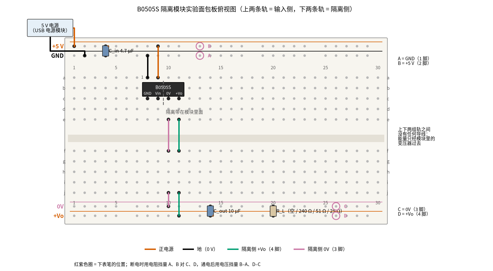

# 24 隔离电源与数字隔离器 · 动手实验篇

[上一页：参数与调试篇](page3.md) · [直觉篇](page1.md) · [原理与实现篇](page2.md) · [参数与调试篇](page3.md) · 本页：动手实验篇 · [下一页：26 上拉/下拉电阻与电平转换 · 直觉篇](../26-pullup-level-shift/page1.md) · 前置节点：[06 桥式整流 · 直觉篇](../06-bridge-rectifier/page1.md)、[09 开关电源 · 直觉篇](../09-switching-power-supply/page1.md)、[09 开关电源 · 原理与实现篇](../09-switching-power-supply/page2.md)、[23 光耦隔离 · 直觉篇](../23-optocoupler/page1.md)

## 这次实验要验证什么

前三页讲了两种隔离电源：一种是接市电的工频变压器，另一种是 5 V 进、5 V 出的隔离 DC-DC 模块。本页只做第二种，用一只 B0505S（金升阳 B_S-1WR3 系列，5 V 输入、5 V 200 mA 输出、1 W、不稳压）和一个 5 V 电源，在面包板上亲手确认三件事：

1. **两侧之间真的没有导电的路**。模块不通电时，用万用表电阻挡量输入侧的 GND、+5 V 对隔离侧的 0V、+Vo，四种组合都应该是开路。
2. **隔离侧确实有电，但只对它自己的 0V 才有意义**。通电后，+Vo 对 0V 有 5 V 左右的电压；可是拿 +Vo 去对输入侧的 GND 量，读数没有确定的值。这就是 [24 隔离电源与数字隔离器 · 直觉篇](page1.md) 第五节说的「两个地」。
3. **不稳压模块的输出随负载变化**。负载从 10% 加到满载，输出电压会往下走；负载低于 10% 时，手册不再保证输出电压。这正是 [24 隔离电源与数字隔离器 · 原理与实现篇](page2.md) 第三节「关键的坑」和 [24 隔离电源与数字隔离器 · 参数与调试篇](page3.md) 第四节「假负载」要解决的问题。

前两页用的模块是 Murata NME0505SC，本页换成更常见、更便宜的 B0505S。两者都是 5 V 转 5 V、1 W、不稳压的同类模块，但具体参数不同，本页所有「应该读到」的数都按 B0505S 的手册来算，不照搬前两页的 NME0505SC 数字。

**本页不能动手的部分**：[24 隔离电源与数字隔离器 · 原理与实现篇](page2.md) 第二节「方案一：工频变压器 + 整流滤波」的初级接 220 V 市电，连同保险丝、电源线，本页一律不做，也不建议在家里或教室里做。模块手册里的「1500 VDC 隔离耐压」是工厂用专门的耐压测试仪做的高压测试，同样不能自己做。

## ⚠️ 安全须知

- **不要接 220 V**。本页唯一的电源是 5 V 直流：USB 充电头加 USB 电源小板，或实验室稳压电源。不要把模块接到任何变压器、插座或市电设备上。前面讲到的工频变压器方案，市电部分请电工做，并选用有安全认证的成品电源。
- **只用 12 V 及以下的直流电**。B0505S 的输入范围是 4.5～5.5 V，手册给的 1 秒以内浪涌上限是 9 V。不要用 9 V 电池或 12 V 适配器直接给它供电，那会超出它的工作范围。四节新的 AA 碱性电池串起来约 6 V，也超过 5.5 V，不要用。
- **注意极性**。手册给的反向电压下限只有 −0.7 V，也就是说正负接反基本就会坏。1 脚是 GND，2 脚是 Vin，模块印字面朝你时最左边是 1 脚（外壳上通常有一个小圆点标在 1 脚这一侧）。两只电解电容的长脚是正极。
- **元件会发烫**。满载那一步用的 25 Ω 电阻要消耗约 0.95 W，必须用 2 W 的电阻，而且会烫手，不要用手摸；51 Ω 那一步约 0.51 W，要用 1 W 电阻。模块自己在满载时也会温热（手册：25 ℃ 环境下外壳温升典型 25 ℃）。闻到焦味或看到电阻变色，马上断电。
- **接线、改线之前先断电**。手册明确写着这只模块**不支持热插拔**：不要在通电时把模块插进面包板或拔出来，也不要通电换负载电阻。每一步都是先拔电源，改好，再插电源。
- **量电阻时一定要断电**。电阻挡是万用表自己往外送一点电流来测的，在通电的电路上用电阻挡，读数没有意义，还可能损坏万用表。

## 器材清单

| 元件 | 型号或数值 | 数量 | 说明 |
|---|---|---|---|
| 隔离 DC-DC 模块 | B0505S-1WR3（或同类 5 V 转 5 V、1 W 不稳压 SIP-4 模块） | 1 | 4 只脚：1 GND、2 Vin、3 0V、4 +Vo，脚距 2.54 mm，可以直接插面包板 |
| 5 V 电源 | USB 充电头 + USB 转面包板的电源小板，或实验室稳压电源 | 1 | 输出 4.5～5.5 V，能给 300 mA 以上 |
| 电解电容 | 4.7 μF，耐压 16 V | 1 | 输入电容 $C_{in}$ ，手册推荐值 |
| 电解电容 | 10 μF，耐压 16 V | 1 | 输出电容 $C_{out}$ ，手册推荐值 |
| 电阻 | 240 Ω，1/4 W | 1 | 约 10% 负载（假负载） |
| 电阻 | 51 Ω，1 W | 1 | 约 50% 负载 |
| 电阻 | 25 Ω，2 W | 1 | 约满载，会烫 |
| 面包板 | 830 孔（30 列以上） | 1 | 上下各两条电源轨 |
| 跳线 | 杜邦线 | 若干 | 另备一根「故意短接」用的导线 |
| 万用表 | 带 20 V 直流挡、20 MΩ 电阻挡；电流挡选做 | 1 | 测满载输入电流要用 10 A（或 20 A）挡 |
| 示波器 | 任意 | 选做 | 只在隔离侧看纹波，注意接地问题 |

如果买不到 25 Ω 2 W，可以用两只 51 Ω 1 W 并联（约 25.5 Ω），每只分担一半功率。

## 搭建步骤

面包板上同一列的 a–e 五个孔连通，f–j 五个孔连通，中间凹槽把上下两半隔开；上下边缘的长条是电源轨，整条横向连通。很多同学搭别的电路时，习惯用两根线把上下两组电源轨连起来，**本页一定不要连**：上面两条轨属于输入侧，下面两条轨属于隔离侧，它们之间唯一的「通道」是模块里面的变压器。

请看图 24-p4-1：朱红色线是输入侧的 +5 V，黑色线是输入侧的 GND，蓝绿色线是隔离侧的 +Vo，红紫色线是隔离侧的 0V。



*图 24-p4-1　B0505S 隔离模块实验的面包板接线（上两条轨是输入侧，下两条轨是隔离侧）*

1. **插模块**（断电状态）。B0505S 印字面朝你，四只脚从左到右插在 c8、c9、c10、c11，分别是 1 脚 GND、2 脚 Vin、3 脚 0V、4 脚 +Vo。插之前先认准 1 脚，插反了 Vin 和 GND 就对调了。
2. **铺输入侧电源轨**。5 V 电源正极接上方最外侧一条轨（+5 V），负极接它下面一条（GND）。先不要插 USB。
3. **接输入侧**。黑线从 a8 接 GND 轨，朱红色线从 a9 接 +5 V 轨。 $C_{in}$ （4.7 μF）直接插在上方两条轨之间的第 4 列，长脚插 +5 V 轨。
4. **把隔离侧引到下面**。红紫色短线从 e10 跨过凹槽插 f10，再从 j10 接到下方里侧一条轨，这条轨就是隔离侧的 0V。蓝绿色短线从 e11 跨过凹槽插 f11，再从 j11 接到下方最外侧一条轨，这条就是 +Vo。
5. **插输出电容**。 $C_{out}$ （10 μF）插在下方两条轨之间的第 14 列，长脚插 +Vo 轨。负载电阻 $R_L$ 的位置在第 20 列，现在先空着。
6. **检查**。对照图 24-p4-1 数一遍：上下两组电源轨之间**没有任何导线**；第 10、11 列的上半区除了模块的脚以外不接别的东西。

图 24-p4-1 里红紫色圆圈是下表笔的位置：A 是上方 GND 轨，B 是上方 +5 V 轨，C 是下方 0V 轨，D 是下方 +Vo 轨。四个点都在电源轨上，表笔插轨上任意一个空孔都可以。

## 测量表

仓库里没有 B0505S 的 SPICE 模型，所以本页「应该读到」一栏的数**直接来自 B0505S 的数据手册**（金升阳 B_S-1WR3 系列，2026.09.07-A/7 版），再用 `code/figs/24_figs.py` 计算：

- 绝缘电阻：500 V 直流下不小于 1000 MΩ；隔离电容典型 20 pF。
- 输入电流：满载典型 244 mA、最大 257 mA；空载典型 8 mA。满载效率最小 78%、典型 82%。
- 输出调整曲线（手册 Fig.1）：负载 10% 时输出偏差典型 +5%（范围 0～+10%），满载时典型 −2.5%（范围 −7.5%～+2.5%），中间近似直线。低于 10% 负载手册不给数，只写「不在规定负载范围内工作时不保证各项参数」。

脚本把这三条直线和负载电阻 $R_L$ 联立，求出每只电阻上的工作点，见图 24-p4-2：


*图 24-p4-2　按手册曲线算出的 B0505S 输出电压和三只负载电阻的预期工作点*

图 24-p4-2 里，橙色典型线从左到右往下斜：负载越重，输出越低。三个圆点就是本页三只电阻的预期读数，蓝色的 240 Ω 正好落在 10% 负载的边上，所以它可以当「假负载」用；即使是最高的那条边，240 Ω 时也只有约 5.49 V，没有越过灰色的 5.5 V 线。灰色区域是手册不管的地方，空载那一步的读数只能记下来，不能拿来「判对错」。

表中 A、B、C、D 见图 24-p4-1。表里的电压按输入正好 5.00 V 算；如果你的电源是 5.10 V，输出也会跟着高一点，手册给的线性调整率最大是输入每变 1%、输出变 1.2%，后面的 Python 程序会自动修正。

| 步骤 | 测什么 | 红表笔 | 黑表笔 | 挡位 | 应该读到 | 读不到时先查 |
|---|---|---|---|---|---|---|
| 1 | 断电：输入地对隔离侧地 | A | C | 电阻 20 MΩ（或最大挡） | 超量程（OL），开路 | 上下两组轨之间有没有习惯性接上的跨接线；模块是否插到了别的列 |
| 2 | 断电：输入地对隔离侧正 | A | D | 电阻 20 MΩ | OL | 同上 |
| 3 | 断电：输入正对隔离侧地 | B | C | 电阻 20 MΩ | OL | 同上 |
| 4 | 断电：输入正对隔离侧正 | B | D | 电阻 20 MΩ | OL | 同上 |
| 5 | 断电：用一根导线把 GND 轨和 0V 轨连上，再量 | A | C | 电阻 200 Ω | 接近 0 Ω（和两支表笔直接碰在一起时差不多） | 导线是否插紧。量完**马上拔掉**，再量一次应回到 OL |
| 6 | 通电、空载：输入电压 | B | A | 直流 20 V | 4.5～5.5 V 之间（手册输入范围），USB 电源一般在 5 V 左右 | USB 线、电源小板开关；读到负值说明表笔反了 |
| 7 | 通电、空载：输出电压 | D | C | 直流 20 V | 手册不给这个数，如实记下即可；**不要接任何芯片** | 读到 0：模块插反或第 10、11 列的跨线没接 |
| 8 | 选做：空载输入电流（拔下 +5 V 那根线，把电流表串进去） | 电源正极那头 | +5 V 轨 | 直流 200 mA | 约 8 mA（手册典型值） | 表笔要插 mA 孔；读数几百毫安说明输出被短路 |
| 9 | 断电插 240 Ω 到第 20 列，再通电 | D | C | 直流 20 V | 约 5.25 V（手册范围 5.00～5.49 V） | 电阻是否插在两条下方轨之间；色环是否读错 |
| 10 | 断电换 51 Ω 1 W，再通电 | D | C | 直流 20 V | 约 5.08 V（4.84～5.32 V） | 同上 |
| 11 | 断电换 25 Ω 2 W，再通电（电阻会烫） | D | C | 直流 20 V | 约 4.88 V（4.65～5.12 V） | 输入电压是否被拉低（同时量一下 B–A）；电源能不能给 300 mA |
| 12 | 选做：25 Ω 时的输入电流 | 电源正极那头 | +5 V 轨 | 直流 10 A（红表笔插 10 A 孔） | 约 233～245 mA（效率 82%～78% 时），手册满载最大 257 mA | 200 mA 挡会烧保险丝；量完把红表笔插回电压孔 |
| 13 | 通电：隔离侧正对输入侧地（「浮地」） | D | A | 直流 20 V | 没有确定的值，可能飘动，可能接近 0 | 如果稳稳读到和第 11 步一样的电压，说明两侧被连通了，回到第 1 步 |
| 14 | 通电：两侧地之间 | C | A | 直流 20 V | 没有确定的值 | 同上 |

量第 1～4 步时，读数可能先跳几下再变成 OL，这是模块两侧之间那约 20 pF 的隔离电容被万用表充电，很快就充满了。只要最后停在 OL 就对。第 5 步是故意的「反面教材」：一根导线就能让两侧的地连在一起，模块里的隔离层再好也白费了。

第 9、11 两步的差，就是这只模块的「负载调整」：按手册典型曲线约下降 0.36 V，手册给的最大负载调整率是 15%，也就是 5 V 的 0.75 V，只要你的差值不超过它就是正常的。第 13、14 步读到「没有确定的值」不是万用表坏了，而是这个问题本身没有答案：隔离侧的电压只相对它自己的 0V 才成立。

## 没有示波器怎么办

本页的主要结论，靠一块万用表都能得出：开路、有电、两个地、随负载变化。但有几件事**只有示波器能看到**，本页不编数字，只说清楚它们是什么：

- **开关波形**。手册写的开关频率是 270 kHz（5 V 输入、满载）。模块里的开关管每秒开关几十万次，万用表的直流挡只给出平均值，完全看不到这些方波。
- **输出纹波**。手册给的纹波典型 30 mVp-p、最大 75 mVp-p（20 MHz 带宽）。这是叠在 5 V 上的一层细小的高频起伏。多数万用表的交流挡只对几百赫兹到几千赫兹的信号准（具体看你的万用表说明书），拿它去量 270 kHz 的纹波，读数没有参考价值。
- **上电过程**。插上 USB 的一瞬间，输出是怎样升到 5 V 的，万用表的刷新太慢，看不到。

没有示波器时能做的替代观察：

1. **用手背感觉温度**。满载跑一两分钟，断电后用手背轻触模块外壳：应该是温热的；25 Ω 电阻则可能烫手，不要碰。模块温热，说明效率不是 100%，约两成的功率变成了热，这和第 12 步算出的效率对得上。
2. **用负载变化代替波形**。第 9～11 步的三个读数，加上图 24-p4-2，就是这只模块最重要的「特性曲线」，比看纹波更能说明「不稳压」是什么意思。

如果你有示波器，只在**隔离侧**测：探头夹 +Vo，地夹夹 0V。这时要注意 [24 隔离电源与数字隔离器 · 参数与调试篇](page3.md) 第三节讲的问题：台式示波器的地夹通常经三孔插头接到插座地线，如果输入侧的 5 V 又来自插在电脑上的 USB 口，两侧的地就可能绕过模块连在一起。稳妥的办法是输入侧改用手机充电头供电，并且测完以后断电、拔掉示波器，再按第 1 步量一次 A–C，确认仍然是开路。

## 用 Python 核对你的读数

把你量到的数填进下面程序的第 1、2 部分（下面是示例值），在仓库根目录运行。程序按手册曲线算出每只电阻上的典型值和范围，读数和典型值相差超过 10% 就提醒你。

```python
import sys, pathlib
sys.path.insert(0, str(pathlib.Path("code/figs").resolve()))  # 在仓库根目录运行
# 24 隔离电源 · 动手实验核对：填入实测值，和 B0505S 手册曲线比较
import math

# ---- 1. 断电时的电阻读数（OL 就写 math.inf）/ Ω ----
R_ISO = {"A–C": math.inf, "A–D": math.inf, "B–C": math.inf, "B–D": math.inf}

# ---- 2. 通电后的读数（示例值，换成你自己的）----
V_IN = 5.08                                   # 步骤 6：B 对 A / V
LOADS = {240: (238.0, 5.31), 51: (51.3, 5.12), 25: (24.8, 4.90)}   # 标称 / Ω : (实际阻值 / Ω, D 对 C / V)
I_IN_FULL = 0.241                             # 步骤 12（选做）：接 25 Ω 时的输入电流 / A，没测就写 None

# ---- 3. 手册 Fig.1 的三条直线：10% 负载和 100% 负载处的偏差 / % ----
CURVE = dict(typ=(5.0, -2.5), max=(10.0, 2.5), min=(0.0, -7.5))
I_MAX, LINE_REG = 0.200, 1.2                  # 额定 200 mA；线性调整率手册最大 1.2 %/%（这里拿来粗略修正）


def v_expect(r, which):
    a, b = CURVE[which]
    k_in = 1 + LINE_REG * (V_IN - 5.0) / 5.0      # 输入每高 1%，输出按高 1.2% 修正
    v = 5.0
    for _ in range(60):
        frac = v / r / I_MAX
        v = 5.0 * (1 + (a + (b - a) * (frac - 0.1) / 0.9) / 100) * k_in
    return v


ok = True
for k, r in R_ISO.items():
    good = r > 20e6
    ok &= good
    print(f"断电 {k}：{'开路 ✓' if good else f'{r:.0f} Ω ✗ 两侧被连通了，先找跨接线'}")
print(f"输入 {V_IN:.2f} V：{'在 4.5～5.5 V 内 ✓' if 4.5 <= V_IN <= 5.5 else '超出手册范围 ✗'}")
print(f"{'负载':>6} {'电流/mA':>8} {'实测/V':>7} {'典型/V':>7} {'范围/V':>12} {'偏差':>7}")
for nom, (r, v) in LOADS.items():
    vt, lo, hi = v_expect(r, "typ"), v_expect(r, "min"), v_expect(r, "max")
    dev = (v - vt) / vt
    flag = "" if abs(dev) <= 0.10 else "  ⚠️ 偏差超过 10%"
    if not lo <= v <= hi:
        flag += "  （不在手册范围内）"
    ok &= abs(dev) <= 0.10
    print(f"{nom:>4} Ω {v / r * 1e3:8.1f} {v:7.2f} {vt:7.2f} {lo:6.2f}～{hi:4.2f} {dev:+7.1%}{flag}")
drop = LOADS[240][1] - LOADS[25][1]
print(f"负载调整：240 Ω → 25 Ω 下降 {drop:.2f} V（{drop / 5:.1%}），手册最大 15%"
      + (" ✓" if drop / 5 <= 0.15 else " ✗"))
if I_IN_FULL:
    p_out = LOADS[25][1] ** 2 / LOADS[25][0]
    eta = p_out / (V_IN * I_IN_FULL)
    print(f"效率 = {p_out:.3f} W / ({V_IN:.2f} V × {I_IN_FULL * 1e3:.0f} mA) = {eta:.0%}"
          + ("（手册满载 78%～82% 附近 ✓）" if 0.70 <= eta <= 0.90 else "  ⚠️ 和手册差得多，先查电流表接法"))
print("全部在范围内" if ok else "有读数超出范围，按测量表最后一栏排查")
```

示例数据里，三个读数和典型值只差 0.7%～1.4%，都在手册范围内。注意示例的输入是 5.08 V，比 5.00 V 高 1.6%，程序已经把典型值按 1.2 %/% 往上修正了约 1.9%，所以 240 Ω 那一行的典型值是 5.35 V，不是表里的 5.25 V。效率算出来 79%，落在手册的 78%～82% 附近。这些示例值只用来演示判断方法，请换成你自己的读数。

## 实验记录表

| 步骤 | 条件 | 应该读到 | 我的读数 | 在范围内吗 |
|---|---|---|---|---|
| 1～4 | 断电，A、B 对 C、D | OL | | |
| 5 | 故意连上 GND 和 0V | 接近 0 Ω | | |
| 6 | 输入电压 B–A | 4.5～5.5 V | | |
| 7 | 空载 D–C | 手册不给 | | （只记录） |
| 8 | 空载输入电流（选做） | 约 8 mA | | |
| 9 | 240 Ω，D–C | 5.00～5.49 V | | |
| 10 | 51 Ω，D–C | 4.84～5.32 V | | |
| 11 | 25 Ω，D–C | 4.65～5.12 V | | |
| 12 | 满载输入电流（选做） | 233～245 mA | | |
| 13、14 | 浮地 D–A、C–A | 没有确定的值 | | （只记录） |

### 思考题

1. 第 1～4 步量出来都是开路，能不能说明这只模块可以挡住 1500 V？

<details>
<summary>答案</summary>

不能。万用表电阻挡往外送的电压只有零点几伏到几伏，它只能说明「在低电压下两侧之间没有导电的路」。手册里的 1500 VDC 是工厂用耐压测试仪加 1 分钟高压、漏电流不超过 1 mA 的测试，绝缘电阻 1000 MΩ 也是在 500 V 下测的。这些高压测试只能由专业人员用专门的仪器做，本页不做，也不要自己尝试。

</details>

2. 第 7 步空载时，为什么不能把 ISO7721 之类的芯片接到 +Vo 上？接上 240 Ω 以后为什么就可以考虑了？

<details>
<summary>答案</summary>

空载低于 10% 负载，B0505S 手册不保证输出电压，前两页的 NME0505SC 示意模型在轻载时甚至会升到 10 V 左右，而 ISO7721 的绝对最大电源电压只有 6 V。并上 240 Ω 以后负载约 22 mA，刚好超过 10%，按手册曲线输出在 5.00～5.49 V 之间，没有超过 ISO7721 推荐的上限 5.5 V。这就是假负载的作用；要求更严格时，应该换稳压型模块或在后面加一级 LDO。

</details>

3. 模块两侧之间有约 20 pF 的隔离电容。它对 50 Hz 和对 270 kHz 的「阻挡能力」各有多大？这说明什么？

<details>
<summary>答案</summary>

电容的容抗是 $X_C = 1/(2\pi f C)$ 。代入 20 pF：50 Hz 时约 159 MΩ，几乎完全挡住；270 kHz 时只有约 29 kΩ，挡得就没那么好了。所以隔离电源对直流和工频隔得很好，但高频的开关噪声会经这只小电容「漏」到另一侧一点点。这也是数据手册里会推荐在两侧之间加 Y 电容、做 EMC 滤波的原因之一。

</details>

## 自测清单

- [ ] 我能说出 B0505S 四只脚的名字，并且知道哪两只属于输入侧、哪两只属于隔离侧。
- [ ] 我能在断电时用电阻挡证明两侧之间是开路，也知道一根跨接线就能毁掉隔离。
- [ ] 我能解释为什么「隔离侧 +Vo 对输入侧 GND」的电压没有确定的值。
- [ ] 我能根据手册曲线说出 10% 负载和满载时输出大约是多少，并解释为什么要加假负载。
- [ ] 我能说清楚本页哪些部分不能动手：市电初级和高压耐压测试。
