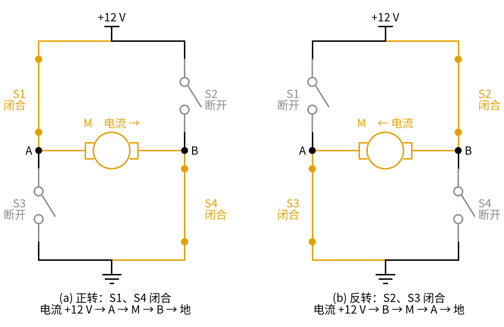
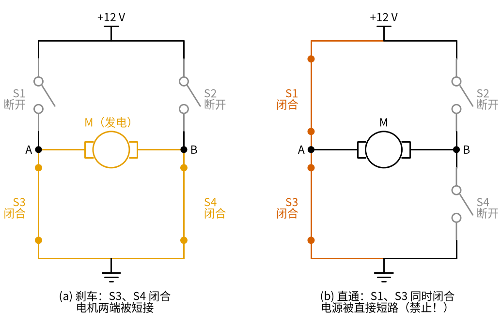
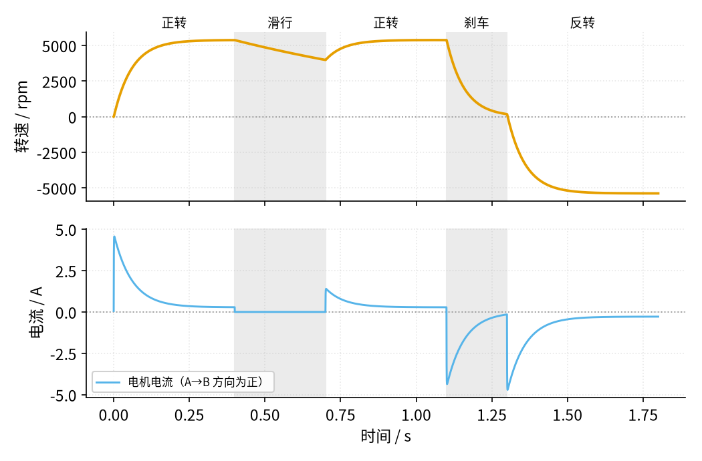

# 25 H 桥电机驱动 · 直觉篇

[上一页：09 开关电源 · 参数与调试篇](../09-switching-power-supply/page3.md) · 本页：直觉篇 · [原理与实现篇](page2.md) · [参数与调试篇](page3.md) · [下一页：原理与实现篇](page2.md) · 前置节点：[21 MOS 管开关 · 直觉篇](../21-mosfet-switch/page1.md) · [22 三极管开关与继电器驱动 · 直觉篇](../22-bjt-relay-driver/page1.md)

## 痛点：电机要会正转、反转，还要能调速

在 [21 MOS 管开关 · 直觉篇](../21-mosfet-switch/page1.md) 里，我们用一只 MOS 管控制了一台直流电机：管子导通，电机转；管子关断，电机停。可是做一辆小车，光会「转」和「停」远远不够：

- 小车要能**后退**，电机就得反着转；
- 小车要能**慢慢开**，电机转速就得能调；
- 遇到障碍要**马上停**，不能靠惯性再滑出去半米。

直流电机反转的办法很简单：把它两根线对调，电流反着流，它就反着转。问题是，你总不能让单片机伸出手去拔线。我们需要一个电路，能用几个控制信号决定「电流从电机的哪一头流进去」。这个电路就是 **H 桥**。

## 类比：一座有四道闸门的「H」形水渠

把电源想成山上的水库（+12 V），地是山脚的河（0 V），电机是一个水车，装在一条横着的水渠中间。水车左端叫 A，右端叫 B。

- A 端往上有一道闸门 S1 通水库，往下有一道闸门 S3 通河；
- B 端也一样，往上 S2，往下 S4。

四道闸门和中间那条横渠连起来，正好是一个字母「H」，这就是名字的来历。

想让水车正着转：打开 S1 和 S4，水从水库经 S1 流到 A，冲过水车到 B，再经 S4 流进河里。想让它反着转：换成 S2 和 S3，水从 B 冲向 A。**永远是一上一下、一左一右，斜着成对打开**。

下面的图 25-p1-1 把两种情况画了出来，橙色是电流走过的路线，灰色是断开的开关。

*图 25-p1-1　H 桥的两种驱动状态：S1、S4 闭合时电流从 A 流向 B（正转）；S2、S3 闭合时电流从 B 流向 A（反转）*

对比图 25-p1-1 的左右两半，电机本身一根线都没动，只是换了一对闭合的开关，流过电机的电流就掉了个头。电机两端的电压在左图是 A 正 B 负，在右图是 B 正 A 负。

## 另外两种状态：刹车，以及绝对不能出现的「直通」

四个开关一共有 16 种组合，真正有用的除了正转、反转，还有两种需要特别认识。下面的图 25-p1-2 左边是「刹车」，右边是「直通」。

*图 25-p1-2　左：两个下面的开关 S3、S4 闭合，电机两端被短接，转动的电机变成发电机，自己产生的电流让它很快停下（刹车）；右：同一侧的 S1、S3 同时闭合，电源经两个开关直接短路（直通），必须禁止*

图 25-p1-2 左边的刹车状态很有意思：电机在惯性下继续转，就像一台发电机，会产生电压（这个电压叫**反电动势**）。两端被短接以后，它发出的电流在自己身上产生阻碍转动的力，于是越转越慢。这比「四个开关全断开、让它自己滑行」停得快得多。

右边朱红色的情况叫**直通**：同一侧上下两个开关同时闭合，电源正极经 S1、S3 直接连到地，中间没有任何负载限流。电流可以在一瞬间达到几十安，开关管会被烧毁。实际电路里，开关是 MOS 管，从「通」变到「断」需要一点时间；如果控制信号让上管刚开始关、下管就开始开，两者会短暂地同时导通。所以 H 桥的控制规则里一定有一条：**同一侧的上管和下管之间，切换时要留一小段「两个都断开」的空档**。这段空档叫**死区时间**，参数与调试篇会算它要留多长。

## 让电机按顺序做几件事

把这几种状态串起来，看看电机的反应。下面的图 25-p1-3 是仿真结果：一台 12 V 小电机先正转，再「滑行」（四个开关全断开），再正转，然后「刹车」，最后直接反转。

*图 25-p1-3　同一台电机依次经历正转、滑行、正转、刹车、反转（灰色底为滑行和刹车）：上图为转速，橙色；下图为电流，天蓝色，A 流向 B 为正*

从图 25-p1-3 能读出三件事：

1. 正转约 0.25 s 后转速稳定在 5377 rpm。刚起动时电流冲到 4.56 A，因为电机还没转起来、没有反电动势，只剩线圈电阻限流。
2. 滑行 0.3 s，转速只从 5377 rpm 降到 3988 rpm；刹车 0.2 s，转速就从 5377 rpm 降到 184 rpm。刹车时电流变成 −4.36 A，方向反了，说明电机在「发电」，正是这股电流把它拽住。
3. 从刹车直接切到反转，电流又冲到 −4.71 A，转速最终稳定在 −5383 rpm，即反方向全速。

## 调速：开关飞快地开合

转速怎么调？最直接的想法是给电机一个较低的电压，但电源是固定的 12 V。H 桥的办法是：让 S1 以每秒两万次的速度开、合（S4 一直闭合）。电机里有线圈（电感），电流来不及跟着跳，它「感受到」的只是平均电压。闭合的时间占一半，平均就是 6 V；占四分之三，就是 9 V。这种方法叫 **PWM**（脉冲宽度调制），闭合时间所占的比例叫**占空比**（这两个词在 [21 MOS 管开关 · 直觉篇](../21-mosfet-switch/page1.md) 已经介绍过，这里是同一个意思）。原理与实现篇会推导它，并回答「为什么常选 20 kHz」。

可以把它想成推秋千：你不必一直用力推，只要每次在同一个节奏里推一小下，秋千就稳定地荡到某个高度；每次推的时间长一点，荡得就高一点。电机的转子很「沉」，开关每秒开合两万次，它根本来不及跟着一开一合加速、减速，只会按「平均推了多少」转到一个稳定的速度。电脑风扇、遥控小车、电动车的调速把手，用的都是这个办法。

## 一句话

**H 桥用四个开关斜着成对导通来决定电流方向：S1、S4 正转，S2、S3 反转，两个下管同时导通是刹车，同一侧上下管同时导通是必须禁止的直通；再用 PWM 快速开合，就能用平均电压调速**。
