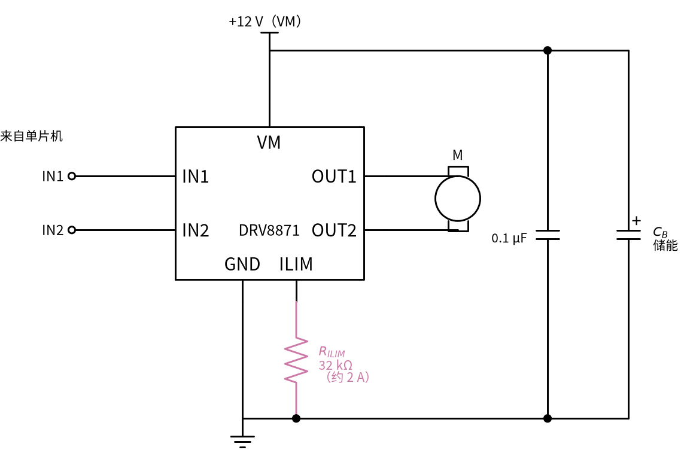
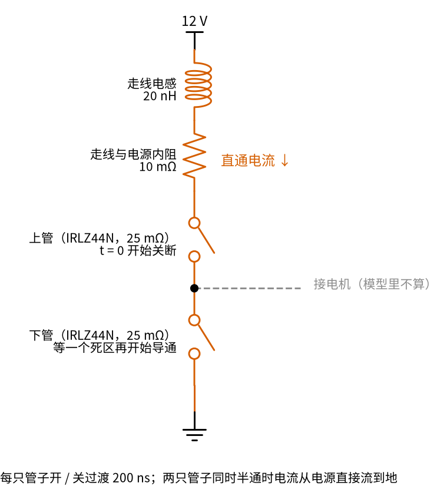
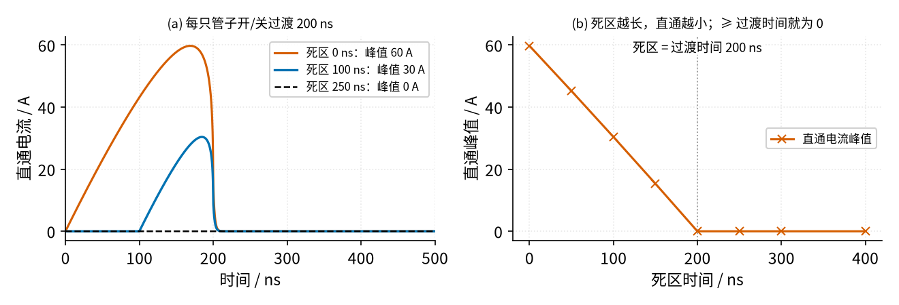
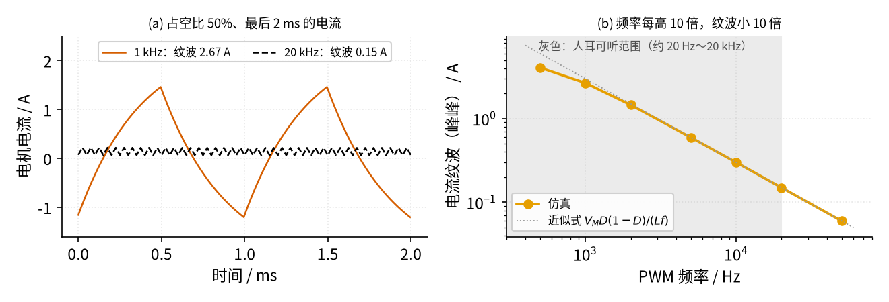
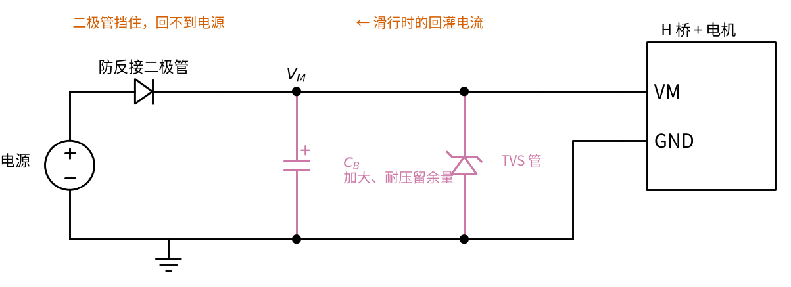
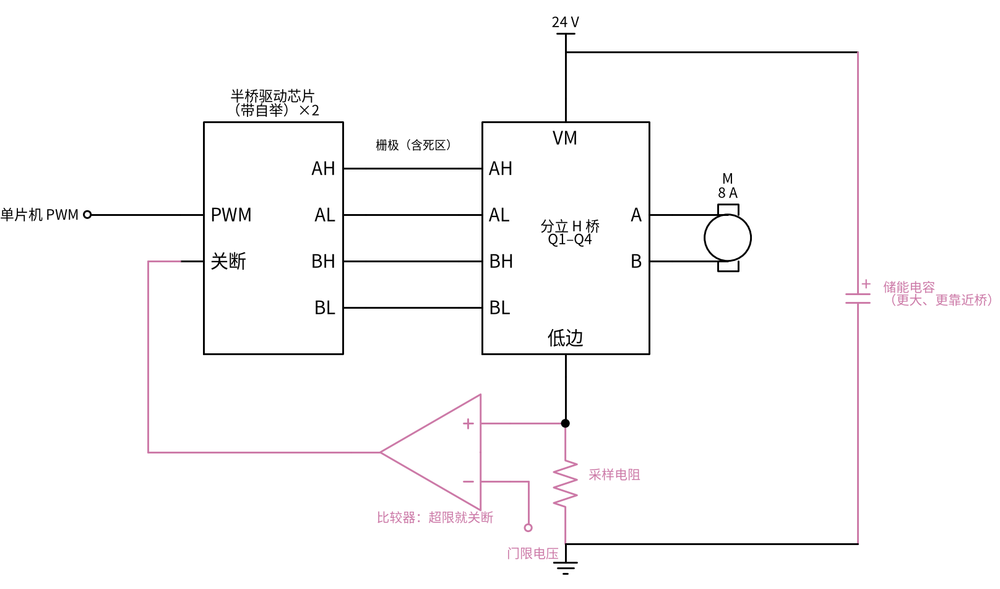

# 25 H 桥电机驱动 · 参数与调试篇

[上一页：原理与实现篇](page2.md) · [直觉篇](page1.md) · [原理与实现篇](page2.md) · 本页：参数与调试篇 · [下一页：25 H 桥电机驱动 · 动手实验篇](page4.md) · 前置节点：[21 MOS 管开关 · 直觉篇](../21-mosfet-switch/page1.md) · [22 三极管开关与继电器驱动 · 直觉篇](../22-bjt-relay-driver/page1.md)

## 本页要解决的问题

原理篇已经让电机转起来、调了速、刹了车。真正动手时还会碰到三类问题：**芯片能不能扛住这个电机**、**死区留多少才不直通**、**PWM 频率选多少才既不啸叫又不发烫**。下面先查芯片参数，再做两组扫描，最后给出排查表。

## 1. 参数含义与常见取值

以 DRV8871 为例（所有数值摘自 [TI DRV8871 数据手册](https://www.ti.com/lit/ds/symlink/drv8871.pdf)）：

| 参数 | 含义 | DRV8871 取值 | 设计时怎么用 |
|---|---|---|---|
| $V_M$ | 电机电源电压范围 | 6.5–45 V | 电机额定电压要落在范围内，并留出停机回灌造成的电压上冲余量 |
| $R_{DS(on)}$ （上管 + 下管） | 电流经过的两只管子的导通电阻 | 典型 565 mΩ（307 + 258）；24 V、1 A 时最大 360 + 320 mΩ | 导通损耗 $I^2 R$ ；2 A 时约 2.3 W |
| $I_{peak}$ | 允许的峰值输出电流 | 3.6 A | 电机起动电流（堵转电流）不能超过它 |
| $t_{DEAD}$ | 芯片自动插入的死区时间 | 220 ns | 不用自己算死区，直通被芯片排除 |
| 输入最小脉宽 | IN1、IN2 的脉冲至少要多宽才能被识别 | 800 ns | 200 kHz 时可用占空比只有 16%–84% |
| $I_{TRIP}$ | 限流值，由 ILIM 引脚的电阻 $R_{ILIM}$ 设定 | $I_{TRIP} = 64\text{ kV} / R_{ILIM}$ （系数 59–69 kV）， $R_{ILIM}$ 不小于 15 kΩ | 超过后两只下管导通 25 µs 让电流下降，再恢复驱动 |
| $I_{OCP}$ | 过流保护门限 | 3.7 / 4.5 / 6.4 A（最小 / 典型 / 最大） | 超过后全部关断 3 ms 再重试 |

DRV8871 手册在应用部分还用了好几段讲储能电容：电容太小，电机突然要电流或者往回灌电流时，电源电压就会跳；电容的耐压要高于工作电压并留余量，而且要尽量靠近芯片放。

### 限流电阻怎么选

原理篇的电机线圈电阻 2 Ω，加上两只管子 0.565 Ω，12 V 起动瞬间电流可达 $12 / 2.565 \approx 4.7\text{ A}$ ，直觉篇的仿真里峰值是 4.56 A。它**超过了** $I_{peak}$ = 3.6 A，也超过了 $I_{OCP}$ 的最小值 3.7 A：有的芯片会在起动时触发过流保护，有的不会。所以必须用 ILIM 把电流限在更低的值。按 $R_{ILIM} = 64\text{ kV} / I_{TRIP}$ 计算：

| $R_{ILIM}$ | 15 kΩ | 20 kΩ | 24 kΩ | 32 kΩ | 43 kΩ | 64 kΩ |
|---|---|---|---|---|---|---|
| $I_{TRIP}$ （典型） | 4.27 A | 3.20 A | 2.67 A | 2.00 A | 1.49 A | 1.00 A |

选 32 kΩ 时典型值 2 A，考虑 59–69 kV 的系数范围，实际在 1.84–2.16 A 之间，电阻本身的误差还要再叠加上去。限流和 [11 过载保护 · 直觉篇](../11-overload-protection/page1.md) 的思路一样：**测电流、比门限、超了就先断一会儿**，只是这里芯片把采样和比较都做在了内部。

按 32 kΩ 接好的电路见下面的图 25-p3-3，只是在原理与实现篇的接法上把 $R_{ILIM}$ 定了值：

*图 25-p3-3　ILIM 引脚经 32 kΩ 的 R_ILIM 接地，典型限流 2 A*

## 2. 扫描一：死区时间从 0 到 400 ns

分立 H 桥要自己安排死区。下面用一个示意模型来扫描：每只管子从导通到关断（或反过来）的过渡都要 200 ns，过渡期间它的电阻从 25 mΩ（IRLZ44N 的导通电阻）逐渐变成断开；电源回路有 20 nH 的走线电感和 10 mΩ 的走线与电源内阻（电路见下面的图 25-p3-4）。让同一侧的上管开始关断，同时等一个死区时间再让下管开始导通，计算从电源直接流过两只管子的「直通电流」。这个模型写在 `code/25_sim.py` 的 `shoot_through` 函数里；下面的图和表中的数字（峰值电流、每次能量、功率）都由 `code/figs/25_figs.py` 算出并打印（输出里「死区 / ns → 直通峰值」那几行）。想自己核对，在仓库根目录运行 `python code/figs/25_figs.py` 即可，它会重新生成同样的配图。

*图 25-p3-4　死区扫描的示意模型：同一侧上下两只 IRLZ44N 串在 12 V 和地之间，朱红色为两管同时半通时的直通电流路径*

*图 25-p3-1　左：三种死区下的直通电流波形；右：直通电流峰值随死区时间的变化（示意模型，每只管子过渡 200 ns）*

读图 25-p3-1：

- 左图朱红色曲线（死区 0 ns）峰值约 60 A，蓝色（100 ns）约 30 A，黑色虚线（250 ns）始终为 0。这几十安的电流只持续一两百纳秒，电流表根本测不到，管子却在悄悄发热。
- 右图朱红色 × 号连成一条下降的直线，在灰色点线（死区 = 过渡时间 200 ns）处降到 0。**死区必须不短于管子的开关过渡时间**，这是唯一的规则。
- 把每次直通的能量乘上次数，就是额外的发热：

| 死区 | 峰值电流 | 每次能量 | 20 kHz 时每个半桥的功率 |
|---|---|---|---|
| 0 ns | 59.7 A | 91.5 µJ | 3.66 W |
| 50 ns | 45.2 A | 51.9 µJ | 2.08 W |
| 100 ns | 30.4 A | 23.3 µJ | 0.93 W |
| 150 ns | 15.3 A | 5.95 µJ | 0.24 W |
| 200 ns 及以上 | 0 | 0 | 0 |

（功率 = 每次能量 × 每周期 2 次 × 20000 次/s。）

注意 200 ns 只是示意值。[21 MOS 管开关 · 原理与实现篇](../21-mosfet-switch/page2.md) 里单片机经 100 Ω 栅极电阻直接驱动 IRLZ44N，关断就要 0.7 µs 左右；那样的电路死区要留到 1 µs 量级。用专门的栅极驱动芯片把过渡缩短到几十纳秒，死区才能做小。死区也不是越长越好：死区期间四只管子都关断，电流只能走体二极管，二极管压降约 0.8 V，比导通的 MOS 管发热更多，而且死区占的时间越多，低占空比时电压的损失越明显。

## 3. 扫描二：PWM 频率从 500 Hz 到 50 kHz

占空比固定为 50%，只改 PWM 频率，看电流纹波怎么变。

*图 25-p3-2　左：1 kHz 与 20 kHz 时稳定后的电机电流；右：电流纹波随 PWM 频率的变化（双对数坐标，灰色区域为人耳可听范围）*

读图 25-p3-2：

- 左图朱红色曲线是 1 kHz：电流在 −1.2 A 到 +1.5 A 之间大幅摆动，纹波 2.67 A，**电流甚至变成负的**，也就是刹车期间电机在发电、在倒拖。平均电流只有 0.14 A，这么大的纹波只会白白发热，线圈还会随电流一起振动发出 1 kHz 的尖叫声。黑色虚线是 20 kHz：纹波只有 0.15 A。
- 右图橙色圆点几乎落在灰色点线（近似式 $V_M D(1-D)/(Lf)$ ）上：**频率每提高 10 倍，纹波减小 10 倍**。1 kHz 以下圆点偏离点线，因为周期已经接近电机的电气时间常数 $L/R$ = 0.5 ms，电流不再是直线变化，近似式不再适用。
- 灰色区域右边界是 20 kHz，人耳一般听不到更高的频率。所以小电机常用 20–25 kHz 的 PWM。

| PWM 频率 | 0.5 kHz | 1 kHz | 2 kHz | 5 kHz | 10 kHz | 20 kHz | 50 kHz |
|---|---|---|---|---|---|---|---|
| 纹波（峰峰值） | 4.06 A | 2.67 A | 1.46 A | 0.60 A | 0.30 A | 0.15 A | 0.060 A |

频率也不能无限提高。21 节算过，MOS 管的开关损耗正比于频率；另外每个周期都要插两次死区，频率越高，死区占的比例越大；DRV8871 还要求输入脉冲至少 800 ns 宽。一般的折中是：**刚好避开可听范围，不再往上加**。

## 4. 故障排查表

| 现象 | 原因 | 怎么查 | 怎么改 |
|---|---|---|---|
| 一上电或一换向，MOS 管烧坏、电源保险丝熔断 | 同一侧上下管同时导通（直通），死区为 0 或不够长 | 示波器同时看同一侧两只管子的栅极波形，看有没有重叠；看电源电流在切换瞬间有没有尖峰 | 死区不短于开关过渡时间；软件里先关断、等待、再导通；改用带死区和互锁的驱动芯片 |
| 电机停机或换向时电源电压冒高，稳压器或电容损坏 | 滑行时电机电流经体二极管回灌电源，电源吸收不了（例如电源前面串了防反接二极管：一只串在电源入口、防止电源正负接反的二极管，它只许电流流进来，回灌的电流就无处可去） | 示波器看 $V_M$ 在关断瞬间的电压上冲 | 加大靠近桥的储能电容，并选更高的耐压；减速用刹车而不是滑行；在 $V_M$ 上加 TVS 管（一种保护二极管：电压超过某个值就导通，把尖峰吸掉） |
| 电机发出尖锐的叫声 | PWM 频率落在 20 Hz–20 kHz 的可听范围 | 示波器或频率计测输入 PWM 频率 | 提高到 20 kHz 以上，同时检查管子温升 |
| 一个方向转得很弱或不转，上管很烫 | 上管是 N 沟道管，栅极电压没有比源极高出几伏，管子工作在半导通状态 | 测上管的 $V_{GS}$ （栅极减源极），不是栅极对地的电压 | 用带自举（见原理与实现篇）或电荷泵（用电容和开关把电压「抬高」到电源以上的小电路）的栅极驱动；或上管改用 P 沟道管 |
| 电机起动时一顿一顿，每隔几毫秒停一下 | 起动电流超过 $I_{OCP}$ ，芯片过流保护关断 3 ms 后重试，再次过流 | 示波器看电机电流，出现周期约 3 ms 的断续 | 按上面的表选 $R_{ILIM}$ ，让芯片限流而不是保护关断；占空比从 0 慢慢升高（软起动） |
| 低速时电机抖动、发热大 | PWM 频率太低，电流纹波大到过零 | 用采样电阻看电流波形 | 提高 PWM 频率，或选电感更大的电机 |

表中第二行的防反接二极管和两种补救画在下面的图 25-p3-5 里：二极管只许电流从电源流进来，滑行时的回灌电流只能给 $C_B$ 充电，所以要加大 $C_B$ 或者在 $V_M$ 上并 TVS 管。

*图 25-p3-5　防反接二极管挡住了回灌电流；红紫色为补救：加大储能电容 C_B、在 V_M 上并 TVS 管（负极朝 V_M）*

## 5. 练习

**练习 1（易）**：用 DRV8871 驱动一个电机，希望限流约 1.5 A。 $R_{ILIM}$ 选多大？考虑 59–69 kV 的系数范围，实际限流值在什么范围？（接法同图 25-p3-3，只换电阻。）

答案

$R_{ILIM} = 64\text{ kV} / 1.5\text{ A} \approx 42.7\text{ kΩ}$ ，取标准值 43 kΩ，典型限流 1.49 A。范围是 $59 / 43 \approx 1.37\text{ A}$ 到 $69 / 43 \approx 1.60\text{ A}$ ，电阻误差另算。

**练习 2（中）**：一个分立 H 桥 PWM 频率 20 kHz，死区设为 50 ns，而管子的过渡时间是 200 ns（与本页模型相同）。每个半桥因直通多出多少发热？把死区改为 250 ns 后呢？

答案

查扫描一的表：50 ns 时每次 51.9 µJ，每周期 2 次，功率 $51.9\text{ µJ} \times 2 \times 20000 \approx 2.08\text{ W}$ ，两个半桥合计约 4 W，没有散热片的管子会很烫。250 ns 时死区已超过过渡时间，直通为 0。

**练习 3（中）**：另一个电机线圈电感 0.5 mH，电源 12 V。要求最坏情况（占空比 50%）下电流纹波不超过 0.2 A，PWM 频率至少多少？这个频率会被听到吗？

答案

$f \ge V_M D(1-D) / (L \cdot \Delta I) = 12 \times 0.25 / (0.5 \times 10^{-3} \times 0.2) = 30\text{ kHz}$ 。30 kHz 高于 20 kHz，听不到。注意这时开关损耗比 20 kHz 时多 50%。

**练习 4（难，变体迁移）**：要驱动一个 24 V、额定 8 A 的电机（比如电动车窗）。还能用 DRV8871 吗？如果改用四只分立 MOS 管，本节的哪些功能需要你自己补上？

答案

不能。DRV8871 的峰值电流只有 3.6 A，8 A 远远超出；电压 24 V 倒是在 6.5–45 V 范围内。改用分立方案时，芯片替你做的事都要自己补：

1. **上管驱动**：N 沟道上管的栅极要比 24 V 再高约 10 V，需要带自举的半桥驱动芯片（21 节讲过的高边问题）。
2. **死区**：按管子和驱动的实际过渡时间设置，不短于过渡时间。
3. **限流和过流保护**：在低边加采样电阻，用比较器判断电流，超限就关断，这就是 [11 过载保护 · 直觉篇](../11-overload-protection/page1.md) 的电路。
4. **储能电容**：电流大了，电容要更大、更靠近桥。

这四样补上以后的框图见图 25-p3-6（红紫色是要自己补的部分；死区由驱动芯片或单片机在栅极信号里安排）：

*图 25-p3-6　练习 4 的分立方案：带自举的半桥驱动芯片、低边采样电阻加比较器、更大更近的储能电容*

另外 8 A 时导通损耗 $I^2 R$ 很可观，要选导通电阻小的管子并考虑散热。

## 小结与下一步

- 选芯片先看三件事：电压范围、峰值电流（和电机起动电流比）、限流怎么设。
- 死区不短于开关过渡时间；PWM 频率刚好避开可听范围。
- 排查时先分清是「直通」「回灌」还是「驱动不足」，再拿示波器去验证。

H 桥用四个开关管让电流可以换向。下一页是本节的 [25 H 桥电机驱动 · 动手实验篇](page4.md)；做完实验进入下一个节点 [20 双控开关 · 直觉篇](../20-two-way-switch/page1.md)，它讲的楼梯灯电路，用两个单刀双掷开关也能让灯在两处随意开关，可以和这里的「对角成对」对照着看。
