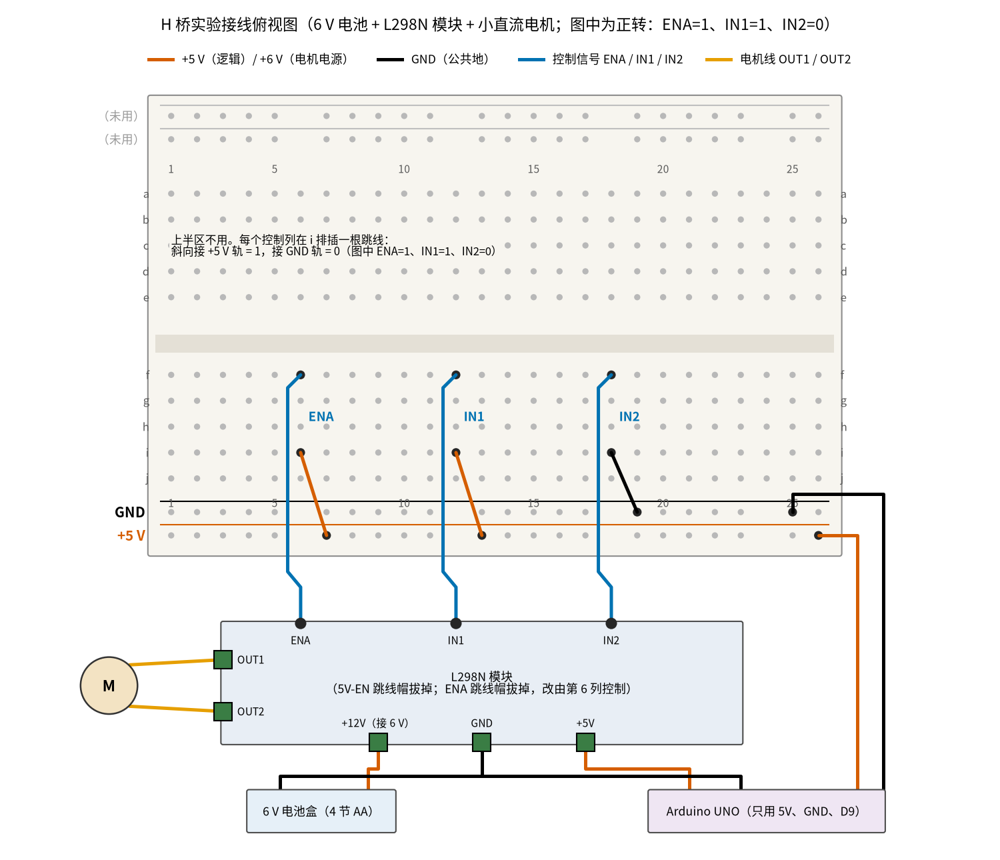
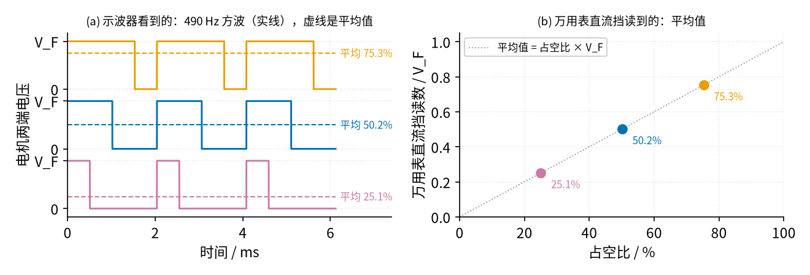

# 25 H 桥电机驱动 · 动手实验篇

[上一页：参数与调试篇](page3.md) · [直觉篇](page1.md) · [原理与实现篇](page2.md) · [参数与调试篇](page3.md) · 本页：动手实验篇 · [下一页：20 双控开关 · 直觉篇](../20-two-way-switch/page1.md) · 前置节点：[21 MOS 管开关 · 直觉篇](../21-mosfet-switch/page1.md) · [22 三极管开关与继电器驱动 · 直觉篇](../22-bjt-relay-driver/page1.md)

## 这次实验要验证什么

用一块现成的 H 桥模块驱动一台 6 V 小直流电机，亲手验证 [25 H 桥电机驱动 · 原理与实现篇](page2.md) 里的两条结论：

1. **两个输入脚的四种组合对应正转、反转、刹车、滑行**（原理与实现篇「电路」一节的真值表）。我们在每种状态下分别量两个输出端对地的电压和电机两端的电压，看清楚「电机两端的电压掉了个头」「刹车是把电机两端接在一起」「滑行是两端都悬空」分别是什么样子。
2. **PWM 调速时电机感受到的是平均电压** $\bar{V} = D \cdot V_M$ （原理与实现篇「推导二」）。万用表的直流挡读到的正好也是这个平均值，所以没有示波器也能验证。

另外再做一个对比：电机转着的时候分别切到刹车和滑行，看电机两端的读数哪个一下归零、哪个慢慢降下来，对应原理与实现篇「刹车与滑行的对比」一节。

## ⚠️ 安全须知

- **只用 12 V 及以下的直流电。** 本实验电机电源用 6 V（4 节 AA 电池），逻辑电源用 Arduino 的 5 V。
- **电源正负不要接反。** 本实验不需要另外插电解电容，但 L298N 模块板上自带电解电容，电池正负接反会损坏它和芯片。接上电池前先用万用表确认哪根线是正极。
- **驱动芯片、散热片和电机都可能发烫，不要用手摸。** L298N 是三极管输出，导通时自己要吃掉一两伏的压降，电流越大越烫。不要长时间用手捏住电机轴不让它转（堵转），堵转电流比空载大很多。
- **接线、改线之前先断电**：先拔电池盒的正极线，再改跳线或表笔位置。尤其是把电流表串进电机回路、或者从电流挡改回电压挡之前，一定先断电。
- **不要自己用分立 MOS 管搭 H 桥来做这个实验**，原因见下面「器材清单」后面的说明。

## 器材清单

| 元件 | 型号或数值 | 数量 | 说明 |
|---|---|---|---|
| H 桥驱动模块 | L298N 双 H 桥模块（红色板，带散热片） | 1 | 只用 A 路：ENA、IN1、IN2、OUT1、OUT2 |
| 小直流电机 | 额定 3–6 V 的小电机（如常见的 130 型） | 1 | 轴上贴一小片胶带，方便看转向 |
| 电机电源 | 4 节 AA 电池盒（6 V）或 6 V 直流电源 | 1 | 接模块的「+12V」端子 |
| 逻辑电源与 PWM | Arduino UNO 和 USB 线 | 1 | 5V 脚给模块逻辑供电，D9 输出 PWM |
| 面包板、杜邦线 | 半块面包板即可；公对公、公对母杜邦线若干 | 1 套 | 面包板只用来切换 ENA、IN1、IN2 的高低电平 |
| 万用表 | 直流 20 V 挡；10 A 电流挡（可选） | 1 | |

**为什么不用 DRV8871？** 本节前三页都以 DRV8871 为例，但它的电机电源范围是 6.5–45 V（[25 H 桥电机驱动 · 参数与调试篇](page3.md) 的参数表），**6 V 低于下限**，芯片会欠压关断。如果你手上只有 DRV8871 模块，就要换一台额定电压更高的电机，电源提高到 9 V 或 12 V（仍然不超过 12 V），并按参数与调试篇选好 $R_{ILIM}$ 。它的真值表和 L298N 不同：IN1 = IN2 = 0 是滑行，IN1 = IN2 = 1 是刹车。它用 MOS 管，压降只有零点几伏（ $I \times 0.565\text{ Ω}$ ），读数会比本页的表更接近电源电压。

**为什么 L298N 要拔掉 5V-EN 跳线帽？** 模块上的 78M05 稳压器要从电机电源降出 5 V 给芯片的逻辑部分用，它大约需要 2 V 的余量。电机电源只有 6 V 时，它只能给出约 4 V，低于 L298 手册要求的逻辑电源下限 4.5 V（[ST L298 数据手册](https://www.st.com/resource/en/datasheet/l298.pdf) 电气特性表）。所以拔掉跳线帽，让「+5V」端子变成输入，由 Arduino 的 5V 脚供电。

**为什么不自己用分立 MOS 管搭？** 原理与实现篇的分立电路用四只 MOS 管，同一侧的上管和下管**绝对不能同时导通**，否则电源经两只管子直接短路，这叫「直通」（[25 H 桥电机驱动 · 直觉篇](page1.md) 里画过这种情况）。面包板上用手插跳线切换输入，切换的一瞬间很容易让上下管都处在导通状态；而且上管的栅极要比电源再高几伏，单靠 5 V 根本驱动不了。参数与调试篇的「扫描一」算过：死区为 0 时直通电流峰值约 60 A；用 IRLZ44N 官方模型、100 Ω 栅极电阻、12 V 电源仿真，死区 0、0.5、1.0、1.5 µs 时直通峰值是 74、26、5.5、0.46 A。这么大的电流只持续不到一微秒，万用表完全看不见，管子却会迅速发热烧毁，面包板的触点也会被烧坏。现成的模块和芯片已经在内部把直通排除掉了（L298 的真值表里没有能让同侧上下管同时导通的组合），所以本实验只用模块。如果以后一定要搭分立 H 桥，必须用带死区的专用栅极驱动芯片，并且先在电源上串保险丝、用限流电源从低压试起。

## 搭建步骤

下面按图 25-p4-1 一步一步接。电路原理就是 [25 H 桥电机驱动 · 原理与实现篇](page2.md) 第二节的四管 H 桥，只是四只管子和保护都装在 L298 芯片里了。



*图 25-p4-1　H 桥实验接线：面包板只用来切换三根控制线，电机电流不经过面包板*

图 25-p4-1 里面包板的作用很简单：每个控制列插一根跳线，斜插到 +5 V 轨就是「1」，插到 GND 轨就是「0」，改状态只要挪这一根跳线。电机的电流从电池经模块的螺丝端子直接到电机，不走面包板，这样大电流不会烧坏面包板的触点。注意三处地（电池负极、Arduino GND、面包板 GND 轨）必须接在一起，否则控制信号没有共同的参考点。

1. **准备模块**：拔掉 L298N 模块上标着「5V-EN」（或 5V_EN，通常在电源端子附近）的那只跳线帽，再拔掉 ENA 插针上的跳线帽。ENB、IN3、IN4 不用管。
2. **面包板电源轨**：Arduino 的 5V 脚用杜邦线接到面包板下方 +5 V 轨第 26 列，Arduino 的 GND 接到 GND 轨第 25 列。上半区和上方两条电源轨不用。
3. **三根控制线**：用公对母杜邦线，把面包板 f6 接到模块 ENA 插针。ENA 有两根插针，跳线帽原来就是把 ENA 和 5 V 短接在一起；接上第 5、7 步的电源后，对 GND 量得 5 V 的那根是 5 V，**不要接**，另一根才是 ENA（可以先接好其他线，最后确认这一根）。f12 接 IN1，f18 接 IN2。
4. **状态跳线**：i6 插一根短跳线到 +5 V 轨第 7 列（ENA = 1）；i12 插到 +5 V 轨第 13 列（IN1 = 1）；i18 插到 GND 轨第 19 列（IN2 = 0）。这就是图里的「正转」状态。改状态时只挪这三根线的 +5 V / GND 那一头。有的模块 IN 脚内部带上拉电阻，**悬空会被当成 1**，所以三根控制线任何时候都要明确接到 +5 V 或 GND。
5. **逻辑电源**：Arduino 的 5V 再用一根线接模块的「+5V」端子，Arduino 的 GND 接模块的「GND」端子。
6. **电机**：电机两根线拧进模块左侧的 OUT1、OUT2 端子。哪根接 OUT1 无所谓，先记下来，正转方向就按实际转向定义。
7. **电机电源，最后接**：电池盒负极拧进模块「GND」端子（和 Arduino 的 GND 在同一个端子里），确认无误后再把电池盒正极拧进「+12V」端子。模块上的电源指示灯应当亮，电机应当开始转。

## 测量表

万用表黑表笔默认放在模块的 GND 端子上。下表的「应该读到」来自 L298 手册在 1 A 时给出的饱和压降：上管 0.95–1.7 V、下管 0.85–1.6 V、两管合计 1.80–3.2 V，用 6 V 电源算出来（ `code/figs/25_figs.py` 打印的「6 V、1 A 手册值」那一行）。手册的曲线显示压降随电流减小而减小，小电机的电流通常比 1 A 小，所以你的读数很可能比表里的范围**更接近 6 V 和 0 V**，这是正常的。下表把「正转时电机两端的读数」记作 $V_F$ ，后面的 PWM 都拿它做比较。

| 步骤 | 测什么 | 红表笔 | 黑表笔 | 挡位 | 应该读到 | 读不到时先查 |
|---|---|---|---|---|---|---|
| 1 | 电机电源 | +12V 端子 | GND 端子 | 直流 20 V | 约 6 V（新电池可能 6.2–6.4 V），记作 $V_S$ | 电池方向、电池盒开关 |
| 2 | 逻辑电源 | +5V 端子 | GND 端子 | 直流 20 V | 约 5 V | Arduino 是否插着 USB；5V-EN 跳线帽是否已拔 |
| 3 | 正转：OUT1 对地 | OUT1 | GND | 直流 20 V | 4.30–5.05 V，比 $V_S$ 低一截 | ENA 是否为 1；三处地是否接通 |
| 4 | 正转：OUT2 对地 | OUT2 | GND | 直流 20 V | 0.85–1.6 V，不是 0 | 同上 |
| 5 | 正转：电机两端 $V_F$ | OUT1 | OUT2 | 直流 20 V | 2.8–4.2 V，等于第 3 步减第 4 步 | 读数为负：表笔反了 |
| 6 | 正转：电机电流（可选），先断电，把电机线从 OUT1 端子拆下 | OUT1 端子 | 拆下的那根电机线 | 10 A 挡 | 记下读数（几十到几百毫安），记作 $I$ | 先断电再改表笔；量完改回电压挡 |
| 7 | 反转（IN1 = 0，IN2 = 1）：OUT1 对地 | OUT1 | GND | 直流 20 V | 0.85–1.6 V | IN1、IN2 两根跳线是否都挪了 |
| 8 | 反转：OUT2 对地 | OUT2 | GND | 直流 20 V | 4.30–5.05 V | 同上 |
| 9 | 反转：电机两端 | OUT1 | OUT2 | 直流 20 V | −2.8 至 −4.2 V，和第 5 步大小相近、符号相反；电机反转 | 大小差很多：两路管子压降不对称，记下来 |
| 10 | 刹车（IN1 = IN2 = 0，ENA = 1），电机停稳后：OUT1 对地 | OUT1 | GND | 直流 20 V | 接近 0 V，一般比第 4 步还小 | ENA 是否仍为 1 |
| 11 | 刹车：OUT2 对地 | OUT2 | GND | 直流 20 V | 接近 0 V | 同上 |
| 12 | 刹车：电机两端 | OUT1 | OUT2 | 直流 20 V | 约 0 V | |
| 13 | 滑行（ENA = 0），电机停稳后：OUT1 对地 | OUT1 | GND | 直流 20 V | **不确定**：可能飘动，也可能停在某个中间值 | 这正是「悬空」的特征，不是故障 |
| 14 | 滑行：OUT2 对地 | OUT2 | GND | 直流 20 V | 不确定，但和第 13 步基本相同 | 两者差很多：电机线没接好 |
| 15 | 滑行：电机两端 | OUT1 | OUT2 | 直流 20 V | 约 0 V | |
| 16 | 正转中把 ENA 改到 GND（滑行），盯着电机两端 | OUT1 | OUT2 | 直流 20 V | 读数**慢慢**降到 0，比刹车慢得多，可能要一两秒甚至更久；电机越转越慢 | 一下就归零：确认改的是 ENA 而不是 IN |
| 17 | 正转中把 IN1 改到 GND（刹车），盯着电机两端 | OUT1 | OUT2 | 直流 20 V | 读数几乎**一下**归零，电机很快停住 | |
| 18 | PWM 占空比 25.1%（见下文），电机两端 | OUT1 | OUT2 | 直流 20 V | 约 $0.251 \times V_F$ ，读数可能轻微跳动 | 是否拔掉了 i12 的跳线，D9 接到了 f12 |
| 19 | PWM 占空比 50.2%，电机两端 | OUT1 | OUT2 | 直流 20 V | 约 $0.502 \times V_F$ | |
| 20 | PWM 占空比 75.3%，电机两端 | OUT1 | OUT2 | 直流 20 V | 约 $0.753 \times V_F$ | |

几点说明：

- **第 3、4 步告诉你压降在哪里。** 理想开关的话，OUT1 应当等于 6 V、OUT2 应当等于 0 V。L298 的上管、下管都是三极管，导通时各自要吃掉约一伏，电机只拿到剩下的部分。这也是参数与调试篇里 DRV8871 这类 MOS 管芯片的优势：它的压降只是电流乘以零点几欧。
- **刹车有两种接法。** L298 手册写的是：ENA = 1 时 IN1 = IN2 就是「快速停车」。IN1 = IN2 = 0 是两只下管导通，和原理与实现篇的 Q3、Q4 刹车一样；IN1 = IN2 = 1 是两只上管导通，同样把电机两端接在一起，这时两个输出端对地都接近电源电压，但电机两端仍然约 0 V。你可以两种都试一下。
- **滑行时输出端是悬空的。** ENA = 0 时四只管子全部关断，OUT1、OUT2 不连到电源也不连到地，万用表量到的是一个没有被任何东西「拉住」的点，读数不确定。但电机线圈把 OUT1 和 OUT2 连在一起，所以两个读数基本相同，电机两端约 0 V。
- **第 16、17 步对应原理与实现篇的刹车与滑行对比。** 电机转着的时候就是一台发电机，万用表读到的就是它发出的反电动势。滑行时没有电流，转速只靠摩擦慢慢降，读数也慢慢降；刹车时电机两端被接在一起，发出的电流反过来拖住它，几乎立刻停下。原理与实现篇的示意电机刹车 136 ms 降到 10%，滑行 2 s 后还剩 14%；你的电机参数不同，但快慢的对比应当一样明显。

## 用 PWM 调速

把 i12 那根状态跳线拔掉（IN1 不再接固定电平），用一根杜邦线把 Arduino 的 D9 接到面包板 f12 那一列（同一列任意一个空孔），ENA 保持 1、IN2 保持 0。给 Arduino 上传下面这段程序：

```cpp
// Arduino UNO：D9 接 L298N 的 IN1（经面包板第 12 列），ENA = 1，IN2 = 0
void setup() { pinMode(9, OUTPUT); }
void loop() {
  analogWrite(9, 64);  delay(8000);   // 占空比 64/255，约 25%
  analogWrite(9, 128); delay(8000);   // 128/255，约 50%
  analogWrite(9, 192); delay(8000);   // 192/255，约 75%
}
```

每 8 秒换一档，你有时间读数。IN1 = 1 时是正转，IN1 = 0 时（IN2 也是 0）是刹车，这正是原理与实现篇推导二里「驱动—刹车」交替的 PWM，所以电机两端的平均电压是 $D \times V_F$ 。analogWrite 的 64、128、192 对应占空比 25.1%、50.2%、75.3%，D9 的 PWM 频率约 490 Hz（Arduino UNO 的默认值）。

**万用表直流挡读到的是平均电压。** 万用表的直流挡内部会对输入做平均（滤波），它跟不上每秒 490 次的跳变，显示的就是一个周期的平均值。读数可能在最后一位上轻微跳动，这是正常的。你还会听到电机发出轻微的「吱」声：490 Hz 在人耳可听范围内，参数与调试篇的 PWM 频率扫描讲过，频率太低电流纹波也大。

## 没有示波器怎么办

本实验大部分内容万用表就够了：四种状态的电压是稳定的直流，PWM 的平均值直流挡直接能读，刹车和滑行的快慢用眼睛看电机、看读数下降的速度就能比较。

只有示波器才能看到的是 PWM 下电机两端**真实的波形**：它不是一个稳定的电压，而是在 $V_F$ 和 0 之间每秒跳 490 次的方波。下面的图 25-p4-2 画出了示波器上应当看到的样子，以及万用表读数和占空比的关系。



*图 25-p4-2　左：示波器上看到的电机两端电压（以正转读数 V_F 为单位）；右：万用表直流挡读到的平均值*

图 25-p4-2 左边的三条方波高度一样，区别只是「高」的时间占一个周期的比例；虚线是平均值，万用表读到的就是这条虚线。右边三个点都落在直线上：占空比翻一倍，读数也翻一倍。电机电流的纹波、刹车瞬间的反向电流、切换瞬间的尖峰，万用表都看不到，要看就只能用示波器，可以对照原理与实现篇的 PWM 仿真图和刹车与滑行对比图，以及参数与调试篇的 PWM 频率扫描图。分立 H 桥里一两百纳秒的直通电流尖峰，更是只能在仿真或示波器上看到。

## 用 Python 核对你的读数

把你量到的数填进去，运行后会算出应该读到的值，并在偏差超过 10% 时提示。

```python
import sys, pathlib
sys.path.insert(0, str(pathlib.Path("code/figs").resolve()))  # 在仓库根目录运行

# ===== 把下面换成你自己的实测值（这里是一组示例，不是标准答案） =====
V_S = 6.20                   # 第 1 步：电机电源，V
FWD = (5.15, 0.60, 4.50)     # 第 3、4、5 步：正转 OUT1 对地、OUT2 对地、电机两端，V
REV = (0.62, 5.12, -4.45)    # 第 7、8、9 步：反转
BRAKE = (0.05, 0.05, 0.00)   # 第 10、11、12 步：刹车，电机停稳后
COAST_MOTOR = 0.00           # 第 15 步：滑行时电机两端
PWM = {64: 1.16, 128: 2.29, 192: 3.41}   # 第 18–20 步：analogWrite 值 → 电机两端读数，V

# L298 手册：IL = 1 A 时上管、下管饱和压降最大 1.7 V、1.6 V，两管合计 1.80–3.2 V
def check(name, meas, calc):
    dev = (meas - calc) / calc * 100
    flag = "  <-- 偏差超过 10%，先断电再按测量表排查" if abs(dev) > 10 else ""
    print(f"{name}: 实测 {meas:.2f}，计算 {calc:.2f}，偏差 {dev:+.1f}%{flag}")

V_F = FWD[2]
check("正转电机两端 = OUT1 − OUT2 / V", V_F, FWD[0] - FWD[1])
check("反转电机两端（取绝对值）/ V", -REV[2], V_F)
drop_h, drop_l = V_S - FWD[0], FWD[1]
print(f"上管压降 {drop_h:.2f} V，下管压降 {drop_l:.2f} V，合计 {drop_h + drop_l:.2f} V")
if drop_h + drop_l > 3.2:
    print("  <-- 总压降超过手册 1 A 时的最大值 3.2 V：电机电流可能过大，或者接触不良")
for name, v in (("刹车", BRAKE[2]), ("滑行", COAST_MOTOR)):
    print(f"{name}时电机两端 {v:.2f} V", "约 0，正常" if abs(v) < 0.1 * V_F else "  <-- 不是 0：电机还在转，或者输入没接对")
for val, v in PWM.items():
    check(f"PWM {val}/255 = {val / 255:.1%} 的平均电压 / V", v, val / 255 * V_F)
```

示例数据里各项偏差都在 10% 以内。PWM 读数比计算值**略大**一点是常见的，原因见思考题 3。偏差超过 10% 就先检查 D9 是否接到了第 12 列、i12 的跳线是否已拔掉、IN2 是否确实是 0。

## 实验记录表

| 项目 | 实测值 | 计算值 | 偏差 |
|---|---|---|---|
| 电机电源 $V_S$ |  | — | — |
| 正转 OUT1 对地 |  | 4.30–5.05 V（1 A 手册值） |  |
| 正转 OUT2 对地 |  | 0.85–1.6 V（1 A 手册值） |  |
| 正转电机两端 $V_F$ |  | OUT1 对地减 OUT2 对地 |  |
| 正转电流 $I$ （可选） |  | — | — |
| 反转电机两端 |  | $-V_F$ |  |
| 刹车 OUT1、OUT2 对地 |  | 接近 0 V | — |
| 刹车电机两端 |  | 约 0 V | — |
| 滑行 OUT1、OUT2 对地 |  | 不确定，两者相同 | — |
| 滑行电机两端 |  | 约 0 V | — |
| 滑行降到 0 大约用时 |  | 比刹车慢得多 | — |
| PWM 25.1% 电机两端 |  | $0.251 \times V_F$ |  |
| PWM 50.2% 电机两端 |  | $0.502 \times V_F$ |  |
| PWM 75.3% 电机两端 |  | $0.753 \times V_F$ |  |

**思考题 1**：正转时你量到 OUT1 对地 5.1 V、OUT2 对地 0.7 V，电源 6.2 V。电机只拿到多少电压？其余的电压去了哪里？

<details><summary>答案</summary>

电机两端是 5.1 − 0.7 = 4.4 V。剩下的 6.2 − 4.4 = 1.8 V 分别落在 L298 内部导通的上管（6.2 − 5.1 = 1.1 V）和下管（0.7 V）上，变成芯片的发热。这就是 L298N 要装散热片的原因，也是为什么用它时电源电压要比电机额定电压高一些。换成 DRV8871 这类 MOS 管芯片，同样的电流下两管压降只有零点几伏。

</details>

**思考题 2**：滑行时 OUT1 对地的读数飘来飘去，可是 OUT1 和 OUT2 之间却稳稳地是 0 V。为什么？

<details><summary>答案</summary>

ENA = 0 时 L298 的四只管子全部关断，OUT1、OUT2 既不接电源也不接地，是「悬空」的，万用表量对地电压时，读数取决于芯片的漏电流、模块上的保护二极管和万用表自己的输入电阻，所以不确定。但 OUT1 和 OUT2 之间接着电机线圈，线圈电阻只有几欧，电机停住时没有反电动势，两端几乎同电位，所以电机两端读 0 V。

</details>

**思考题 3**：PWM 占空比 50.2% 时，万用表读到的电机两端电压比 $0.502 \times V_F$ 稍大一点。有人说「万用表坏了」，你怎么看？

<details><summary>答案</summary>

不一定是万用表的问题，更可能是压降变了。 $V_F$ 是电机全速时量的，那时电流较大，管子压降也较大；PWM 下平均电流较小，每次「驱动」期间管子的压降可能比全速时小，方波的高电平就比 $V_F$ 略高，平均值自然略大于 $0.502 \times V_F$ 。只要偏差在 10% 以内就是正常的。万用表直流挡读的是平均值这一点没有错。

</details>

## 自测清单

- 我能说清楚 L298N 在 6 V 下为什么要拔掉 5V-EN 跳线帽，以及 DRV8871 为什么不能直接用 6 V。
- 我能按真值表接出正转、反转、刹车、滑行，并预测每种状态下两个输出端对地和电机两端的读数。
- 我能用 OUT1、OUT2 的对地读数算出驱动芯片自己吃掉了多少电压。
- 我能解释万用表直流挡在 PWM 下读到的为什么是平均电压，并用三档占空比验证 $\bar{V} = D \times V_F$ 。
- 我能说出分立 MOS 管 H 桥「直通」为什么会烧管，以及为什么万用表看不到它。
