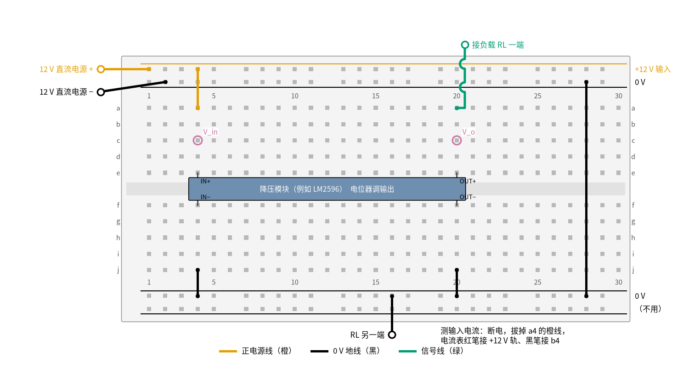
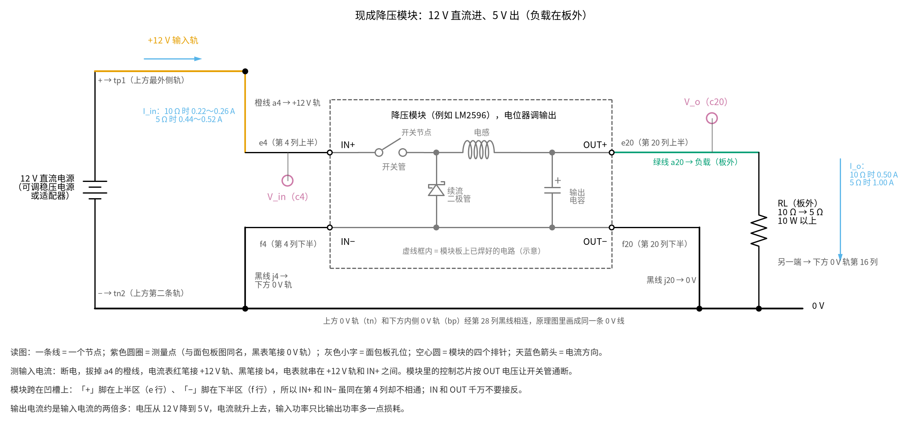

# 25 开关电源 · 动手实验篇

[上一页：参数与调试篇](page3.md) · [直觉篇](page1.md) · [原理与实现篇](page2.md) · [参数与调试篇](page3.md) · 本页：动手实验篇 · [下一页：26 H 桥电机驱动 · 直觉篇](../26-h-bridge/page1.md) · 前置节点：[01 元件速成 · 直觉篇](../01-components-basics/page1.md)、[03 半导体入门 · 直觉篇](../03-semiconductor-basics/page1.md)、[13 桥式整流 · 直觉篇](../13-bridge-rectifier/page1.md)、[21 线性稳压 · 直觉篇](../21-linear-regulator/page1.md)

## 这次实验要验证什么

用一块现成的降压模块，在 12 V 直流输入下亲手量出开关电源最反直觉的一点：**输出 5 V、0.5～1 A 时，输入电流只有输出电流的一半不到**，效率在八九成以上；而线性稳压在同样条件下输入电流等于输出电流，效率只有约 42%（结论见 [25 开关电源 · 直觉篇](page1.md) 第三节「为什么这样就省电」和 [25 开关电源 · 原理与实现篇](page2.md) 第三节的伏秒平衡）。顺带用万用表的直流挡「看」一眼开关节点：它的平均值约等于输出电压。

## ⚠️ 安全须知

> [!WARNING]
> **不要接 220 V。** 本页只用 12 V 及以下的**直流**电源：实验室可调直流电源（限流设 1.5 A），或者输出 12 V、电流 1.5 A 以上的成品直流适配器。不要用市电变压器，不要拆开手机充电器、电脑适配器等成品电源拿里面的板子做实验：这类离线式开关电源里面有几百伏的直流，拔掉插头后电容里仍可能带电。凡是和市电相连的接线、维修，请持证电工来做。

- **只用 12 V 及以下的直流电。** 降压模块的输入端标着「IN」，输出端标着「OUT」，千万不要接反；接反通电会烧模块。
- **电解电容分正负极。** 模块板上的电解电容已经焊好；如果你另外在输入端并电解电容，耐压选 25 V 以上，长脚接 +12 V。
- **元件会发烫，不要用手摸。** 负载 5 Ω 时，负载电阻要发 5 W 的热，必须用 10 W 以上的功率电阻，放在瓷砖等不怕烫的东西上；模块上的芯片、电感和二极管在 1 A 下也会明显发热。要知道温度用测温枪。
- **接线、改线之前先断电。** 断电就是关掉电源输出或拔下适配器插头。串电流表、换负载、换电位器都先断电。
- 先调电压、后接负载：模块的电位器出厂位置不确定，第一次上电前不要接负载，先把输出调到 5 V。

## 器材清单

| 元件 | 型号或数值 | 数量 | 说明 |
|---|---|---|---|
| 降压模块 | 可调降压模块，例如 LM2596 模块（输入耐压 30 V 以上、输出 3 A） | 1 | 四个焊盘 IN+、IN−、OUT+、OUT− 焊上排针，就能插面包板 |
| 直流电源 | 12 V 可调直流稳压电源，或 12 V / 1.5 A 以上直流适配器 | 1 | 第 8 步「改输入电压」要用可调电源 |
| 负载电阻 | 10 Ω，10 W 以上 | 1 | 输出约 0.5 A，先用它 |
| 负载电阻 | 5 Ω，10 W 以上 | 1 | 输出约 1 A，对应原理篇的主例 |
| 万用表 | 带直流 20 V 挡和 10 A（或 2 A）电流挡 | 1～2 | 两只最方便：一只量电流，一只量电压 |
| 面包板、跳线 | 830 孔面包板；负载回路用粗一点的线 | 若干 | 橙色接 +12 V，黑色接 0 V，绿色接输出 |
| 小一字螺丝刀 | — | 1 | 调模块上的电位器 |

先用万用表电阻挡量两只负载电阻的实际阻值。面包板触点只适合 1 A 左右，5 Ω 那一步电流约 1 A，线要插紧，做完尽快断电。

## 搭建步骤

模块里面就是 [25 开关电源 · 原理与实现篇](page2.md) 第二节那张异步降压电路（上管开关、续流二极管、电感、输出电容，加一块控制芯片），只是做成了一块小板。图 25-p4-1 是插上面包板后的俯视图。



*图 25-p4-1　降压模块的面包板接线（12 V 直流输入，负载在板外）*

对照 图 25-p4-2 的电路原理图看模块的四只脚：左边是输入 IN+、IN−，右边是输出 OUT+、OUT−，虚线框里是模块板上已经焊好的降压电路。



*图 25-p4-2　图 25-p4-1 对应的电路原理图（灰色小字是面包板孔位，空心圆是模块排针，虚线框内是模块电路的示意）*

**对照看**：面包板的连通规则见 [01 元件速成 · 动手实验篇](../01-components-basics/page4.md)：同一列上半 a–e 连通、下半 f–j 连通，凹槽两边不通。模块跨在凹槽上，IN+ 和 IN− 都在第 4 列，却一个在 e 行、一个在 f 行，所以原理图里它们是两个节点；同理 OUT+ 和 OUT− 在第 20 列也互不相通。c4 和 a4 跟 IN+ 同在第 4 列上半，所以 V_in 就是 IN+ 的电压；c20、a20 跟 OUT+ 同在第 20 列上半，就是 V_o。虚线框里的异步降压电路和 [25 开关电源 · 原理与实现篇](page2.md) 第二节「实际电路」是同一种结构，带示波器测纹波的接法见 [25 开关电源 · 参数与调试篇](page3.md) 第六节。

1. **焊排针。** 给模块的四个焊盘各焊一根排针（请会焊接的同学或老师帮忙）。焊好后对着灯光确认 IN 和 OUT 的标字。
2. **铺电源轨。** 电源正极接上方最外侧轨（+12 V），负极接上方第二条轨（0 V）。黑线从上方 0 V 轨第 28 列接到下方内侧轨第 28 列，让下方那条轨也是 0 V。先不要通电。
3. **插模块。** 模块跨在中间凹槽上：IN+ 插 e4、IN− 插 f4、OUT+ 插 e20、OUT− 插 f20（你的模块长度不同就按实际列号，原则是输入、输出各占一列，「+」在上半区、「−」在下半区）。
4. **接输入。** 橙线 a4 → 上方 +12 V 轨；黑线 j4 → 下方 0 V 轨。
5. **接输出地。** 黑线 j20 → 下方 0 V 轨。
6. **先不接负载，调电压。** 通电，红表笔插 c20、黑表笔插 0 V 轨，用螺丝刀慢慢转模块上的电位器，直到读数为 5.00 V。多数模块顺时针转电压升高，转二三十圈都可能没反应，要有耐心。断电。
7. **接负载。** 一根粗线从 a20 引到板外 10 Ω 负载的一端，另一根从下方 0 V 轨第 16 列引到负载另一端。
8. **串电流表（测输入电流时）。** 断电，拔掉 a4 的橙线；万用表打到电流挡、红表笔插 10 A（或 2 A）孔，红表笔接上方 +12 V 轨，黑表笔接 b4。这样电源电流全部经过电流表才进入模块。

画图脚本断言 IN+ 接 +12 V、IN− 和 OUT− 都接 0 V、IN+ 和 OUT+ 没有被连在一起；接错一处图就画不出来。

## 测量表

「应该读到」的数分两类。原理篇电路的值来自 ngspice 仿真：1 A 的读数取自 [review/spice/25.md](../review/spice/25.md) 的面包板读数表；0.5 A 的读数是把同一个网表的负载改成 10 Ω、占空比改成 0.436（让输出回到 5.0 V）重新仿真得到的。原理篇的电路里没有控制芯片，开关也比 LM2596 内部的三极管开关理想，所以**现成模块的效率会低一些**；TI 的 LM2596 手册给的 5 V 版典型效率是 12 V 输入、3 A 输出时 80%。下表的输入电流范围就是按效率 80%～95% 算出来的。

| 步骤 | 测什么 | 红表笔 | 黑表笔 | 挡位 | 应该读到 | 读不到时先查 |
|---|---|---|---|---|---|---|
| 1 | 输入电压（空载） | c4 | 0 V 轨 | 直流 20 V | 12.00 V | 电源是否打开、限流是否太小 |
| 2 | 输出电压（空载，调好后） | c20 | 0 V 轨 | 直流 20 V | 5.00 V | 转电位器没反应：可能已转到头，反方向转 |
| 3 | 输出电压，10 Ω | c20 | 0 V 轨 | 直流 20 V | 5.00 V（仿真 5.01 V） | 明显下降：电源限流太小或输入线接触不良 |
| 4 | 输入电流，10 Ω | +12 V 轨 | b4 | 直流 10 A | 0.22～0.26 A（原理篇电路仿真 0.219 A） | 读到 0.5 A 左右：你接的可能是线性稳压板，或模块坏了 |
| 5 | 输入电压，10 Ω（带载） | c4 | 0 V 轨 | 直流 20 V | 12.00 V（可调电源）；适配器会略降 | 降得多：适配器功率不够 |
| 6 | 输出电压，5 Ω | c20 | 0 V 轨 | 直流 20 V | 5.00 V（仿真 5.01 V） | — |
| 7 | 输入电流，5 Ω | +12 V 轨 | b4 | 直流 10 A | 0.44～0.52 A（仿真 0.443 A） | 超过 0.6 A：模块过热或负载接错 |
| 8 | 改输入电压：9 V、10.5 V、12 V（只用可调电源），10 Ω | c20 和电流表 | 0 V 轨 | 直流 20 V / 10 A | 输出都是 5.00 V；输入电流随输入电压升高而**减小** | 9 V 时输出掉：这块模块的压差偏大 |
| 9 | 开关节点平均电压（选做），5 Ω | 电感靠芯片那一端的焊点 | 0 V 轨 | 直流 20 V | 比输出高几十毫伏（仿真 5.06 V） | 读到 12 V：表笔碰到了输入端 |

**输出电流**不用串表：10 Ω 时约 5.00 ÷ 10 = 0.50 A，5 Ω 时约 1.00 A，用你量到的负载阻值算更准。第 4 步和第 7 步最值得盯着看：输出 1 A，输入却只要不到 0.5 A。能量守恒没被打破：输入 12 V × 0.44 A ≈ 5.3 W，输出 5 V × 1 A = 5 W，电压降了，电流就升了。

第 9 步的开关节点在模块板上，没有插孔，要用表笔尖顶住电感靠芯片的那一端（或续流二极管的阴极）。这里其实是 12 V 和约 −0.4 V 之间来回跳的方波，万用表直流挡只能读到它的平均值。这一步表笔容易打滑碰到别的焊点，没把握就跳过。

## 没有示波器怎么办

万用表能证明的是「平均值」层面的结论：输出稳在 5 V、输入电流小于输出电流、效率高、开关节点的平均值约等于输出。第 8 步改输入电压也能用万用表做：线性稳压的输入电流不随输入电压变，开关电源的输入电流却随输入升高而减小，因为输入功率差不多不变。

还有一个只用万用表的对比：如果你做过 [21 线性稳压 · 动手实验篇](../21-linear-regulator/page4.md)，那块板子在 12 V 输入、0.49 A 负载时输入电流约 0.50 A，调整管热得必须装散热片；而这块模块输出 1 A 时，按效率 80%～95% 算，整块板子的损耗只有约 0.3～1.3 W，比 21 调整管的 1.6 W（只输出 0.49 A）还少。

**只有示波器才能看到的：**

- 开关节点在 12 V 和 −0.4 V 之间跳的方波、电感电流在 0.84～1.16 A 之间的三角波，见 [25 开关电源 · 直觉篇](page1.md) 第二节的波形图。
- 输出纹波（原理篇电路仿真只有几毫伏，万用表看不出来）以及测纹波时要用接地弹簧代替长地线夹的方法，见 [25 开关电源 · 参数与调试篇](page3.md) 第六节第 3 步和 [25 开关电源 · 原理与实现篇](page2.md) 第四节。
- 本页电源是浮地的直流电源，示波器地夹接到降压电路的 0 V 没有问题；同样的操作放到离线式电源的初级上就是短路，所以本页**不涉及**任何离线式电源。

## 用 Python 核对你的读数

把你量到的电压、电流和负载阻值填进去。代码算出输入功率、输出功率、效率和占空比，判断效率是否落在 80%～95% 的合理范围（偏出 10% 以上就提示），并和「同样输出的线性稳压」对比。

```python
import sys, pathlib
sys.path.insert(0, str(pathlib.Path("code/figs").resolve()))  # 在仓库根目录运行
# 25 开关电源 · 动手实验核对：填入实测值，算效率、对比线性稳压
ETA_LO, ETA_HI = 0.80, 0.95      # 合理范围：LM2596 手册 80%（3 A），原理篇电路仿真约 95%

# ---- 1. 你量到的值（示例值，换成你自己的）----
runs = [  # (说明, 输入电压 V, 输入电流 A, 输出电压 V, 负载 Ω)
    ("10 Ω", 12.00, 0.238, 5.00, 10.1),
    ("5 Ω", 12.00, 0.478, 4.99, 5.05),
    ("10 Ω, 输入 9 V", 9.00, 0.312, 5.00, 10.1),
    ("10 Ω, 输入 10.5 V", 10.50, 0.270, 5.00, 10.1),
]
V_SW = 5.05                      # 第 9 步：开关节点平均值（没量就填 None）
V_SET = 5.00                     # 第 2 步你调好的输出

warn = 0
for name, vin, iin, vo, rl in runs:
    io = vo / rl
    pin, pout = vin * iin, vo * io
    eta = pout / pin
    lo, hi = pout / (vin * ETA_HI), pout / (vin * ETA_LO)
    flag_i = not (lo * 0.9 <= iin <= hi * 1.1)
    flag_v = abs(vo - V_SET) / V_SET > 0.10
    warn += flag_i + flag_v
    print(f"{name:<14} 输出 {io:.2f} A / {pout:.2f} W，输入 {pin:.2f} W，效率 {eta * 100:.1f}%，"
          f"输入电流期望 {lo:.3f}～{hi:.3f} A" + ("  ← 输入电流偏出范围" if flag_i else "")
          + ("  ← 输出偏离设定值" if flag_v else ""))
    print(f"{'':<14} 同样输出的线性稳压：输入电流 ≈ {io:.2f} A，效率 ≈ {vo / vin * 100:.0f}%，多发热 {(vin - vo) * io:.2f} W")

vin, vo = runs[0][1], runs[0][3]
print(f"理想占空比 D ≈ V_o / V_in = {vo / vin:.3f}（原理篇含损耗仿真 0.436～0.441）")
if V_SW is not None:
    dev = (V_SW - vo) / vo * 100
    print(f"开关节点平均 {V_SW:.2f} V，比输出高 {V_SW - vo:+.2f} V（偏差 {dev:+.1f}%）")
    if abs(dev) > 10:
        warn += 1
        print("  ← 偏差太大：表笔可能没碰在电感靠芯片的一端")
print("全部在范围内" if warn == 0 else f"有 {warn} 项需要检查")
```

示例数据是按效率约 87% 编的练习值，不是实测结果。你的模块效率在 80% 多到 90% 出头都正常；如果低于 70%，先摸一下（用测温枪）哪个元件最烫，再对照 [25 开关电源 · 参数与调试篇](page3.md) 的故障排查表。

## 实验记录表

| 项目 | 实测值 | 计算值 | 偏差 |
|---|---|---|---|
| 输入电压（空载 / 10 Ω / 5 Ω） |  |  |  |
| 输出电压（空载 / 10 Ω / 5 Ω） |  |  |  |
| 输入电流（10 Ω） |  |  |  |
| 输入电流（5 Ω） |  |  |  |
| 效率（10 Ω / 5 Ω） |  |  |  |
| 输入 9 V / 10.5 V 时的输入电流 |  |  |  |
| 开关节点平均电压（选做） |  |  |  |

### 思考题

**1. 输出 1 A，为什么输入只要不到 0.5 A？这违反能量守恒吗？**

<details><summary>答案</summary>

不违反。守恒的是功率，不是电流。输出 5 V × 1 A = 5 W，加上损耗，输入大约 5.3～6.3 W，在 12 V 下就是 0.44～0.52 A。开关电源像一个「电压的变速箱」：电压降了，电流就升了。线性稳压做不到这一点，它的输入电流等于输出电流，多出来的 7 V × 1 A = 7 W 全变成热。

</details>

**2. 第 8 步里输入电压从 9 V 升到 12 V，为什么输入电流反而减小？**

<details><summary>答案</summary>

负载要的功率是 2.5 W，基本不变；效率也大致不变，所以输入功率差不多不变。输入功率 = 输入电压 × 输入电流，电压升高，电流就减小。控制芯片做的事是自动把占空比调小（ $D \approx V_o/V_{in}$ ），让输出保持 5 V。

</details>

**3. 开关节点其实是 12 V 和 −0.4 V 之间的方波，为什么万用表读到的是约 5 V？**

<details><summary>答案</summary>

万用表直流挡读的是平均值。方波的平均值约等于 $12 \times D - 0.4 \times (1 - D)$ ，D 约 0.44 时约为 5.06 V。电感对直流几乎没有压降（只有线圈电阻上的几十毫伏），所以开关节点的平均值和输出几乎相同，这就是伏秒平衡在直流上的样子。

</details>

## 自测清单

- 我能分清降压模块的 IN 和 OUT，并在接负载前把输出调到 5 V。
- 我能把电流表串进模块的输入端，量完后把表笔插回电压孔。
- 我能用输入、输出的电压和电流算出效率，并解释输入电流为什么比输出电流小。
- 我能说出为什么本实验只用低压直流电源，为什么不能拆成品充电器做实验。
- 我能说出哪些现象只能用示波器看，以及测纹波时为什么要换接地弹簧。
